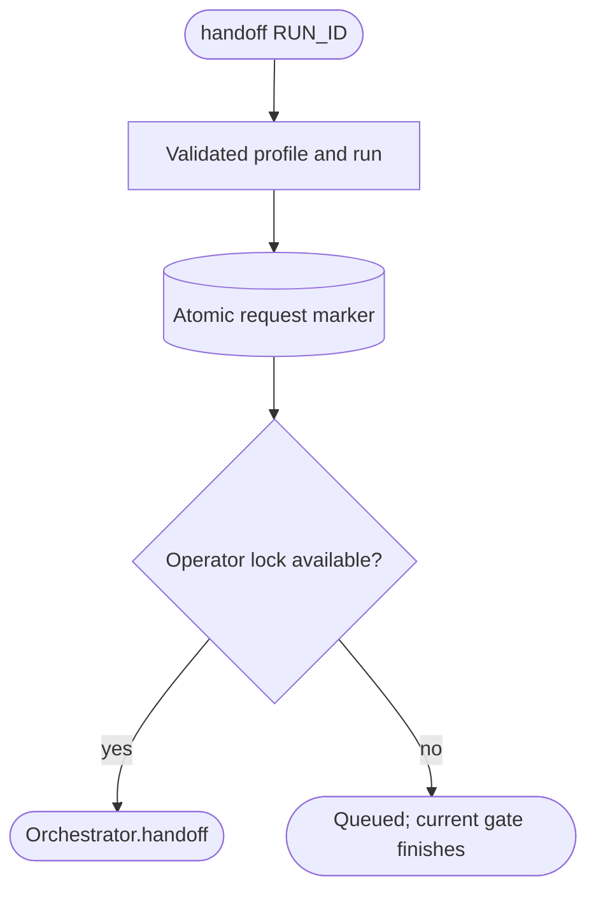

<!--
Copyright (c) 2026 DDP Engineering
This software is licensed under the PolyForm Noncommercial License 1.0.0.
Commercial use requires a separate commercial license.
See the LICENSE.txt file for full license details.
SPDX-License-Identifier: LicenseRef-PolyForm-Noncommercial-1.0.0
-->

# CLI

## Purpose and boundaries

`04_Software/adore/cli.py` is ADORE's operator control plane. The `adore`
console script and `python -m adore` are deliberately thin argparse adapters
over typed components; there is no parallel web or REST control surface.

## Public interface

The CLI exposes configuration (`show`, `validate`, guarded scalar `set`),
runtime lifecycle (`run`, `status`, `runs`, pause/resume, cancel/retry/logs,
reset/delete/cleanup), metrics (`stats`, `report`, `export`), and profile setup
and management (`init`, `profile`, global `--profile`). Its configuration path
precedence is explicit `-c`, named profile, active profile, then local
`config.toml`.

## Invariants

Invalid/missing configuration produces a clear nonzero result rather than a
traceback. Destructive state operations require `--force`; mutations acquire
the single-conductor lock; cleanup removes only a provably stale local lock and
reports corrupt state without deleting it. `run` additionally tees output to
the rotating ADORE process log. All intervention commands change ADORE-owned
state only: they do not edit AEGIS journals or cause a merge.

## Requirement coverage

- `REQ-FUNC-39697089` - explicit force and live-lock protection for mutations.
- `REQ-FUNC-3557ecdf` - profile resolution, use tracking, and visible corrupt run state.

## Dependencies and verification

The CLI composes config, state, orchestrator, process log, metrics, profiles,
wizard, and utilities. `04_Software/tests/test_smoke.py` exercises command
outcomes, configuration errors, locks, force guards, logging/rotation, cleanup
reports, and profile-oriented flows against temporary local state.

## Routing

For cli interfaces, start at `04_Software/adore/cli.py` and its matching existing component tests. Checkpoint/handoff contracts are covered in `04_Software/tests/test_checkpoint_handoff.py`; conduction belongs to Orchestrator.

## Key behaviors

- `REQ-FUNC-c9d64cfe`: explicit safe human ownership with durable recovery evidence and protected run state.

## Architecture

## Files

- `04_Software/adore/cli.py`.
- `04_Software/tests/test_checkpoint_handoff.py`: ownership contract boundaries.
