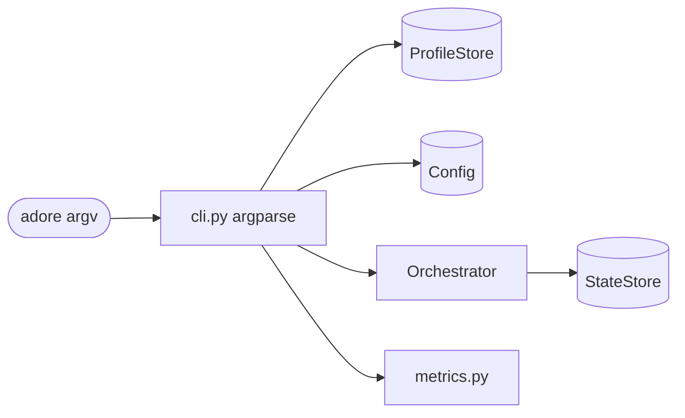

<!--
Copyright (c) 2026 DDP Engineering
This software is licensed under the PolyForm Noncommercial License 1.0.0.
Commercial use requires a separate commercial license.
See the LICENSE.txt file for full license details.
SPDX-License-Identifier: LicenseRef-PolyForm-Noncommercial-1.0.0
-->

# CLI

## Routing

Use this page for `adore` commands, argparse, profile/config precedence and
selected-ticket invocation. Start at `04_Software/adore/cli.py`; verify with
`04_Software/tests/test_smoke.py`. The HTTP API is in `web-interface.md`.

## Purpose and boundaries

`04_Software/adore/cli.py` is ADORE's operator control plane. The `adore`
console script and `python -m adore` are deliberately thin argparse adapters
over typed components. The optional web worker invokes this CLI for operations;
its HTTP routes live in `web-interface.md`.

## Command groups

The CLI exposes configuration (`show`, `validate`, guarded scalar `set`),
runtime lifecycle (`run`, `status`, `runs`, pause/resume, cancel/retry/handoff/logs,
reset/delete/cleanup), metrics (`stats`, `report`, `export`), and profile setup
and management (`init`, `profile`, global `--profile`). Its configuration path
precedence is explicit `-c`, named profile, active profile, then local
`config.toml`.
`run --once --ticket IID` selects one eligible ticket for a web Start request;
it returns nonzero if that ticket cannot be picked.

## Public interface

The `adore` console command and `python -m adore` expose configuration,
profiles, operator controls, run execution and metrics. `run --once --ticket`
accepts a positive forge ticket IID with normal selection checks.

## Invariants

Explicit `-c`, named profile, active profile and local `config.toml` define
configuration precedence. Invalid config returns nonzero. Engine mutations
respect the conductor lock; force is required for destructive state changes.
`config set` shares a per-directory edit lock with the web API; contention
returns a nonzero result without changing the config file. It reads and
writes the file as bytes and keeps its CR LF or LF line endings; added lines
take the file's ending.
`handoff` queues a validated request when a conductor holds the lock and
completes the transfer under the lock when idle. The terminal state preserves
the worktree for human ownership and grants no publication approval.
The CLI never merges or edits AEGIS journals directly.
`report` and `stats --rebuild` return a typed metrics-evidence error for
conflicting versioned usage. Rebuild computes all summaries before writing so
a late corrupt run cannot partially refresh the projection.

## Operator safeguards

Invalid/missing configuration produces a clear nonzero result rather than a
traceback. Destructive state operations require `--force`; mutations acquire
the single-conductor lock; `profile delete --remove-resources` releases the
containers and worktrees recorded for the project's own runs, except human-owned
ones, before deleting the profile;
cleanup removes only a provably stale local lock and the selected project's
own finished and orphaned run resources, and reports corrupt runs while keeping
their resources. `run` additionally tees output to
the rotating ADORE process log. All intervention commands change ADORE-owned
state only: they do not edit AEGIS journals or cause a merge.

## Key behaviors

- REQ-FUNC-ffb9ed29 / REQ-UX-b75e1df8: config validate accepts local profiles; config plan resolves pinned native policy without project commands. Local config set resolves the same plan before writing. Existing run/retry/cancel/handoff/cleanup commands retain conductor ownership.

Native ownership/auth route to `local-execution.md`; focused proof is
`04_Software/tests/test_local_execution.py`.

- `REQ-UX-94a97e70`: `config plan` previews exact reviewed image/commands; selected source is checked by validate/set. `retry --reprepare` explicitly authorizes capped replay.

- `REQ-FUNC-39697089` - explicit force and live-lock protection for mutations.
- `REQ-FUNC-3557ecdf` - profile resolution, use tracking, and visible corrupt run state.
- `REQ-FUNC-f9946b6b` - selected-ticket web operations retain CLI boundaries.
- `REQ-REL-94e653aa` - operator handoff uses the conductor's safe boundary.
- `REQ-PLAT-722173c8` - configuration edits keep the file's line endings on every OS.
- `REQ-SEC-63767e17` - `config set` refuses secret-looking keys except ADORE's own `metrics.capture_tokens`.

## Architecture

The web worker calls the same CLI command boundary with fixed argument vectors.

## Files

- `04_Software/tests/test_local_execution.py`: native integration/negative proof.

- `04_Software/adore/cli.py` - command parsing and routing.
- `04_Software/tests/test_smoke.py` - CLI behavior and failure contracts.
- `04_Software/tests/test_orchestrator.py` - selected-ticket selection checks.
- `04_Software/tests/test_checkpoint_handoff.py` - handoff command boundaries.
