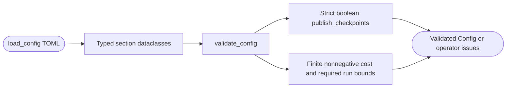

<!--
Copyright (c) 2026 DDP Engineering
This software is licensed under the PolyForm Noncommercial License 1.0.0.
Commercial use requires a separate commercial license.
See the LICENSE.txt file for full license details.
SPDX-License-Identifier: LicenseRef-PolyForm-Noncommercial-1.0.0
-->

# Configuration

## Purpose and boundaries

Loads TOML into typed configuration for platform, selection, executor,
container, recovery, budgets, delivery, profiles, and metrics. Validation
fails closed at external trust boundaries before a poll starts.

## Public interface

- `load_config()` builds the dataclass model; `validate_config()` returns
  deterministic operator-facing problems.
- `ConfigError` distinguishes unreadable/malformed configuration from a valid
  model with reported validation issues.

## Invariants

Configuration establishes the permitted forge, executor, container, budget,
and delivery policy before an orchestration run begins. It forbids forge
credentials in executor environment allowlists, rejects unsafe executor modes,
requires draft-only delivery, and validates paths, labels, retries, duration,
and resource limits instead of letting a later component guess.

## Requirement coverage

- `REQ-FUNC-ca17a8e8` - draft-only delivery and credential isolation.
- `REQ-FUNC-97e17737` - executor and egress policy validation.

## Files

- `04_Software/adore/config.py`
- `04_Software/tests/test_config.py`

## Routing

For TOML budget validation and typed config loading, start at
`04_Software/adore/config.py` and `04_Software/tests/test_config.py`.
Enforcement and recovery belong to Orchestrator; profile storage belongs to Profiles.

## Key behaviors

- `REQ-FUNC-b0811cbe`: finite nonnegative reported-cost caps; zero explicitly
  disables monetary enforcement for subscription/local execution while retaining
  usage telemetry and other run bounds. Negative/nonfinite/type-invalid caps
  cannot create an executable profile. Positive defaults remain 5.0.

## Architecture

## Remote checkpoint and ownership contract

- `REQ-FUNC-dd307c58`: strict opt-in WIP checkpoint visibility, exact remote identity/ancestor/lease protection, bounded transport recovery and approval-bound delivery.
- `REQ-FUNC-c9d64cfe`: queued safe-boundary handoff; durable pending/handed-off state preserves resources and prevents automatic retry/reset.
- Focused verification: `04_Software/tests/test_checkpoint_handoff.py`.
