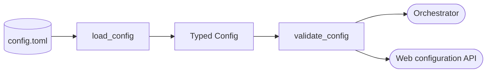

<!--
Copyright (c) 2026 DDP Engineering
This software is licensed under the PolyForm Noncommercial License 1.0.0.
Commercial use requires a separate commercial license.
See the LICENSE.txt file for full license details.
SPDX-License-Identifier: LicenseRef-PolyForm-Noncommercial-1.0.0
-->

# Configuration

## Routing

Use this page for typed TOML loading, executor/auth validation, budgets,
container settings and delivery policy. Start at `04_Software/adore/config.py`;
verify with `04_Software/tests/test_config.py`. Web config edits belong to
`web-interface.md` and assisted prompts to `wizard.md`.

## Purpose and boundaries

Loads TOML into typed configuration for platform, selection, executor,
container, recovery, budgets, delivery, profiles, and metrics. Validation
fails closed at external trust boundaries before a poll starts.

## Public interface

- `load_config()` builds the dataclass model; `validate_config()` returns
  deterministic operator-facing problems.
- `ConfigError` distinguishes unreadable/malformed configuration from a valid
  model with reported validation issues.

## Invariants

Configuration establishes the permitted forge, executor, container, budget,
and delivery policy before an orchestration run begins. It forbids forge
credentials in executor environment allowlists, rejects unsafe executor modes,
requires draft-only delivery, and validates paths, labels, retries, duration,
and resource limits instead of letting a later component guess.
ADORE-managed `stage_host_auth` supports only OpenCode and Codex. Pi may use an
operator-provided credential mount with staging disabled; unsupported
executor/staging pairs fail validation before a run starts.
`delivery.publish_checkpoints` is a strict opt-in boolean; draft-only MR/PR
approval remains mandatory. The reported-cost cap accepts finite nonnegative
USD amounts, with zero disabling only that cap.

## Key behaviors

- REQ-FUNC-ffb9ed29 / REQ-UX-b75e1df8: LocalConfig supplies account/home/path/environment/cgroup_root. Explicit execution.backend=local rejects recipes, restricted egress, staging and container-only options. Non-secret local maps reject managed/forge variables and literal inline provider credentials. Container remains the default.

Native ownership/auth route to `local-execution.md`; focused proof is
`04_Software/tests/test_local_execution.py`.

- `REQ-FUNC-e2b539d4`: Closed ExecutionConfig selection/backend/bounds; recipe mode permits empty profile image. Source authority belongs to preparation.md.

- `REQ-FUNC-ca17a8e8` - draft-only delivery and credential isolation.
- `REQ-FUNC-97e17737` - executor and egress policy validation.
- `REQ-FUNC-7ce5b17a` - web-created and imported profiles share the typed
  validator.
- `REQ-REL-94e653aa` - checkpoint publication is explicit and off by default.

## Architecture

Both CLI and web use the same validated model before changing runtime policy.

## Files

- `04_Software/tests/test_local_execution.py`: native integration/negative proof.

- `04_Software/adore/config.py`
- `04_Software/tests/test_config.py`
