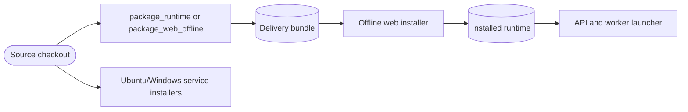

<!--
Copyright (c) 2026 DDP Engineering
This software is licensed under the PolyForm Noncommercial License 1.0.0.
Commercial use requires a separate commercial license.
See the LICENSE.txt file for full license details.
SPDX-License-Identifier: LicenseRef-PolyForm-Noncommercial-1.0.0
-->

# Deployment and packaging

## Routing

Use this page for runtime/web bundle creation, offline installation, launch,
release consistency and OS service installers. Start at `02_Tools/` and
`04_Software/deploy/`; verify with `test_web_package.py` and
`test_release_consistency.py`. Web API behavior belongs to `web-interface.md`.

## Purpose and boundaries

`04_Software/deploy/` provides host-specific unattended operation, while
`02_Tools/package_runtime.*` creates a compact, transparent runtime bundle.
They keep OS-specific behavior outside ADORE's portable Python conductor.
`02_Tools/package_web_offline.py` additionally creates an OS/Python-specific
web bundle from the locked dependencies and bundled React assets.

## Public interface

`deploy/install-ubuntu.sh` prepares an Ubuntu 22+ checkout and can install a
systemd service. `deploy/install-windows.ps1` prepares Windows 11 and can
register the ADORE Task Scheduler task in loop or repeating-once mode.
Both scripts are fail-fast, idempotent, validate the chosen config, leave state
on uninstall, and never put secret values in argv or logs. They refuse
an unattended install with `[executor] internet = true` (open container egress)
unless the operator passes `--allow-open-egress` / `-AllowOpenEgress`; with it
false they build (Ubuntu) or verify (Windows) the egress proxy image.
The OS scheduler and ADORE's durable lock together prevent a second poller.

## Invariants

The PowerShell/Bash packagers derive the bundle name from the release version,
stage the runtime, deployment files and selected operator documentation, and
exclude virtual environments, state, worktrees, tests, caches, and `.env`.
Portable ZIP creation rejects links/special entries and replaces output only
after a complete archive. `check_release_consistency.py` verifies version,
metadata, documentation, artifact layout, exclusions, and legacy identity
drift before release handoff.
The web bundle carries local dependency wheels, a checksum manifest, installer
and launcher. Installation verifies the media and invokes `pip --no-index`;
the manifest checks Git, forge, executor and runtime tool groups before target
creation. A check-only invocation verifies host readiness without installation;
required images load or are inspected before creating the Python environment.
the API and worker are separate foreground processes. See `web-interface.md`.
The combined web launcher supervises both processes as one pair, stopping the
survivor after either exits and applying a finite restart limit with 1/2/4-second
backoff by default. An external service manager can instead supervise the
installed entrypoints separately.

## Key behaviors

- `REQ-FUNC-e3daac09` - version-derived, state-free portable runtime bundle.
- `REQ-FUNC-78969e20` - fail-fast installer/uninstaller and explicit unattended egress policy.
- `REQ-PLAT-a1b60ff9` - offline web installation from host-matched media.

## Architecture

OS-specific setup stays outside the portable conductor. Web installation
verifies media integrity, rejects unlisted files and never downloads packages
at install time. It requires host Git, forge CLI and container runtime;
executor binaries are verified by project readiness inside prepared images.
Media can embed an image archive or require an exact preinstalled image tag;
both paths validate the tag before creating the Python runtime. With a selected
image and executor, installation probes the binary inside the image using
`--network none` and `--pull=never`.

## Files

- `02_Tools/package_runtime.*`, `package_web_offline.py` - delivery media.
- `02_Tools/install_web_offline.py`, `launch_web.py` - offline install and launch.
- `02_Tools/check_release_consistency.py` - release contract checker.
- `04_Software/deploy/` - OS service installation.
- `04_Software/tests/test_web_package.py`, `test_release_consistency.py` - checks.
