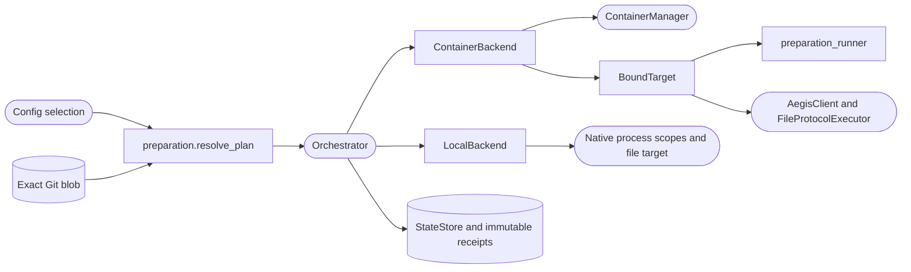

<!--
Copyright (c) 2026 DDP Engineering
This software is licensed under the PolyForm Noncommercial License 1.0.0.
Commercial use requires a separate commercial license.
See the LICENSE.txt file for full license details. SPDX-License-Identifier: LicenseRef-PolyForm-Noncommercial-1.0.0
-->

# Execution

## Routing

Start at `04_Software/adore/execution.py` for execution contracts.
Focused verification: `04_Software/tests/test_execution.py` and `04_Software/tests/test_preparation_lifecycle.py`. Conductor ordering/recovery belongs
to `orchestrator.md`; CLI/GUI selection belongs to `cli.md`/`web-interface.md`.

## Purpose and boundaries

Provide the shared backend contract and container preparation file runner. `ExecutionBackend` supplies paths/shell, the executor environment (`executor_environment()`, no argument: `{}` for a container, the native account environment for local), provision/tool checks, resource/image identity, bound commands and owned stop/interrupt/remove. `ContainerBackend` implements existing ContainerManager semantics. `BoundTarget` verifies pinned identity before each command. `run_preparation_step` transmits file scripts, validates receipts and preserves typed incomplete results; standalone `preparation_runner.py` drains bounded redacted streams and enforces process-group timeouts. The conductor owns order, budgets, recovery and publication.

## Public interface

`ExecutionBackend` supplies paths/shell, the executor environment (`executor_environment()`, no argument: `{}` for a container, the native account environment for local), provision/tool checks, resource/image identity, bound commands and owned stop/interrupt/remove. `ContainerBackend` implements existing ContainerManager semantics. `BoundTarget` verifies pinned identity before each command. `run_preparation_step` transmits file scripts, validates receipts and preserves typed incomplete results; standalone `preparation_runner.py` drains bounded redacted streams and enforces process-group timeouts. The conductor owns order, budgets, recovery and publication.

## Invariants

Exact source/configuration authority; closed input grammar and recovery records;
bounded scripts/time/output/replay; unchanged egress/credential scope; immutable
source/image/resource evidence; setup finishes before AI. Explicit replay retains
worktree effects and prior attempt receipts. No publication or merging authority.

## Key behaviors

- REQ-FUNC-ffb9ed29 / REQ-UX-b75e1df8: ExecutionBackend has ContainerBackend and LocalBackend implementations. Native targets use run_files and native worktree/IO paths. Container controls refuse native identities before any manager call; native controls verify pinned runtime/launch scope. Preparation remains container-only.

Native ownership/auth route to `local-execution.md`; focused proof is
`04_Software/tests/test_local_execution.py`.

- `REQ-FUNC-e2b539d4`: immutable exact-source reviewed image/command plan.
- `REQ-FUNC-e5419c07`: bounded same-container setup before AEGIS/AI.
- `REQ-REL-d8fd134e`: fail-closed pinned recovery and explicit capped replay.
- `REQ-FUNC-e397f7f6`: shared backend lifecycle/transport contract.

## Architecture

Conductor → ContainerBackend → ContainerManager. BoundTarget → preparation file runner or existing AEGIS/executor transport; all reuse the same target paths and resource.

## Files

- `04_Software/tests/test_local_execution.py`: native integration/negative proof.

- `04_Software/adore/execution.py`: public component and contracts.
- `04_Software/adore/preparation_runner.py`: standalone bounded step runner.
- `04_Software/tests/test_execution.py` and `04_Software/tests/test_preparation_lifecycle.py`: injected contract proof.
- `05_SoftwareDocu/Component_Execution.md`: detailed component documentation.
- `01_Documentation/Container_Preparation.md`: operator contract.

Preparation transport checks owned directory containment and linked parents before creating files, and checks result ownership before retaining evidence.

Native AEGIS stdout preserves the established 4 MiB JSON exchange bound; gate
stdout, stderr and questions remain bounded at 64 KiB. Native stream decoding
rejects invalid UTF-8; truncated JSON cannot become successful AEGIS evidence.
The shared drain retains container defaults. Saved local readiness checks reuse
approved profile .env values in memory through the same native environment.
