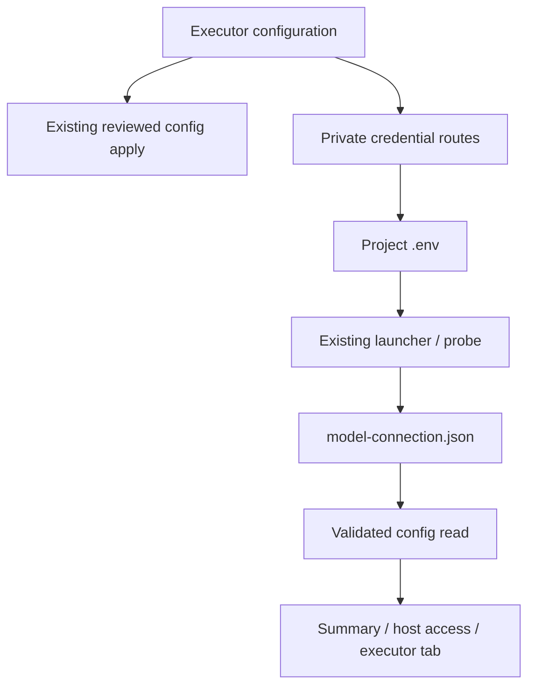

<!--
Copyright (c) 2026 DDP Engineering
This software is licensed under the PolyForm Noncommercial License 1.0.0.
Commercial use requires a separate commercial license.
See the LICENSE.txt file for full license details. SPDX-License-Identifier: LicenseRef-PolyForm-Noncommercial-1.0.0
-->

# Executor configuration

## Routing

Project executor/model/key configuration starts at `04_Software/adore/web/executor_settings.py`, app.py executor credential/model routes and `web/src/ExecutorCredentials.tsx`. Probe execution belongs to model-connection.md; generic candidate apply to web-interface.md.

## Purpose and boundaries

One project-owned workspace; protected provider variable edits and durable model evidence. Launcher reads existing .env; config candidates own TOML application; installed CLI owns subscription login.

## Public interface

GET/PUT/DELETE executor-credentials (Admin), config GET model_connection, model test POST persistence. See Component_Executor_Configuration.md for exact schemas/error/status contracts.

## Invariants

CSRF/admin/immutable identity/config and conductor locks/pause/idle/pending guards. Private bounded atomic dotenv edits; secret-free API/audit; strict duplicate/corrupt evidence rejection before stale filtering. Current public result binds model/revision and internal credential digest. Key changes delete old evidence. Real model testing remains explicit.

## Key behaviors

REQ-FUNC-4e9e7ecc executor tab/ownership; REQ-SEC-1c210f3f approved project API credentials; REQ-DATA-f304fd2e durable current model result. Existing command tables/manual model IDs and external subscription login guidance preserve actual capabilities. Summary presents model evidence only in the adjacent host-check disclosure; the executor tab retains the explicit test/result.

## Architecture

## Change map

Credential persistence/binding: executor_settings.py, test_executor_settings.py. HTTP permissions/locks: app.py and same tests. GUI ownership: App/routes/ExecutorCredentials/ReadinessEvidence/ModelConnection, executor-config/model-connection/settings Chromium journeys.

## Files

Source/tests above; detailed component contract `05_SoftwareDocu/Component_Executor_Configuration.md`; operator web/security/configuration references. No SQLite migration.
