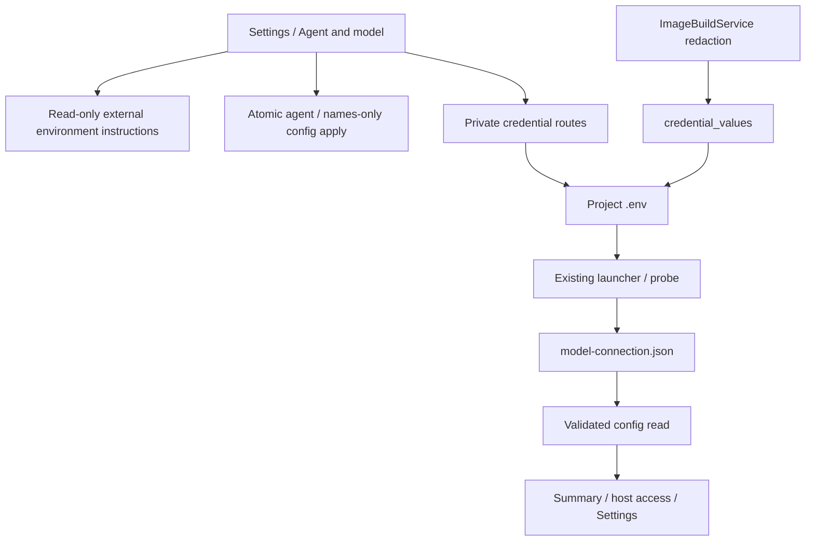

<!--
Copyright (c) 2026 DDP Engineering
This software is licensed under the PolyForm Noncommercial License 1.0.0.
Commercial use requires a separate commercial license.
See the LICENSE.txt file for full license details. SPDX-License-Identifier: LicenseRef-PolyForm-Noncommercial-1.0.0
-->

# Executor configuration

## Routing

Project executor/model/key configuration starts at `04_Software/adore/web/executor_configuration.py`, reviewed candidate routes and `web/src/ExecutorSelectionEditor.tsx` / `CredentialNamesEditor.tsx`; private key storage starts at `04_Software/adore/web/executor_settings.py`, app.py executor credential/model routes and `web/src/ExecutorCredentials.tsx`. Probe execution belongs to model-connection.md; generic candidate apply to web-interface.md.

## Purpose and boundaries

One project-owned workspace; protected provider variable edits and durable model evidence. Launcher reads existing .env; config candidates own TOML application; installed CLI owns subscription login.

## Public interface

GET/PUT/DELETE executor-credentials (Admin), config GET model_connection, model test POST persistence. See Component_Executor_Configuration.md for exact schemas/error/status contracts.

credential_values exposes the existing strict bounded private dotenv read solely
for in-memory image-source/output rejection/redaction. No values are exported or
forwarded to builds. Corruption fails closed; missing input is empty. Focused
proof lives in test_image_build.py and existing provider credential boundaries.

## Invariants

CSRF/admin/immutable identity/config and conductor locks/pause/idle/pending guards. Private bounded atomic dotenv edits; secret-free API/audit; strict duplicate/corrupt evidence rejection before stale filtering. Current public result binds model/revision and internal credential digest. Key changes delete old evidence. Real model testing remains explicit.

## Key behaviors

- REQ-UX-b75e1df8: Local installed native argv is editable through validated reviewed candidates. Container editors retain standard presets. Subscription login stays external; local stores are reused in place. Protected provider edits/current model evidence keep project-bound contracts.

Native control/auth route to local-execution.md. Focused proof:
`04_Software/tests/test_local_execution.py`.

**Project → Settings → Agent and model** owns the default coding agent, the selected agent's launch command/model, AI connection testing and external container guidance. Its **Authentication** disclosure groups allowed credential variable names, host sign-in reuse and **Provider API keys**. The agent editor offers OpenCode, Pi, Codex and Qwen Code even when their command tables are absent. Selecting an agent loads its saved command/model or the documented command preset; a new model ID must be supplied explicitly. Prepare reviews agent, command and model together, then Apply writes one complete paused/idle candidate. The generic launch-command/model labels follow the selected agent. Edit keeps agent, command and model controls inside their existing description/value rows; the default-agent row owns Prepare/Cancel for the complete draft, beside its dropdown using the shared editor layout and normal responsive wrapping. Grouped-edit guidance stays in the description column. Validation occupies its own line after the controls, keeping selector/actions aligned when the selected agent needs a model; Prepare remains disabled until the complete draft is valid. Credential names are added through a dropdown and remain visible as individually removable selections. Installed agents and runtime preparation remain external. The old `/executor` URL redirects to Settings. Developers read non-secret settings/results without mutation actions.

The names-only credential selector offers known provider names and retained custom names, independently of coding agent. Empty lists support existing server sign-in. Applying names does not delete saved `.env` values. Provider API keys offers private Save/Disconnect for known allowed variables and shows sources only; key changes require paused pickup and idle/pending-free state. Explicit Test AI connection remains the evidence of model access and may incur provider charges. Subscription login retains the installed CLI's external service-account workflow.

REQ-FUNC-c829c366 owns atomic supported-agent enrollment; REQ-FUNC-08cc2676 owns reviewed names-only lists. executor_configuration.py validates exact selection and full TOML meaning. implementation_settings.py retains scoped collection writes; app.py reconstructs selection/list pending records against their base before use. Direct PUT requires candidate review.

## Architecture

## Change map

Atomic agent/names-only selection: executor_configuration.py, implementation_settings.py, app.py, test_web_executor_configuration.py and settings helper tests. Credential persistence/binding: executor_settings.py, test_executor_settings.py. HTTP permissions/locks: app.py and same tests. GUI ownership: App/routes/ExecutorSelectionEditor/CredentialNamesEditor/ExecutorCredentials/ReadinessEvidence/ModelConnection, executor-config/model-connection/settings Chromium journeys.

## Files

- `04_Software/tests/test_local_execution.py`: native integration/negative proof.

Source/tests above; detailed component contract `05_SoftwareDocu/Component_Executor_Configuration.md`; operator web/security/configuration references. No SQLite migration.

## External environment guidance

REQ-UX-01d189b8 / REQ-FUNC-6b8494a7: ExecutorEnvironment.tsx reads the validated
config executor_environment object. Container profiles show effective image and
one external Dockerfile/build/profile disclosure; local profiles omit it. The
resolved profile path is Admin-only. No mutation requests occur. Settings/guided
creation omit container/execution/local/worktree editors. Existing dedicated AI
endpoint and executor/model/credential operations remain. Focused proof:
test_web_image_build.py and images.spec.ts.
