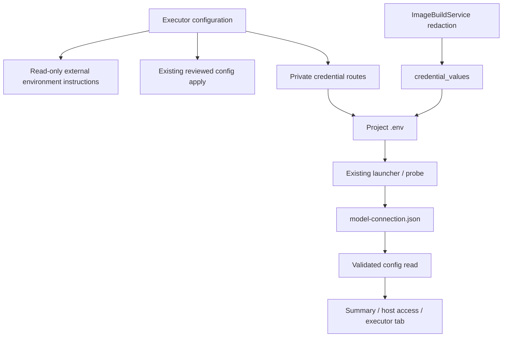

<!--
Copyright (c) 2026 DDP Engineering
This software is licensed under the PolyForm Noncommercial License 1.0.0.
Commercial use requires a separate commercial license.
See the LICENSE.txt file for full license details. SPDX-License-Identifier: LicenseRef-PolyForm-Noncommercial-1.0.0
-->

# Executor configuration

## Routing

Project executor/model/key configuration starts at `04_Software/adore/web/executor_settings.py`, app.py executor credential/model routes and `web/src/ExecutorCredentials.tsx`. Probe execution belongs to model-connection.md; generic candidate apply to web-interface.md.

## Purpose and boundaries

One project-owned workspace; protected provider variable edits and durable model evidence. Launcher reads existing .env; config candidates own TOML application; installed CLI owns subscription login.

## Public interface

GET/PUT/DELETE executor-credentials (Admin), config GET model_connection, model test POST persistence. See Component_Executor_Configuration.md for exact schemas/error/status contracts.

credential_values exposes the existing strict bounded private dotenv read solely
for in-memory image-source/output rejection/redaction. No values are exported or
forwarded to builds. Corruption fails closed; missing input is empty. Focused
proof lives in test_image_build.py and existing provider credential boundaries.

## Invariants

CSRF/admin/immutable identity/config and conductor locks/pause/idle/pending guards. Private bounded atomic dotenv edits; secret-free API/audit; strict duplicate/corrupt evidence rejection before stale filtering. Current public result binds model/revision and internal credential digest. Key changes delete old evidence. Real model testing remains explicit.

## Key behaviors

- REQ-UX-b75e1df8: Local installed native argv is editable through validated reviewed candidates. Container editors retain standard presets. Subscription login stays external; local stores are reused in place. Protected provider edits/current model evidence keep project-bound contracts.

Native control/auth route to local-execution.md. Focused proof:
`04_Software/tests/test_local_execution.py`.

REQ-FUNC-4e9e7ecc executor tab/ownership; REQ-SEC-1c210f3f approved project API credentials; REQ-DATA-f304fd2e durable current model result. Existing command tables supply the Default coding agent dropdown; exact documented launch presets supply command choices through reviewed candidates. Container arbitrary command input and missing-table enrollment fail closed, including direct PUT and persisted review/apply. Container custom active commands remain displayed until a preset is applied. Local installed native argv uses validated reviewed text candidates. Manual model IDs and external subscription login guidance preserve actual capabilities. Settings and Provider credentials share one panel with Test AI connection at its heading right. Summary presents model evidence only in the adjacent host-check disclosure; the executor tab retains the explicit test/result.

## Architecture

## Change map

Credential persistence/binding: executor_settings.py, test_executor_settings.py. HTTP permissions/locks: app.py and same tests. GUI ownership: App/routes/ExecutorCredentials/ReadinessEvidence/ModelConnection, executor-config/model-connection/settings Chromium journeys.

## Files

- `04_Software/tests/test_local_execution.py`: native integration/negative proof.

Source/tests above; detailed component contract `05_SoftwareDocu/Component_Executor_Configuration.md`; operator web/security/configuration references. No SQLite migration.

## External environment guidance

REQ-UX-01d189b8 / REQ-FUNC-6b8494a7: ExecutorEnvironment.tsx reads the validated
config executor_environment object. Container profiles show effective image and
one external Dockerfile/build/profile disclosure; local profiles omit it. The
resolved profile path is Admin-only. No mutation requests occur. Settings/guided
creation omit container/execution/local/worktree editors. Existing dedicated AI
endpoint and executor/model/credential operations remain. Focused proof:
test_web_image_build.py and images.spec.ts.
