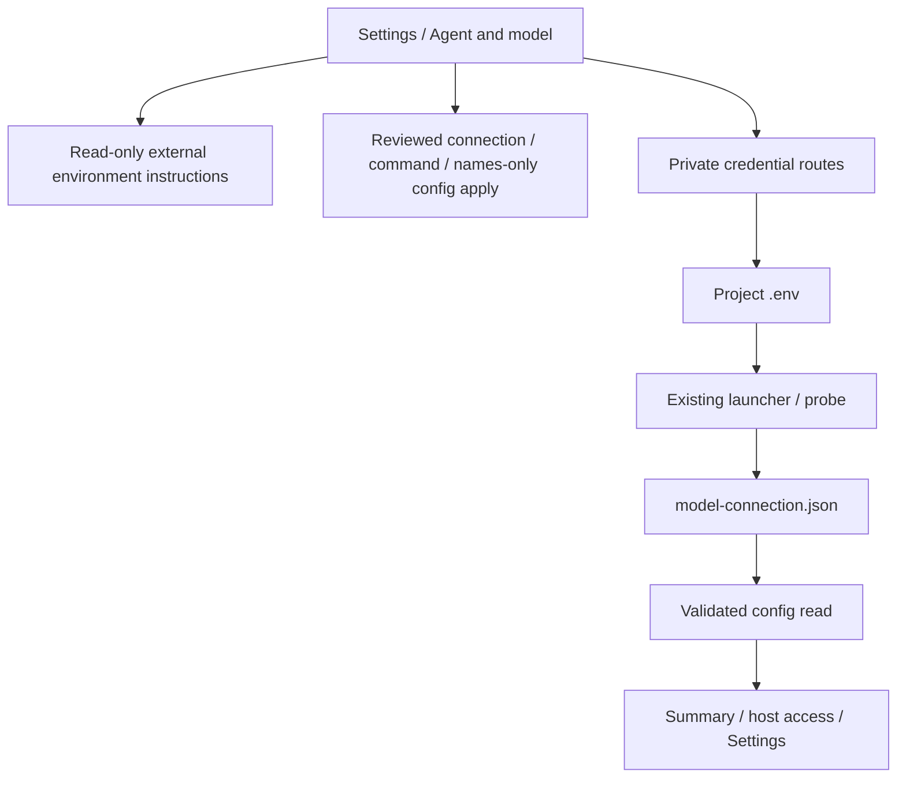

<!--
Copyright (c) 2026 DDP Engineering
This software is licensed under the PolyForm Noncommercial License 1.0.0.
Commercial use requires a separate commercial license.
See the LICENSE.txt file for full license details. SPDX-License-Identifier: LicenseRef-PolyForm-Noncommercial-1.0.0
-->

# Executor configuration

## Routing

Project provider/model/endpoint, launch-command and key configuration starts at `04_Software/adore/web/executor_configuration.py` (`LAUNCH_PRESETS`, `CONNECTION_KEY`, `set_connection`), the provider rules in `04_Software/adore/pi_providers.py` (catalog `pi_catalog.json`), reviewed candidate routes in `web/app.py`, `web/src/executorSettings.ts`, `agentConnection.ts`, `AgentConnectionEditor.tsx` and `CredentialNamesEditor.tsx`; private key storage starts at `04_Software/adore/web/executor_settings.py`, app.py executor credential/model routes and `web/src/ExecutorCredentials.tsx`; the server's ChatGPT sign-in starts at `04_Software/adore/chatgpt.py`, the app.py `/api/v1/chatgpt-sign-in` routes, `web/src/ChatGptSignIn.tsx` and `web/src/chatgptCopy.ts`. Probe execution belongs to model-connection.md; generic candidate apply to web-interface.md.

## Purpose and boundaries

One project-owned workspace; protected provider variable edits and durable model evidence. Launcher reads existing .env; config candidates own TOML application; an installed native Pi owns its own subscription sign-in. The ADORE server owns one ChatGPT sign-in in `<ADORE home>/chatgpt`, shared by every `chatgpt` project of the server; it is not project configuration.

## Public interface

GET/PUT/DELETE executor-credentials (Admin; only the configured provider's credential variable; the list is empty for `chatgpt`), GET `/api/v1/pi-providers` (provider catalog, with `chatgpt.models`), GET/PUT/DELETE `/api/v1/chatgpt-sign-in`, DELETE `/api/v1/chatgpt-sign-in/pending` and POST `/api/v1/projects/{name}/chatgpt-sign-in` (Admin; the server's ChatGPT sign-in, see web-interface.md), config GET model_connection, model test POST persistence. See Component_Executor_Configuration.md for exact schemas/error/status contracts.

credential_values exposes the existing strict bounded private dotenv read. No
values are exported. Corruption fails closed; missing input is empty. It has no
caller since the image-build subsystem was removed.

## Invariants

CSRF/admin/immutable identity/config and conductor locks/pause/idle/pending guards. Private bounded atomic dotenv edits; secret-free API/audit; strict duplicate/corrupt evidence rejection before stale filtering. Current public result binds model/revision and internal credential digest. Key changes delete old evidence. Real model testing remains explicit.

## Key behaviors

- REQ-UX-b75e1df8: The server backend shows the current account and optional project tools PATH. ADORE owns the pinned Pi launcher. Protected provider edits and model evidence remain bound to the project.

Native control/auth route to local-execution.md. Focused proof:
`04_Software/tests/test_local_execution.py`.

**Project → Settings → Agent and model** owns the Pi provider, model and OpenAI-compatible endpoint, the launch command, AI connection testing, `execution.backend`, the container runtime and image (and the current account and optional tools PATH for local projects) and external container guidance. Pi is the only coding agent; there is no agent selector. Its **Authentication** disclosure groups additional credential variable names and **Provider API key**. Provider, model and endpoint are one reviewed candidate, the virtual edit key `executor.connection` (strict JSON `{provider, model, base_url, api}`; `valid_connection` requires a provider from `provider_ids()`, a model matching `pi_providers.MODEL_ID_RE`, and an http(s) base URL plus a Pi API type exactly for `custom`). `set_connection` rewrites `[executor] provider`/`model` and removes or adds `[executor.endpoint]`, preserving unrelated TOML (verified by re-parse). Setting metadata maps the rows `executor.provider`, `executor.model`, `executor.endpoint.base_url` and `executor.endpoint.api` to that edit key; they cannot be staged individually (400). `AgentConnectionEditor.tsx` edits it: provider select (OpenAI-compatible endpoint, ChatGPT subscription, Pi's API-key providers), model input with Pi's models as suggestions, endpoint URL and API type only for `custom`. `executor.command` offers only the `LAUNCH_PRESETS` choice (`branding.PI_NATIVE_COMMAND`) for a container project, whose run uses the image's pinned Pi; a local project uses fixed managed Pi RPC. The command may be absent from `config.toml`, which then uses the default. `web/src/executorSettings.ts` supplies four-locale labels and `executorSettingHelp` text for `executor.command`, `executor.model`, `executor.env_keys`, `executor.provider`, `executor.endpoint.*` and `executor.connection`; `settingVisible(key, executorOnly, backend)` shows container rows for container projects and local-account rows for local ones. Each edit is prepared, reviewed and applied as one paused/idle candidate; unchanged simple candidates show a notice with disabled Apply. Credential names are added through a dropdown and remain visible as individually removable selections. Backend, runtime and image edits go only through the reviewed flow (prepare candidate, review, apply). While the image row is edited it offers the same server image suggestions. Installed agents and runtime preparation remain external. The old `/executor` URL redirects to Settings. Developers read non-secret settings/results without mutation actions.

The names-only selector for additional credential variables offers `PROVIDER_KEYS` (`pi_providers.key_variables()`: the catalog key variables plus `ADORE_ENDPOINT_API_KEY`) and retained custom names. It defaults to empty (`env_keys = []`): the provider's key variable is always passed. Applying names does not delete saved `.env` values. Provider API key offers private Save/Disconnect for exactly the configured provider's credential variable (`credential_variable`; `ADORE_ENDPOINT_API_KEY`, optional, for `custom`) and shows its source only; key changes require paused pickup and idle/pending-free state. Explicit Test AI connection remains the evidence of model access and may incur provider charges. ChatGPT sign-in is for container projects. Server projects use the configured project credential and managed Pi.

For `provider = "chatgpt"` `credential_variable` is None, `secret_names` adds no provider variable and App.tsx shows `ChatGptSignIn.tsx` to Admins of a non-archived project in place of the Provider API key form. The panel shows the status `signed-in`, `not-signed-in` or `sign-in-again`, starts Sign in with ChatGPT, takes the pasted redirect address, and offers Cancel and Disconnect ChatGPT. Signing in needs neither paused pickup nor an idle project. `AgentConnectionEditor.tsx` suggests the catalog's `chatgpt.models` (`providerModels`) as models for `chatgpt`. Config GET returns `model_connection: null` for a `chatgpt` project while the server's status is not `signed-in`. A `chatgpt` project needs `execution.backend = "container"` and stage limits of at most 3000 s (config.md). `credential_binding` hashes only the effective values of `secret_names(executor)` (`env_keys` plus the provider's credential variable; process environment first, then project `.env`); saved evidence whose `executor` is not `pi`, whose model differs from `executor.model`, or whose binding differs is not presented.

REQ-FUNC-2df31adf owns Pi as the only agent with no agent choice; REQ-FUNC-08cc2676 owns reviewed names-only lists. `app.py` `_valid_candidate_scalar` validates the connection and command candidates and the full candidate passes `validate_config`. implementation_settings.py retains scoped collection writes; app.py reconstructs list pending records against their base before use. Direct PUT requires candidate review.

## Architecture

## Change map

Connection/command/names-only settings: pi_providers.py, executor_configuration.py, implementation_settings.py, app.py, test_web_executor_configuration.py, test_web_launch_presets.py and settings helper tests. Credential persistence/binding: executor_settings.py, test_executor_settings.py. HTTP permissions/locks: app.py and same tests. GUI ownership: App/routes/executorSettings/agentConnection/AgentConnectionEditor/CredentialNamesEditor/ExecutorCredentials/ChatGptSignIn/chatgptCopy/ReadinessEvidence/ModelConnection, executor-config/model-connection/settings Chromium journeys. ChatGPT sign-in: chatgpt.py, isolation.py `helper_command`, app.py sign-in routes, test_chatgpt.py, test_web_chatgpt.py, web/tests/chatgpt.test.mjs.

## Files

- `04_Software/tests/test_system_packages.py`: package authority, independent egress, recovery and reviewed settings contracts.

- `04_Software/tests/test_local_execution.py`: native integration/negative proof.
- `04_Software/adore/chatgpt.py`: the server's ChatGPT sign-in, status and stage tokens.
- `04_Software/web/src/ChatGptSignIn.tsx`, `04_Software/web/src/chatgptCopy.ts`: the sign-in panel and its four-locale copy and transport parsers.
- `04_Software/tests/test_web_chatgpt.py`, `04_Software/web/tests/chatgpt.test.mjs`: sign-in route and panel proof.

Source/tests above; detailed component contract `05_SoftwareDocu/Component_Executor_Configuration.md`; operator web/security/configuration references. No SQLite migration.

## External environment guidance

REQ-UX-01d189b8 / REQ-FUNC-6b8494a7: ExecutorEnvironment.tsx reads the validated
config executor_environment object. Container profiles show effective image and
one external Dockerfile/build/profile disclosure; local profiles omit it. The
resolved profile path is Admin-only. The notice makes no mutation requests; the
Dockerfile and build stay on the server. Administrators choose `execution.backend`,
`container.runtime`, `container.image` and `local.path` at enrollment step 2
and in Settings. `local.account` is fixed to `current`. Settings edits require
a reviewed candidate. A direct PUT returns 409 `pending_config_required`.
GET /api/v1/executor-images?runtime=docker|podman (Admin,
read-only, 15 s timeout, drops `<none>`) returns {runtime, available, images} for
image suggestions (serverImages.ts); enrollment proposes a `pi-*` tag,
preferring `adore-executor-base`, never over a typed value. Additional env_keys may be
empty. All other container/execution/local/worktree keys stay refused (400
environment_managed_externally). A pending candidate with an `image_build`
binding or for an operator-owned key, which only an earlier build could stage,
is 503 `pending_config_corrupt` on view and apply; an administrator can still
discard it (DELETE /api/v1/projects/{name}/config/pending). ADORE web has no
image definition or build routes; the OpenAI-compatible endpoint is edited only
through `executor.connection`, and model and credential operations are those
above. Focused proof:
test_executor_environment_choice.py, test_web_pending_config.py and images.spec.ts.

## Installed executor suggestions

Local enrollment and launch-command editing use the admin-only filesystem
discovery and manual path picker described in [Installed executor discovery](executor-discovery.md).
Existing saved/manual commands retain authority; selected paths are revalidated
by native policy and applied through the existing reviewed configuration flow.

The local launch command is not editable; guided setup and reviewed settings share the managed Pi backend.
