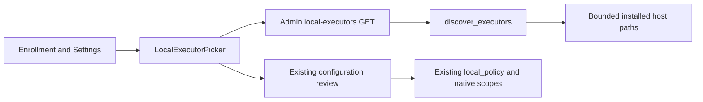

<!--
Copyright (c) 2026 DDP Engineering
This software is licensed under the PolyForm Noncommercial License 1.0.0.
Commercial use requires a separate commercial license.
See the LICENSE.txt file for full license details. SPDX-License-Identifier: LicenseRef-PolyForm-Noncommercial-1.0.0
-->

# Installed executor discovery

## Routing

Installed agent detection, prefilled commands and manual executable paths start at
`adore/executor_discovery.py`, `web/src/LocalExecutorPicker.tsx` and
`web/src/localExecutors.ts`. Native launch enforcement belongs to local-execution.md;
reviewed saved configuration belongs to executor-configuration.md.

## Purpose and boundaries

Suggest native installed launches for the current ADORE host/account. Installation,
authentication and model probes stay with the operator and existing components.

## Public interface

Admin GET `/api/v1/local-executors`, Cache-Control no-store, returns system/machine/
account and four executor records with bounded installation arrays. Each candidate
has executable, nullable entrypoint, standard command and PATH/npm source.
`discover_executors` accepts injected OS/environment/home/excluded paths for tests.

## Invariants

Read-only installed paths and native account identity: no CLI invocation, shim parsing, credential reads or installation.
Absolute non-project native paths, bounded roots/results, Windows real exe or Node
plus installed JS. Existing native policy independently validates launch identity.
Manual edits and saved commands retain authority; stale results are ignored.

## Change map

| Request | Start | Focused proof |
|---|---|---|
| Host/native/npm layouts | executor_discovery.py | tests/test_executor_discovery.py |
| Suggestions and manual paths | LocalExecutorPicker.tsx, localExecutors.ts | localExecutors.test.mjs, local-executors.spec.ts |
| Existing Settings | App.tsx, ExecutorSelectionEditor.tsx | local-executors.spec.ts |

## Key behaviors

- REQ-FUNC-cd5bffc3: admin-only bounded installed host launch discovery.
- REQ-UX-3ce12a1a: automatic enrollment proposals and explicit installed/manual choices.

## Architecture

## Files

Source and tests above; `05_SoftwareDocu/Component_Executor_Discovery.md` documents
schemas and integration; `01_Documentation/Local_Execution.md` describes usage.
`02_Tools/verify_package.py` proves the actual packaged API on both native hosts.

## Simple native setup

Enrollment uses current-account defaults and displays read-only Runs as identity.
Detected installations remain visible; a closed Advanced disclosure holds full
optional re-detection, command/manual executable and home/PATH/Linux delegation.
Discovery starts on native-picker mount; agent changes use the validated complete
listing. Agent and model groups controls into independent vertical columns. Settings retains saved
account assertions and overrides in Advanced. Manual/saved command authority,
existing authentication and native launch validation remain unchanged.

Displayed account and machine come from the same native_context used by execution
(Windows token account or Linux effective UID). Unavailable identity produces
HTTP 503 local_host_identity_unavailable rather than a guessed shell username.
