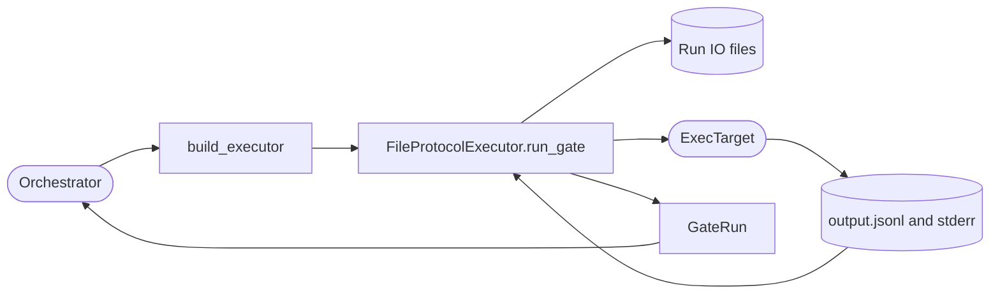

<!--
Copyright (c) 2026 DDP Engineering
This software is licensed under the PolyForm Noncommercial License 1.0.0.
Commercial use requires a separate commercial license.
See the LICENSE.txt file for full license details.
SPDX-License-Identifier: LicenseRef-PolyForm-Noncommercial-1.0.0
-->

# Executor launcher

## Routing

Use this page for executor selection, gate script transport, output parsing,
session handling and usage/cost telemetry. Start at
`04_Software/adore/executor/launcher.py`; verify with
`04_Software/tests/test_executor.py`. Stage decisions belong to
`orchestrator.md`.

## Purpose and boundaries

`04_Software/adore/executor/` launches one bounded executor gate inside an
already-provisioned container. It is an executor-neutral transport and result
collector; the orchestrator decides which stage to run and what an outcome
means.

## Public interface

- `build_executor(kind, command_template, model, questions_file)` selects the
  `opencode`, `pi`, `codex`, or `qwen` implementation.
- `FileProtocolExecutor.run_gate(...)` accepts an injected container-exec seam,
  worktree/io paths, prompt, timeout, optional session, and archive stem; it
  returns a typed `GateRun`.
- `GateRun` reports exit status, typed `timed_out`, questions, bounded output,
  usage, explicit token/cost coverage, and archive information.

## Invariants

The launcher writes LF-only `gate.sh` into the run IO directory and invokes
the backend shell and native IO path (container default `sh /adore/io/gate.sh`); prompts and models are shell-quoted before they
enter that script. Results cross the container boundary through `output.jsonl`,
`stderr.log`, and the configured questions file rather than fragile host/WSL
argv or streamed output. A timeout is taken solely from `CommandResult.timed_out`,
not guessed from exit text. Each requested archive is immutable under
`io/archive/`, so a retry cannot destroy prior evidence.

The executor receives no forge credentials and cannot publish. Unsafe
auto-approval flags are rejected by configuration validation. The launcher
starts a fresh session for each gate and never guesses a retry from timeout text.
OpenCode and Codex mark cost as reported only when their event stream has an
explicit cost field; token-only usage does not prove a zero-dollar cost.
Complete OpenCode, Pi and Codex token records mark token coverage even when
their counts are zero; missing or partial records do not claim coverage.
Pi counts only completed `turn_end` JSON events, including cache-read and
cache-write input tokens; streaming and message-end copies are ignored. Invalid
usage values are skipped. Pi's embedded monetary value is an executor estimate,
so the launcher leaves billed cost unavailable for administrator price rules.

## Key behaviors

- `REQ-FUNC-e397f7f6`: Bound targets supply shell/worktree/IO paths and verified resource identity; plain injected callables retain the container defaults. Prompts/scripts remain file transported and quoted.

- `REQ-FUNC-59ccdb74` - WSL-safe file transport and typed timeout propagation.
- `REQ-FUNC-c6e5282d` - questions parking and immutable launch archives.
- `REQ-FUNC-448cbde7` - usage and cost coverage for web metrics.

## Architecture

The file protocol decouples prompts and results from host/container argument
quoting; the caller owns stage policy.

## Files

- `04_Software/adore/executor/base.py` - typed gate result and common helpers.
- `04_Software/adore/executor/launcher.py` - file protocol and parsers.
- `04_Software/tests/test_executor.py` - launch, timeout and usage contracts.
