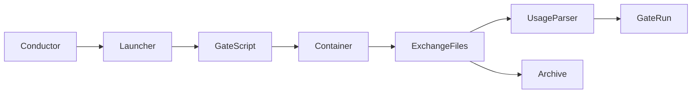

<!--
Copyright (c) 2026 DDP Engineering
This software is licensed under the PolyForm Noncommercial License 1.0.0.
Commercial use requires a separate commercial license.
See the LICENSE.txt file for full license details.
SPDX-License-Identifier: LicenseRef-PolyForm-Noncommercial-1.0.0
-->

# Executor launcher

## Routing

Use for executor commands, gate exchange files, questions, launch archives and token/cost parsing. Start at `04_Software/adore/executor/launcher.py` and `04_Software/tests/test_executor.py`. Container lifecycle belongs to isolation; run budgets and publication belong to the orchestrator.

## Purpose and boundaries

Launch one fresh, bounded executor gate in an existing isolated container and collect its typed result. The orchestrator owns stage selection and lifecycle decisions.

## Public interface

`build_executor(kind, command_template, model, questions_file)` selects the launcher. `FileProtocolExecutor.run_gate(...)` accepts a container-exec seam, worktree, IO directory, prompt, timeout and archive stem and returns `GateRun` with exit/timeout, questions, output, usage and archives.

## Invariants

Prompts and model names are shell-quoted in LF-only `gate.sh`; the container executes only `sh /adore/io/gate.sh`. Live exchange files are cleared before each launch. Timeouts come from typed command results. Per-launch archives are immutable. The executor receives no forge credentials; unsafe executor flags are rejected. Each launch starts a fresh session.

## Key behaviors

- Output, errors and questions cross the host/container boundary through files.
- Pi usage sums assistant `message_end` records: input plus cacheRead/cacheWrite, output, and provider-reported USD `cost.total`. `agent_end` duplicates and non-assistant messages are ignored. Invalid structures, negative counts/costs and non-finite costs are skipped; streams without usage remain zero.
- OpenCode parses step-finish usage; Codex parses completion usage; Qwen uses the shared transport.
- Questions park through the orchestrator; archives preserve each attempt's evidence.

## Architecture

## Files

- `04_Software/adore/executor/base.py`: execution and result contracts.
- `04_Software/adore/executor/launcher.py`: shared file transport and executor usage parsers.
- `04_Software/tests/test_executor.py`: offline public gate tests, including Pi stream boundaries.

## Requirement coverage

- `REQ-FUNC-59ccdb74`: WSL-safe transport and typed timeout propagation.
- `REQ-FUNC-c6e5282d`: questions and immutable archives.
- `REQ-FUNC-28f0cd82`: completed Pi assistant usage accounting.
