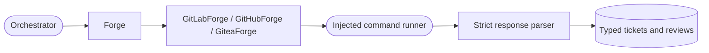

<!--
Copyright (c) 2026 DDP Engineering
This software is licensed under the PolyForm Noncommercial License 1.0.0.
Commercial use requires a separate commercial license.
See the LICENSE.txt file for full license details.
SPDX-License-Identifier: LicenseRef-PolyForm-Noncommercial-1.0.0
-->

# Forge adapters

## Routing

Use this page for forge ticket/comment/label/branch/review contracts. Start at `04_Software/adore/forge/base.py` and concrete adapters; verify through `04_Software/tests/test_forge.py`. Candidate approval and lifecycle belong to `orchestrator.md`.

`REQ-FUNC-93bd42af`: Review merge state authorizes shared conductor cleanup through host Git. GitLab carries a native delete-on-merge hint; GitHub/Gitea use conductor cleanup. Gitea's external `merged` field must be boolean when supplied, or raises `ForgeError`.

## Purpose and boundaries

Defines the forge-neutral data model and adapter boundary for GitHub (`gh`),
GitLab (`glab`), and Gitea (`tea`): tickets, comments, labels, branches, and
draft or ready MR/PRs.

## Public interface

The `Forge` interface normalizes ticket selection, open-ticket browsing
(`list_open(limit)`), claims, comments, labels,
branch state, push, and draft or ready MR/PR operations, plus repository label listing and
creation (`list_labels`, `create_label`) used by `adore/forge_labels.py` to create a project's
missing ADORE labels (`REQ-FUNC-a6884923`). Concrete GitHub, GitLab, and
Gitea adapters translate their CLIs through an injectable command runner and
return typed domain data, leaving orchestration policy above the boundary.

## Invariants

All CLI output, URLs, status lines, and JSON are parsed as untrusted input and
malformed responses raise `ForgeError`; well-formed CLI exits with malformed
output raise its subclass `ForgeResponseError`. Adapters expose no merge action and
cannot use a human comment without a valid ADORE marker as mutable state.

## Key behaviors

- `REQ-FUNC-f699f84a` - malformed forge response data fails closed.
- `REQ-FUNC-e7a89a6d` - publication creates draft or ready records according to the requested boolean and has no merge capability.

## Architecture

Draft state is a creation input; the adapters expose no merge operation.

## Files

- `04_Software/adore/forge/`
- `04_Software/tests/test_forge.py`
