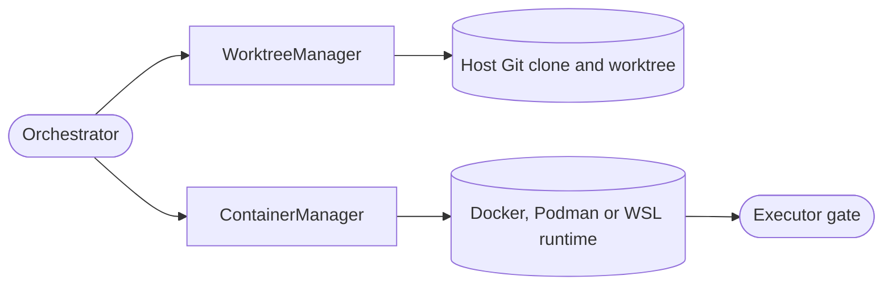

<!--
Copyright (c) 2026 DDP Engineering
This software is licensed under the PolyForm Noncommercial License 1.0.0.
Commercial use requires a separate commercial license.
See the LICENSE.txt file for full license details.
SPDX-License-Identifier: LicenseRef-PolyForm-Noncommercial-1.0.0
-->

# Isolation

## Routing

Use this page for Git worktrees, host-side checkpoint commits, container
provisioning, egress and cancellation. Start at
`04_Software/adore/isolation.py`; verify with
`04_Software/tests/test_isolation.py`. Run policy belongs to `orchestrator.md`.

`REQ-FUNC-93bd42af`: `remove_remote_branch` validates ref/target and exact published commit, deletes through host Git with an exact remote lease and verifies absence. Missing refs are idempotent success; malformed output, foreign commits and transport failures raise `IsolationError`.

## Purpose and boundaries

Creates one Git worktree and one executor container per run, mounts the
repository, worktree and bounded IO exchange plus explicit configured mounts,
and owns lifecycle cleanup.

## Public interface

`WorktreeManager` creates/removes ADORE-owned Git worktrees and
`ContainerManager` creates, executes in, stops, and removes the matching
container through a Docker, Podman, or WSL-wrapped runtime. Runtime commands
are injected for offline testing, and predictable branding names bind resources
to their run. `WorktreeManager` accepts the configured agent name/email for
host-side checkpoint commits, so a new clone needs no local Git identity.

## Invariants

- Supports Docker, rootless Podman, and WSL-wrapped runtimes.
- Manages optional open, none, or allowlist-proxy egress resources.
- Mounts the repository, worktree and bounded IO exchange. Explicit configured
  mounts may also provide executor credentials; forge credentials remain on
  the host.
- Every allowlist-proxy run has its own proxy and network name: a long name
  keeps its start and ends in a 10-hex SHA-256 digest of the executor name,
  within 63 characters for the proxy and 48 after the network prefix.
- Cleanup removes only listed per-run names derived from the target executors
  the orchestrator passes and keeps any name also derived from a retained one;
  it never deletes by prefix alone. It does not recognise the old cut proxy and
  network names of earlier ADORE builds; the operator removes those by hand
  (`01_Documentation/Recovery_And_Maintenance.md`).
- Git identity is applied only to ADORE checkpoint commits; it does not
  reconfigure the operator's clone.

## Key behaviors

- `REQ-REL-d8fd134e`: `resource_identity`/`image_identity` validate authoritative bounded runtime output, actual IDs/name/status and duplicate fields. ContainerBackend verifies owned identity before bound commands and lifecycle controls.

- `REQ-FUNC-fcb2448b` - isolated container/worktree provisioning and egress modes.
- `REQ-FUNC-42b1c98a` - idempotent, fail-closed Git worktree lifecycle.
- `REQ-FUNC-0ad8ba4f` - WSL runtime mount translation and command prefixing.
- `REQ-FUNC-f9946b6b` - an active executor gate can be interrupted for a
  worker-authorized cancellation.
- `REQ-REL-94e653aa` - guarded ticket-branch pushes verify exact remote
  identity and ancestry; worktree progress is measured between gates.

## Architecture

The worktree and container are per run; the conductor alone decides when to
provision, interrupt or release them.

## Files

- `04_Software/adore/isolation.py`
- `04_Software/tests/test_isolation.py`
- `04_Software/tests/test_checkpoint_handoff.py`
