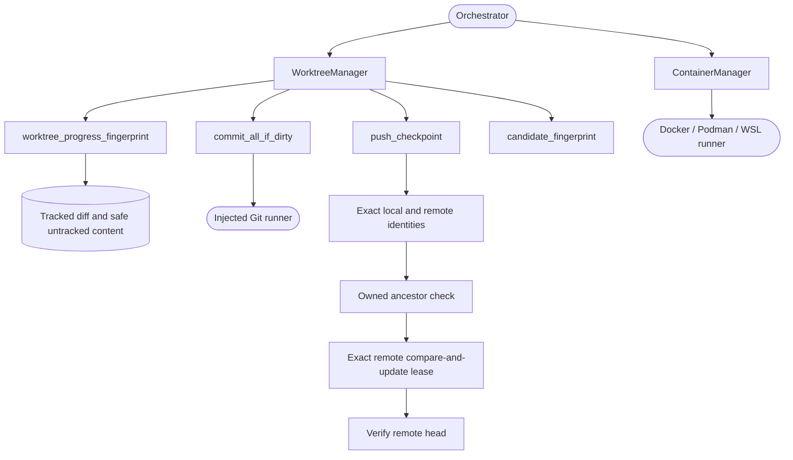

<!--
Copyright (c) 2026 DDP Engineering
This software is licensed under the PolyForm Noncommercial License 1.0.0.
Commercial use requires a separate commercial license.
See the LICENSE.txt file for full license details.
SPDX-License-Identifier: LicenseRef-PolyForm-Noncommercial-1.0.0
-->

# Isolation

## Purpose and boundaries

Creates one Git worktree and one executor container per run, mounts only the
worktree and bounded IO exchange, and owns lifecycle cleanup.

## Public interface

`WorktreeManager` creates/removes ADORE-owned Git worktrees and
`ContainerManager` creates, executes in, stops, and removes the matching
container through a Docker, Podman, or WSL-wrapped runtime. Runtime commands
are injected for offline testing, and predictable branding names bind resources
to their run.

## Key behaviors

- Supports Docker, rootless Podman, and WSL-wrapped runtimes.
- Manages optional open, none, or allowlist-proxy egress resources.
- Mounts only the worktree and bounded IO exchange; executor credentials and
  host state are outside its container contract.
- Cleanup preserves resources owned by active and failed runs and rejects
  uncertain ownership rather than broad deletion.

## Requirement coverage

- `REQ-FUNC-fcb2448b` - isolated container/worktree provisioning and egress modes.
- `REQ-FUNC-42b1c98a` - idempotent, fail-closed Git worktree lifecycle.
- `REQ-FUNC-0ad8ba4f` - WSL runtime mount translation and command prefixing.

## Files

- `04_Software/adore/isolation.py`
- `04_Software/tests/test_isolation.py`

## Routing

For Git worktree fingerprints, checkpoint operations, container mounts, egress
or cleanup, start at `WorktreeManager` / `ContainerManager` in
`04_Software/adore/isolation.py` and `04_Software/tests/test_isolation.py`.
Conduction decisions belong to Orchestrator; gate execution belongs to Executor.

## Invariants

Git/runtime failures raise `IsolationError`. Resource ownership is checked
before cleanup. Dirty progress observation excludes task journals and generated
caches; approval fingerprinting requires a clean candidate. Untracked progress
paths must be safe relative regular files or symlinks; symlinks contribute target
text without reading the target, and symlink directory parents are refused.

## Change map

| Request | Start with | Focused verification |
|---|---|---|
| Dirty progress observation | `worktree_progress_fingerprint` | `worktree_progress` |
| Approval and delivery integrity | `candidate_fingerprint`, `product_diff_fingerprint` | fingerprint cases |
| Container and mount lifecycle | `ContainerManager` | container, WSL and egress cases |

## Architecture

`REQ-FUNC-dff76be9` uses the dirty progress digest to observe candidate work
independently of the task Log. The conductor combines the two signals.

## Remote checkpoint and ownership contract

- `REQ-FUNC-dd307c58`: strict opt-in WIP checkpoint visibility, exact remote identity/ancestor/lease protection, bounded transport recovery and approval-bound delivery.
- `REQ-FUNC-c9d64cfe`: queued safe-boundary handoff; durable pending/handed-off state preserves resources and prevents automatic retry/reset.
- Focused verification: `04_Software/tests/test_checkpoint_handoff.py`.
