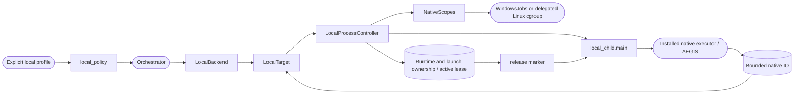

<!--
Copyright (c) 2026 DDP Engineering
This software is licensed under the PolyForm Noncommercial License 1.0.0.
Commercial use requires a separate commercial license.
See the LICENSE.txt file for full license details. SPDX-License-Identifier: LicenseRef-PolyForm-Noncommercial-1.0.0
-->

# Local execution

## Routing

Native backend/account/auth/Job/cgroup/run_files requests start at
`04_Software/adore/local_execution.py`, `local_process.py` and `local_child.py`.
Focused proof: `04_Software/tests/test_local_execution.py`. Core stages belong to
orchestrator.md, recipes to preparation.md and guarded GUI apply to web-interface.md.

## Purpose and boundaries

Implement shared native execution and verified process ownership. The conductor
owns ticket/worktree/stage/budget/approval/draft delivery; the operator owns project
tools and interactive account authentication.

## Public interface

LocalBackend provision/bind/resource_identity/verify_required_tools/stop/interrupt/remove;
LocalTarget run_files/call/read_output/redact/auth_available; local_policy,
local_environment, local_argv and local_probe. LocalProcessController launch/interrupt/
recover delegates to NativeScopes; child.main enforces scope membership and release.

## Invariants

Explicit selection and same actual account/environment for probes/gates; closed
pinned runtime/lease/scope, immutable ownership and PID birth before control.
Scope assignment and durable ownership precede project code. Confirm descendants
drained before release; corruption/control failure preserves evidence/worktrees.
No recovered PID-only kill, login, credential copies, forge env or tool installs.
Worktrees are not host sandboxes; container egress/recipes cannot be selected.

## Change map

| Request | Start | Focused proof |
| --- | --- | --- |
| Profile/auth/argv/policy | local_execution.py | local environment/drift/output selectors |
| Tree lifecycle/recovery | local_process.py | scope/process/Job/cgroup selectors |
| Launch ordering | local_child.py | child release/cancel selectors |
| Native conductor/GUI | orchestrator.py, web/app.py | retry/cleanup/readiness/settings selectors |

## Key behaviors

- REQ-FUNC-ffb9ed29: pinned local selection/resource and default container compatibility.
- REQ-REL-50474528: scoped lifecycle with immutable launch/PID-birth checks.
- REQ-FUNC-5e2fe079: same fresh gate/AEGIS file contract through native argv.
- REQ-SEC-f7b9111e: bounded strict/redacted evidence and auth reused in place.
- REQ-UX-b75e1df8: native probes and actual machine/account/tooling notice.

## Architecture

Ownership is persisted and scope established before release. Shared gates/probes
use the same bound target; the existing conductor remains the stage owner.

## Files

- `04_Software/adore/local_execution.py`: policy/account/auth/path and file transport.
- `04_Software/adore/local_process.py`: OS scopes/durable ownership and bounded control.
- `04_Software/adore/local_child.py`: trusted scope/release launcher.
- `04_Software/tests/test_local_execution.py`: offline positive/negative boundary proof.
- `05_SoftwareDocu/Component_Local_Execution.md`: component contract.
- `01_Documentation/Local_Execution.md`: operator setup/security/recovery.
