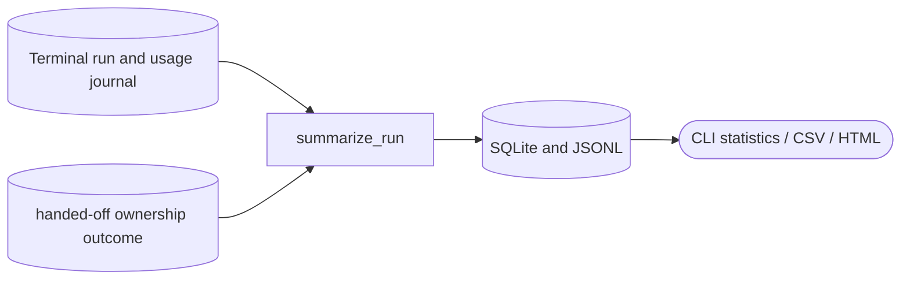

<!--
Copyright (c) 2026 DDP Engineering
This software is licensed under the PolyForm Noncommercial License 1.0.0.
Commercial use requires a separate commercial license.
See the LICENSE.txt file for full license details.
SPDX-License-Identifier: LicenseRef-PolyForm-Noncommercial-1.0.0
-->

# Metrics

## Purpose and boundaries

`04_Software/adore/metrics.py` turns durable terminal-run state and journals
into honest operator statistics. It remains local and standard-library based:
SQLite, JSONL mirror, CSV, and an optional static HTML dashboard—no metrics
service is required.

## Public interface

`summarize_run()` builds one `RunSummary`; `record_summary()` upserts it by
run id and refreshes the JSONL mirror. `load_summaries`, `aggregate`,
`export_csv`, `render_html`, and `profile_stats` supply the CLI report, export,
dashboard, and profile figures. `done`, `failed`, `cancelled`, and `handed-off` are
recordable terminal lifecycles.

## Invariants

Usage comes from append-only journal `usage` events, not transient executor IO
files. One SQLite row per run and the mirror must agree. Governance outcome is
derived only from strict-verification journal data. A metrics write failure is
visible but must never overwrite the governed run result; missing historical
data is reported as zero, not invented.

## Requirement coverage

- `REQ-FUNC-f5aaaa62` - one truthful terminal summary per run.
- `REQ-FUNC-ef74f46e` - filtered aggregates, CSV, and escaped static HTML.

## Dependencies and verification

It depends on state/journal access and standard-library `sqlite3`, `csv`,
`json`, and `html`. `04_Software/tests/test_metrics.py` covers summary
calculation, strict outcomes, idempotent persistence, migrations, filters,
aggregates, escaping, and human-merge statistics; executor and orchestrator
tests cover usage and terminal recording integration.

## Routing

For metrics interfaces, start at `04_Software/adore/metrics.py` and its matching existing component tests. Checkpoint/handoff contracts are covered in `04_Software/tests/test_checkpoint_handoff.py`; conduction belongs to Orchestrator.

## Key behaviors

- `REQ-FUNC-c9d64cfe`: explicit safe human ownership with durable recovery evidence and protected run state.

## Architecture

## Files

- `04_Software/adore/metrics.py`.
- `04_Software/tests/test_checkpoint_handoff.py`: ownership contract boundaries.
