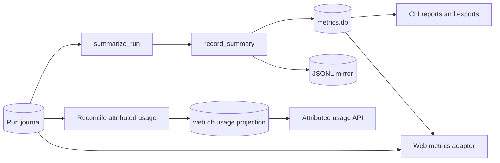

<!--
Copyright (c) 2026 DDP Engineering
This software is licensed under the PolyForm Noncommercial License 1.0.0.
Commercial use requires a separate commercial license.
See the LICENSE.txt file for full license details.
SPDX-License-Identifier: LicenseRef-PolyForm-Noncommercial-1.0.0
-->

# Metrics

## Routing

Use this page for `summarize_run`, `record_summary`, CLI `stats/report/export`,
terminal run metrics and static reports. Start at `04_Software/adore/metrics.py`;
verify with `04_Software/tests/test_metrics.py`. The role-filtered web projection
is in `web-interface.md` and `adore/web/app.py`.

## Purpose and boundaries

`metrics.py` turns durable terminal-run state and journals into local operator
statistics using SQLite, a JSONL mirror, CSV, and static HTML. It owns terminal
summary persistence. The web adapter reads summaries and source journals for
daily reporting; it does not replace them.

## Public interface

`summarize_run()` builds a `RunSummary`; `record_summary()` upserts by run ID and
refreshes the mirror. `load_summaries`, `aggregate`, `export_csv`, `render_html`
and `profile_stats` supply CLI reporting and exports. Only terminal lifecycles
are recordable.

## Invariants

Usage comes from append-only journal events. One SQLite row per run and the
mirror must agree. Strict-verification data determines governance outcome. A
metrics write failure is visible without overwriting the governed run result.
The legacy CLI summary reports missing historical usage as zero; the web adapter
distinguishes missing cost coverage from a reported zero and does not add
summaries and journal events as separate runs.
The conductor writes one schema-1 `usage-observation` per executor launch,
identifying reported, unavailable or disabled token/cost telemetry. The web
adapter deduplicates identical run/attempt observations, rejects conflicts,
and keeps numeric `usage` events as the only source of totals. Older launches
without an observation stay unclassified.
New numeric `usage` events share the run/attempt ID. `metrics.unique_usage_events`
deduplicates identical replay for terminal summaries and web daily/attributed
views, and raises `MetricsError` on malformed or conflicting versioned input.

## Key behaviors

- `REQ-FUNC-f5aaaa62` - one truthful terminal summary per run.
- `REQ-FUNC-ef74f46e` - filtered aggregates, CSV and escaped static HTML.
- `REQ-FUNC-448cbde7` - web daily trends and explicit cost coverage.
- Administrator web estimates use immutable project/executor/model rates from
  `WebStore`; reported and estimated money never sum the same event twice.
- Web revision counts distinguish human-requested MR/PR changes (`revise-label`)
  from automatic pipeline repairs (`pipeline-failed`); unknown triggers stay
  unclassified in coverage.

## Architecture

The web adapter uses journal timestamps for daily and headline usage, including
active runs. Terminal summaries supply lifecycle/review fields and token totals
for legacy runs without usable journal usage. Administrator global daily CSV
rows preserve project/repository identity and separate reported/estimated money.
Attributed usage reads reconcile journal evidence into the local web SQLite
projection before returning rows; replay uses immutable project and source IDs
and rejects changed or vanished events. Schema 11 also projects launch coverage
and tracks each run's journal length and digest as an ingestion cursor;
non-append edits fail closed. The administrator rebuild action also
includes archived profiles without changing execution state.

## Files

- `04_Software/adore/metrics.py` - terminal summaries, storage and exports.
- `04_Software/adore/web/app.py` - role-filtered web projection.
- `04_Software/tests/test_metrics.py` - summary and persistence contracts.
- `04_Software/tests/test_web_metrics.py` - daily and coverage contracts.
- `04_Software/tests/test_web_pricing.py` - dated estimate and role boundaries.
