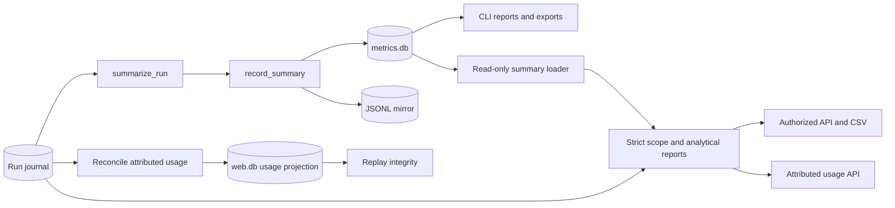

<!--
Copyright (c) 2026 DDP Engineering
This software is licensed under the PolyForm Noncommercial License 1.0.0.
Commercial use requires a separate commercial license.
See the LICENSE.txt file for full license details.
SPDX-License-Identifier: LicenseRef-PolyForm-Noncommercial-1.0.0
-->

# Metrics

## Routing

Use this page for `summarize_run`, `record_summary`, CLI `stats/report/export`,
terminal run metrics and static reports. Start at `04_Software/adore/metrics.py`;
verify with `04_Software/tests/test_metrics.py`. The role-filtered web projection
is in `web-interface.md`, `adore/web/analytics.py` and `adore/web/app.py`.

## Purpose and boundaries

`metrics.py` turns durable terminal-run state and journals into local operator
statistics using SQLite, a JSONL mirror, CSV, and static HTML. It owns terminal
summary persistence. The web adapter reads summaries and source journals for
daily reporting; it does not replace them.

## Public interface

`summarize_run()` builds a `RunSummary`; `record_summary()` upserts by run ID and
refreshes the mirror. `load_summaries`, `aggregate`, `export_csv`, `render_html`
and `profile_stats` supply CLI reporting and exports. Only terminal lifecycles
are recordable.
The terminal set includes `handed-off`, which records human-owned work as a
distinct outcome without marking it merged or approved.

## Invariants

Usage comes from append-only journal events. One SQLite row per run and the
mirror must agree. Strict-verification data determines governance outcome. A
metrics write failure is visible without overwriting the governed run result.
The CLI summary reports missing usage as zero; the web adapter
distinguishes missing cost coverage from a reported zero and does not add
summaries and journal events as separate runs.
The conductor writes one schema-1 `usage-observation` per executor launch,
identifying reported, unavailable or disabled token/cost telemetry. The web
adapter deduplicates identical run/attempt observations, rejects conflicts,
and keeps numeric `usage` events as the only source of totals. A launch
without an observation stays unclassified. Only `stage-launch` counts as a
launch; the retired `delivery-fix` and `revise-start` events do not.
Every numeric `usage` event carries the versioned identity
`event_id = "<run_id>:<attempt>"` and the full current fields; one without an
event ID is refused. `metrics.unique_usage_events` deduplicates identical replay
for terminal summaries and web daily/attributed views, and raises `MetricsError`
on malformed or conflicting input.
`metrics.db` has one current `run_summaries` shape: a table whose columns differ
is refused with "metrics database <path> was written by another ADORE build;
delete it to start fresh", never altered in place.

## Key behaviors

- `REQ-FUNC-f5aaaa62` - one truthful terminal summary per run.
- `REQ-FUNC-ef74f46e` - filtered aggregates, CSV and escaped static HTML.
- `REQ-FUNC-448cbde7` - shared scoped web aggregates and exports.
- `REQ-DATA-5a620f4e` - composite job lifetime/period/unallocated consumption.
- `REQ-REL-6564a3b2` - strict analytical sources and filters.
- `REQ-FUNC-83da8d95` - server-selected cohorts and duration samples.
- `REQ-REL-94e653aa` - human handoff is a terminal, preserved outcome.
- Administrator web estimates use immutable project/executor/model rates from
  `WebStore`; reported and estimated money never sum the same event twice.
- Web revision counts distinguish human-requested MR/PR changes (`revise-label`)
  from automatic pipeline repairs (`pipeline-failed`); unknown triggers stay
  unclassified in coverage.

## Architecture

Reporting scope is the authorized immutable project set, a half-open UTC
instant interval `[from,to)`, the selected IANA timezone and day/week/month
granularity. Inclusive date controls resolve each local midnight independently;
the upper bound is midnight after `day_to`, including 23/25-hour DST days.
Omitted bounds are unbounded; both omitted explicitly select `all_time`.
All scoped totals, cards, tables, daily rows, cohorts and exports use this scope.

Started uses the first `picked` event; completed/failed uses the latest event
matching the final lifecycle. Checkpoints and state update times do not supply
these dates. Recorded summary start/end is fallback only without lifecycle
journal evidence. `current_stock` separately names jobs/active/waiting/review/
terminal now, including only actual retained runtime state.

Unique usage is attributed at its own consumption instant. `jobs` uses
`(project_id,run_id)` with separate `lifetime`, `in_period`, `unallocated`,
source and coverage. Summaries survive runtime-state removal; positive
summary-only measurements (a run known only from metrics.db, for example a
deleted one) belong to lifetime/unallocated, never a fabricated period.
Missing individual token fields stay null; explicit measured zero stays zero.
A naive, date-only or unparseable usage timestamp is `metrics_corrupt`, and a
summary table with missing or extra columns fails closed (503). Financial fields and financial coverage are Admin-only in every nested
projection and export. Reported and estimated costs remain separate; matching
immutable prices use the consumption UTC day, and never price reported money
again. Coverage identifies partial evidence rather than asserting a full bill.

Review cohorts use first MR opening/adoption in scope; validation cohorts use
first strict verdict in scope. Human merge uses reviewed jobs with actual done
in scope and `merged by human`. Rework requires reviewer-requested revision;
pipeline repair is separate. Each rate exposes numerator/denominator; empty is
null. Open reviews are labeled current state. Monetary efficiency uses only
period consumption for the completed/human-merged cohort and separate known
reported/estimated samples.

Duration is terminal-summary elapsed wall time including waits, selected by
recorded end instant in scope. Count, sum and sorted exact `samples_seconds`
support pooled mean/median without browser date approximation. Recorded zero
is valid; absent pairs are excluded and inconsistent pairs fail.

Raw state/JSONL and read-only summary rows are validated before filters.
Malformed JSON, duplicate keys, unsupported schema, invalid fields, conflicting
versioned identity/timestamp, numeric overflow and invalid versioned timestamps
fail typed 503 without source rewriting. Invalid scope/identity filters return
422. Analytical summary reads neither initialize nor migrate runtime data.
CSV includes scope/project provenance, empty unavailable cells and spreadsheet
escaping; `X-ADORE-Scope`/`X-ADORE-Coverage` describe empty exports too.
Project `/api/v1/projects/{name}/jobs-usage.csv` and Admin global
`/api/v1/jobs-usage.csv` share usage date/timezone/group/executor/model filters.

Offline proof: `test_web_scoped_metrics.py`, `test_web_metrics.py`,
`test_web_pricing.py`, and `web/tests/metrics.test.mjs`, followed by native
Python/Ruff and frontend validation. CLI summary/export semantics are preserved.

## Files

- `04_Software/adore/metrics.py` - terminal summaries, storage and exports.
- `04_Software/adore/web/app.py` - role-filtered web projection.
- `04_Software/tests/test_metrics.py` - summary and persistence contracts.
- `04_Software/tests/test_web_metrics.py` - daily and coverage contracts.
- `04_Software/tests/test_web_pricing.py` - dated estimate and role boundaries.

- `04_Software/adore/web/analytics.py` - strict scope and analytical reports.
- `04_Software/tests/test_web_scoped_metrics.py` - DST, allocation, CSV, corrupt sources.
