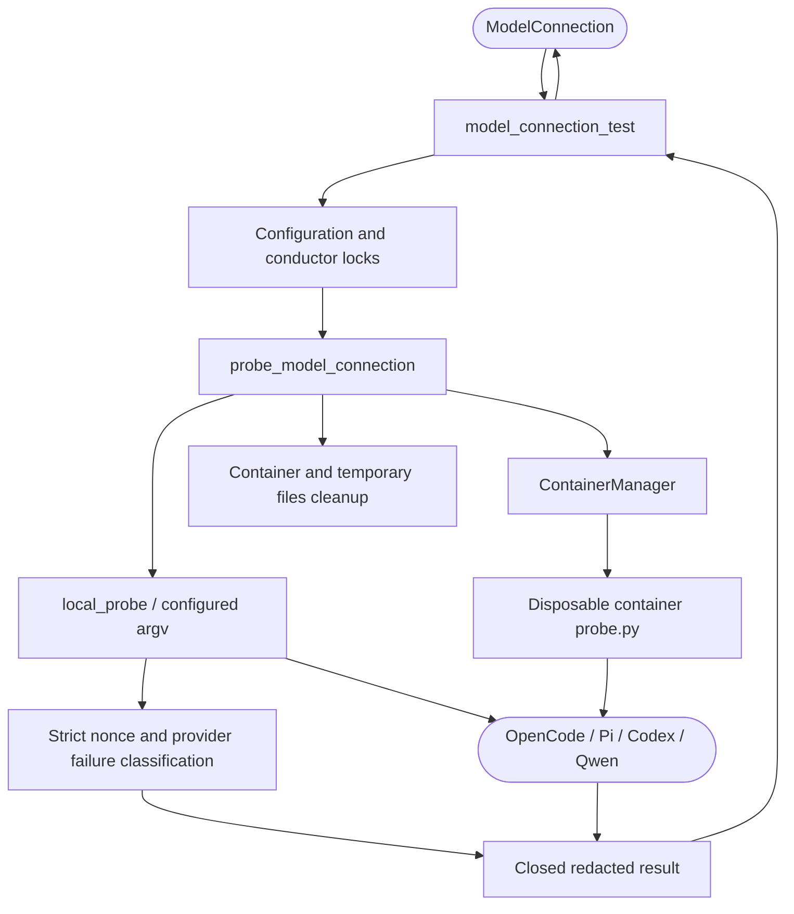

<!--
Copyright (c) 2026 DDP Engineering
This software is licensed under the PolyForm Noncommercial License 1.0.0.
Commercial use requires a separate commercial license.
See the LICENSE.txt file for full license details. SPDX-License-Identifier: LicenseRef-PolyForm-Noncommercial-1.0.0
-->

# Model connection

## Routing

Test AI connection and executor model diagnostic start at `04_Software/adore/web/model_connection.py`; focused proof: `04_Software/tests/test_model_connection.py`. Host prerequisites belong to web-interface.md/endpoint_probe.py.

## Purpose and boundaries

Explicit model access testing for all four executor CLIs. ContainerManager owns isolation; executor-configuration.md owns private credential/evidence persistence; host readiness owns prerequisite and OpenCode tool-stream evidence.

## Public interface

`probe_model_connection(config, runner, env_file)` and POST `/api/v1/projects/{identity}/model-connection-test`; closed executor/model/ready/reason evidence plus project/revision/time.

## Invariants

Admin/CSRF and idle configuration/conductor locks precede execution. Saved model, allowlisted secrets and egress are reused; core repo/work mounts are empty. Container probes use fixed shell-free commands; native probes reuse saved argv.
Both require completed nonce responses; malformed data/tool invocation fails closed. Raw output is redacted and cleanup is bounded.

## Key behaviors

- REQ-FUNC-ffb9ed29 / REQ-UX-b75e1df8: Native nonce challenges use local_probe and the same configured argv/account/environment as gates, with 45-second inference and verified scope cleanup. Incomplete/malformed/wrong-nonce/tool-bearing events fail closed. No login or complete-job/tool-acceptance claim; container diagnostics keep fixed commands.

Native ownership/auth route to `local-execution.md`; focused proof is
`04_Software/tests/test_local_execution.py`.

- `REQ-UX-94a97e70`: Explicit disposable model checks resolve the same effective preparation image through bounded Git reads, refuse stale source and never execute recipe commands.

- REQ-FUNC-de028c15: OpenCode/Pi/Codex/Qwen explicit connectivity; 45-second inference/90-second setup deadline, 1 MiB capture, 8-second cleanup commands.
- Settings → Agent and model heading action, integrated credential/settings panel, cost notice, duplicate suppression and exact project/configuration binding; executor_settings.py durably saves and validates credential-bound evidence used in Summary/host access.

## Architecture

Only model connectivity is tested; full job/tool acceptance remains separate.

## Files

- `04_Software/tests/test_local_execution.py`: native integration/negative proof.

- `04_Software/adore/web/model_connection.py`, `web/app.py`: probe/API.
- `04_Software/web/src/ModelConnection.tsx`, `App.tsx`, `styles.css`: GUI.
- `04_Software/tests/test_model_connection.py`, `web/e2e/model-connection.spec.ts`: offline proof.
- `05_SoftwareDocu/Component_Model_Connection.md`: detailed contract.

## Native OpenCode completion

REQ-FUNC-a8865e64: exact nonce text with finite positive time.end and optional
finite nonnegative time.start <= end plus clean exit can prove this short model
challenge when step_finish is omitted. Missing completion/wrong text, malformed
or duplicate JSON, invalid parts, error events and tool events/tool-calls finishes
fail closed. Typed model/authentication failures are classified even with exit
zero; recognizable stderr failures on nonzero exit retain their closed cause.
No raw provider output is persisted and no extra model request is sent.
