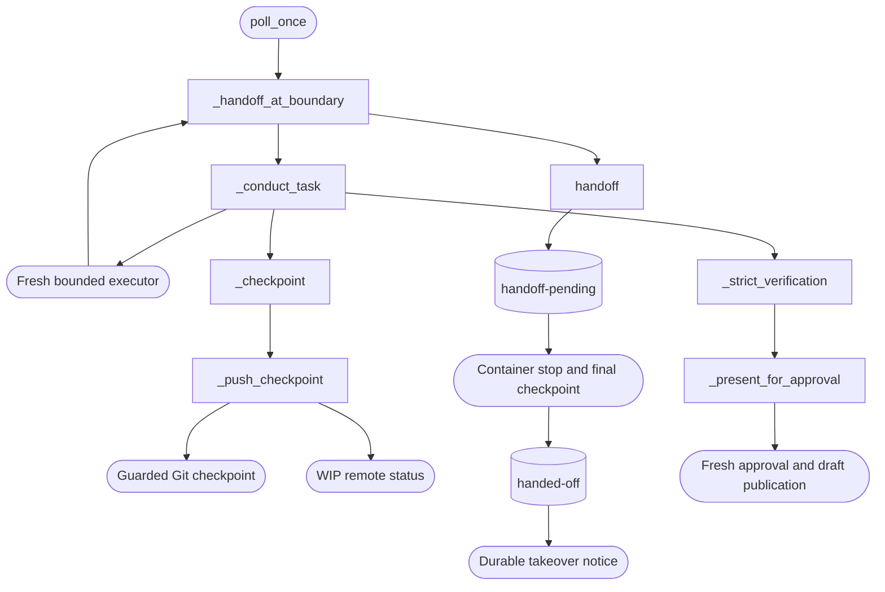

<!--
Copyright (c) 2026 DDP Engineering
This software is licensed under the PolyForm Noncommercial License 1.0.0.
Commercial use requires a separate commercial license.
See the LICENSE.txt file for full license details.
SPDX-License-Identifier: LicenseRef-PolyForm-Noncommercial-1.0.0
-->

# Orchestrator

## Purpose and boundaries

`04_Software/adore/orchestrator.py` is the deterministic conductor around an
agent-operated AEGIS task. It selects eligible tickets, provisions isolation,
runs one fresh executor session per stage attempt, and persists enough state to
recover visibly after interruption.

## Public interface

The conductor owns ticket claiming, worktrees/containers, AEGIS task binding,
budgets, retries, clarification parking, notifications/outbox replay,
validation, candidate fingerprinting, and draft-only MR/PR publication. AEGIS
owns journal content and governance checks; the executor performs bounded code
work; forge adapters perform remote operations. ADORE never merges and never
hands forge credentials to an executor. Each stage prompt declares the task
autopilot-to-deliver by explicit conductor instruction and has the executor
record `interaction: autopilot` in the journal header, so the AEGIS checkpoint
default never stops an executor before the transition ADORE waits to observe.
Each stage prompt also forbids AEGIS child task journals (`task --parent`): the
conductor pins exactly one task per run and reads only that journal, so work in
a child would be invisible to stage supervision.

## Invariants

Lifecycle state (`working`, parked, approval, publishing, review, terminal)
is separate from the AEGIS stage. Stage failures, transient infrastructure
retries, questions, typed AEGIS timeouts, and typed executor timeouts are
classified independently and journaled. Failed resources are preserved for
operator recovery. Strict verification and a fresh approval must match the
exact candidate fingerprint before delivery publication or a draft MR/PR; any drift forces
re-conduction. The approval presentation leads with the deviations the
journal recorded; they inform the approver and never block.

## Requirement coverage

- `REQ-FUNC-ff7dad34` - candidate-bound approval and draft-only publication.
- `REQ-FUNC-83133b5e` - deterministic stage failure and timeout recovery.
- `REQ-FUNC-1ec4a21d` - durable, idempotent notification outbox replay.

## Dependencies and verification

The `Orchestrator` composes config, state store, AEGIS client, executor,
isolation, forge adapters, identity, metrics, and utilities through injectable
seams. `04_Software/tests/test_orchestrator.py` covers full/quick paths,
recovery limits, clarification, outbox replay, ticket/MR reconciliation,
approval freshness, timeout classification, cleanup protections, and the
absence of merge behavior.

## Routing

For stage conduction, partial continuations, retry limits, approval or ticket
reconciliation, start at `Orchestrator` in `04_Software/adore/orchestrator.py`
and `04_Software/tests/test_orchestrator.py`. Worktree observation belongs to
Isolation; model stream accounting belongs to Executor Launcher.

## Change map

| Request | Start with | Focused verification |
|---|---|---|
| Stage completion or continuation | `_conduct_task`, `_stage_prompt` | `partial_stage`, full/quick path cases |
| Recovery and questions | `_stage_failure`, `_park` | failure, timeout, clarification cases |
| Publication and approval | `_strict_verification`, `_present_for_approval` | approval and review cases |

## Key behaviors

- `REQ-FUNC-b0811cbe`: monetary enforcement runs only for positive reported-cost
  caps; explicit zero preserves telemetry and all remaining run limits.

- `REQ-FUNC-dff76be9`: a zero-exit same-stage gate continues only with changed
  candidate content and a strict nonempty append to the work Log. The conductor
  checkpoints, records `stage-continuation` and supplies recent work plus Handoff
  instructions to a fresh session. Continuation preserves stage failure counts;
  every session consumes existing iteration/time/cost/file budgets.
- `REQ-FUNC-83133b5e`: failed gates or missing progress use bounded recovery;
  only a legal stage transition resets the current failure count.
- `REQ-FUNC-ff7dad34`: independent validation and fresh candidate-bound approval
  precede draft publication.

## Architecture

## Files

- `04_Software/adore/orchestrator.py`: conductor, lifecycle and approval policy.
- `04_Software/tests/test_orchestrator.py`: offline behavior and trust boundaries.
- `05_SoftwareDocu/Component_Orchestrator.md`: operator/component contract.

## Remote checkpoint and ownership contract

- `REQ-FUNC-dd307c58`: strict opt-in WIP checkpoint visibility, exact remote identity/ancestor/lease protection, bounded transport recovery and approval-bound delivery.
- `REQ-FUNC-c9d64cfe`: queued safe-boundary handoff; durable pending/handed-off state preserves resources and prevents automatic retry/reset.
- Focused verification: `04_Software/tests/test_checkpoint_handoff.py`.
