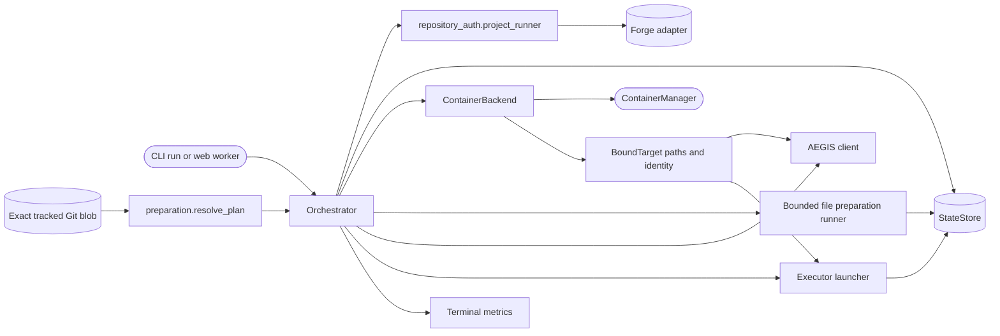

<!--
Copyright (c) 2026 DDP Engineering
This software is licensed under the PolyForm Noncommercial License 1.0.0.
Commercial use requires a separate commercial license.
See the LICENSE.txt file for full license details.
SPDX-License-Identifier: LicenseRef-PolyForm-Noncommercial-1.0.0
-->

# Orchestrator

## Routing

Use this page for ticket selection, run lifecycle, stage gates, approval,
publication and recovery. Start at `04_Software/adore/orchestrator.py` and
verify with `04_Software/tests/test_orchestrator.py`. Web queueing belongs to
`web-interface.md`; CLI argument parsing belongs to `cli.md`.

## Purpose and boundaries

The orchestrator conducts one agent-operated AEGIS task through isolation,
bounded stage execution, validation and draft publication. AEGIS owns its task
journal, the executor performs code work, and forge adapters perform remote
operations. ADORE never merges or gives forge credentials to an executor.

## Public interface

`poll_once(ticket_iid=None)` selects an eligible ticket and conducts its run;
`run_loop()`, `retry(run_id)`, `cancel(run_id)` and `handoff(run_id)` expose
bounded operations.
`Orchestrator.from_config()` constructs the conductor from validated settings
and binds project-scoped forge credentials through repository-auth.md using
the env-file directory. Worktree/container/executor credentials stay separate.

## Invariants

The conductor owns ticket claiming, worktrees/containers, budgets, retries,
clarification parking, outbox replay, candidate fingerprinting and draft-only
MR/PR publication. One AEGIS task is pinned to each run. Strict verification
and fresh candidate-bound approval precede delivery push or draft creation;
optional guarded progress checkpoints stay on the owned ticket branch and do
not open an MR/PR. Drift forces re-conduction. Failed and handed-off resources
remain available for recovery. Cleanup works only on this project's run IDs and
keeps active, failed, human-owned and corrupt runs' resources. Selected-ticket
requests retain readiness, hold and exclude checks.
Worker-authorized cancellation markers interrupt a working executor gate;
the conductor alone finalizes cancellation and clears the marker.
At a safe boundary, a requested handoff stops autonomous work, preserves the
worktree and wins over a concurrent cancellation request. A foreign remote
checkpoint commit stops execution instead of replacing human work.
An idle poll republishes failed-run recovery commits only when the local branch
has advanced or a recorded transport error remains; a verified checkpoint
does not refresh historical run timestamps.

## Key behaviors

Profiles without recipes retain the existing recovery/profile-update contract and empty execution record; immutable preparation policy applies to recipe runs.

- `REQ-FUNC-e5419c07`: Resolve/persist plan, pin base commit, bind identity, provision/check/stage auth, then execute bounded preparation before AEGIS/AI. Immutable receipts and policy/resource IDs guard resume; explicit replay recreates the owned container and retains worktree/history.

- `REQ-FUNC-ff7dad34` - candidate-bound approval and draft-only publication.
- `REQ-FUNC-83133b5e` - deterministic stage failure and timeout recovery.
- `REQ-FUNC-1ec4a21d` - durable notification outbox replay.
- `REQ-FUNC-f9946b6b` - selected-ticket web start uses the normal conductor.
- `REQ-FUNC-448cbde7` - usage events carry executor/model/review-round context
  and explicit token/cost coverage for web analytics. Complete zero-token
  reports remain known zero; partial records do not create numeric usage.
- `REQ-REL-94e653aa` - opt-in remote checkpoints and durable human handoff
  preserve DCP recovery evidence and the fresh approval boundary.

## Architecture

The conductor is the only stage owner; API requests do not conduct in the HTTP
process.

## Files

- `04_Software/adore/orchestrator.py` - lifecycle and gate logic.
- `04_Software/tests/test_orchestrator.py` - selection, recovery and delivery.
- `04_Software/tests/test_checkpoint_handoff.py` - checkpoint and handoff edges.
