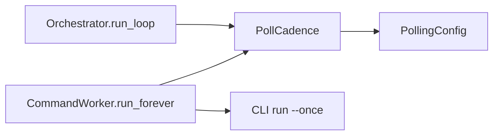

<!--
Copyright (c) 2026 DDP Engineering
This software is licensed under the PolyForm Noncommercial License 1.0.0.
Commercial use requires a separate commercial license.
See the LICENSE.txt file for full license details. SPDX-License-Identifier: LicenseRef-PolyForm-Noncommercial-1.0.0
-->

# Polling cadence

## Routing

Use `04_Software/adore/polling.py` for automatic scheduling calculations.
Worker scheduling is web-interface.md; CLI conduction is orchestrator.md.

## Purpose and boundaries

Shared in-memory cadence, without execution, persistence, queue authority or sleeps.

## Public interface

`PollCadence.validate(PollingConfig)` validates types/bounds; `next_delay(config,
failed=True|False|None)` returns post-round wait seconds and retains multiplier.

## Invariants

Positive integer base; nonnegative integer jitter; boolean backoff; ValueError
on invalid policy/outcome. Errors double up to 8x; success/disabled reset 1;
quiet None retains multiplier. Uniform 0..jitter added after multiplication.

## Key behaviors

REQ-FUNC-d62f500f schedules CLI/web equally; REQ-REL-5f261755 retains quiet cadence;
REQ-DATA-cb4ed315 rejects invalid cadence before external automatic invocation.

## Architecture

## Files

- 04_Software/adore/polling.py
- 04_Software/tests/test_web_commands.py
- 04_Software/tests/test_orchestrator.py
- 05_SoftwareDocu/Component_Polling.md
