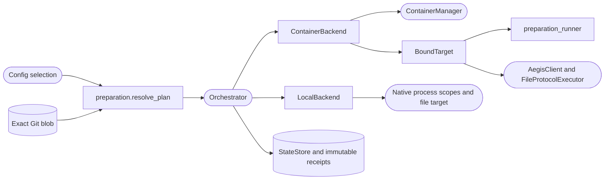

<!--
Copyright (c) 2026 DDP Engineering
This software is licensed under the PolyForm Noncommercial License 1.0.0.
Commercial use requires a separate commercial license.
See the LICENSE.txt file for full license details. SPDX-License-Identifier: LicenseRef-PolyForm-Noncommercial-1.0.0
-->

# Preparation

## Routing

Start at `04_Software/adore/preparation.py` for preparation contracts.
Focused verification: `04_Software/tests/test_preparation.py`. Conductor ordering/recovery belongs
to `orchestrator.md`; external CLI selection belongs to `cli.md`/`web-interface.md`.

## Purpose and boundaries

Resolve closed reviewed preparation plans before executable project effects. `parse_selection`, `parse_recipe`, `resolve_plan`, `validate_plan`, `preview_plan`, `public_plan` and `effective_probe_config` validate exact Git source, image precedence, fixed-depth grammar, closed persisted policy and non-secret SHA-256 identity. Every job is validated; unsupported syntax raises `PreparationError`. Configuration apply and the conductor share this authority.

## Public interface

`parse_selection`, `parse_recipe`, `resolve_plan`, `validate_plan`, `preview_plan`, `public_plan` and `effective_probe_config` validate exact Git source, image precedence, fixed-depth grammar, closed persisted policy and non-secret SHA-256 identity. Every job is validated; unsupported syntax raises `PreparationError`. Configuration apply and the conductor share this authority.

## Invariants

Exact source/configuration authority; closed input grammar and recovery records;
bounded scripts/time/output/replay; unchanged egress/credential scope; immutable
source/image/resource evidence; setup finishes before AI. Explicit replay retains
worktree effects and prior attempt receipts. No publication or merging authority.

## Key behaviors

- REQ-FUNC-ffb9ed29 / REQ-UX-b75e1df8: Local plans use backend=local, empty image/selection/steps and image_source=local. Closed local policy fingerprints machine/account/environment/executable without commands. Container policy keys and fingerprints retain their established shape.

Native ownership/auth route to `local-execution.md`; focused proof is
`04_Software/tests/test_local_execution.py`.

- `REQ-FUNC-e2b539d4`: immutable exact-source reviewed image/command plan.
- `REQ-FUNC-e5419c07`: bounded same-container setup before AEGIS/AI.
- `REQ-REL-d8fd134e`: fail-closed pinned recovery and explicit capped replay.
- `REQ-FUNC-e397f7f6`: shared backend lifecycle/transport contract.

## Architecture

Typed selection → exact regular Git blob → complete grammar validation → normalized fingerprinted plan. No install, fetch, model call or image pull occurs in preview.

## Files

- `04_Software/tests/test_local_execution.py`: native integration/negative proof.

- `04_Software/adore/preparation.py`: public component and contracts.
- `04_Software/adore/preparation_runner.py`: standalone bounded step runner.
- `04_Software/tests/test_preparation.py`: injected contract proof.
- `05_SoftwareDocu/Component_Preparation.md`: detailed component documentation.
- `01_Documentation/Container_Preparation.md`: operator contract.
