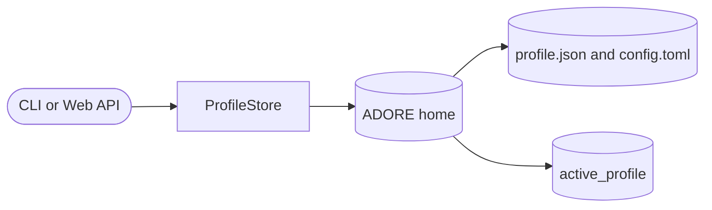

<!--
Copyright (c) 2026 DDP Engineering
This software is licensed under the PolyForm Noncommercial License 1.0.0.
Commercial use requires a separate commercial license.
See the LICENSE.txt file for full license details.
SPDX-License-Identifier: LicenseRef-PolyForm-Noncommercial-1.0.0
-->

# Runtime-project profiles

## Routing

Use this page for ADORE home, named project profiles, active-profile
resolution and profile metadata. Start at `04_Software/adore/profiles.py`;
verify with `04_Software/tests/test_profiles.py`. Web grants and archived
project state belong to `web-interface.md`.

## Purpose and boundaries

`04_Software/adore/profiles.py` lets a single ADORE installation serve several
projects without mixing their configuration, active pointer, run state, or
metrics.

## Public interface

`adore_home()` resolves the cross-platform home. `ProfileStore` owns profile
creation, load/save/list, touch, rename/delete, and active-profile operations.
`resolve_config_path()` has one stable precedence: explicit `-c` path, named
profile, active profile, then `./config.toml`. `ProfileError` distinguishes a
missing/corrupt profile from a usable empty store.

## Invariants

Each profile is `<home>/profiles/<name>/` with `config.toml` and a
non-secret `profile.json`; `active_profile` is a one-line pointer. Profile
state defaults beneath that profile so run data and statistics stay isolated.
Writes are atomic, corrupt metadata fails closed and is reported, and deletion
clears a matching active pointer. The store deliberately persists metadata
only, never credentials or `.env` values.
Each profile has an immutable 32-hex `project_id` distinct from its directory
label. Legacy sidecars derive a stable ID from their stored name and creation
timestamp; a rename persists that ID, while a malformed ID fails closed.

## Key behaviors

- `REQ-FUNC-db248962` - deterministic config-path precedence and corrupt-profile rejection.
- `REQ-FUNC-41265a32` - atomic profile metadata and active-pointer consistency.

## Architecture

Profile metadata identifies a project; the run state remains in its configured
state root and web grants remain in the separate identity store.

## Files

This standard-library component uses `adore.util` and the package version.
`04_Software/tests/test_profiles.py` covers home resolution, CRUD, active
pointer consistency, resolution precedence, corrupt metadata, and unknown-key
tolerance offline.
