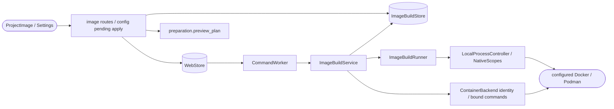

<!--
Copyright (c) 2026 DDP Engineering
This software is licensed under the PolyForm Noncommercial License 1.0.0.
Commercial use requires a separate commercial license.
See the LICENSE.txt file for full license details. SPDX-License-Identifier: LicenseRef-PolyForm-Noncommercial-1.0.0
-->

# Project executor images

## Routing

Use for Define image / Build and verify / Use image, image-build profile artifacts,
bounded runtime clients and image_build pending bindings. Start at
adore/web/image_build.py and image_build_runner.py; focused proof is
tests/test_image_build.py and test_web_image_build.py. Native run execution
belongs to local-execution.md; per-worktree library setup to preparation.md.

## Purpose and boundaries

ImageBuildStore owns explicit bounded administrator source/check/policy and
durable evidence. ImageBuildService builds/verifies an installed-base extension;
the native runner controls only its runtime-client scope. Existing queue/worker
and configuration application retain authorization/serialization/approval;
ContainerBackend owns bound image/container identity and preparation owns recipe
authority. The conductor owns full runs and model access has its own probe.

## Public interface

Store read/save/export/operation/operations/cancel/log/live_log;
service prepare/run/recover/review; typed ImageBuildError. Scoped project
image-build HTTP read/write/export/operations/status/cancel and optional
ConfigEdit.image_build_id through existing pending/apply. ProjectImage is a
Settings isolation slot; imageBuild.ts validates closed source/evidence/bindings.
The slot receives the existing SettingsList image-edit callback and inline editor;
ProjectImage also receives the active image value. Existing-image selection
delegates to the current reviewed editor, which owns focus and preserves a draft.

## Invariants

- Source/config/project/runtime/account/base/result/context/checks bind selection.
- Dockerfile-only context, installed pinned base, unique labeled managed tags,
  non-root adore verification, no host mounts/credentials/provider calls.
- Explicit none/default network and finite time/CPU/memory/output/retention.
- Corrupt, stale, failed, cancelled, interrupted or uncertain results fail closed.
  Owned create receipts/identity checks precede commands and cleanup.
- Cancellation uses verified native scopes. Unconfirmed daemon cleanup is uncertain;
  restart never repeats builds. Images persist; no registry publication or pruning.
- Stage/apply use existing paused/idle/revision locks and shared recipe conflicts.
- Native executable argv resolves against controlled PATH. Actual exit/timeout
  and owned bounded strict UTF-8 redacted stream files supply runtime responses;
  missing executable or invalid captured output fails closed.

## Change map

| Change | Start | Focused proof |
| --- | --- | --- |
| Source / records / pipeline | ImageBuildStore / ImageBuildService | test_image_build.py |
| Native client / cancellation | ImageBuildRunner / LocalProcessController | image adapter tests, local process ownership tests |
| Queue / reviewed apply | CommandWorker / app image routes / config pending | test_web_image_build.py |
| Compact presentation | ProjectImage.tsx / imageBuild.ts / SettingsList | imageBuild.test.mjs / images.spec.ts |

## Key behaviors

- REQ-FUNC-a6a81d86: bounded versioned project definition outside checkout.
- REQ-REL-2cbd8d83: durable bounded owned runtime work and deterministic recovery.
- REQ-FUNC-6d6843ab: exact image/non-root/executor/declared tool verification.
- REQ-SEC-56f5f4a9: current verified image/check candidate through guarded apply.
- REQ-UX-1b9b5789: backend/image controls precede collapsed advanced settings;
  inline active-image editing uses existing review. Aligned responsive source/
  check columns, visible downloads, spaced actions/results and loaded failure
  output explain the three localized steps. Read-only compiler guidance and
  resizable 16/six-line fields preserve drafts and paused/role/local ownership.

## Architecture

## Files

- 04_Software/adore/web/image_build.py and image_build_runner.py.
- Integration: web/app.py, commands.py, store.py; protected credential readers
  repository_auth.load_connection and executor_settings.credential_values.
- 04_Software/web/src/ProjectImage.tsx, imageBuild.ts, settings.ts, App.tsx, styles.css.
- 04_Software/tests/test_image_build.py and test_web_image_build.py.
- 04_Software/web/tests/imageBuild.test.mjs and web/e2e/images.spec.ts/server.py.
- 05_SoftwareDocu/Component_Project_Images.md;
  01_Documentation/Project_Executor_Images.md.

Podman identity pins checked hostname and graphRoot/runRoot/graph driver, excluding
mutable inventory counts. Strict raw OCI and sha256-prefixed IDs normalize for
image evidence; exact backend-inspected resource representation owns controls.
