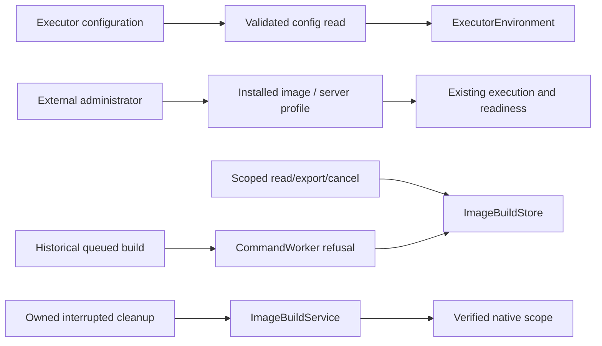

<!--
Copyright (c) 2026 DDP Engineering
This software is licensed under the PolyForm Noncommercial License 1.0.0.
Commercial use requires a separate commercial license.
See the LICENSE.txt file for full license details. SPDX-License-Identifier: LicenseRef-PolyForm-Noncommercial-1.0.0
-->

# Project image evidence and external preparation

## Routing

Start at web/app.py config/image routes and CommandWorker for external-ownership
boundaries; ExecutorEnvironment.tsx owns read-only guidance; serverImages.ts owns
server image suggestions. Artifact retention and
owned cleanup start at image_build.py/image_build_runner.py. Runtime execution
belongs to execution.py; recipes to preparation.md; native execution to
local-execution.md.

## Purpose and boundaries

Preserve historical scoped image records, exports and owned interruption recovery.
External administrator owns Dockerfile/build. Backend, runtime and image selection
are administrator choices at enrollment and in reviewed Settings edits. Web GUI
displays instructions/current effective image; no image definition or build editor is
exposed.

## Public interface

Historical scoped GET/export/status/cancel remain. Authorized definition PUT and
operation POST return 410 environment_managed_externally; config environment
PUT/stage/old apply return400, except execution.backend, container.runtime,
container.image and local.account/home/path/cgroup_root (reviewed flow; direct PUT 409
pending_config_required). GET /api/v1/executor-images (Admin, read-only) lists server
images per runtime. Config GET executor_environment contains backend,
effective image (or null if unresolvable), and resolved config_path only for Admin.

## Invariants

Authorization/CSRF/project scoping precede mutation refusal. Retained queued builds
fail without runtime launch; owned running recovery remains identity checked.
Corrupt artifacts/config/pending input fails closed. No history/image deletion or
schema migration. The dedicated AI endpoint remains supported independently.

## Key behaviors

REQ-UX-01d189b8: conditional four-locale Dockerfile/profile guidance, real Admin
path, Dev omission and responsive disclosure. REQ-FUNC-6b8494a7: all web environment
mutation paths for the other environment keys fail before writes/builds; old candidates remain readable and
can be discarded. Runtime/readiness/preparation retain their own authority.

## Architecture

## Change map

| Seam | Source | Proof |
| --- | --- | --- |
| External guards/current metadata | web/app.py | test_web_image_build.py / test_web_pending_config.py |
| Legacy queue and recovery | web/commands.py, image_build.py | test_web_image_build.py / test_image_build.py |
| Notice and guided defaults | ExecutorEnvironment/App/EnrollmentWizard | images/settings/enrollment.spec.ts |

## Files

The source/tests above; Component_Project_Images.md and Project_Executor_Images.md
provide implementation and operator contracts. Internal retained pipeline tests
continue to verify stored artifact/runtime identity and cleanup.
