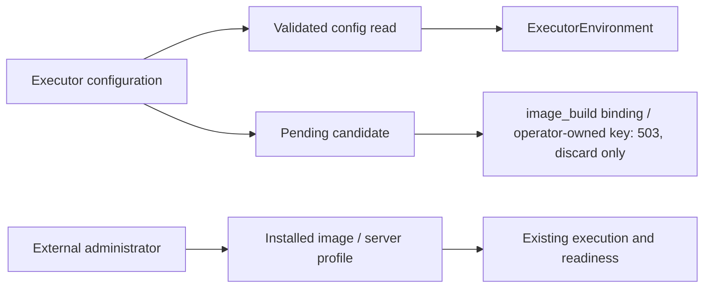

<!--
Copyright (c) 2026 DDP Engineering
This software is licensed under the PolyForm Noncommercial License 1.0.0.
Commercial use requires a separate commercial license.
See the LICENSE.txt file for full license details. SPDX-License-Identifier: LicenseRef-PolyForm-Noncommercial-1.0.0
-->

# Project images: external preparation

## Routing

Start at web/app.py config routes for external-ownership boundaries;
ExecutorEnvironment.tsx owns read-only guidance; serverImages.ts owns server
image suggestions. Runtime execution belongs to execution.py; recipes to
preparation.md; native execution to local-execution.md.

## Purpose and boundaries

The external administrator owns the Dockerfile and the image build. ADORE has
no image-build subsystem: no Dockerfile draft store, runner, worker operation or
build recovery. Backend, runtime and image selection are administrator choices
at enrollment and in reviewed Settings edits. Web GUI displays
instructions/current effective image; no image definition or build editor is
exposed.

## Public interface

The removed `/api/v1/projects/{name}/image-build` routes (draft, export,
operations, operation status and cancel) answer 404. Config environment
PUT/stage return 400 environment_managed_externally, except execution.backend,
container.runtime, container.image and local.account/home/path/cgroup_root
(reviewed flow; direct PUT 409 pending_config_required). GET
/api/v1/executor-images (Admin, read-only) lists server images per runtime.
Config GET executor_environment contains backend, effective image (or null if
unresolvable), and resolved config_path only for Admin.

## Invariants

Authorization/CSRF/project scoping precede mutation refusal. Corrupt
config/pending input fails closed. A pending candidate with an `image_build`
binding or for an operator-owned environment key, which only an earlier build
could stage, is 503 `pending_config_corrupt` on view and apply; an administrator
can still discard it (DELETE /api/v1/projects/{name}/config/pending). No image
deletion or schema migration. The dedicated AI endpoint remains supported
independently.

## Key behaviors

REQ-UX-01d189b8: conditional four-locale Dockerfile/profile guidance, real Admin
path, Dev omission and responsive disclosure. REQ-FUNC-6b8494a7: all web environment
mutation paths for the other environment keys fail before writes; a corrupt
pending candidate can only be discarded. Runtime/readiness/preparation retain
their own authority.

## Architecture

## Change map

| Seam | Source | Proof |
| --- | --- | --- |
| External guards/current metadata | web/app.py | test_executor_environment_choice.py / test_web_pending_config.py |
| Notice and guided defaults | ExecutorEnvironment/App/EnrollmentWizard | images/settings/enrollment.spec.ts |

## Files

The source/tests above; Component_Project_Images.md and Project_Executor_Images.md
provide implementation and operator contracts.
