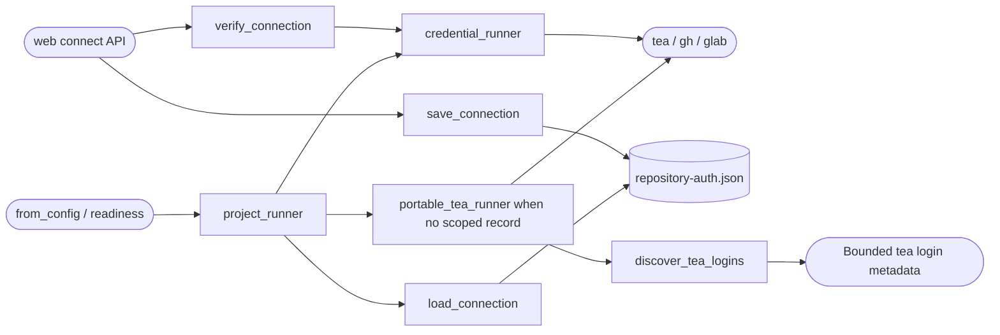

<!--
Copyright (c) 2026 DDP Engineering
This software is licensed under the PolyForm Noncommercial License 1.0.0.
Commercial use requires a separate commercial license.
See the LICENSE.txt file for full license details. SPDX-License-Identifier: LicenseRef-PolyForm-Noncommercial-1.0.0
-->

# Repository authentication

## Routing

Use for project-scoped repository tokens, GUI Connect repository and isolation of
tea/gh/glab credentials, portable tea config discovery and missing-login recovery.
Start at adore/repository_auth.py, adore/gitea_auth.py and
tests/test_repository_connection.py. API authorization/UI belongs to web-interface.md;
Git clone/push belongs to isolation.md and host provisioning to doctor.md.

## Purpose and boundaries

Owns token validation, read-only account/repository verification, protected scoped
persistence and forge CLI binding. API owns permission/locks; worktree transport
credentials and executor model credentials have separate owners.

## Public interface

verify_connection returns an internal verified record; connection_view returns safe
identity only. save_connection publishes privately and invalidates old readiness.
project_runner loads strict scope-bound credentials or retains external auth when
missing. RepositoryAuthError subclasses ForgeError with a value-free code.

load_connection publicly returns the strictly validated protected internal record
or None when absent. project_runner uses that read for scoped forge auth.
Additional focused proof: tests/test_repository_connection.py scoped/corrupt
persistence.

## Invariants

Only selected forge commands receive secrets; no argv, shared config, process-env
mutation or executor propagation. Strict schema/identity/provider/repo/login binding;
corrupt/stale data never falls back. TLS verification retained. Explicit HTTP
acknowledgement except GitHub. Atomic 0600 POSIX files, Windows profile ACLs.
Verification failure preserves saved credentials; GUI response excludes token.

## Key behaviors

- REQ-FUNC-5de75419: verify account and exact repository before scoped connection.
- REQ-SEC-d5459298: isolated persistence/execution with fail-closed corruption.

## Architecture

API holds idle/config locks and records audit separately. Command configuration
is temporary; only the protected scoped record persists.

## Files

- 04_Software/adore/repository_auth.py
- 04_Software/adore/gitea_auth.py
- 04_Software/tests/test_gitea_auth.py
- 04_Software/tests/test_repository_connection.py
- 05_SoftwareDocu/Component_Repository_Auth.md

The Connect repository dialog uses Cancel as its single dismissal button,
beside Verify and connect. Cancel and Escape clear the in-memory draft token.

Failed Gitea web readiness checks log bounded metadata, closed missing-login
reason codes and host config-file presence flags. Arbitrary stderr, credentials,
account names and filesystem paths stay out of these diagnostics; the boolean
readiness response remains unchanged. See Component_Repository_Auth.md.

## Portable current-account Gitea discovery

`gitea_auth.py` owns safe TeaLogin metadata, discover_tea_logins and
portable_tea_runner. Standard absolute roots come from XDG/current Windows
Local/Roaming AppData/home or Linux home; explicit XDG and the first populated
CLI source are authoritative. The library never reads/copies credential contents
or searches private application caches. Strict bounded metadata rejects
ambiguity, duplicate fields/names, invalid URLs/defaults and excessive output.

project_runner prioritizes protected scoped records. An absent external Gitea
record enables a single pre-HTTP missing-login recovery, selecting the configured
name, one default or sole login. Success, HTTP failures and other providers keep
their authority. CLI doctor and new/transfer probes reuse the wrapper; saved-project probes
avoid rewrapping protected credentials. API reads map closed auth errors and
readiness keeps boolean failure. Enrollment uses the same safe metadata and
omits ambiguous suggestions. UI/help offers localized connection instructions.

Requirements: REQ-FUNC-cacfa8b2 and REQ-UX-163a1c99. Proof: test_gitea_auth.py,
test_repository_connection.py, test_repository_source.py, errors.test.mjs and
help.test.mjs.

Repository credential changes make previous readiness evidence stale through its private authentication-context fingerprint; rejected changes leave the existing record intact.
