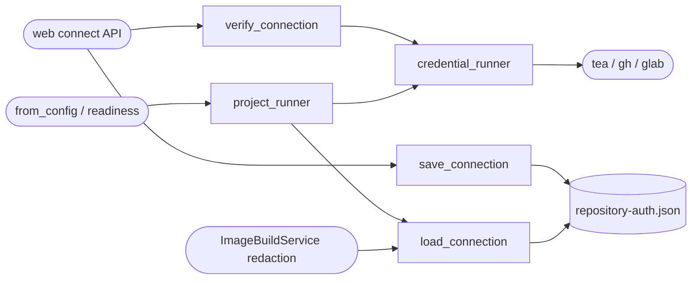

<!--
Copyright (c) 2026 DDP Engineering
This software is licensed under the PolyForm Noncommercial License 1.0.0.
Commercial use requires a separate commercial license.
See the LICENSE.txt file for full license details. SPDX-License-Identifier: LicenseRef-PolyForm-Noncommercial-1.0.0
-->

# Repository authentication

## Routing

Use for project-scoped repository tokens, GUI Connect repository and isolation of
tea/gh/glab credentials. Start at adore/repository_auth.py and
tests/test_repository_connection.py. API authorization/UI belongs to web-interface.md;
Git clone/push belongs to isolation.md and host provisioning to doctor.md.

## Purpose and boundaries

Owns token validation, read-only account/repository verification, protected scoped
persistence and forge CLI binding. API owns permission/locks; worktree transport
credentials and executor model credentials have separate owners.

## Public interface

verify_connection returns an internal verified record; connection_view returns safe
identity only. save_connection publishes privately and invalidates old readiness.
project_runner loads strict scope-bound credentials or retains external auth when
missing. RepositoryAuthError subclasses ForgeError with a value-free code.

load_connection publicly returns the strictly validated protected internal record
or None when absent. project_runner uses that read for scoped forge auth; image
artifacts use only its token for in-memory rejection/redaction. Build clients
receive no token. Additional focused proof: tests/test_image_build.py credential
boundaries and tests/test_repository_connection.py scoped/corrupt persistence.

## Invariants

Only selected forge commands receive secrets; no argv, shared config, process-env
mutation or executor propagation. Strict schema/identity/provider/repo/login binding;
corrupt/stale data never falls back. TLS verification retained. Explicit HTTP
acknowledgement except GitHub. Atomic 0600 POSIX files, Windows profile ACLs.
Verification failure preserves saved credentials; GUI response excludes token.

## Key behaviors

- REQ-FUNC-5de75419: verify account and exact repository before scoped connection.
- REQ-SEC-d5459298: isolated persistence/execution with fail-closed corruption.

## Architecture

API holds idle/config locks and records audit separately. Command configuration
is temporary; only the protected scoped record persists.

## Files

- 04_Software/adore/repository_auth.py
- 04_Software/tests/test_repository_connection.py
- 05_SoftwareDocu/Component_Repository_Auth.md
