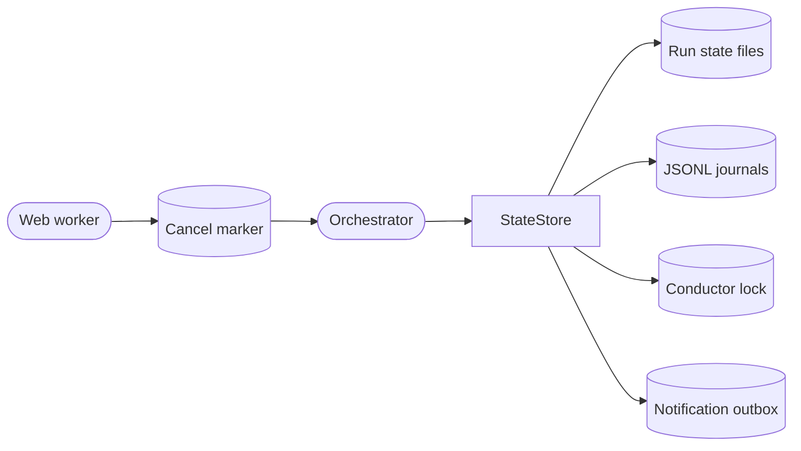

<!--
Copyright (c) 2026 DDP Engineering
This software is licensed under the PolyForm Noncommercial License 1.0.0.
Commercial use requires a separate commercial license.
See the LICENSE.txt file for full license details.
SPDX-License-Identifier: LicenseRef-PolyForm-Noncommercial-1.0.0
-->

# State store

## Routing

Use this page for schema-1 run state, journals, conductor locks, outbox and
cancellation markers. Start at `04_Software/adore/state.py`; verify with
`04_Software/tests/test_state.py`. Web queue state belongs to
`web-interface.md`.

## Purpose and boundaries

Persists schema-1 `RunState` records, append-only JSONL audit events, pending
notification outbox records, pause state, and the single-conductor lock.

## Public interface

`StateStore` creates, loads, updates, lists, and deletes explicitly selected
runs; appends durable journal events; queues/replays notifications; reads the
global pause flag; and acquires the instance lock. `StateError` and lock errors
make invalid state/ownership visible to CLI and orchestrator recovery paths.

## Invariants

Corrupt or unknown state never resets itself. Locks are reclaimed only when a
readable same-host owner PID is provably dead; unknown ownership stays locked.
Run updates and journal writes are atomic enough to preserve recovery evidence,
and failed runs are retained until an operator performs an explicit action.
Cancellation markers identify one run and are consumed by the active conductor;
the web worker cannot write an arbitrary terminal lifecycle into run state.

## Key behaviors

- `REQ-FUNC-0bdb23d5` - schema-1 state corruption fails closed.
- `REQ-FUNC-51f9c365` - lock reclamation requires a provably dead local owner.
- `REQ-FUNC-1a2c56fe` - append-only journal persistence and torn-tail recovery.
- `REQ-FUNC-f9946b6b` - authorized cancellation signals an active run through
  a bounded marker.

## Architecture

The durable store preserves recovery evidence and refuses corrupt or uncertain
ownership instead of resetting it.

## Files

- `04_Software/adore/state.py`
- `04_Software/tests/test_state.py`
