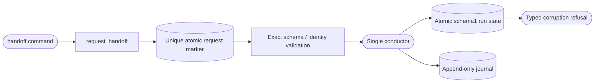

<!--
Copyright (c) 2026 DDP Engineering
This software is licensed under the PolyForm Noncommercial License 1.0.0.
Commercial use requires a separate commercial license.
See the LICENSE.txt file for full license details.
SPDX-License-Identifier: LicenseRef-PolyForm-Noncommercial-1.0.0
-->

# State store

## Purpose and boundaries

Persists schema-1 `RunState` records, append-only JSONL audit events, pending
notification outbox records, pause state, and the single-conductor lock.

## Public interface

`StateStore` creates, loads, updates, lists, and deletes explicitly selected
runs; appends durable journal events; queues/replays notifications; reads the
global pause flag; and acquires the instance lock. `StateError` and lock errors
make invalid state/ownership visible to CLI and orchestrator recovery paths.

## Invariants

Corrupt or unknown state never resets itself. Locks are reclaimed only when a
readable same-host owner PID is provably dead; unknown ownership stays locked.
Run updates and journal writes are atomic enough to preserve recovery evidence,
and failed runs are retained until an operator performs an explicit action.

## Requirement coverage

- `REQ-FUNC-0bdb23d5` - schema-1 state corruption fails closed.
- `REQ-FUNC-51f9c365` - lock reclamation requires a provably dead local owner.
- `REQ-FUNC-1a2c56fe` - append-only journal persistence and torn-tail recovery.

## Files

- `04_Software/adore/state.py`
- `04_Software/tests/test_state.py`

## Routing

For state-store interfaces, start at `04_Software/adore/state.py` and its matching existing component tests. Checkpoint/handoff contracts are covered in `04_Software/tests/test_checkpoint_handoff.py`; conduction belongs to Orchestrator.

## Key behaviors

- `REQ-FUNC-c9d64cfe`: explicit safe human ownership with durable recovery evidence and protected run state.

## Architecture

