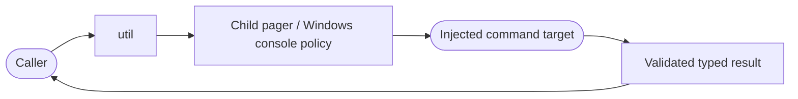

<!--
Copyright (c) 2026 DDP Engineering
This software is licensed under the PolyForm Noncommercial License 1.0.0.
Commercial use requires a separate commercial license.
See the LICENSE.txt file for full license details.
SPDX-License-Identifier: LicenseRef-PolyForm-Noncommercial-1.0.0
-->

# Utilities

## Routing

Start at `04_Software/adore/util.py`; focused proof is
`04_Software/tests/test_util.py`. Shared execution/recipe policy belongs to
`execution.md` and `preparation.md`.

## Purpose and boundaries

Provides injectable, shell-free command execution, duration parsing, UTC
timestamps, bounded output helpers, and reparse-point-safe cleanup support.

## Public interface

`run_command()` takes an argv sequence and returns `CommandResult`, preserving
stdout, stderr, exit code and the authoritative timeout flag.
`automatic_environment` copies and fixes child pager values;
`background_process_options` supplies Windows no-console launch options.
Helpers parse configuration durations, normalize UTC timestamps, bound external
text/bytes, and remove only an explicitly selected tree without following
Windows reparse points.

## Key behaviors

- `REQ-FUNC-e2b539d4`: Subprocess bytes retain original CRLF for exact-source hashes; strict_json_loads rejects duplicate keys, non-finite constants and excessive decoder nesting.

- `CommandResult.timed_out` is set only when ADORE's wrapper kills a process.
- Callers must not infer timeout from exit code or stderr wording.
- External command failures return data so higher layers choose recovery.
- Boundary helpers reject malformed or oversized external data rather than
  silently truncating decision values.

## Requirement coverage

- `REQ-FUNC-1aa7a007` - authoritative typed timeout result.
- `REQ-FUNC-2613bf7d` - shell-free command execution and duration parsing.

## Files

- `04_Software/adore/util.py`
- `04_Software/tests/test_util.py`

## Invariants

Commands use injected argv runners and typed captured results; retained source newlines remain exact. External JSON ambiguity fails closed.

## Architecture

## Automatic child policy

`automatic_environment` returns a child-only copy with case-normalized
GIT_PAGER/PAGER set to cat; explicit mappings retain their isolation.
`background_process_options` returns CREATE_NO_WINDOW only on Windows.
`run_command` applies both and closes stdin while preserving captured result,
exact newline decoding and timeout/OS-error contracts. Native, worker and regex
launches reuse this policy. Focused proof: test_automatic_processes.py plus
runner tests in test_util.py. Requirements: REQ-PLAT-989c6478, REQ-PLAT-967d0c80.
