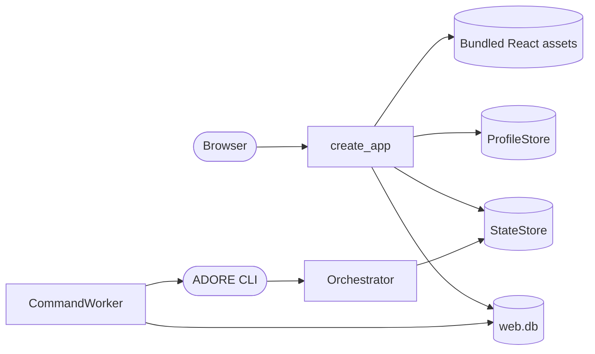

<!--
Copyright (c) 2026 DDP Engineering
This software is licensed under the PolyForm Noncommercial License 1.0.0.
Commercial use requires a separate commercial license.
See the LICENSE.txt in the .agentic folder for full license details.
SPDX-License-Identifier: LicenseRef-PolyForm-Noncommercial-1.0.0
-->

# Web interface

Secondary text uses contrasting light/dark theme colours. Project metadata,
configuration values, type/domain hints and field help use 0.875rem text with
1.5 line height; long identifiers and guidance wrap within their panels.
On narrow screens, setting labels, values and help stack vertically.

## Routing

Use this page for `adore-web`, `adore-web-worker`, `/api/v1`, web login/RBAC,
React views, the web queue, or offline web media. Start at
`04_Software/adore/web/app.py` for API behavior and
`04_Software/web/src/App.tsx` for UI behavior. Focused tests are
`04_Software/tests/test_web_*.py`. Engine internals belong to `orchestrator.md`.

## Purpose and boundaries

The optional web package gives one ADORE host an authenticated dashboard and
durable control queue. The API reads existing profiles and run state and never
launches an executor directly. The separate worker executes fixed CLI commands;
the orchestrator still owns readiness, locks, approvals and draft publication.

## Public interface

- `create_app(home, probe_runner=...)` mounts `/api/v1` and bundled static
  assets. The runner is injectable for explicit host-readiness probes.
- `adore-web --home ...` binds loopback; remote traffic uses a TLS proxy.
  Uvicorn accepts forwarded context only from loopback proxy peers, and HTTPS
  login emits a Secure session cookie.
- `adore-web-worker --home ...` polls profiles and queued operations.
- `WebStore(home / "web.db")` owns accounts, sessions, grants, audit and queue.
- `02_Tools/package_web_offline.py` creates a host-matched delivery directory;
  `install_web_offline.py` installs from local wheels only.

## Invariants

- Fresh identity stores bootstrap `admin` / `admin` once with an Argon2id hash.
  A corrupt or deleted initialized store does not recreate the default login.
- Schema 6 stores optional per-account language and theme. Authenticated
  preference reads and CSRF-protected partial updates remain account-scoped;
  null values use the browser fallback and corrupt rows fail closed.
- Developer routes check membership before reading a project and omit all
  financial fields. Project configuration reads return redacted effective
  settings to assigned developers, with per-setting source, editability (the
  same rule as edits) and restart metadata; other project identities return
  404.
  Configuration mutations, account management and global metrics require admin.
- Schema 7 binds grants to immutable profile IDs. Older creation-stamped grants
  migrate only while they still match the original profile; name-only grants
  are cleared. Schema 9 binds rates to project IDs, retaining older rates
  without applying them if their profile ownership cannot be proven. Schema 8
  binds queued operations to project IDs and marks
  unprovable legacy pending work uncertain. Renames retain grants and queued
  targets, while a reused name cannot inherit either.
- Mutations require CSRF; sessions are opaque, expiring and revocable.
- Administrator password reset revokes target sessions and sets the schema-13
  reset marker; until the account changes its own password, only `/me`,
  `/me/preferences`, `/me/password` and sign-out answer, and other
  authenticated routes return 403 `password_change_required`. The bootstrap
  `admin` and upgraded accounts start unmarked.
- Every API error body is `{"detail": {"code", "message"?}}` with a stable
  snake_case code; store sentences map to fixed codes, unknown text becomes
  `request_rejected`, validation is 422 `invalid_request`, and unknown
  `/api/...` paths return 404 `not_found`. `web/src/errors.ts` holds an
  EN/FR/DE/RO sentence for every code `app.py` can emit.
- Config reads omit
  credential-looking fields; journal views use a role-aware field allowlist.
  The same name rule (`_is_secret_key` in `adore/cli.py`) also refuses web edits
  and CLI `config set`; ADORE's own boolean `metrics.capture_tokens` is exempt
  while its value is a boolean (`REQ-SEC-63767e17`).
- Web config edits use a SHA-256 revision and the same per-directory process
  lock as CLI `config set`; direct host file changes do not use that lock.
  Staged, applied, direct and OpenCode endpoint edits write bytes and keep the
  file's CR LF or LF line endings (`REQ-PLAT-722173c8`).
- The administrator UI stages one validated config candidate per project,
  reviews its revision and applies it only with no active run, conductor or
  queued operation. Identity/runtime edits require paused pickup. Retrying an
  interrupted apply reconciles exact candidate bytes and profile labels.
- Explicit administrator readiness checks use bounded doctor probes from the
  API host and return booleans only. AEGIS file presence is checked without
  executing repository code. A configured local OpenCode model is tested from
  a disposable executor container with the project egress policy and a
  redacted reason. WSL runtime detection remains unverified; CLI output and
  credentials are never returned.
- The OpenCode local-endpoint form saves `provider/model`, URL, and an optional
  allowlisted credential environment reference atomically;
  its compatible provider override, bounded timeout and optional HTTPS CA path
  are generated in the same config revision. Pending review exposes only these
  non-secret endpoint fields.
- Project creation and shared config validation permit ADORE-managed host-auth
  staging only for OpenCode and Codex. Pi and Qwen use the non-staged choice;
  Pi can authenticate through an operator-provided, protected credential mount
  while `stage_host_auth` remains false.
- Web-created profiles use an absolute, project-specific worktree root under
  ADORE home. ADORE uses the configured agent identity for host-side checkpoint
  commits, even when the fresh clone has no local Git identity.
- The audit trail is available only on the administrator API and page.
- Jobs keeps authorized project selection beside ticket/start controls in page
  content. Localized ticket Help describes an existing repository issue number
  and positive integer syntax. Switching projects clears the ticket draft;
  archived profiles expose history selection with job-start controls hidden.
  Observed executor and Outcome contains use aligned wider fields with localized
  Help and examples. Executor is exact and case-sensitive against recorded
  journal identity; outcome is a case-insensitive fragment of the saved ADORE
  result/error explanation. These filters retain their bounds and do not search
  full AEGIS or executor logs. Text fields stack on narrow screens.
- The Jobs UI uses `/projects/{name}/runs-page` with an initial ten-item response and
  exact lifecycle/stage/observed-executor, inclusive UTC last-update date, and bounded outcome
  text filters; grants and corrupt-state checks precede data. Malformed or reversed date inputs fail;
  corrupt persisted update timestamps fail closed when date filtering is used.
  The overview requests seven recent runs plus unfiltered lifecycle counts.
  Selected-ticket history displays Date, Event and Stage in a locally paged
  table, showing latest entries first by reversing a copy of the journal array.
  Saved journal order and escaped event text are preserved. It starts with ten
  rows and offers 10/25/50/All for longer history. Project/run changes reset
  its paging, and empty history uses the standard empty state.
  Its summary cards expand into a project table or a selected-project job table;
  expanded job tables request authorized full run history and paginate locally.
  The project selector is inside the Projects expansion on Overview. The
  Projects page itself uses sortable, paged authorized rows and per-row
  administrator pickup/archive actions with scoped details for all roles.
  Administrators open Add project as a separate page with localized field help.
  The clone path refers to an existing Git clone on the ADORE host. Editable
  image suggestions are examples, not a local-image inventory. Success opens
  project details; Back and Cancel return to Projects without a mutation.
  Import project is also a separate administrator page. It previews a selected
  config file before importing the exact revision, clears browser-held file
  contents and preview when leaving, and opens details after successful import.
  Pending and completed human handoffs have localized lifecycle labels and
  filters. Cancel is unavailable during and after human ownership transfer.
- The React session switch clears private caches and increments a generation
  guard so in-flight responses from the previous account are ignored.
- Project daily CSV exports follow the same financial filter as metrics JSON;
  the global daily CSV is administrator-only and includes project/repository
  provenance with spreadsheet-safe repository labels.
- Project/global metrics JSON and CSV share inclusive local-date `day_from`/`day_to`
  filters, an IANA timezone and day/week/month grouping. UTC/day is the default.
  The `period` object sums selected dated journal buckets; `totals`,
  coverage, run rows and revision attribution remain all-time. Summary-only
  usage is not fabricated into daily buckets, and developers receive no money.
  Completed-job trends use terminal lifecycle evidence rather than a later
  recovery checkpoint event; legacy journals fall back to stored run update time.
- Project/global metrics expose terminal elapsed-time sample count, average
  and median separately from event-based throughput. The period duration
  sample uses local completion day. Missing timestamps are excluded; corrupt
  persisted spans fail closed. Elapsed time includes human waiting.
- All-time quality cohorts count one job per review, first validation and
  human merge. Reviewer rework requires a `revise-label` revision after an
  observed MR/PR opening/adoption; pipeline repair remains separate. Null rates
  represent empty denominators, and malformed validation verdicts fail closed.
- Stage failures and operator retries are distinct quality counts.
  Administrator cost-efficiency averages use reported and estimated money in
  separate completed and human-merged evidence cohorts; developer responses
  contain no monetary efficiency fields.
- Project/global attributed usage JSON and CSV group journal events by the
  selected local day/week/month,
  executor and model with exact identity filters. Job counts remain separate;
  missing identity stays unknown, developer exports omit money, and CSV labels
  are spreadsheet-safe. Corrupt persisted identity fails closed.
- Schema-11 SQLite usage and launch-coverage projections are reconciled against retained journals
  before attributed reads. An administrator can explicitly replay archived and
  current projects; a per-run cursor prevents repeated events adding rows, and changed or vanished
  source evidence fails closed without changing run state.
- Administrators add immutable effective-dated rates for exact
  project/executor/model combinations; estimates apply only to usage events
  without reported cost and remain separate from reported totals.
- Worker authorization is rechecked after queueing. Interrupted operations
  become `uncertain`, never blindly replayed.
  A queued Cancel is rejected if the run became human-owned before execution.
- During every blocking worker command or project poll, a watcher rechecks
  pending cancel grants across projects and
  writes a per-run marker. The conductor interrupts the matching working gate
  and performs normal teardown; a revoked grant creates no marker.
- Selected-ticket starts retain the conductor's readiness and approval gates.
  The web layer never merges.
- Offline installation verifies the manifest and runs `pip --no-index`.
- About exposes bundled project license text and versioned third-party notices.
- Below 760px, primary navigation opens from a labeled collapsible menu and
  closes after page selection. Narrow panels wrap text while data tables keep
  their own horizontal scrolling.

## Change map

| Change requested | Start with | Focused verification |
|---|---|---|
| Accounts, sessions, queue | `adore/web/store.py` | `test_web_auth.py`, `test_web_commands.py` |
| API permissions/config/metrics | `adore/web/app.py` | `test_web_rbac.py`, `test_web_config.py`, `test_web_pending_config.py`, `test_web_readiness.py`, `test_web_metrics.py` |
| Worker execution | `adore/web/commands.py` | `test_web_commands.py` |
| Language, theme, views | `web/src/App.tsx`, `web/src/i18n.ts` | `npm run validate`, isolated Chromium journeys |
| URLs, tabs, navigation | `web/src/routes.ts`, `web/src/App.tsx` | `npm test` (`routes.test.mjs`), browser check |
| Background refresh and paging | `web/src/polling.ts`, `ServerPager` in `App.tsx`, `/api/v1/audit-page` | `npm test` (`polling.test.mjs`), `test_web_paging.py` |
| Error codes and messages | `adore/web/app.py` (`_error`, `_STORE_ERROR_CODES`), `web/src/errors.ts` | `test_web_errors.py`, `npm test` (`errors.test.mjs`) |
| Project developer access | `/api/v1/projects/{name}/access` routes in `adore/web/app.py`, `project_members` and `set_membership` in `adore/web/store.py`, `ProjectAccess` in `App.tsx`, `web/src/routes.ts` | `test_web_project_access.py`, `npm test` (`routes.test.mjs`), browser check |
| Project settings list and row editing | `_setting_metadata` in `adore/web/app.py`, `web/src/settings.ts`, `SettingsList` in `App.tsx` | `test_web_config.py`, `npm test` (`settings.test.mjs`), browser check |
| Setting help texts and catalog | `web/src/settingHelp.ts`, `web/src/settingKeys.json`, `default_config()` in `adore/config.py` | `test_web_setting_catalog.py`, `npm test` (`settingHelp.test.mjs`), browser check |
| Offline media | `02_Tools/*web*.py` | `test_web_package.py`, installed HTTP smoke |

## Key behaviors

- `REQ-SEC-9ee171c9` - local accounts and durable, fail-closed sessions.
- `REQ-SEC-59d97c68` - project scope and developer financial privacy.
- `REQ-FUNC-7ce5b17a` - project setup, config and status.
- `REQ-FUNC-f9946b6b` - durable selected-ticket operations and admin pickup.
- `REQ-FUNC-448cbde7` - observed usage, reported/estimated costs and coverage.
- `REQ-UX-749d37c8` - four locales, themes and responsive UI.
- `REQ-SEC-676d284c` / `REQ-UX-309a6b3f` - administrator reset requires a new
  password; the browser shows only the change-password card meanwhile.
- `REQ-FUNC-9c1f728e` / `REQ-UX-e6ed7168` - stable API error codes and their
  localized banner text.
- `REQ-UX-359f8cbf` - browser-side project-name validation.
- `REQ-UX-94dc4e69` - error banners reflect only the latest user action.
- `REQ-UX-4200375b` - every view has a stable path URL with history support.
- `REQ-UX-d88d3d7f` - project details tabs and project links.
- `REQ-UX-3dda4965` / `REQ-UX-02f35869` - example placeholders, required
  markers and the stated password rule.
- `REQ-UX-5b0fa167` / `REQ-UX-48d6a55d` - phone table scroll cue and Jobs
  filter toggle.
- `REQ-SEC-a514d0b2` / `REQ-UX-772cb418` / `REQ-FUNC-bcaf01be` - delete
  an archived, idle project after typed-name confirmation; the worker runs the
  resource-removing CLI delete and human-owned worktrees are kept.
- `REQ-UX-205e5379` / `REQ-UX-deb101f5` / `REQ-UX-48fb199d` /
  `REQ-UX-0c03fc93` / `REQ-UX-d93fab0f` / `REQ-UX-7fdffe77` - name and ticket
  links, scoped card hints, SVG icons, heading spacing, project-executor price
  default and the empty-metrics message.
- `REQ-NFR-da638732` / `REQ-NFR-46c98d6c` / `REQ-FUNC-a83c4cd3` - no polling
  while hidden and server-paged Audit/Overview tables.
- `REQ-UX-66e6f3f5` - project details presents collapsible, guided settings with administrator editing.
- `REQ-FUNC-49b766fe` / `REQ-UX-9a625fc5` / `REQ-UX-a62e69a9` - per-setting source, editability and
  restart metadata; Set for this project / Default badges, row editing and the project-set filter.
- `REQ-UX-b0e9a434` / `REQ-FUNC-c6c71dbd` - every setting's help text in EN/FR/DE/RO and
  its ADORE default; the catalog test keeps texts in step with the configuration keys.
- `REQ-SEC-3ce206e4` / `REQ-UX-7ca5687c` - administrators grant or remove one developer's access to one
  project from its Access tab; other grants stay; developers see no tab.
- `REQ-SEC-c2298428` - redacted project configuration reads follow grants; edits remain administrator-only.
- `REQ-PLAT-a1b60ff9` - host-specific offline installation.
- `REQ-REL-94e653aa` - checkpoint-bearing state and handoff lifecycles remain
  readable and protected after replacement of the DCP runtime.

## Architecture

One web worker owns command ordering for one home. During any blocking engine
command or project poll, the worker watches queued cancellations across projects and
signals the active conductor after rechecking grants. Other queued operations
wait for the current engine command. Administrator metrics attribute usage and
reported/estimated cost to the most recent revision-started event in each run;
initial work remains in run totals and developers receive no financial rows.
API liveness at `/api/v1/health` is separate from readiness at `/api/v1/ready`.
The worker refreshes a schema-5 SQLite heartbeat even while an engine command
blocks; a stopped, stale or corrupt heartbeat does not claim readiness.
Administration expands into System status, Users and Audit sidebar pages;
both roles reach a top-level My account page. Every view has a path URL
(`web/src/routes.ts`) kept in sync with view state; project details uses
Overview/Configuration/Prices/Access tabs and Jobs/Metrics links. Project details shows effective
configuration in compact sections, common settings first, with a Set for this
project / Default badge, field type, domain and purpose help and a filter for
project-set settings; administrators edit settings on their rows and stage
endpoint and price changes there. The
settings response is scoped to the current project identity so switching
projects cannot briefly show another project's values. Audit policy defaults to unlimited
and its form displays saved day/MiB limits, representing unlimited as zero.
Zero or blank maps to API null; bounded values convert to integer days/bytes
through `04_Software/web/src/auditPolicy.ts`, covered by offline Node tests.
Administrators can set day and stored-text byte limits. Schema 12
prunes oldest events transactionally when configured while preserving other
history. Audit and other long tables provide 10/25/50/All paging; Jobs uses
the scoped run-page API for the same choices. API fetches bypass browser cache
so a newly deployed endpoint cannot be masked by stale HTML.
The Administration System status page polls readiness every five seconds and labels worker
status separately from forge, executor and model reachability.
It also polls administrator-only storage status every 30 seconds. The API reads
free space for home and each project state root, warns below 1 GiB and returns
an explicit service error if measurement fails, without exposing host paths.
The React About dialog makes the surrounding shell inert, keeps keyboard focus
on its Close button, and restores focus to About when closed. Narrow layouts
expose Sign out in the top bar while the sidebar account row is hidden.
The top bar supplies the sole page title and common actions on every page.
Project details keeps the identity opened through authorized Projects rows.
Its metadata rows use 4px gaps and 18px separation before actions. Platform
administration/account pages use their own controls. Responsive rows
keep these controls visible while content begins with page data. Metric hints,
usage actions and account rows wrap on narrow screens.
Metrics keeps its authorized project selector with the common reporting range,
timezone, grouping and CSV menu above keyboard-operable Summary, Usage, Quality,
Trends and administrator-only Projects tabs. Administrators use All projects
scope for pooled totals and comparisons.
Every category and CSV menu follows that scope; single-project mode limits
comparison rows and developer mode exposes assigned-project operational data.
Summary includes a paginated project breakdown in All projects scope.
`04_Software/web/src/metrics.ts` pools counters, nullable evidence, quality cohorts and
terminal duration samples; `04_Software/web/tests/metrics.test.mjs` verifies it offline.
Developer export choices remain project-scoped and omit money; usage
exports also carry the Usage tab's executor/model filters. Compact layouts put
the shared reporting controls in two rows.
Session clearing also returns the shell to Overview, preventing a blank
administrator-only page after a developer signs in. Successful asynchronous
user creation and config staging reset their forms without a false error.
A signed-in account with a pending required password change is held outside
the shell session, so only the change-password card renders and no dashboard
polling starts. The error banner stores the raw failure; `web/src/errors.ts`
renders it in the active locale, and each user action or view change clears
it. `web/src/projectName.ts` supplies the `v`-flag-safe project-name pattern
for Add and Import project. Primary buttons take their text colour from the
`--on-accent` theme token.

## Files

- `04_Software/adore/web/{app,store,commands,server}.py` - API, SQLite store,
  worker and listener.
- `04_Software/adore/web/static/` - bundled local UI and license.
- `04_Software/web/` - React source and build configuration;
  `web/src/errors.ts` (error localization), `web/src/projectName.ts`
  (shared name pattern), `web/src/routes.ts` (URL scheme) and
  `web/src/polling.ts` (visibility-aware refresh) and `web/src/settings.ts`
  (configuration rows and grouping) and `web/src/settingHelp.ts` (per-setting
  help texts for the `web/src/settingKeys.json` catalog) are pure modules tested by
  `web/tests/*.test.mjs`.
- `02_Tools/{package_web_offline,install_web_offline,launch_web,stamp_web_assets}.py`
  - offline media and static asset preparation.
- `04_Software/tests/test_web_*.py` - focused API, pricing, worker and packaging tests.
