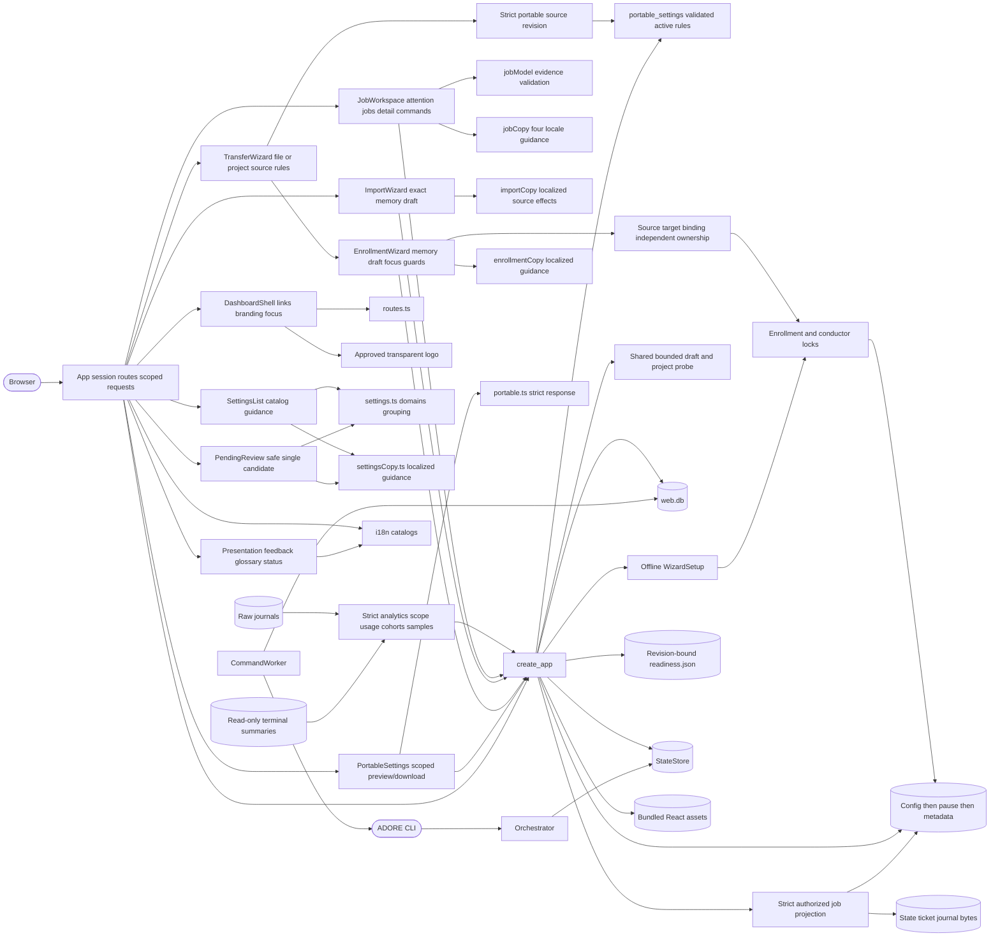

<!--
Copyright (c) 2026 DDP Engineering
This software is licensed under the PolyForm Noncommercial License 1.0.0.
Commercial use requires a separate commercial license.
See the LICENSE.txt in the .agentic folder for full license details.
SPDX-License-Identifier: LicenseRef-PolyForm-Noncommercial-1.0.0
-->

# Web interface

Secondary text uses contrasting light/dark theme colours. Project metadata,
configuration values, type/domain hints and field help use 0.875rem text with
1.5 line height; long identifiers and guidance wrap within their panels.
On narrow screens, setting labels, values and help stack vertically.

## Routing

Use this page for `adore-web`, `adore-web-worker`, `/api/v1`, web login/RBAC,
React action workspaces/project hubs, the web queue, or offline web media. Start at
`04_Software/adore/web/app.py` for API behavior and
`04_Software/web/src/App.tsx` for shell/project behavior and `JobWorkspace.tsx`
for attention/global jobs/details; `web/e2e/jobs.spec.ts` verifies those views. Focused tests are
`04_Software/tests/test_web_*.py`. Engine internals belong to `orchestrator.md`.

## Purpose and boundaries

The optional web package gives one ADORE host an authenticated dashboard and
durable control queue. The API reads existing profiles and run state and never
launches an executor directly. The separate worker executes fixed CLI commands;
the orchestrator still owns readiness, locks, approvals and draft publication.

## Public interface

- Admin/CSRF `transfer-source/preview/check/create` create fresh stopped projects
  from strict portable files or immutable authorized source identities. Exact source
  bytes/ID and target revision are bound; source/session/ownership are rechecked
  during existing locked atomic publication. All 16 rules transfer, while target
  identity/repository/environment/references are supplied anew. Allocated state,
  worktrees and derived metrics remain independent; corrupt/overlapping ownership,
  stale sources, rollback and replay fail closed. `TransferWizard` reviews the
  selected source; optional `EnrollmentWizard` mode shows complete source/default/
  effect mapping, required reconfirmation and retained memory-only correction.
  Selected files are reread at target boundaries. Tests: `test_web_transfer.py`
  and `web/e2e/transfer.spec.ts`; exact TOML/export remain separate contracts.

- Admin-only `/projects/{name}/config/portable-settings` validates a bounded
  active snapshot through `portable-settings.md`; canonical no-store JSON and
  optional fixed attachment omit pending/identity/host/access/credential data.
  Authorization precedes lookup, invalid sources return value-free 503, and
  optional preview checksum conflicts return 409. Project ownership is rechecked
  after snapshot export; changed identity rejects. Exact TOML/CSV contracts retain
  their behavior. `PortableSettings.tsx` owns four-locale explicit preview and
  exact-byte download, strict `portable.ts` response validation and unmount/ref
  guards. Failed reads empty the preview and require retry. Tests are
  `test_web_portable_settings.py`, `web/tests/portable.test.mjs` and
  `web/e2e/portable.spec.ts`.

- `/api/v1/jobs-page` provides complete globally ordered authorized current and
  archived job history, optional project/search/attention/status/executor/outcome/UTC date filters and optimistic
  content revisions. `/api/v1/jobs/{project_id}/{run_id}` uses composite identity.
  `adore/web/jobs.py` strictly validates schema-1 state, saved ticket metadata and
  JSONL bytes without altering operational journal recovery. See
  `05_SoftwareDocu/Component_Web_Jobs.md` for exact fields and source semantics.

- Exact Admin/CSRF import-preview returns config/candidate revisions, structured
  local findings and allowlisted review. import-check reuses bounded probes with
  ephemeral revision/time-bound status; import confirms unchanged bytes after
  full identity/ownership/state reinspection within enrollment/conductor locks.

- `create_app(home, probe_runner=...)` mounts `/api/v1` and bundled static
  assets. The runner is injectable for explicit host-readiness probes.
- Guided `setup-preview` returns canonical secret-free setup/paths and a digest
  binding exact deterministic config, ID, display and description. Additive
  `setup-check` returns ephemeral revision/time-bound evidence; `setup-create`
  compares the reviewed revision before existing atomic stopped publication.
  All require Admin/CSRF. Setup includes supported labels, run limits and credential
  environment names. Gitea probes honor the selected tea login.
- `EnrollmentWizard` owns six-step memory state, localized visible guidance,
  corrective findings/focus, generation invalidation, loss guards and frozen review.
  The immediate creation ref lock prevents double submit. Completion explains
  stopped pickup and separate activation; persistent project readiness is checked
  separately. `enrollmentCopy.ts` preserves EN/FR/DE/RO and existing themes/branding.
- `adore-web --home ...` binds loopback; remote traffic uses a TLS proxy.
  Uvicorn accepts forwarded context only from loopback proxy peers, and HTTPS
  login emits a Secure session cookie.
- `adore-web-worker --home ...` polls profiles and queued operations.
- `WebStore(home / "web.db")` owns accounts, sessions, grants, audit and queue.
- `02_Tools/package_web_offline.py` creates a host-matched delivery directory;
  `install_web_offline.py` installs from local wheels only.

## Invariants

- Global job reads authorize selected profiles before state IO and recheck
  grants/profile metadata after complete source validation. Failed authorized
  reads return typed errors without partial totals. Source revisions reject
  changed continuations; ordering uses UTC activity then composite identity.
  Actual persisted questions/comment/candidate/MR references support actions;
  missing titles, timestamps, named responsibility and usage stay unknown.
  Strict links and selected redacted fields protect source secrets; reads
  execute no external commands and write no state.

- Web enrollment publishes metadata only after config and stopped pickup, under
  enrollment/conductor locks; failure removes visibility before rollback/unlock.
  Existing completed server history is retained at its declared state location. Display edits preserve all operational identity.
- Local setup preview and ID availability never probe tools or publish profiles.
  Findings carry safe code/field/remediation; exact backend detail codes appear
  under existing localized HTTP error categories. Secret literals fail closed.
- Read models distinguish structural validation, pickup and explicit verification.
  Profile-owned readiness.json validates identity/digest/UTC time/schema/redacted
  checks; absent evidence is unverified and changed config is stale. Mid-probe
  config changes cannot publish current evidence. See Component_Web_API.md.

- `DashboardShell` renders authorized semantic links, approved transparent
  DDP Engineering branding at its original aspect ratio on dark navigation,
  a skip link and visible keyboard focus. Main views are Overview, Projects,
  Jobs and Statistics; stable URL paths remain owned by `routes.ts`.
- `Presentation` supplies localized text/icon statuses, delivery definitions,
  distinct pending/error feedback and role-specific empty project guidance.
  Essential field instructions remain visible and associated with controls.
- App keys data by project/filter and guards completions by request/session
  identity. Numeric totals render from successful reads; failed reads hide
  stale totals. Refresh retries current-view reads. Closing a job clears its
  URL identity. Jobs/Overview default to complete all-authorized current/archived
  history or an explicit selected project. JobWorkspace guards render keys and
  composite detail identity; changed continuations hide totals/detail and require
  explicit restart. Validated jobModel checks safe links, counts/groups and stages.

- Fresh identity stores bootstrap `admin` / `admin` once with an Argon2id hash.
  A corrupt or deleted initialized store does not recreate the default login.
- Schema 6 stores optional per-account language and theme. Authenticated
  preference reads and CSRF-protected partial updates remain account-scoped;
  null values use the browser fallback and corrupt rows fail closed.
- Developer routes check membership before reading a project and omit all
  financial fields. Project configuration reads return redacted effective
  settings to assigned developers, with per-setting source, editability (the
  same rule as edits), declared type/domain/default and restart metadata.
  Dev reads omit the financial cap; credential-bearing URLs are redacted before
  row/default/review generation. Other project identities return
  404.
  Configuration mutations, account management and global metrics require admin.
- Schema 7 binds grants to immutable profile IDs. Older creation-stamped grants
  migrate only while they still match the original profile; name-only grants
  are cleared. Schema 9 binds rates to project IDs, retaining older rates
  without applying them if their profile ownership cannot be proven. Schema 8
  binds queued operations to project IDs and marks
  unprovable legacy pending work uncertain. Renames retain grants and queued
  targets, while a reused name cannot inherit either.
- Mutations require CSRF; sessions are opaque, expiring and revocable.
- Administrator password reset revokes target sessions and sets the schema-13
  reset marker; until the account changes its own password, only `/me`,
  `/me/preferences`, `/me/password` and sign-out answer, and other
  authenticated routes return 403 `password_change_required`. The bootstrap
  `admin` and upgraded accounts start unmarked.
- Every API error body is `{"detail": {"code", "message"?, "issues"?}}` with a stable
  snake_case code; store sentences map to fixed codes, unknown text becomes
  `request_rejected`, validation is 422 `invalid_request`, and unknown
  `/api/...` paths return 404 `not_found`. `web/src/errors.ts` holds an
  EN/FR/DE/RO sentence for every code `app.py` can emit.
- Config reads omit
  credential-looking fields; journal views use a role-aware field allowlist.
  The same name rule (`_is_secret_key` in `adore/cli.py`) also refuses web edits
  and CLI `config set`; ADORE's own boolean `metrics.capture_tokens` is exempt
  while its value is a boolean (`REQ-SEC-63767e17`).
- Web config edits use a SHA-256 revision and the same per-directory process
  lock as CLI `config set`; direct host file changes do not use that lock.
  Staged, applied, direct and OpenCode endpoint edits write bytes and keep the
  file's CR LF or LF line endings (`REQ-PLAT-722173c8`).
- The administrator UI prepares one validated config candidate per project,
  reviews safe active/proposed values, effect, affected project, observed time and
  unrecorded actor, with both full base/candidate revisions and applies it only with no active run, conductor or
  queued operation. Identity/runtime edits require paused pickup. Retrying an
  interrupted apply reconciles exact candidate bytes and profile labels.
- Explicit administrator readiness checks use bounded doctor probes from the
  API host and persist typed revision/time-bound evidence. AEGIS file presence is checked without
  executing repository code. A configured local OpenCode model is tested from
  a disposable executor container with the project egress policy and a
  redacted reason. WSL runtime detection remains unverified; CLI output and
  credentials are never returned.
- The OpenCode local-endpoint form saves `provider/model`, URL, and an optional
  allowlisted credential environment reference atomically;
  its compatible provider override, bounded timeout and optional HTTPS CA path
  are generated in the same config revision. Pending review exposes only these
  non-secret endpoint fields.
- Project creation and shared config validation permit ADORE-managed host-auth
  staging only for OpenCode and Codex. Pi and Qwen use the non-staged choice;
  Pi can authenticate through an operator-provided, protected credential mount
  while `stage_host_auth` remains false.
- Web-created profiles use an absolute, project-specific worktree root under
  ADORE home. ADORE uses the configured agent identity for host-side checkpoint
  commits, even when the fresh clone has no local Git identity.
- The audit trail is available only on the administrator API and page.
- JobWorkspace reads `/jobs-page` for complete authorized attention/jobs/history
  and composite `/jobs/{project_id}/{run_id}` for detail. Overview leads with
  human-action/failure/handoff attention and follows with scoped current counts.
  Jobs keeps search/project/status group visible and advanced exact filters
  disclosed. Ten-row server pages carry source revisions on continuation.
  Detail leads with lifecycle, actual stage, reason, role/location and conditional
  following action. Missing names/duration/consumption remain unknown. Old saved
  activity and the separately polled control-worker heartbeat express different
  evidence. Timeline contains only redacted saved events, locally reverse-paged
  at 10/25/50/All without inferring unvisited stages.
- Manual start requires a current authorized selected project and visible effect
  guidance. Retry/cancel mirror conservative existing lifecycle guards, excluding
  pending/completed handoff cancellation. A ref lock prevents repeated submission;
  the existing queue is polled for pending/running/succeeded/failed/uncertain.
  Unreadable status leaves completion unknown; server/worker authority remains
  decisive. Scope changes discard ticket drafts and superseded command results.
- Projects show display labels, independent pickup and explicit revision/time-bound
  verification, counts/activity and scoped actions. Summary includes the same
  evidence and Jobs/Statistics links; Settings stays read-only for Dev, Prices and
  Access are Admin-only, and History selects terminal jobs. Legacy configuration
  and prices routes remain valid. Missing legacy update times remain unknown in
  project summaries; nonempty corrupt timestamps fail closed.
  Administrators open Add project as a six-step guided page with visible localized
  instructions. Clone paths identify existing Git clones on the ADORE host;
  executor/model/runtime/image values describe actual operator setup. Back retains
  the memory draft, Cancel warns about loss, and completion confirms stopped pickup
  before the explicit Open project action.
  Exact configuration enrollment mounts ImportWizard with four-locale visible file
  source, unchanged-copy and server-history guidance. Six ordered steps show all
  consequential locations and recognized settings; internal Back/Change retains
  memory drafts and invalidates old checks/review. File requests reread fatal UTF-8
  bytes, changed disk files fail closed, leaving warns and unmount clears drafts.
  Frozen confirmation uses a ref lock; failures preserve corrections and success
  confirms stopped pickup with a separate Open project action.
  Pending and completed human handoffs have localized lifecycle labels and
  filters. Cancel is unavailable during and after human ownership transfer.
- The React session switch clears private caches and increments a generation
  guard so in-flight responses from the previous account are ignored.
- Project daily CSV exports follow the same financial filter as metrics JSON;
  the global daily CSV is administrator-only and includes project/repository
  provenance with spreadsheet-safe repository labels.
- Shared analytical scope and contracts:

Reporting scope is the authorized immutable project set, a half-open UTC
instant interval `[from,to)`, the selected IANA timezone and day/week/month
granularity. Inclusive date controls resolve each local midnight independently;
the upper bound is midnight after `day_to`, including 23/25-hour DST days.
Omitted bounds are unbounded; both omitted explicitly select `all_time`.
All scoped totals, cards, tables, daily rows, cohorts and exports use this scope.

Started uses the first `picked` event; completed/failed uses the latest event
matching the final lifecycle. Checkpoints and state update times do not supply
these dates. Recorded summary start/end is fallback only without lifecycle
journal evidence. `current_stock` separately names jobs/active/waiting/review/
terminal now, including only actual retained runtime state.

Unique usage is attributed at its own consumption instant. `jobs` uses
`(project_id,run_id)` with separate `lifetime`, `in_period`, `unallocated`,
source and coverage. Historical summaries survive runtime-state removal;
positive summary-only measurements belong to lifetime/unallocated, never a
fabricated period. Missing individual token fields stay null; explicit measured
zero stays zero. Neutral legacy summary defaults are unknown. Legacy missing,
invalid, naive or date-only timestamps contribute unallocated coverage and
amounts. Financial fields and financial coverage are Admin-only in every nested
projection and export. Reported and estimated costs remain separate; matching
immutable prices use the consumption UTC day, and never price reported money
again. Coverage identifies partial evidence rather than asserting a full bill.

Review cohorts use first MR opening/adoption in scope; validation cohorts use
first strict verdict in scope. Human merge uses reviewed jobs with actual done
in scope and `merged by human`. Rework requires reviewer-requested revision;
pipeline repair is separate. Each rate exposes numerator/denominator; empty is
null. Open reviews are labeled current state. Monetary efficiency uses only
period consumption for the completed/human-merged cohort and separate known
reported/estimated samples.

Duration is terminal-summary elapsed wall time including waits, selected by
recorded end instant in scope. Count, sum and sorted exact `samples_seconds`
support pooled mean/median without browser date approximation. Recorded zero
is valid; absent pairs are excluded and inconsistent pairs fail.

Raw state/JSONL and read-only summary rows are validated before filters.
Malformed JSON, duplicate keys, unsupported schema, invalid fields, conflicting
versioned identity/timestamp, numeric overflow and invalid versioned timestamps
fail typed 503 without source rewriting. Invalid scope/identity filters return
422. Analytical summary reads neither initialize nor migrate runtime data.
CSV includes scope/project provenance, empty unavailable cells and spreadsheet
escaping; `X-ADORE-Scope`/`X-ADORE-Coverage` describe empty exports too.
Project `/api/v1/projects/{name}/jobs-usage.csv` and Admin global
`/api/v1/jobs-usage.csv` share usage date/timezone/group/executor/model filters.

Offline proof: `test_web_scoped_metrics.py`, `test_web_metrics.py`,
`test_web_pricing.py`, and `web/tests/metrics.test.mjs`, followed by native
Python/Ruff and frontend validation. CLI summary/export semantics are preserved.

- Schema-11 SQLite usage and launch-coverage projections are reconciled against retained journals
  before attributed reads. An administrator can explicitly replay archived and
  current projects; a per-run cursor prevents repeated events adding rows, and changed or vanished
  source evidence fails closed without changing run state.
- Administrators add immutable effective-dated rates for exact
  project/executor/model combinations; estimates apply only to usage events
  without reported cost and remain separate from reported totals.
- Worker authorization is rechecked after queueing. Interrupted operations
  become `uncertain`, never blindly replayed.
  A queued Cancel is rejected if the run became human-owned before execution.
- During every blocking worker command or project poll, a watcher rechecks
  pending cancel grants across projects and
  writes a per-run marker. The conductor interrupts the matching working gate
  and performs normal teardown; a revoked grant creates no marker.
- Selected-ticket starts retain the conductor's readiness and approval gates.
  The web layer never merges.
- Offline installation verifies the manifest and runs `pip --no-index`.
- About exposes bundled project license text and versioned third-party notices.
- Below 760px, primary navigation opens from a labeled collapsible menu and
  closes after page selection. Narrow panels wrap text while data tables keep
  their own horizontal scrolling.

## Change map

| Change requested | Start with | Focused verification |
|---|---|---|
| Authorized global job evidence, paging, revisions | `adore/web/jobs.py`, `jobs_page` and `job_detail` in `app.py` | `test_web_jobs.py`, `test_web_paging.py`, `test_web_rbac.py` |
| Portable new-project file/copy, mapping and source revision | `TransferWizard.tsx`, `EnrollmentWizard.tsx`, `_prepare_transfer`, `transfer_source` | `test_web_transfer.py`, `web/e2e/transfer.spec.ts` |
| Enrollment, display identity, readiness evidence | `adore/profiles.py`, `adore/wizard.py`, `adore/web/app.py` | `test_web_enrollment.py`, `test_web_errors.py` |
| Exact TOML enrollment, safe review and probe | `web/src/ImportWizard.tsx`, `importCopy.ts`, `_inspect_project_import` | `test_web_import.py`, `web/e2e/import.spec.ts` |
| Guided enrollment steps, correction, draft loss and review | `web/src/EnrollmentWizard.tsx`, `web/src/enrollmentCopy.ts`, `App.tsx` | `web/e2e/enrollment.spec.ts` |
| Accounts, sessions, queue | `adore/web/store.py` | `test_web_auth.py`, `test_web_commands.py` |
| API permissions/config/metrics | `adore/web/app.py` | `test_web_rbac.py`, `test_web_config.py`, `test_web_pending_config.py`, `test_web_readiness.py`, `test_web_metrics.py` |
| Worker execution | `adore/web/commands.py` | `test_web_commands.py` |
| Action workspace, next action and observed history | `web/src/JobWorkspace.tsx`, `jobModel.ts`, `jobCopy.ts` | `web/tests/jobs.test.mjs`, `web/e2e/jobs.spec.ts`, `test_web_jobs.py` |
| Language, theme, views | `web/src/App.tsx`, `web/src/i18n.ts` | `npm run validate`, isolated Chromium journeys |
| Shell, branding, scope, request feedback | `web/src/DashboardShell.tsx`, `web/src/Presentation.tsx`, `web/src/App.tsx` | `web/e2e/shell.spec.ts`, `web/tests/shell.test.mjs` |
| URLs, tabs, navigation | `web/src/routes.ts`, `web/src/App.tsx` | `npm test` (`routes.test.mjs`), browser check |
| Background refresh and paging | `web/src/polling.ts`, `JobWorkspace`, `ServerPager` in `App.tsx`, `/api/v1/audit-page` | `npm test` (`polling.test.mjs`), `test_web_paging.py` |
| Error codes and messages | `adore/web/app.py` (`_error`, `_STORE_ERROR_CODES`), `web/src/errors.ts` | `test_web_errors.py`, `npm test` (`errors.test.mjs`) |
| Project developer access | `/api/v1/projects/{name}/access` routes in `adore/web/app.py`, `project_members` and `set_membership` in `adore/web/store.py`, `ProjectAccess` in `App.tsx`, `web/src/routes.ts` | `test_web_project_access.py`, `npm test` (`routes.test.mjs`), browser check |
| Project settings list and row editing | `_setting_metadata` in `adore/web/app.py`, `web/src/settings.ts`, `SettingsList` in `App.tsx` | `test_web_config.py`, `npm test` (`settings.test.mjs`), browser check |
| Setting help texts and catalog | `web/src/settingHelp.ts`, `web/src/settingKeys.json`, `default_config()` in `adore/config.py` | `test_web_setting_catalog.py`, `npm test` (`settingHelp.test.mjs`), browser check |
| Offline media | `02_Tools/*web*.py` | `test_web_package.py`, installed HTTP smoke |

## Key behaviors

- `REQ-DATA-5a620f4e` / `REQ-REL-6564a3b2` / `REQ-FUNC-83da8d95` - composite measured job consumption, strict sources and server-selected analytical samples.

- `REQ-FUNC-20010f79`, `REQ-SEC-934b2dca`, `REQ-UX-7d0b71c3`: isolated stopped portable enrollment, exact authorized source binding and explanatory mapping/reconfirmation.

- `REQ-SEC-f96d80d4` / `REQ-UX-302fbce4`: Admin-only authoritative portable
  rule preview/download with strict scoped transport and no enrollment writes.

- `REQ-UX-b758d2b7`, `REQ-UX-78923e00`, `REQ-UX-a7969a9d`,
  `REQ-FUNC-25dc0271` — complete authorized action workspace, pickup/verification
  project hubs, observed safe timeline/advanced filters and actual queued outcomes.

- `REQ-FUNC-e8455ab6`, `REQ-DATA-0ba9e469`, `REQ-SEC-5d0f86e7` — complete
  authorized job pages, actual persisted evidence/unknowns and strict trusted sources.

- `REQ-UX-3b5b2257`, `REQ-FUNC-c987bc4a`, `REQ-REL-39c1b197`, `REQ-DATA-71853fbc` - explanatory exact enrollment, explicit ephemeral checks, locked candidate publication and memory correction/loss guards.

- `REQ-UX-072cf049`, `REQ-UX-3609c9ed`, `REQ-UX-002cbd25`, `REQ-UX-7f8fde2c` - guided supported steps, memory correction/loss protection, field focus and stopped completion.
- `REQ-FUNC-702b0fce`, `REQ-FUNC-49e89542`, `REQ-DATA-e1eaf583`, `REQ-SEC-dc4bd0c3` - complete canonical preview, explicit ephemeral probe, exact guarded creation and reference-only Admin/CSRF draft boundaries.

- `REQ-DATA-d893df33`, `REQ-FUNC-e8e0e304` - stable display identity and portable advisory ID checks.
- `REQ-REL-c598b075`, `REQ-FUNC-3d8f6f5e` - metadata-last stopped enrollment and offline findings.
- `REQ-DATA-70e5e3bb`, `REQ-SEC-61fb8552` - revision-bound evidence and guarded secret-free setup.

- `REQ-UX-955615bd` / `REQ-UX-aa5e358e` - authorized accessible shell and approved branding.
- `REQ-UX-8031b8eb` / `REQ-UX-0713852d` - localized delivery vocabulary and explicit project context.
- `REQ-UX-257ab3f0` / `REQ-UX-9a8b409d` - scoped request feedback and role-specific empty access guidance.

- `REQ-SEC-9ee171c9` - local accounts and durable, fail-closed sessions.
- `REQ-SEC-59d97c68` - project scope and developer financial privacy.
- `REQ-FUNC-7ce5b17a` - project setup, config and status.
- `REQ-FUNC-f9946b6b` - durable selected-ticket operations and admin pickup.
- `REQ-FUNC-448cbde7` - observed usage, reported/estimated costs and coverage.
- `REQ-UX-749d37c8` - four locales, themes and responsive UI.
- `REQ-SEC-676d284c` / `REQ-UX-309a6b3f` - administrator reset requires a new
  password; the browser shows only the change-password card meanwhile.
- `REQ-FUNC-9c1f728e` / `REQ-UX-e6ed7168` - stable API error codes and their
  localized banner text.
- `REQ-UX-359f8cbf` - browser-side project-name validation.
- `REQ-UX-94dc4e69` - error banners reflect only the latest user action.
- `REQ-UX-4200375b` - every view has a stable path URL with history support.
- `REQ-UX-d88d3d7f` - project details tabs and project links.
- `REQ-UX-3dda4965` / `REQ-UX-02f35869` - example placeholders, required
  markers and the stated password rule.
- `REQ-UX-5b0fa167` / `REQ-UX-48d6a55d` - phone table scroll cue and Jobs
  filter toggle.
- `REQ-SEC-a514d0b2` / `REQ-UX-772cb418` / `REQ-FUNC-bcaf01be` - delete
  an archived, idle project after typed-name confirmation; the worker runs the
  resource-removing CLI delete and human-owned worktrees are kept.
- `REQ-UX-205e5379` / `REQ-UX-deb101f5` / `REQ-UX-48fb199d` /
  `REQ-UX-0c03fc93` / `REQ-UX-d93fab0f` / `REQ-UX-7fdffe77` - name and ticket
  links, scoped card hints, SVG icons, heading spacing, project-executor price
  default and the empty-metrics message.
- `REQ-NFR-da638732` / `REQ-NFR-46c98d6c` / `REQ-FUNC-a83c4cd3` - no polling
  while hidden and server-paged Audit/Overview tables.
- `REQ-UX-2bea4ff1` / `REQ-UX-84025a2c` - purpose categories, visible setting
  guidance, catalog control domains and exact single-candidate safe review, with
  explicit apply/discard, recorded evidence fallbacks and scoped request guards.
- `REQ-UX-66e6f3f5` - project details presents collapsible, guided settings with administrator editing.
- `REQ-FUNC-49b766fe` / `REQ-UX-9a625fc5` / `REQ-UX-a62e69a9` - per-setting source, editability and
  restart metadata; Set for this project / Default badges, row editing and the project-set filter.
- `REQ-UX-b0e9a434` / `REQ-FUNC-c6c71dbd` - every setting's help text in EN/FR/DE/RO and
  its ADORE default; the catalog test keeps texts in step with the configuration keys.
- `REQ-SEC-3ce206e4` / `REQ-UX-7ca5687c` - administrators grant or remove one developer's access to one
  project from its Access tab; other grants stay; developers see no tab.
- `REQ-SEC-c2298428` - redacted project configuration reads follow grants; edits remain administrator-only.
- `REQ-PLAT-a1b60ff9` - host-specific offline installation.
- `REQ-REL-94e653aa` - checkpoint-bearing state and handoff lifecycles remain
  readable and protected after replacement of the DCP runtime.

## Architecture

One web worker owns command ordering for one home. During any blocking engine
command or project poll, the worker watches queued cancellations across projects and
signals the active conductor after rechecking grants. Other queued operations
wait for the current engine command. Administrator metrics attribute usage and
reported/estimated cost to the most recent revision-started event in each run;
initial work remains in run totals and developers receive no financial rows.
API liveness at `/api/v1/health` is separate from readiness at `/api/v1/ready`.
The worker refreshes a schema-5 SQLite heartbeat even while an engine command
blocks; a stopped, stale or corrupt heartbeat does not claim readiness.
Administration expands into System status, Users and Change history sidebar pages;
both roles reach a top-level My account page. Every view has a path URL
(`web/src/routes.ts`) kept in sync with view state; project details uses
Summary/Settings/Prices/Access/History tabs and Jobs/Statistics links. Project details shows effective
configuration in seven purpose categories with frequent settings first within each,
with a Set for this
project / Default badge, field type, domain and purpose help and a filter for
project-set settings; administrators edit settings on their rows and stage
endpoint and price changes there. The
settings response is scoped to the current project identity so switching
projects cannot briefly show another project's values. Audit policy defaults to unlimited
and its form displays saved day/MiB limits, representing unlimited as zero.
Zero or blank maps to API null; bounded values convert to integer days/bytes
through `04_Software/web/src/auditPolicy.ts`, covered by offline Node tests.
Administrators can set day and stored-text byte limits. Schema 12
prunes oldest events transactionally when configured while preserving other
history. Audit and other long tables provide 10/25/50/All paging; Jobs uses
the complete revision-bound global API for the same choices. API fetches bypass browser cache
so a newly deployed endpoint cannot be masked by stale HTML.
The Administration System status page polls readiness every five seconds and labels worker
status separately from forge, executor and model reachability.
It also polls administrator-only storage status every 30 seconds. The API reads
free space for home and each project state root, warns below 1 GiB and returns
an explicit service error if measurement fails, without exposing host paths.
The React About dialog makes the surrounding shell inert, keeps keyboard focus
on its Close button, and restores focus to About when closed. Narrow layouts
expose Sign out in the top bar while the sidebar account row is hidden.
The top bar supplies the sole page title and common actions on every page.
Project details keeps the identity opened through authorized Projects rows.
Its metadata rows use 4px gaps and 18px separation before actions. Platform
administration/account pages use their own controls. Responsive rows
keep these controls visible while content begins with page data. Metric hints,
usage actions and account rows wrap on narrow screens.
Statistics keeps its authorized project selector with the common reporting range,
timezone, grouping and CSV menu above keyboard-operable Summary, Usage, Quality,
Trends and administrator-only Projects tabs. Administrators use All projects
scope for pooled totals and comparisons.
Every category and CSV menu follows that scope; single-project mode limits
comparison rows and developer mode exposes assigned-project operational data.
Summary includes a paginated project breakdown in All projects scope.
`04_Software/web/src/metrics.ts` pools counters, nullable evidence, quality cohorts and
terminal duration samples; `04_Software/web/tests/metrics.test.mjs` verifies it offline.
Developer export choices remain project-scoped and omit money; usage
exports also carry the Usage tab's executor/model filters. Compact layouts put
the shared reporting controls in two rows.
Session clearing also returns the shell to Overview, preventing a blank
administrator-only page after a developer signs in. Successful asynchronous
user creation and config staging reset their forms without a false error.
A signed-in account with a pending required password change is held outside
the shell session, so only the change-password card renders and no dashboard
polling starts. The error banner stores the raw failure; `web/src/errors.ts`
renders it in the active locale, and each user action or view change clears
it. `web/src/projectName.ts` supplies the `v`-flag-safe project-name pattern
for Add and Import project. Primary buttons take their text colour from the
`--on-accent` theme token.

## Files

- `web/src/TransferWizard.tsx`, `transferCopy.ts`, optional `EnrollmentWizard` transfer mode and `tests/test_web_transfer.py`, `web/e2e/transfer.spec.ts` own portable new-project enrollment.

- `04_Software/web/src/JobWorkspace.tsx` — scoped attention/jobs/detail, observed
  paging and queued command feedback; `jobModel.ts` validates transport evidence,
  `jobCopy.ts` localizes conditional actions.
- `04_Software/web/tests/jobs.test.mjs`, `04_Software/web/e2e/jobs.spec.ts` — public
  evidence/route boundaries and offline real API/worker/browser journeys.

- `04_Software/adore/web/jobs.py`
- `04_Software/tests/test_web_jobs.py`
- `05_SoftwareDocu/Component_Web_Jobs.md`

- `04_Software/web/src/ImportWizard.tsx`, `importCopy.ts` and `web/e2e/import.spec.ts` - exact enrollment flow, localized guidance and offline browser boundaries.

- `04_Software/web/src/EnrollmentWizard.tsx` and `enrollmentCopy.ts` - memory-only
  guided setup and supported locale copy; `web/e2e/enrollment.spec.ts` - real API
  offline success/failure/roles/draft/focus/locales/390px journeys.

- `04_Software/adore/web/{app,store,commands,server}.py` - API, SQLite store,
  worker and listener.
- `04_Software/adore/web/static/` - bundled local UI and license.
- `04_Software/web/src/{DashboardShell,Presentation}.tsx` - shared authenticated
  frame and localized request/status/glossary presentation; approved logo in `src/assets/`.
- `04_Software/web/e2e/shell.spec.ts` - offline role, scope, error, branding and responsive journeys.
- `04_Software/web/` - React source and build configuration;
  `web/src/errors.ts` (error localization), `web/src/projectName.ts`
  (shared name pattern), `web/src/routes.ts` (URL scheme) and
  `web/src/polling.ts` (visibility-aware refresh) and `web/src/settings.ts`
  (configuration rows and grouping) and `web/src/settingHelp.ts` (per-setting
  help texts for the `web/src/settingKeys.json` catalog) are pure modules tested by
  `web/tests/*.test.mjs`.
- `02_Tools/{package_web_offline,install_web_offline,launch_web,stamp_web_assets}.py`
  - offline media and static asset preparation.
- `04_Software/tests/test_web_*.py` - focused API, pricing, worker and packaging tests.

### Settings edit and review seam

Start at `App.tsx` SettingsList/PendingReview and `settings.ts` for grouped controls
and strict transport; `settingsCopy.ts` and the existing settingHelp catalog supply
four-locale guidance. Server `_setting_metadata`, `_public_pending_config` and
pending routes own safe domains and candidate values; the browser supplies both
reviewed revisions. Focused proof: `tests/test_web_pending_config.py`,
`tests/test_web_config.py`, `web/tests/settings.test.mjs`, `web/e2e/settings.spec.ts`.
Malformed reads disable actions; ref locking and captured session/view/request
identity prevent duplicate or stale completion. The existing configuration/conductor
locks remain the final authority for every apply.

Restored endpoint CA paths are revalidated before review/apply against the same HTTPS, absolute executor path, bounded length and no traversal/control-character domain as preparation; malformed paths return `pending_config_corrupt`.

Discard focus restoration runs in a post-render effect after the mutation busy guard clears, with the original captured scope checked before focusing the enabled edit control.

- `04_Software/adore/web/analytics.py` - shared scope, strict sources and analytical reports.
- `04_Software/tests/test_web_scoped_metrics.py` - scoped analytical boundary proof.
