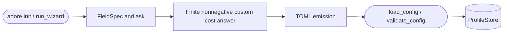

<!--
Copyright (c) 2026 DDP Engineering
This software is licensed under the PolyForm Noncommercial License 1.0.0.
Commercial use requires a separate commercial license.
See the LICENSE.txt file for full license details.
SPDX-License-Identifier: LicenseRef-PolyForm-Noncommercial-1.0.0
-->

# Assisted configuration wizard

## Purpose and boundaries

`04_Software/adore/wizard.py` implements `adore init`: it turns explicit
operator answers and environment guidance into a minimal, validated
runtime-project profile rather than asking an operator to hand-author every
TOML section.

## Public interface

`run_wizard()` drives the setup flow. `FieldSpec` and `ask()` provide the
validated prompt primitive; `ConsoleAsker` is interactive and `ScriptedAsker`
drives `--answers FILE` and offline tests. The result is a profile config and
metadata created through `ProfileStore`.

## Invariants

Every answer is validated before output. Non-interactive bad input fails fast;
interactive input is re-prompted. The assembled TOML is written to a temporary
file and passed through the same `load_config`/`validate_config` path as the
runtime before it can replace a profile, so invalid profiles are never saved.
Secrets are never written: only required environment-variable names are
derived. The wizard validates branch-rule compatibility and reports missing
tools or unsuitable AEGIS payloads as setup guidance, not a hidden mutation.

## Requirement coverage

- `REQ-FUNC-5771eecc` - generated configuration validates before it is saved.
- `REQ-FUNC-6c82ad42` - invalid/unconfirmed answers cannot create or overwrite a profile.

## Dependencies and verification

It composes doctor probes, profiles, typed config validation, and an injected
command runner. `04_Software/tests/test_wizard.py` covers a golden valid
profile, answer failures, overwrite/confirmation safeguards, deterministic
non-interactive output, branch checks, and the no-invalid-save guarantee.

## Routing

For assisted profile creation and custom budget answers, start at
`04_Software/adore/wizard.py` and `04_Software/tests/test_wizard.py`.
Enforcement and recovery belong to Orchestrator; profile storage belongs to Profiles.

## Key behaviors

- `REQ-FUNC-b0811cbe`: finite nonnegative reported-cost caps; zero explicitly
  disables monetary enforcement for subscription/local execution while retaining
  usage telemetry and other run bounds. Negative/nonfinite/type-invalid caps
  cannot create an executable profile. Positive defaults remain 5.0.

## Architecture

## Files

- `04_Software/adore/wizard.py`: validated interactive/scripted profile creation.
- `04_Software/tests/test_wizard.py`: generated-config and answer boundaries.
- `05_SoftwareDocu/Component_Wizard.md`: implementation-facing wizard contract.
