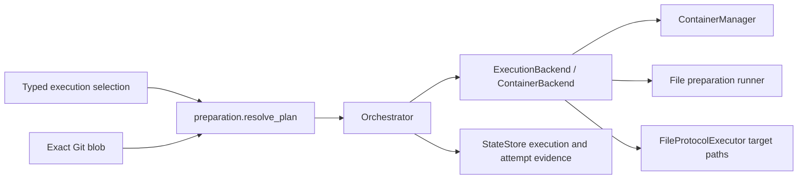

<!--
Copyright (c) 2026 DDP Engineering
This software is licensed under the PolyForm Noncommercial License 1.0.0.
Commercial use requires a separate commercial license.
See the LICENSE.txt in the .agentic folder for full license details.
SPDX-License-Identifier: LicenseRef-PolyForm-Noncommercial-1.0.0
-->

# TASK-315b24d1 - Gitea #24 shared execution backend and deterministic container preparation

stage: done
type: feature
path: full
interaction: autopilot
requirements: REQ-FUNC-e2b539d4, REQ-FUNC-e5419c07, REQ-REL-d8fd134e, REQ-FUNC-e397f7f6, REQ-UX-94a97e70
parent:
branch: task/adore-web-interface
base: 401ff250db47028b9986b150608de852a9e468ee
opened: 2026-10-07

## Done checklist (current stage)

- [x] validated candidate confirmed unchanged
- [x] validation evidence, diff, exclusions and outcome presented
- [x] existing explicit human authorization for local delivery recorded
- [x] journal/report included in local commit
- [x] local-only delivery and same-commit close-out completed

## Frame

Problem: STATED #24: container lifecycle coupling blocks shared execution environments; per-worktree preparation has no deterministic contract.
Desired outcome: A reviewed, revision-pinned container plan prepares dependencies sequentially before gates, retaining legacy profiles and safe recovery.
Actors: Project author writes recipes; administrator reviews selection; conductor owns lifecycle; executor owns AEGIS implementation; human approves publication.
Primary scenario: Reviewed profile selection -> exact Git recipe resolution -> complete plan validation -> worktree/container/tool checks -> bounded setup -> first AI gate in that container.
Examples: uv --version followed by uv sync --locked; multiline shell input containing spaces.
Counterexamples: uses, triggers, aliases, image conflicts, changed target revision and recovered incomplete setup fail before AI launch.
In scope: #24 backend/container adapter, closed recipe grammar, typed selection/preview, durable identity/evidence/recovery, CLI and existing GUI settings, affected docs/changelog.
Out of scope: #21 local adapter, #22 image builds, automatic tool discovery, live acceptance, remote publication, release assignment, planning edits, managed AEGIS payload.
Constraints: STATED existing task/adore-web-interface; portable standard-library core; offline injectable runners; preserved credentials/egress/gates/approval; focused checks only.
Success signals: Every #24 acceptance behavior has public positive/negative contract evidence and documented downstream seams.
Evidence: OBSERVED config.py typed defaults/dependencies=[], isolation.py ContainerManager, executor/base.py ExecTarget, launcher.py file protocol, orchestrator.py lifecycle, state.py strict schema 1, web/app.py scalar revision-bound apply. Complete issue bodies 24/23/21/22 read through tea ddp.
Assumptions: INFERRED schema-specific grammar is sufficient for the expressly small subset and preserves offline installation.
Unknowns: Live runtime/model/forge acceptance deferred; epic integration remains future work.
Decision-blocking questions: None; ticket delegates listed design choices and source inspection supports concrete decisions.
Proposed behaviors: Pin source/plan; prepare once per verified resource; fail closed on drift or interruption; replay only after explicit operator recovery; reuse existing configuration authorization.
Path and reason: full. New public behavior=no quick eligibility; new interface/format=no; dependency unchanged=yes; existing requirement fully covers=no; trust/data behavior unchanged=no. No children; implementation is tightly integrated.

## Requirement coverage

| Frame outcome / trigger | Atomic behavior / response | Requirement | Positive case | Boundary / failure | Verification / decision |
| --- | --- | --- | --- | --- | --- |
| Operator selects preparation | Resolve exact reviewed plan | REQ-FUNC-e2b539d4 | Multiline recipe and image | Unsupported YAML, linked blob, stale revision, image conflict | preparation.py public plan tests; closed v1 grammar |
| First recipe run | Ordered bounded setup before gates | REQ-FUNC-e5419c07 | Same-container ordered steps | Nonzero/timeout/cancel prevents gates | backend/conductor tests; file runner |
| Resume/retry after interruption | Identity-bound reuse or explicit replay | REQ-REL-d8fd134e | Same stopped resource reused | Corrupt state, drift, incomplete setup, exhausted replay | state/backend/conductor tests; closed additive record |
| Legacy/default operation | Shared execution lifecycle | REQ-FUNC-e397f7f6 | Existing gates/parking/auth/cleanup | Runtime/control failure | backend + impacted executor/isolation/conductor regression |
| Authorized settings review/apply | One normalized plan preview and evidence | REQ-UX-94a97e70 | CLI/GUI reviewed selection/effective image | Cross-project/role/stale/active apply | CLI/web/frontend tests; existing operations/guard paths |

Existing isolation/recovery/credential/approval requirements remain in force;
new requirements cover the added independent capabilities rather than rewriting
legacy semantics. Exact schema/recovery/limits are in the linked spec.

## Design

Requirements coverage: all five rows use the linked spec and public seams above.
STATED ticket delegates the listed design decisions. OBSERVED core dependencies=[];
the schema-specific parser preserves that installation/packaging contract.
Components: preparation.py resolves/validates/fingerprints source plans;
execution.py defines ExecutionBackend, target paths and ContainerBackend;
the existing ContainerManager stays the low-level argv/runtime resource adapter.
Orchestrator owns durable preparation status, cancellation and explicit retry;
the executor receives a backend-bound command target carrying target paths.
Data ownership: plan and redacted attempt evidence under the authoritative run
directory outside worktree; only transport scripts/results enter mounted IO.
Compatibility: optional closed execution record in schema 1; old state stays
legacy-only; old binaries reject new fields. MINOR feature, no release assignment.
Recovery: automatic transient retries cannot rerun steps; ordinary retry rejects
incomplete setup; retry --reprepare acknowledges whole-plan replay in a fresh
owned container/retained worktree, max configured attempts. Successful reuse
checks actual container and image IDs, not a name or success marker.
Security: exact regular Git blob, argv-only Git/runtime, file script transport,
same egress/environment as gates, no forge secrets. Redact all supplied secret
values before retention. Closed parser rejects rather than coerces semantics.
Ordering: complete plan -> worktree -> provision/tool/auth -> durable running
record -> sequential setup -> success record -> gates. Cancellation watcher
stops the owned container during setup; authoritative wrapper timeout is distinct
from an inner exit 124. Failed/interrupted setup never becomes ready.
UI: one execution.preparation scalar (path#job@commit) uses existing pending
review/apply; normalized preview binds current target and source at stage/apply.
Read-only plan/readiness does no setup. Run detail shows preparation evidence.
Backend target paths remove launcher mount assumptions through its injected seam,
retaining legacy defaults for fakes. #21 implements adapter/transport; #22 binds
verified image IDs through plan/operations. No local/build features implemented.
Alternatives: broad YAML dependency rejected to preserve offline stdlib contract;
general hand-written YAML parser rejected in favor of fixed-depth schema grammar;
automatic replay rejected because setup may be non-idempotent.
Risks: executable recipe/input and container runtime remain trust boundaries;
resource replacement requires explicit recovery; live and epic-wide proof deferred.
Expected files: preparation.py, execution.py, config.py, isolation.py, state.py,
orchestrator.py, executor/base.py + launcher.py, cli.py, web/app.py + jobs.py,
web/src settings/review/detail, config example, affected user/component docs,
component knowledge/context and Unreleased changelog; corresponding offline tests.
Open decisions: none before build; differences discovered later are recorded.

### Proposed architecture - TASK-315b24d1

## Log

- 2026-10-07 frame: full path, scope accepted under explicit autopilot instruction; existing clean branch verified; no journal belongs to #24 (0 open, historical search found none). Installed BMAD renderer and referenced setup skill are absent; repository-installed AEGIS governs implementation.
- 2026-10-07 validation deviation: full Python/frontend suites and strict --run deferred by originating user instruction; focused offline contracts, affected lint/type/build and strict advisory substitute. Epic-wide acceptance and live checks remain deferred.
- 2026-10-07 specify: five independent behavior requirements created; coverage audited against complete issue #24 and existing contracts; exact preparation/profile/recovery spec written. Reference syntax checked against official GitHub workflow and Gitea comparison documentation; compatibility covers only the closed subset.

- 2026-10-07 design: audited exact spec and backend architecture; no unresolved design decisions. Additional util.py raw-text command decoding is needed to fingerprint CRLF source bytes accurately; existing command semantics and injectable runners remain.
- 2026-10-07 build red: REQ-FUNC-e2b539d4; command=`.venv/Scripts/python.exe -m pytest -q tests/test_preparation.py`; exit=1; expected missing behavior=profile has no execution selection (1 failed, 3 passed).

- 2026-10-07 build green: `.venv/Scripts/python.exe -m pytest -q tests/test_preparation.py tests/test_config.py tests/test_config_line_endings.py`; exit=0; 87 passed, one existing Starlette deprecation warning; REQ-FUNC-e2b539d4 selection/source/grammar/policy contracts.
- 2026-10-07 build red: REQ-REL-d8fd134e and REQ-FUNC-e397f7f6; command=`.venv/Scripts/python.exe -m pytest -q tests/test_execution.py`; exit=1; expected missing behavior=runtime lacks durable fail-closed container/image identity (7 failed).

- 2026-10-07 build green: backend identity + isolation/util focused tests exit=0; 77 passed, 1 existing platform skip. File transport/result/redaction test also passed.
- 2026-10-07 build red: REQ-REL-d8fd134e; command=`.venv/Scripts/python.exe -m pytest -q tests/test_state.py::test_execution_state_is_additive_and_closed tests/test_execution.py`; exit=1; expected missing behavior=no durable execution state (1 failed, 8 passed).

- 2026-10-07 build green: `.venv/Scripts/python.exe -m pytest -q tests/test_state.py tests/test_execution.py`; exit=0; 40 passed, additive closed state and file-result evidence contracts.
- 2026-10-07 build red: REQ-FUNC-e5419c07 and REQ-REL-d8fd134e; command=`.venv/Scripts/python.exe -m pytest -q tests/test_orchestrator.py::test_recipe_preparation_precedes_ai_and_is_not_replayed_on_resume`; exit=1; expected missing behavior=AEGIS probe reached with zero preparation steps.

- 2026-10-07 build green: conductor/order/reuse + state/executor tests 61 passed; impacted conductor and checkpoint/handoff regressions 139 passed; exit=0.
- 2026-10-07 build red: REQ-UX-94a97e70; command=`.venv/Scripts/python.exe -m pytest -q tests/test_profile_cli.py::test_cli_previews_reviewed_plan_without_setup tests/test_web_pending_config.py::test_preparation_selection_reviews_plan_and_rejects_stale_source`; exit=1; expected missing behavior=CLI rejects config plan and GUI rejects execution.preparation (2 failed).

- 2026-10-07 build green: CLI and pending/web config selection/source/revision tests exit=0; 52 passed with one existing deprecation warning.
- 2026-10-07 build red: REQ-UX-94a97e70; command=`node --test tests/settings.test.mjs` from web; exit=1; expected missing behavior=unreviewed preparation enables Apply (1 failed, 8 passed).

- 2026-10-07 build red: REQ-FUNC-e397f7f6; command=`04_Software/.venv/Scripts/python.exe -m pytest -q 04_Software/tests/test_aegis.py::test_backend_paths_control_aegis_file_transport`; exit=1; expected missing behavior=AEGIS still invokes hardcoded container IO paths. Aegis-client component knowledge read; extend the already designed backend-native transport seam.

- 2026-10-07 build red: REQ-FUNC-e2b539d4; command=`04_Software/.venv/Scripts/python.exe -m pytest -q 04_Software/tests/test_preparation.py::test_job_ids_may_match_schema_field_names`; exit=1; expected missing behavior=valid job ID steps is mistaken for its child list.

- 2026-10-07 build red: REQ-FUNC-e5419c07; command=`04_Software/.venv/Scripts/python.exe -m pytest -q 04_Software/tests/test_execution.py::test_preparation_runner_redacts_existing_staged_auth_values`; exit=1; expected missing behavior=staged auth values are not yet redacted from preparation output. Use only the already-staged supported executor auth file, retaining credential scope.

- 2026-10-07 build red: REQ-REL-d8fd134e; command=`04_Software/.venv/Scripts/python.exe -m pytest -q 04_Software/tests/test_preparation_lifecycle.py::test_crashed_preparation_becomes_explicit_interrupted_evidence`; exit=1; expected missing behavior=crash reconciliation leaves preparation marked running after the run fails.

- 2026-10-07 build red: REQ-FUNC-e397f7f6; command=`04_Software/.venv/Scripts/python.exe -m pytest -q 04_Software/tests/test_preparation_lifecycle.py::test_legacy_retry_keeps_existing_profile_update_contract`; exit=1; expected missing behavior=legacy retry fails after operator runtime environment update. Preserve absent recipe records and existing profile recovery semantics; immutable preparation policy applies to recipe runs.

- 2026-10-07 build green: all new boundary corrections proved by preparation/execution/lifecycle and affected AEGIS/state/CLI/web/frontend regressions. Legacy retry focused proof: 16 lifecycle tests passed; recipe drift remains refused. Offline selected browser review/apply journey: 1 passed. Affected frontend typecheck/isolated production build passed. Component/user docs, requirements and knowledge reconciled.

- 2026-10-07 validate semantic review: return to build for two input-boundary corrections: reject invalid Unicode recipe text with the public typed error; reject linked preparation parents before creating transport directories. No scope/design change.

- 2026-10-07 build red: REQ-FUNC-e2b539d4 and REQ-FUNC-e5419c07; command=`04_Software/.venv/Scripts/python.exe -m pytest -q 04_Software/tests/test_execution.py::test_transport_rejects_linked_parents_before_creating_files 04_Software/tests/test_preparation.py::test_recipe_rejects_unsupported_ambiguous_and_excessive_input`; exit=1; 2 failed, 16 passed; expected failures=transport writes a directory before rejecting linked parent, and invalid Unicode escapes public typed error.

- 2026-10-07 build green: `04_Software/.venv/Scripts/python.exe -m pytest -q 04_Software/tests/test_execution.py 04_Software/tests/test_preparation.py 04_Software/tests/test_preparation_lifecycle.py`; exit=0; 73 passed. Both semantic findings corrected; affected component docs and requirement links updated; return to validate.

- 2026-10-07 validate semantic reconciliation: all 65 evolution paths reviewed; 11 added, 54 modified, none removed. Preparation tests existed at the anchor and correctly appear modified. No planning, managed AEGIS payload, version/dependency changes or unrelated candidate files. Proposed backend architecture matches current component diagrams. All five active requirements and concrete path/test links re-read; legal/traceability inspection passed. No Manual verification declarations in these five requirements. No children.
- 2026-10-07 explicit review round 1, specification question: Does the candidate implement the agreed #24 requirements/design and preserve scope/exclusions? Verdict=approved. Exact closed source/plan, bounded ordered setup, identity recovery, backend lifecycle, CLI/GUI authorization/evidence map to all five requirements. Legacy profile update/recovery retained. #21/#22 and remote/live/epic-wide acceptance excluded as instructed.
- 2026-10-07 explicit review round 1, quality question: Is the same candidate correct, fail-closed at external boundaries, portable, maintainable and sufficiently proved within authorized verification? Verdict=approved. Separate criterion review by the implementing agent; no external or second-agent review claimed. Semantic findings were corrected before these verdicts. Typed source/state/runtime errors, credential redaction, capped file/process/time evidence, ownership checks, negative public tests and directly affected regressions support approval; full/epic/live acceptance limitation remains explicit.

- 2026-10-07 final validation: unchanged reviewed candidate SHA-256=a1eb082d30a59f2e675173bfd6cbf96175bf7db5d2b2ed1f1c7480ae50e42961 (all changed Git-visible files except task records); evolution=65 product files (11 added, 54 modified, 0 removed), complete change=86 Git-visible files including project-owned governance.
- 2026-10-07 focused Python final proof: command=`.venv/Scripts/python.exe -m pytest -q tests/test_preparation.py tests/test_execution.py tests/test_preparation_lifecycle.py tests/test_config.py tests/test_config_line_endings.py tests/test_isolation.py tests/test_util.py tests/test_state.py tests/test_orchestrator.py tests/test_checkpoint_handoff.py tests/test_executor.py tests/test_aegis.py tests/test_profile_cli.py tests/test_web_pending_config.py tests/test_web_config.py tests/test_web_jobs.py tests/test_model_connection.py tests/test_portable_settings.py tests/test_web_portable_settings.py` from `04_Software`; exit=0; 677 passed, 1 existing platform skip, 1 pre-existing Starlette/httpx deprecation; 148.14 seconds. Covers new contracts and directly affected config, lifecycle, backend, transport, state, CLI, web and portable-settings behavior. Entire Python suite was not run.
- 2026-10-07 focused frontend final proof: command=`node --test tests/executionPlan.test.mjs tests/settings.test.mjs tests/settingHelp.test.mjs tests/jobs.test.mjs tests/portable.test.mjs` from `04_Software/web`; exit=0; 22 passed. Command=`npm run build:e2e`; exit=0; UI and E2E TypeScript checks, isolated Vite build and asset stamp passed. Existing large-bundle warning remains (743.82 kB minified), accepted as non-blocking; code splitting is outside #24. Command=`npx playwright test e2e/settings.spec.ts -g "review exact preparation commands before applying a recipe selection" --project=chromium`; exit=0; 1 passed (11.4 seconds), offline fixture. Existing NO_COLOR/FORCE_COLOR warning is cosmetic. Entire frontend suites were not run.
- 2026-10-07 static final proof: command=`04_Software/.venv/Scripts/ruff.exe check <all changed/new Python paths from git ls-files -m -o --exclude-standard>`; exit=0; all checks passed. `git diff --check` exit=0; Git line-ending normalization notices reflect configured attributes. Python inspection of every candidate legal prologue and all five requirement affected-path/AST test links passed. No dependency/version changes.
- 2026-10-07 strict advisory final proof: command=`python .agentic/aegis.py check --task TASK-315b24d1 --strict`; exit=0; strict ok, errors=0 warnings=9 notes=25. Eight warnings concern pre-existing stale requirement paths, two tracked sidecars and older journal metadata. Ninth is expected outside-layout for changed canonical config.example.toml. Notes belong to existing manual requirements outside this task. No malformed current journal/requirement flags. `--run` and full/integrated/live acceptance were not executed, per the recorded user constraint; focused evidence is the explicit substitute, not a claim of full acceptance.
- 2026-10-07 validate: specification and quality verdicts remain approved, round 1, for the unchanged reviewed candidate. Knowledge/context/architecture, requirements and manual-declaration inspection complete. Advance to local-only delivery.

- 2026-10-07 deliver: final unchanged candidate and approved verdicts confirmed; presentation includes focused commands/results, all accepted warnings and deferred full/epic/live proof, no children, and staged diff=86 files/3832 insertions/99 deletions before report/close-out. Originating human authorization permits local commit now on task/adore-web-interface; remote publication remains forbidden. Commit covers implementation/tests, directly affected docs/changelog and project-owned governance. Exclusions remain #21/#22, planning, release/dependency changes, managed AEGIS payload and live acceptance.

- 2026-10-07 DEVIATION validate: full Python/frontend suites and aggregate strict --run deferred by explicit originating user instruction; focused final proof substitutes for #24 only. Epic #23 integration and live acceptance remain unverified.
- 2026-10-07 deliver close-out: repository-local commit is the complete authorized outcome. Close-out is included before the same commit under deliver step 7; no push, PR/MR, merge, release or deployment. Report-time warning count 10 includes the expected two still-open delivery checklist items; close-out ticks them. Product/spec/requirements/knowledge candidate remains unchanged.

## Rulings

- RULING-001 | date=2026-10-07 | decision=Task-specific autopilot, focused validation and local commit authorized; no remote publication, branch/worktree change, global defaults or live acceptance | reason=Originating human instruction | source=user | supersedes=none

## Handoff

current: done
status: ready
next: none; local-only close-out is carried by the delivery commit.
must_read: .agentic/tasks/TASK-315b24d1.md, .agentic/steps/6_deliver.md
blockers: none

## Stage report

stage: deliver
result: completed
current: done
changed: #24 reviewed shared backend and deterministic container preparation delivered locally
evidence: 677 Python + 22 frontend + 1 browser passed; lint/type/build passed; strict advisory errors=0; local-only close-out included in delivery commit
issues: 1 existing platform skip; existing warnings; full/epic/live acceptance deferred by user instruction
next: none within #24 local delivery scope
needs_user: no
spec_compliance: approved
implementation_quality: approved
review_round: 1

## Delivery report (2026-10-07)

- stage: deliver; type: feature; path: full; branch: task/adore-web-interface
- requirements:
  - REQ-FUNC-e2b539d4 - Resolve reviewed container preparation plans
  - REQ-FUNC-e5419c07 - Execute bounded preparation before executor gates
  - REQ-REL-d8fd134e - Bind preparation recovery to immutable runtime identity
  - REQ-FUNC-e397f7f6 - Route executor lifecycle through a shared execution backend
  - REQ-UX-94a97e70 - Review execution plans through project configuration
- deviations: full suites and aggregate strict --run deferred by explicit user instruction; focused final #24 proof substitutes. Epic #23 integration and live acceptance remain unverified.
- explicit review: enabled; spec_compliance=approved; implementation_quality=approved; review_round=1
- diff vs task base 401ff25: 86 file(s) changed, 3834 line(s) added
- checks: errors=0 warnings=10 notes=25
- checklist: 3/5 done; open: journal/report included in local commit; local-only delivery and same-commit close-out completed
