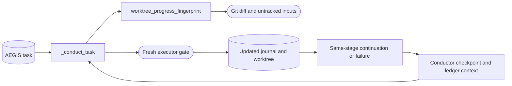

<!--
Copyright (c) 2026 DDP Engineering
This software is licensed under the PolyForm Noncommercial License 1.0.0.
Commercial use requires a separate commercial license.
See the LICENSE.txt in the .agentic folder for full license details.
SPDX-License-Identifier: LicenseRef-PolyForm-Noncommercial-1.0.0
-->

# TASK-44f819ac - Continue evidenced partial stages without spending recovery failures

stage: done
type: fix
path: full
interaction: autopilot
requirements: REQ-FUNC-dff76be9, REQ-FUNC-83133b5e, REQ-FUNC-28f0cd82
parent:
branch: ddp/pi-usage-accounting
base: a4d0e20b0046fc07d4e29bb688e0e5e383fbaac0
opened: 2026-09-28

## Done checklist (current stage)

- [x] Validated candidate confirmed unchanged except revalidated changelog correction
- [x] Validation evidence, diff, exclusions and local commit outcome presented
- [x] Local commit and task closure approved by the human
- [x] Journal and delivery report included in commit candidate
- [x] Approved repository-local commit prepared
- [x] Close-out carried by successful local delivery commit

## Frame

Problem: ADORE records successful but incomplete build sessions as NO_STAGE_PROGRESS failures, consuming the three-attempt recovery limit despite useful source/test changes.
Desired outcome: Finish or safely continue governed stage work, retaining genuine failure detection and all run/approval limits.
Actors: ADORE conductor, fresh executor, AEGIS task journal, operator.
Scenario: Fresh build session changes code/tests and appends durable evidence -> same stage remains -> checkpoint and fresh bounded continuation; eventually validate/deliver with independent verification.
Positive: Two materially progressing partial build sessions precede completion without failure incidents.
Counterexamples: Journal-only edits, code-only edits without append-only work evidence, rewritten history, failed commands or fingerprint failures never masquerade as continuations; total iterations/cost/time/files remain bounded.
Scope: orchestrator and isolation progress observation, offline tests, current component/operator docs, requirements and deployment script for the tested patch.
Exclusions: NILO ticket implementation, AEGIS payload, merging, manual commits/pushes, new model selection and unrelated prior usage patch.
Constraints: One stage per fresh session; journal stays stage authority; executor never commits or receives forge credentials; only conductor checkpoints; existing failure counter resets only after a real stage transition.
Success signals: Offline conductor/isolation tests prove continuation, rejection and budget exhaustion; canonical test/lint/strict proof; live startup/continuation when safe to deploy.
Evidence: STATED: user wants workflow flaws corrected. OBSERVED: both archived build attempts exit zero after source/test work and append partial green ledger entries; task remains build with needs_user=no. OBSERVED: current prompt allows a voluntary partial stop and recovery instruction is generic. INFERRED: distinguish measurable work plus appended ledger from a stall. UNKNOWN: final outcome of still-running third legacy attempt.
Interaction: Existing explicit user permission for repair branches and autopilot through validation continues; publication remains separate. Reuse ddp/pi-usage-accounting, preserving the prior validated uncommitted patch.
Path: full; adds observable continuation behavior and one isolation observation interface, no runtime dependency or persisted-state migration. Quick path fails the no-new-behavior/no-new-interface criteria.

## Requirement coverage

| Outcome | Requirement | Positive | Boundary | Verification | Design |
|---|---|---|---|---|---|
| Continue evidenced unfinished work | REQ-FUNC-dff76be9 | Code delta and appended work ledger | Only one signal, rewritten log, invalid fingerprint source | Orchestrator and isolation offline tests | Dirty work fingerprint plus append-only AEGIS log |
| Preserve recovery and bounds | REQ-FUNC-83133b5e | True failures retain attempt count; transition resets | Continuing work exceeds global iteration budget | Existing and added conductor tests | No continuation state field; existing budgets apply each launch |

## Design

Observe a worktree progress digest immediately before and after a successful same-stage gate. Hash the tracked binary diff against HEAD plus named untracked file contents; exclude task journals/sidecars and known generated caches, include source, tests, requirements, specs and component docs. Use Git pathspec exclusions and validate untracked relative paths; hash symlink targets without following them. Refuse Git/read failures.

Continue only when that digest changes AND the validated task log is a strict append-only extension with nonempty newly recorded evidence. Checkpoint through the conductor, record stage-continuation, and relaunch a fresh session with the recent ledger and instruction to read Handoff/Stage report and finish the current stage. Do not change the stage or reset stage_failures. Every new session still spends the existing iteration, wall-clock, cost and file budgets. A unchanged digest, missing/rewritten ledger or genuine nonzero exit keeps current recovery behavior; a snapshot trust failure stops visibly.

Strengthen initial stage prompts: perform the whole current stage before returning; zero exit does not itself prove completion; a necessary context handoff must preserve real candidate changes and appended evidence, never fabricate a stage advance. Blocking questions still park without failures. No additional config/state schema. Alternatives: forcing stage promotion discards unfinished work; trusting only a journal edit accepts bookkeeping churn; treating every partial stop as failed exhausts recovery without detecting an error.

### Proposed architecture - TASK-44f819ac

## Log

- 2026-09-28 frame: Full scope requested by user; retain prior usage candidate and branch, autopilot through validation, no manual publication.
- 2026-09-28 specify: Continuation requirement drafted; existing deterministic recovery contract retained. Positive, malformed-input, no-progress and overall-budget observations mapped.
- 2026-09-28 design: Combined candidate/ledger progress with existing budgets; no stage promotion or failure-counter reset for a partial checkpoint. Build begins.

- 2026-09-28 build red: corrected fixture stages show both continuation regressions fail as NO_STAGE_PROGRESS before implementation; isolation observation interface absent. Anchor captured after red.
- 2026-09-28 build: shared conductor combines changed candidate digest and strict nonempty append-only work ledger, checkpoints continuations without failure-counter resets, supplies fresh durable context, and strengthens whole-stage prompts. Isolation validates untracked paths and hashes link targets without following them. Focused component suite passed 121 tests; added advancement/failure/link cases passed 17 with one Windows symbolic-link privilege skip. Ruff passed. Active requirement, component docs and routing/architecture knowledge reconciled; validate begins.

- 2026-09-28 validate: semantic review confirms unchanged approval authority, genuine failure/timeout paths, no state schema/dependency change, and append-only ledger plus candidate-content trust checks. Reviewed source/tests/docs and preserved prior usage candidate; its requirement is included for integrated coverage. Evolution includes seven scoped non-AEGIS paths, with prior validated usage patch retained outside this task anchor.
- 2026-09-28 final validation: `python .agentic/aegis.py check --task TASK-44f819ac --strict --run` exit=0; full configured pytest command passed (20.7s), Ruff passed, errors=0, warnings=3, notes=1. Two tracked sidecars are pre-existing; previous usage task remains at its publication checkpoint; uncovered launcher belongs to its active usage requirement and is now explicitly included in this integrated journal. Windows cannot create unprivileged test symlinks, so that one focused case skipped locally; Linux deployment replay will execute it. Explicit review disabled. Validated candidate advances to deliver; manual commits/pushes remain outside current authorization.
- 2026-09-28 deployment decision: install an isolated patched runtime and select it for subsequent scheduled launches through a numbered host script. The current legacy conductor keeps its existing imported code and runtime paths; no interruption or forced AEGIS promotion. This satisfies the safe boundary by changing future dispatch, with live shared source hashes and Linux offline replay checked before scheduler selection.

- 2026-09-28 deployment verified: DCPServer numbered script 19 installed a separate runtime whose entire ADORE Python package matches this validated repository candidate, then atomically selected it for subsequent launches of all six profiles. Linux replay passed 126 conductor/isolation tests, including symbolic-link boundaries. Actual NIL worktree fingerprint and selected runtime import exit=0; idempotent reinstallation verifies full candidate and dispatcher hashes. The ongoing legacy build session is preserved at working/build, failures=2, iterations=6; NIL remains resumed and GPT-6 Sol/medium retained. No forced journal advance, commits or pushes. Deployment artifacts are known-good copies in DCP_Server 5_Software; canonical workflow code and tests remain in this ADORE repo.

- 2026-09-28 documentation follow-up: user asks whether ADORE documentation needs updates. Component contracts and knowledge already describe continuation; operator operations/recovery/configuration and cheat sheets omit its observable distinction. Return to validate for prose-only reconciliation and canonical final proof, then rebuild both existing 0.13.0 delivery packages under the prior explicit packaging request. No runtime, settings, model or version edits.

- 2026-09-28 documentation validation: operations, recovery, configuration reference and monitoring/recovery cheat sheets now explain candidate-plus-ledger continuation, unchanged stage observation, local checkpoints, failure-counter preservation, global budgets, NO_STAGE_PROGRESS and WORKTREE_PROGRESS. Semantic review matches source and active requirements; no executable, config or version change. `python .agentic/aegis.py check --task TASK-44f819ac --strict --run` exit=0, full configured tests passed (38.5s), Ruff passed, errors=0, warnings=4, notes=1. Two tracked sidecars and prior task's pending publication remain pre-existing; the two explicitly requested delivery archives are outside software layout and follow the separate packaging procedure. No required verification weakened.
- 2026-09-28 packaging outcome: regenerated ZIP and tar.gz at unchanged 0.13.0 after documentation proof. Archive read-back verifies identical 63-file payloads, exact current runtime source and every operator documentation file; release consistency --require-artifacts exit=0. Packaging is a separate delivery operation under the user's existing authorization. Component documentation and knowledge remain current; manual Git commit/push approval is still separate.

- 2026-09-28 delivery approval: user says "ok, close task and commit changes". Approved outcome is one local integrated commit in each repair repository and closure of these completed repair journals; remote push/PR/merge and NILO ticket closure are outside this outcome. Final candidate scope includes source/tests/current documentation, governance records and requested same-version packages; DCP excludes the unrelated WireGuard archive and .claude settings.

- 2026-09-28 local delivery close-out: approved integrated local commit carries this done journal and report. Report-time advisory counts are scoped to each journal: earlier ADORE tasks do not claim later feature coverage; TASK-4f1d55b2 provides the integrated final proof. Remaining close-out checklist warnings resolve with this journal update; prior accounted repository findings remain. Commit-only outcome has no subsequent push/PR/deployment gate. NILO ticket #26 is not closed or handed off.

## Rulings

- RULING-001 | date=2026-09-28 | decision=Correct observed ADORE workflow flaws through validation and reproducible deployment; preserve manual publication boundary | reason=Current user request and existing repair/autopilot authorization | source=user | supersedes=none

- RULING-002 | date=2026-09-28 | decision=Close completed repair journals and commit integrated changes locally | reason=Current explicit user approval | source=user | supersedes=none

## Handoff

current: done
status: ready
next: None; approved local commit is the delivery outcome
must_read: .agentic/tasks/TASK-44f819ac.md
blockers: none

## Stage report

stage: deliver
result: completed
current: done
changed: Evidenced stage continuation; local commit and task closure
evidence: Canonical ADORE full tests/Ruff/strict exit0;282 Linux component cases; equal63-file archives
issues: Accepted advisory findings recorded; NILO #26 remains stopped at validate
next: None; local commit only
needs_user: no
spec_compliance: disabled
implementation_quality: disabled
review_round:

## Delivery report (2026-09-28)

- stage: deliver; type: fix; path: full; branch: ddp/pi-usage-accounting
- requirements:
  - REQ-FUNC-dff76be9 - Continue evidenced partial stage work within run budgets
  - REQ-FUNC-83133b5e - Recover governed stage failures deterministically
  - REQ-FUNC-28f0cd82 - Collect Pi assistant token and cost usage
- deviations: none recorded
- explicit review: disabled; existing validation remains required
- diff vs task base a4d0e20: 56 file(s) changed, 2593 line(s) added
- checks: errors=0 warnings=13 notes=1
- checklist: 5/6 done; open: Close-out carried by successful local delivery commit
