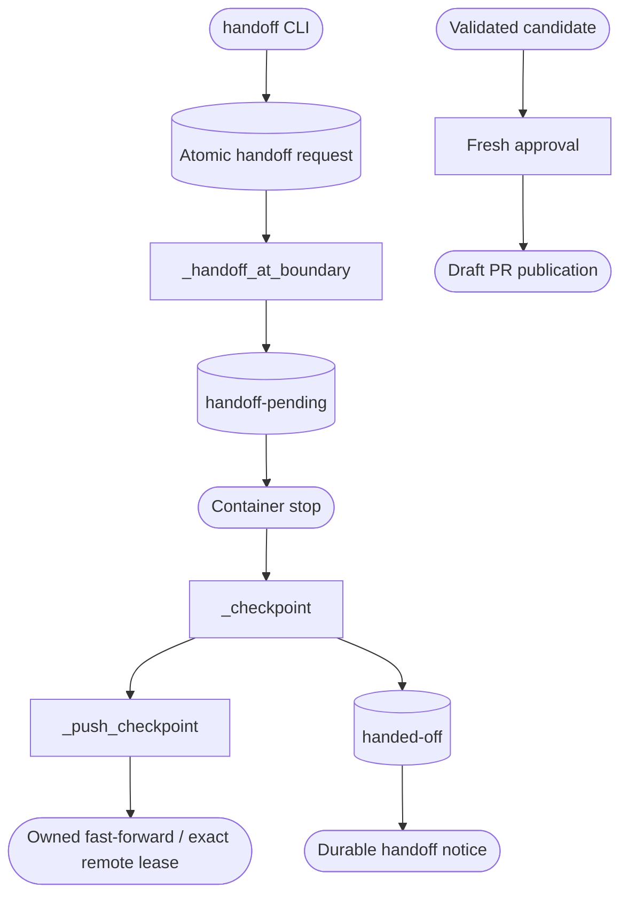

<!--
Copyright (c) 2026 DDP Engineering
This software is licensed under the PolyForm Noncommercial License 1.0.0.
Commercial use requires a separate commercial license.
See the LICENSE.txt in the .agentic folder for full license details.
SPDX-License-Identifier: LicenseRef-PolyForm-Noncommercial-1.0.0
-->

# TASK-4f1d55b2 - Publish opt-in progress checkpoints and transfer runs to human ownership

stage: done
type: feature
path: full
interaction: autopilot
requirements: REQ-FUNC-dd307c58, REQ-FUNC-c9d64cfe, REQ-FUNC-ff7dad34, REQ-FUNC-b0811cbe, REQ-FUNC-dff76be9, REQ-FUNC-28f0cd82
parent:
branch: ddp/pi-usage-accounting
base: a4d0e20b0046fc07d4e29bb688e0e5e383fbaac0
opened: 2026-09-28

## Done checklist (current stage)

- [x] Validated candidate confirmed unchanged except revalidated changelog correction
- [x] Validation evidence, diff, exclusions and local commit outcome presented
- [x] Local commit and task closure approved by the human
- [x] Journal and delivery report included in commit candidate
- [x] Approved repository-local commit prepared
- [x] Close-out carried by successful local delivery commit

## Frame

Problem: Work before delivery approval lives only on the conductor host; a developer cannot fetch it or explicitly take ownership without manual recovery.
Desired outcome: Optional automatic remote progress checkpoints plus an explicit safe human handoff.
Actors: Operator, conductor, coding executor, forge, human developer.
Scenario: Enabled profile -> local checkpoint -> guarded remote push -> visible WIP status; handoff request -> current bounded session finishes -> container stopped -> final checkpoint attempted -> handed-off state with preserved evidence and no automatic resume.
Examples: NILO adore/pi-26 becomes fetchable before delivery approval; handoff preserves task journal and candidate for a developer.
Counterexamples: Remote developer commits are never overwritten; a malformed remote response or pending/live ownership never permits unsafe continuation; missing approval never opens a PR; publication off never pushes ordinary checkpoints.
Scope: Shared config, Git isolation, state, conductor, CLI, offline tests, operator/component documentation, same-version packages and reproducible server deployment with NILO opt-in.
Exclusions: Merging; automatically handing off the live ticket; editing NILO product code; manual commits/pushes of these repair repositories; resuming handed-off runs; arbitrary gate interruption.
Constraints: Retain all prior uncommitted validated work. Existing repair/autopilot authorization persists; current implement authorizes the detailed proposal and NILO opt-in. Forge credentials remain conductor-only. All host changes use numbered DCP setup.
Success signals: Offline config/default/type tests; guarded Git push and conflict/race/corrupt-response cases; status/default/approval/continuation cases; idle and queued handoff, notification failure, cleanup, retry/reset refusal, preserved dirty recovery; canonical full proof and live deploy/read-back.
Evidence: STATED: user says implement after approving proposal. OBSERVED: _checkpoint commits locally; _publish pushes after approval; failed runs preserve resources; pause affects only new pickup; one conductor lock owns mutation. INFERRED: additive state fields and durable request markers support backward-compatible recovery. UNKNOWN: stage where live ticket will be at rollout; defer rollout to a safe boundary.
Path: full. New observable behavior=no quick eligibility; new CLI/config/state interface; no runtime dependency; security/publication contract changes explicitly authorized.
Interaction: autopilot through validation; manual repository publication stays separate.

## Requirement coverage

| Outcome | Requirement | Positive | Boundary | Design/test seam |
|---|---|---|---|---|
| Fetchable WIP checkpoints | REQ-FUNC-dd307c58 | enabled local checkpoint pushes and records exact commit | default off, invalid bool, remote divergence/corruption/failure/race | typed opt-in, guarded WorktreeManager push, conductor/status tests |
| Exclusive human ownership | REQ-FUNC-c9d64cfe | idle or queued handoff stops and preserves run | active lock, stop/push/notification failure, automatic retry/reset/cleanup | durable request marker, safe boundary, handed-off state, CLI/state tests |
| Delivery approval | REQ-FUNC-ff7dad34 | exact approval opens draft | WIP push grants no delivery approval | existing and new conductor approval cases |

## Design

REQ-FUNC-dd307c58: delivery.publish_checkpoints is a strict boolean default false. Each normal conductor checkpoint may push its clean committed head with WIP message/status, including evidenced continuation. Isolation validates branch/ref output and uses an atomic compare-and-update lease without force-overwriting a divergent branch. The durable state stores last verified remote checkpoint and push error. Remote equality to current HEAD permits crash recovery; unexpected remote changes fail loudly and stop automatic work. Transient push failure is retried within existing bounds; remaining failure preserves local work, marks remote stale and posts a required notice. Each later checkpoint retries; no PR or approval is produced by this path.
REQ-FUNC-c9d64cfe: handoff command writes an atomic validated request marker independently of conductor state ownership; if lock free it executes immediately, otherwise it queues for the current bounded executor to finish. Conductor checks before new sessions and after each executor returns, and during reconciliation/publication boundaries. Container stop must succeed before ownership is marked handed-off. Final dirty checkpoint is attempted; failure retains dirty files and reports recovery limitation. Final guarded remote push is explicitly authorized by handoff even if ordinary checkpoint opt-in is off. Persist handed-off before notifications; notification failures retain ownership rather than rearming code work. Clear request after durable completion. Polling, retry/reset and orphan cleanup preserve handed-off work; explicit cancel/delete remain resource-release operations.
Compatibility: schema1 fields additive with defaults; unknown/corrupt fields and request markers fail closed. New lifecycle is understood by the upgraded core; deploy only at an idle boundary. Executor receives no new credentials. Existing branch name is retained. Approval remains bound to exact validated candidate; revise/merge behavior preserved.
Concurrency: one conductor owns state, commits and remote pushes; only request marker is an out-of-band write. Remote pushes compare exact expected ref so developer commits cannot be lost between observation and write. Local human edits begin only after handed-off status, never while request is queued.
Observability: exact local/remote commit and error in state/status; checkpoint-pushed, checkpoint-push-failed and handed-off events; comments contain WIP disclaimer and fetch/journal instructions, with adapter-neutral ticket URL-derived branch links.
Tradeoff: active handoff waits for bounded gate completion instead of killing a process mid-write. Human ownership has no automatic hand-back; recreate/reassign intentionally later.
Risks: remote visibility of unfinished tracked content is explicitly authorized; existing gitignore and conductor-only credentials remain. Git race requires lease-qualified ref update. Stage branch collision is treated as external ownership rather than adopted implicitly.
Expected files: config/isolation/state/orchestrator/cli; their tests; sample config and operator/component/context/knowledge docs; metrics terminal recognition and tests. No architecture split; existing components retain ownership.

### Proposed architecture - TASK-4f1d55b2

## Log

- 2026-09-28 frame: Full path accepted under current implementation request and earlier autopilot repair authority; existing repair branch retained to integrate preserved accounting/continuation/zero-cap work.
- 2026-09-28 specify: Two independent behavior requirements drafted; delivery requirement clarified to distinguish opt-in WIP checkpoint publication from approval-bound delivery.
- 2026-09-28 design: Explicit opt-in, durable remote checkpoint state, remote ownership guard and safe queued human handoff selected. Build begins; no unresolved product decision.

- 2026-09-28 build red: REQ-FUNC-dd307c58 and REQ-FUNC-c9d64cfe; command=`python -m pytest -q 04_Software/tests/test_checkpoint_handoff.py --tb=no`; exit=1; 21 expected failures and3 existing-boundary passes. Missing behavior: opt-in default/type validation, remote guarded publication and durable checkpoint fields, safe handoff/request/CLI and remote ownership error. Test package import corrected before observing this behavior failure.

- 2026-09-28 build: shared config/Git/state/conductor/CLI/metrics implementation and operator/component docs completed. Focused integrated component suite267 passed/1 platform skip;38 new contract cases pass. Safe-boundary audit adds durable handoff-pending before stop/Git work so handed-off never permits editing while the conductor mutates the worktree. Interrupted transfer resumes; notification transport cannot reclaim human ownership. Failed-run polling publishes existing committed recovery work without restarting development. Requirement coverage active; validate begins.

- 2026-09-28 final core validation: `python .agentic/aegis.py check --task TASK-4f1d55b2 --strict --run` exit=0 after final semantic/contract/knowledge review. Configured full pytest passed20.8s; Ruff passed0.1s; errors0/warnings7/notes1. Accepted advisory findings are two pre-existing tracked sidecars, three prior validated task delivery checklists, the operator config template outside layout, and explicitly requested delivery ZIP/tar.gz outside layout; existing manual-verification requirement note remains. Evolution records21 scoped non-AEGIS modified paths since red anchor, including the new test file that was present at anchor. No source/test/docs changes after proof.
- 2026-09-28 package and live outcome: ZIP/tar.gz regenerated at existing0.13.0 with equal payload bytes; release consistency exit=0. ZIP SHA2566f2d4b0d36fa3eae50993f191f802a24f3765dee910e1ec7a762fae86a8d52b8. DCP numbered script21 verifies this exact24-file Python inventory, installs an isolated selected core under conductor lock and changes only NIL delivery.publish_checkpoints=true. Installation/reinstallation/public config validation exit=0;282 offline Linux component tests pass. Public poll publishes preserved committed branch adore/pi-26; ls-remote confirms ec8b1708b1965f3452145eaacfb69c4e05fb6c2d matches durable checkpoint_remote_commit, error empty. Existing failed validate iteration11 remains stopped; latest dirty task journal stays local until explicit human handoff. No live handoff or manual Git publication performed.

- 2026-09-28 close-out review: user explicitly approves local commits and task closure. Final diff exposed duplicate new-feature entries under historical changelog releases and a repeated Unreleased Fixed heading; reconcile release history before publication. Return to validate for documentation-only correction; runtime source and installed deployment remain unchanged. Both local archives will be refreshed; immutable DCP deployment ZIP retains its recorded installation receipt. No push, PR, merge or NILO handoff requested.

- 2026-09-28 delivery approval: user says "ok, close task and commit changes". Approved outcome is one local integrated commit in each repair repository and closure of these completed repair journals; remote push/PR/merge and NILO ticket closure are outside this outcome. Final candidate scope includes source/tests/current documentation, governance records and requested same-version packages; DCP excludes the unrelated WireGuard archive and .claude settings.

- 2026-09-28 final close-out validation: changelog now keeps checkpoint/handoff entries only in Unreleased and uses one Fixed section. Canonical `python .agentic/aegis.py check --task TASK-4f1d55b2 --strict --run` exit0; full tests17.1s/Ruff0.1s; errors0/warnings7/notes1 with prior explained findings. Archives regenerated at0.13.0;63 payload files identical and release consistency exit0. Latest ZIP SHA256611a5c2089710c517d42c048ae8541522d925ce5eab0d3b98fb22e4a22ea16eb. Runtime source unchanged; DCP retains immutable installed ZIP6f2d4b0d and its original receipt. No source/test/docs changes after proof.

- 2026-09-28 local delivery close-out: approved integrated local commit carries this done journal and report. Report-time advisory counts are scoped to each journal: earlier ADORE tasks do not claim later feature coverage; TASK-4f1d55b2 provides the integrated final proof. Remaining close-out checklist warnings resolve with this journal update; prior accounted repository findings remain. Commit-only outcome has no subsequent push/PR/deployment gate. NILO ticket #26 is not closed or handed off.

## Rulings

- RULING-001 | date=2026-09-28 | decision=Implement approved checkpoint/handoff proposal through validation and NILO deployment opt-in; retain separate manual Git publication boundary | reason=Current implement request and persistent repair authority | source=user | supersedes=none

- RULING-002 | date=2026-09-28 | decision=Close completed repair journals and commit integrated changes locally | reason=Current explicit user approval | source=user | supersedes=none

## Handoff

current: done
status: ready
next: None; approved local commit is the delivery outcome
must_read: .agentic/tasks/TASK-4f1d55b2.md
blockers: none

## Stage report

stage: deliver
result: completed
current: done
changed: WIP checkpoints and safe human handoff; local commit and task closure
evidence: Canonical ADORE full tests/Ruff/strict exit0;282 Linux component cases; equal63-file archives
issues: Accepted advisory findings recorded; NILO #26 remains stopped at validate
next: None; local commit only
needs_user: no
spec_compliance: disabled
implementation_quality: disabled
review_round:

## Delivery report (2026-09-28)

- stage: deliver; type: feature; path: full; branch: ddp/pi-usage-accounting
- requirements:
  - REQ-FUNC-dd307c58 - Publish explicit work-in-progress checkpoints with remote ownership protection
  - REQ-FUNC-c9d64cfe - Transfer preserved runs to explicit human ownership at safe execution boundaries
  - REQ-FUNC-ff7dad34 - Conduct governed ticket delivery
  - REQ-FUNC-b0811cbe - Permit an explicitly disabled reported-cost budget
  - REQ-FUNC-dff76be9 - Continue evidenced partial stage work within run budgets
  - REQ-FUNC-28f0cd82 - Collect Pi assistant token and cost usage
- deviations: none recorded
- explicit review: disabled; existing validation remains required
- diff vs task base a4d0e20: 56 file(s) changed, 2619 line(s) added
- checks: errors=0 warnings=8 notes=1
- checklist: 5/6 done; open: Close-out carried by successful local delivery commit
