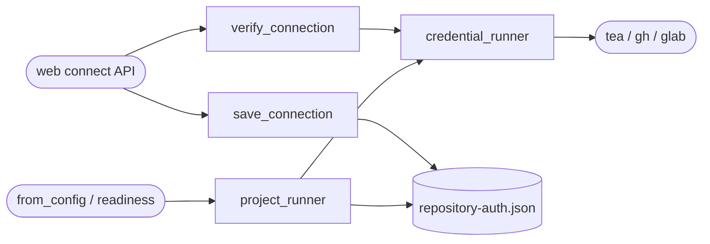

<!--
Copyright (c) 2026 DDP Engineering
This software is licensed under the PolyForm Noncommercial License 1.0.0.
Commercial use requires a separate commercial license.
See the LICENSE.txt in the .agentic folder for full license details.
SPDX-License-Identifier: LicenseRef-PolyForm-Noncommercial-1.0.0
-->

# TASK-51cc42f9 - Connect project repository credentials from GUI

stage: done
type: feature
path: full
interaction: autopilot
requirements: REQ-FUNC-5de75419, REQ-SEC-d5459298
parent:
branch: task/adore-web-interface
base: d6d82a0685f9e9b2d534d8db17908d9942b8d035
opened: 2026-10-06

## Done checklist (current stage)

- [x] validated candidate unchanged, distinct reviews approved
- [x] candidate, targeted proof and full-suite deviation presented
- [x] standing human scoped commit/push/deploy authority recorded
- [x] journal/report committed and scoped product delivered
- [x] close-out after successful delivery

## Frame

Problem: STATED repository sign-in currently requires external server setup.
Desired outcome: STATED configure Gitea, GitHub and GitLab sign-in from GUI.
Actors: Administrator; service-account worker.
Primary scenario: Summary -> Connect repository -> review server/repository -> submit token -> verify account and repository read access -> save scoped credentials -> readiness and worker use them.
Examples: STATED Gitea project currently reports failed sign-in.
Counterexamples: Failed verification never replaces saved credentials; no token enters executor environment or browser storage.
In scope: Admin/CSRF connector, three forge CLI bindings, protected profile-local secrets, bounded verification, redaction, targeted tests, same-change docs, normal commit/push/deploy.
Out of scope: OAuth application enrollment, Git clone/push credential setup, merges, live executor acceptance, epic continuation, full suite.
Constraints: Four hours, three fix cycles, twenty authored files, no agents; preserve other projects and existing global logins. Full suite deferred by user.
Success signals: Verified account/repository result; same selected-project credentials used in host check and worker; invalid input/output and corrupt/stale storage fail closed without secret disclosure.
Evidence: OBSERVED forge adapters accept injectable runners; from_config currently uses shared CLI auth; profile metadata has immutable project_id. OBSERVED official CLI environment/config contracts and local tea help.
Assumptions: INFERRED current iterative commit/push/deploy authority applies.
Unknowns: Actual account permissions and token validity remain human live acceptance.
Decision-blocking questions: None.
Proposed behaviors: Explicit token form; scope-bound saved auth; memory-only browser secret; request clears token; host/repository/account success result; old readiness invalidated after credential replacement.
Path and reason: Full. New public behavior/interface yes, existing requirement coverage no, new dependency no, security/data change yes; quick path rejected.

## Requirement coverage

| Outcome | Atomic behavior | Requirement | Positive | Boundary | Verification | Design |
|---|---|---|---|---|---|---|
| GUI login | Verify then save selected account | REQ-FUNC-5de75419 | all three CLI/API identities | bad token/HTTP/JSON/wrong repo | offline API + browser | scoped connector |
| Protect credentials | Isolated fail-closed binding | REQ-SEC-d5459298 | worker and readiness use project scope | CSRF/role/corrupt/stale/output/storage | offline public boundary tests | secret runner + atomic record |

## Design

REQ-FUNC-5de75419: new repository_auth module owns URL/token validation, account and repository JSON verification through injected CLI runner and atomic profile-local repository-auth.json publication. GUI receives only provider, server, repository and authenticated account. Admin sees explicit form/disclosure in Summary. Credentials stored only after both probes succeed, timeouts bounded; no write API scope assertion or Git push claim.
REQ-SEC-d5459298: record binds immutable project_id plus platform kind/repo/login. Missing record preserves existing CLI behavior; malformed/mismatched record raises typed ForgeError subclass and never falls back. read metadata verifies immutable identity. Runner injects token only for selected forge CLI, sanitizes returned streams, leaves other commands untouched. GH/GitLab env tokens and isolated config dirs; tea reads a temporary 0600 JSON-as-YAML config through XDG_CONFIG_HOME (official config schema) with configured login name. Temporary directory is cleaned after each invocation, never touches shared logins. No token argv or executor propagation.
Request validation rejects controls, URL credentials/path/query/fragment, oversized token and unacknowledged HTTP. HTTPS verifies certificates; optional HTTP requires explicit administrator acknowledgement for existing local Gitea. Selected server is shown before submission. Authentication is read-only /user + repository request; CLI failure/malformed identity fails closed. Saved record uses atomic replace and 0600; containing profile permissions remain operator-owned on Windows.
Config lock plus conductor lock prevent replacement during active work. Identity/config digest rechecked after network verification. Audit records action/project only. Readiness evidence removed before publication (safe failure leaves evidence absent); fresh explicit check needed. Existing verification reporting not forged.
Orchestrator.from_config binds forge runner using env-file parent; GUI readiness binds same module. Existing CLI/global auth unaffected when no scoped record. No config schema migration or new dependency. Backups contain secrets and must retain service-account access restrictions.
Tests: API happy/all providers, auth and trust boundary failures, runtime isolation/redaction; browser localized keyboard form/success/failure/unmount. Limits as Frame. No open product decisions.
### Proposed architecture - TASK-51cc42f9

Expected files: repository_auth.py, orchestrator.py, web/app.py, RepositoryConnection.tsx, App.tsx, focused backend/browser tests, component/operator/knowledge/changelog and requirements/spec.

## Log

- 2026-10-06 frame/specify/design: Accepted scoped GUI login for three providers under standing authority; two atomic requirements and scoped CLI design recorded; targeted testing only, no children.

- 2026-10-06 build red: `.\04_Software\.venv\Scripts\python.exe -m pytest -q 04_Software/tests/test_repository_connection.py` exit1/7 failures; expected missing endpoint returned405. No source changed before anchor.

- 2026-10-06 build: Three-provider verified connector, protected isolated CLI binding, engine/readiness integration and memory-only four-locale GUI complete. Focused backend/readiness46passed23.08s; six browser journeys passed25s; typecheck/e2e build exit0. Local tea0.16 isolated JSON-as-YAML config parse exit0 without network. Targeted review and docs pending.

- 2026-10-06 DEVIATION validate: Explicit user full-suite deferral; targeted Python/browser/typecheck/build and strict catalog replace check--run. Full application regression and live token permissions remain unproven.

- 2026-10-06 validate: Reviewed final source/GUI/schema/locks/redaction, docs, contexts and requirement links. Separate same-agent compliance and implementation-quality lenses approve round1; no agents or independent-agent claim. Architecture matches repository-auth knowledge. No scope expansion or genuine open product decision. Auth success remains read-only permission evidence, Git transport external. Full-suite deviation retained. Seventeen authored paths plus generated/workflow separately; within four-hour/three-cycle/twenty-authored-file bounds.
- 2026-10-06 final focused proof: Backend/readiness46passed23.08s; existing from_config env/preference compatibility1passed0.46s; focused Ruff exit0; UI/E2E typecheck and isolated build exit0; final six browser journeys passed28.8s after CSS spacing fix. Production build exit0,index-BuRvXcMA.js/index-DFwp1Ryh.css. Existing Vite bundle-size advisory accepted; full-suite coverage remains unproven. Narrow dark screenshot inspected, fields/buttons wrap with no overflow; no secret present.
- 2026-10-06 host provisioning: DCP service PATH originally had tea0.15.1 but no gh/glab. Simulated apt install added exactly two packages, zero upgrades/removals; actual Ubuntu gh2.45.0 and glab1.36.0 installation exit0. Both now visible in service PATH. Isolated tea/glab config-format reads exit0 with dummy offline placeholder and no network/authentication. Local tea0.16 config read also exit0. Existing CLI logins unchanged; real token acceptance pending. Readiness and worker services active before deploy; sufficient disk available.

- 2026-10-06 final catalog: strict exit0,0errors; existing two tracked sidecars/four legacy journal issues retained. Scoped .gitignore outside-layout accepted as credential protection. Generated minified bundle scan-size heuristic remains advisory; source/asset construction reviewed, no real credentials embedded. Generated asset coverage added to requirement. No source/test edits after proof.
- 2026-10-06 deliver: Candidate17 authored paths, generated assets and workflow/docs presented with47Python/6browser proof and full-suite deviation. Standing human authority covers normal commit/push and existing DCP deploy; no PR/merge/version or live forge/executor acceptance.

## Rulings

- RULING-001 | date=2026-10-06 | decision=Continue scoped implementation, targeted validation, normal commit/push/deploy | reason=Explicit current implementation request and standing iterative delivery authority; full suite deferred | source=user | supersedes=none

## Handoff

current: done
status: ready
next: Human live token acceptance for each provider; full regression suite at the end of GUI iterations.
must_read: .agentic/specs/REQ-FUNC-5de75419.md
blockers: none

## Stage report

stage: deliver
result: completed
current: done
changed: GUI repository connection for Gitea/GitHub/GitLab and isolated worker/readiness credentials.
evidence: Python47/browser6 passed; lint/typecheck/build passed; d346014 pushed and deployed, both services active, HTTPS health/readiness200 and protected projects401, served assets identical.
issues: Full suite deferred by user; live token/Git transport acceptance pending.
next: Human live token acceptance and deferred final full suite.
needs_user: no
spec_compliance: approved
implementation_quality: approved
review_round: 1

## Delivery report (2026-10-06)

- stage: deliver; type: feature; path: full; branch: task/adore-web-interface
- requirements:
  - REQ-FUNC-5de75419 - Connect and verify a project repository account
  - REQ-SEC-d5459298 - Isolate repository credentials and reject corrupt evidence
- deviations: 1 recorded
  - validate: Explicit user full-suite deferral; targeted Python/browser/typecheck/build and strict catalog replace check--run. Full application regression and live token permissions remain unproven.
- explicit review: enabled; spec_compliance=approved; implementation_quality=approved; review_round=1
- diff vs task base d6d82a0: 31 file(s) changed, 1527 line(s) added; 1 file(s) not content-scanned
- checks: errors=0 warnings=8 notes=25
- checklist: 3/5 done; open: journal/report committed and scoped product delivered; close-out after successful delivery

## Delivery close-out (2026-10-06)

- Product commit d34601419348f55684381c13d126eaa0be0e148c normally pushed to task/adore-web-interface; remote head verified. Candidate archive SHA256 21ac33115824e41e4b5635887527389bc38b0ed4afb3754f668e946c020de876 verified before extraction.
- Existing DCP instance deployed successfully from /home/dpasare/apps/adore/web-ux-d346014. Backup: /home/dpasare/apps/adore/backups/web-ux-d346014-20261006170726. Both API/worker services active with candidate PYTHONPATH; served JS/CSS byte-identical to candidate. SQLite schema14/integrity ok, audit58. HTTPS root/health/readiness200; protected projects401 authentication_required. No real-token verification or live job/executor acceptance performed.
- Implementation/delivery complete; full suite deferred by user, real Gitea/GitHub/GitLab token and Git transport permissions remain human acceptance. Journal-only close-out committed separately after successful deployment.
