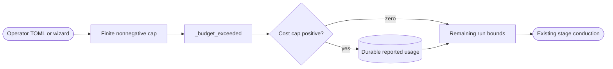

<!--
Copyright (c) 2026 DDP Engineering
This software is licensed under the PolyForm Noncommercial License 1.0.0.
Commercial use requires a separate commercial license.
See the LICENSE.txt in the .agentic folder for full license details.
SPDX-License-Identifier: LicenseRef-PolyForm-Noncommercial-1.0.0
-->

# TASK-53654d5b - Allow explicitly disabled cost caps for subscription executors

stage: done
type: change
path: full
interaction: autopilot
requirements: REQ-FUNC-b0811cbe, REQ-FUNC-dff76be9, REQ-FUNC-28f0cd82
parent:
branch: ddp/pi-usage-accounting
base: a4d0e20b0046fc07d4e29bb688e0e5e383fbaac0
opened: 2026-09-28

## Done checklist (current stage)

- [x] Validated candidate confirmed unchanged except revalidated changelog correction
- [x] Validation evidence, diff, exclusions and local commit outcome presented
- [x] Local commit and task closure approved by the human
- [x] Journal and delivery report included in commit candidate
- [x] Approved repository-local commit prepared
- [x] Close-out carried by successful local delivery commit

## Frame

Problem: NIL ticket #26 reached validate but stopped at BUDGET_EXHAUSTED because Pi reported $6.22 above its configured $5 cap, despite subscription OAuth.
Desired outcome: Operator can explicitly disable the reported-cost cap and recover the preserved run; dollar metrics remain visible and other run budgets remain enforced.
Actors: Operator, config validator, assisted wizard, shared ADORE conductor, subscription executor.
Scenario: Set max_cost_usd=0 -> valid profile -> high historic cost does not stop stage conduction -> remaining bounded validation and human publication approval.
Positive: Zero through TOML and wizard accepts; $6.22 historical usage continues. Positive caps still stop at their thresholds.
Counterexamples: Negative, nonfinite, boolean and nonnumeric caps fail closed; zero never disables iteration/time/file limits or changes provider authentication/account limits.
Scope: ADORE config/orchestrator/wizard, tests, component/operator docs, same-version packages, numbered DCP deployment/profile update and public retry of preserved ticket #26.
Exclusions: Manual commits/pushes/merge, AEGIS payload, clearing usage or failure history, changing other profiles, disabling provider usage limits.
Constraints: Existing user repair/autopilot authority persists; current request explicitly authorizes removing NIL's monetary limit. Positive $5 defaults remain for unchanged API-backed profiles. Preserve all earlier usage/continuation work on ddp/pi-usage-accounting.
Success signals: Offline load/conduction/wizard positive and malformed boundaries; full canonical test/lint/strict proof; numbered host setup sets zero and validates exact installed source/profile; public retry resumes validate with preserved $6.22 history.
Evidence: STATED: user uses ChatGPT subscription and requests cap removal. OBSERVED: server lifecycle failed/stage validate/iterations6/failures0, empty notification outbox, Pi model openai-codex/gpt-6-sol medium and openai-codex auth type oauth. OBSERVED: config enforces >0 and conductor compares cost unconditionally. OBSERVED: official OpenAI auth distinguishes ChatGPT subscription from API-key usage; provider plan limits remain independent. UNKNOWN: account-side credits/overage settings; tool cost field is not a provider invoice.
Path: full; changes the allowed configuration contract and wizard interface. Quick criteria fail new behavior/interface requirements.
Interaction: autopilot through validation under existing authorization; no manual publication.

## Requirement coverage

| Outcome | Requirement | Positive | Boundary | Verification | Design |
|---|---|---|---|---|---|
| Explicit monetary opt-out | REQ-FUNC-b0811cbe | TOML/wizard zero plus high recorded cost | Negative/nonfinite/type corruption, other budget exhausted | Config, wizard and conductor offline tests | Finite nonnegative cap; enforce only positive values |

## Design

Use the existing numeric max_cost_usd field: zero explicitly disables only cost enforcement, positive finite values retain their meaning/default. Config rejects booleans, strings, negative and nonfinite numbers without uncaught type errors. Wizard custom budgets accept finite nonnegative numbers and label zero as disabling the cap. The conductor reads historical cost once only when the cap is positive; usage journaling/metrics are untouched. Existing time/iteration/file checks remain in their established order. No runtime dependency or state migration.

Deploy an isolated same-version runtime from the exact verified delivery ZIP through a numbered setup script. Acquire NIL's existing conductor lock, validate the resulting zero-cap profile against new code before atomic selection, preserve profile state/auth/model and scheduler behavior, then use public retry to recover the failed run. All infrastructure mutations remain reproducible in DCP_Server 5_Software.

## Log

- 2026-09-28 frame: Observed preserved validate failure caused solely by positive cost cap; scope/autopilot resolved from current request and earlier repair authorization.
- 2026-09-28 specify: Explicit-zero requirement drafted with positive cap compatibility and invalid-type/budget boundaries.
- 2026-09-28 design: Finite nonnegative numeric setting, positive-only enforcement and unchanged usage metrics selected. Wizard is an affected component; its knowledge and component contract read. Full path; build begins.

- 2026-09-28 build red: REQ-FUNC-b0811cbe; command=`python -m pytest -q 04_Software/tests/test_config.py 04_Software/tests/test_orchestrator.py 04_Software/tests/test_wizard.py -k cost_cap --tb=no`; exit=1; expected missing behavior=zero rejected by config/wizard and cost checked unconditionally; malformed caps also expose infinity/bool acceptance and uncaught string comparison. Nine expected failures after correcting the scripted-asker fixture's interaction mode.

- 2026-09-28 build: config accepts explicit zero and rejects invalid/nonfinite types, conductor enforces only positive caps without clearing usage, and custom wizard documents/accepts zero. Three focused component files pass 145 tests; seven cost/enforcement cases including validation-to-approval with $6.22 history pass. Ruff clean after routine formatting. Requirement active; operator/component docs, budget policy and config/wizard routing/architecture knowledge updated. Existing continuation/usage candidates preserved. Validate begins.

- 2026-09-28 validate: semantic review confirmed finite nonnegative config/wizard contract, zero-only monetary bypass, retained history and other run bounds, positive cap compatibility and unchanged subscription authentication. Evolution refreshed; final `python .agentic/aegis.py check --task TASK-53654d5b --strict --run` exit=0: configured full pytest passed in41.8s and Ruff in0.2s, errors=0/warnings=6/notes=1. Accepted advisory findings: two tracked sidecars, prior validated tasks' unticked delivery checklists, operator configuration template outside layout, and explicitly requested delivery archives outside layout; existing requirement manual-verification note retained. No source/test/docs candidate edits after proof.
- 2026-09-28 package/deployment: both delivery archives rebuilt at existing0.13.0, source inventory and archive equivalence verified, release consistency exit=0. ZIP SHA256 c10e248f43a69e250b0169dc196bedd060231b23f52bb28ae1c69cea30ac2f9e. DCP numbered script20 selected this exact isolated shared runtime and NIL max_cost_usd=0 under conductor lock, preserving model/medium and all other settings. Host installation/reinstallation/public config validation exit=0;147 Linux config/conductor/wizard tests pass. Public retry resumes ticket26 validate/working iteration7 with running container; six historical usage records totaling$6.2230356 remain. DCP full repository proof passed independently. No manual commits/pushes introduced; delivery publication remains outside authorization.

- 2026-09-28 delivery approval: user says "ok, close task and commit changes". Approved outcome is one local integrated commit in each repair repository and closure of these completed repair journals; remote push/PR/merge and NILO ticket closure are outside this outcome. Final candidate scope includes source/tests/current documentation, governance records and requested same-version packages; DCP excludes the unrelated WireGuard archive and .claude settings.

- 2026-09-28 local delivery close-out: approved integrated local commit carries this done journal and report. Report-time advisory counts are scoped to each journal: earlier ADORE tasks do not claim later feature coverage; TASK-4f1d55b2 provides the integrated final proof. Remaining close-out checklist warnings resolve with this journal update; prior accounted repository findings remain. Commit-only outcome has no subsequent push/PR/deployment gate. NILO ticket #26 is not closed or handed off.

## Rulings

- RULING-001 | date=2026-09-28 | decision=Remove monetary limit for NIL subscription execution and recover through validation; preserve other budgets and manual publication boundary | reason=Current explicit request plus prior repair/autopilot/resume authorization | source=user | supersedes=none

- RULING-002 | date=2026-09-28 | decision=Close completed repair journals and commit integrated changes locally | reason=Current explicit user approval | source=user | supersedes=none

## Handoff

current: done
status: ready
next: None; approved local commit is the delivery outcome
must_read: .agentic/tasks/TASK-53654d5b.md
blockers: none

## Stage report

stage: deliver
result: completed
current: done
changed: Explicit zero monetary cap; local commit and task closure
evidence: Canonical ADORE full tests/Ruff/strict exit0;282 Linux component cases; equal63-file archives
issues: Accepted advisory findings recorded; NILO #26 remains stopped at validate
next: None; local commit only
needs_user: no
spec_compliance: disabled
implementation_quality: disabled
review_round:

## Delivery report (2026-09-28)

- stage: deliver; type: change; path: full; branch: ddp/pi-usage-accounting
- requirements:
  - REQ-FUNC-b0811cbe - Permit an explicitly disabled reported-cost budget
  - REQ-FUNC-dff76be9 - Continue evidenced partial stage work within run budgets
  - REQ-FUNC-28f0cd82 - Collect Pi assistant token and cost usage
- deviations: none recorded
- explicit review: disabled; existing validation remains required
- diff vs task base a4d0e20: 56 file(s) changed, 2606 line(s) added
- checks: errors=0 warnings=11 notes=1
- checklist: 5/6 done; open: Close-out carried by successful local delivery commit
