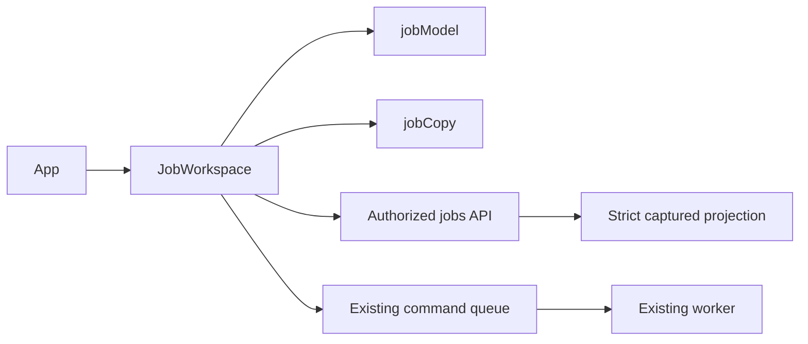

<!--
Copyright (c) 2026 DDP Engineering
This software is licensed under the PolyForm Noncommercial License 1.0.0.
Commercial use requires a separate commercial license.
See the LICENSE.txt in the .agentic folder for full license details.
SPDX-License-Identifier: LicenseRef-PolyForm-Noncommercial-1.0.0
-->

# TASK-60c83db1 - Action-oriented project hubs and authorized job workspace

stage: done
type: feature
path: full
interaction: autopilot
requirements: REQ-UX-b758d2b7, REQ-UX-78923e00, REQ-FUNC-25dc0271, REQ-UX-a7969a9d
parent:
branch: task/adore-web-interface
base: e48be8dc0264e2e066481d4ed24fbb504b378102
opened: 2026-10-05

## Done checklist (current stage)

- [x] validated candidate confirmed unchanged; otherwise returned to validate
- [x] validation evidence, diff, exclusions, and outcome presented
- [x] delivery confirmed by the human
- [x] journal and report included in the delivery commit
- [x] agreed outcome delivered, normally a PR
- [x] close-out committed after the outcome succeeded, or carried by the
      delivery commit where nothing could fail after it

## Frame

Problem: STATED operators cannot tell why work waits or where to act.
Desired outcome: STATED next action is explained from retained evidence across authorized projects.
Actors: authenticated admin; developer with assigned project grants; human forge responder/approver/reviewer; worker/conductor.
Primary scenario: open Overview -> complete authorized attention read -> open composite job -> read real evidence -> act on forge or submit a permitted queued command.
Examples: clarification with saved question/comment opens the ticket; approval opens the observed candidate comment.
Counterexamples: missing approval evidence does not manufacture a link or named reviewer; done does not imply merged.
In scope: #12 Overview, project hub/list, complete global Jobs, details, localization, offline tests, documentation.
Out of scope: #13 settings redesign; statistics/message contract; merge/UI approval/job pause; other tickets; releases/live acceptance.
Constraints: four hours; three corrective review cycles; twenty authored product/doc files; workflow/generated counted separately; external executors/subagents/extra paid API cost zero; existing task/adore-web-interface branch.
Success signals: all eight issue criteria tested with honest unknown/error/authorization behavior; exact candidate final proof/inventory.
Evidence: OBSERVED App.tsx scoped runs-page UI; adore/web/jobs.py and Component_Web_Jobs.md complete revision-bound API; native #12 dependencies #5/#11 closed, authenticated tea ddp; local/remote HEAD e48be8dc0264e2e066481d4ed24fbb504b378102 clean. STATED approved English DESIGN_BRIEF.md and captures.
Assumptions: INFERRED safe observed event timeline and compatible global advanced filters are minimal supporting backend work.
Unknowns: measured consumption, named actors, unseen journal stages and live host acceptance remain unknown.
Decision-blocking questions: none within authorized scope.
Proposed behaviors: scoped attention/current-state cards; independent pickup/verification; authorized hub links; complete global search/pagination; observed details/timeline; asynchronous effects/results.
Path and reason: full, changed public behavior and additive compatible read fields/query filters.
| Quick criterion | yes | no | Evidence |
|---|---|---|---|
| No observable behavior change | | x | redesigned views |
| No interface/data addition | | x | global advanced filters/timeline |
| No dependency | x | | existing React/Python |
| Existing requirement covers all | | x | new UX contract |
| No security/data behavior effect | | x | validated frontend evidence boundary |
Children: none; tightly coupled scope, explicit zero delegation budget.

## Requirement coverage

| Frame outcome | Atomic behavior | Requirement | Positive case | Boundary or failure | Verification | Design decision or no impact |
|---|---|---|---|---|---|---|
| Attention/detail | Scoped evidence presentation | REQ-UX-b758d2b7 | actual clarification and approval links | incomplete/corrupt/stale evidence | jobs browser/model tests | JobWorkspace validated projection |
| Project hub | Authorized context/pickup/verification navigation | REQ-UX-78923e00 | Summary and existing Settings URLs | unassigned project/Dev Access | browser/routes tests | App/routes and revision-bound verification |
| Global backend support | Complete advanced filter/timeline read | REQ-FUNC-25dc0271 | exact executor/outcome/date plus safe timeline | invalid/torn/secret/unauthorized sources | test_web_jobs | strict captured source allowlist |
| Mutations | Explained actual async command result | REQ-UX-a7969a9d | start42 queues then succeeds | start43 fails; changed lifecycle refuses | real API fake worker/browser | fixed existing operation contracts |

## Design

Requirements coverage: REQ-UX-b758d2b7 -> JobWorkspace + validated jobModel/localized jobCopy; REQ-UX-78923e00 -> App project hub/routes/verification; REQ-FUNC-25dc0271 -> captured source projection + app filters/detail; REQ-UX-a7969a9d -> existing command queue with explicit effects/ref locks/final-result polling.
Responsibilities: App keeps session/shell/project/config/statistics contracts; JobWorkspace owns scoped jobs/overview/detail requests, controls and command feedback; jobModel validates safe evidence; jobCopy owns EN/FR/DE/RO copy. Python strict projection owns sanitized observed timeline/executor identities, API owns authorization/filtering.
Interfaces: additive contract documented in specs/REQ-UX-b758d2b7.md; legacy endpoints and URL paths remain valid; add /projects/<id>/history with terminal job scope; Settings remains legacy configuration URL; Prices remains reachable in Settings.
State: memory request/filter state only; server sources and command queue remain authoritative. Distinct lifecycle/stage, no stage progress synthesis or merge outcome inference.
Execution: read complete server page -> validate -> render; continuation sends snapshot; source conflict hides candidate and reloads first page only on explicit restart. Detail guards composite identity and scope. Poll heartbeat and pending operations with visibility-aware bounded timers; late/unmounted/session results ignored.
Failure: hide totals on malformed/incomplete/error; display distinct incomplete message and explicit restart for changed sources. Queue failures retain actual result; uncertain requests remain visible instead of claiming success. Existing API rechecks grants at execution.
Security: exclude unauthorized navigation and reject direct routes; never fetch unassigned source; validate HTTP(S) links/no credentials/controls/backslashes; only saved redacted fields; no financial detail inference.
Concurrency: scoped generation/request sequence, immediate ref submission lock; optimistic revisions clearly explained. Selected job stays within owning project; colliding IDs use composite keys/URLs.
Compatibility: no dependency/persisted state schema change. Keep Configuration/Prices links and Jobs project+run deep links. History is terminal job history, not later structured audit work.
Observability: persisted last activity; >15 minutes labeled old recorded activity (not proof of failure); heartbeat independent; unknown named actors, timestamps/usage and unobserved steps explicit.
Test seams: public Python HTTP; pure model validation Node tests; real API offline browser fixture with fake commands, response faults for incomplete/corrupt transport and delayed races.
Alternatives: concatenating project pages cannot prove completeness; calling live forge on refresh violates evidence contract; no speculative usage collectors.
Expected files (19 authored limit): App, routes, styles, JobWorkspace, jobModel, jobCopy; tests/jobs.test.mjs; e2e/jobs.spec.ts, server.py, shell.spec.ts, dashboard.spec.ts; adore/web/app.py, jobs.py; tests/test_web_jobs.py; Component_Web_Frontend.md, Component_Web_Jobs.md, Component_Web_API.md; Web_Interface.md; CHANGELOG.md. Workflow/generated separately.
Risks: global reads scan retained history, not durable frozen snapshots; old sources may omit evidence. Long App extraction is incremental; preserve settings/metrics behavior.
Open decisions: none; absent telemetry stays unknown.

### Proposed architecture - TASK-60c83db1

## Log

- 2026-10-05 build red: REQ-FUNC-25dc0271 / REQ-UX-b758d2b7; `pytest -q tests/test_web_jobs.py -k summary_preserves` exit=1; missing legacy update timestamps made /projects return 503, blocking navigation to valid strict jobs.
- 2026-10-05 DEVIATION build: minimal compatible project summary correction accepts absent legacy activity as unknown, while malformed nonempty timestamps still fail closed; necessary to expose #11 honest missing evidence through #12 navigation. Supporting gap and test recorded before implementation.

- 2026-10-05 build red: REQ-FUNC-25dc0271 supporting attention filter; `pytest -q tests/test_web_jobs.py -k advanced_filters` exit=1; attention=true returned 4 ordinary jobs instead of 0. Exact compatible filter documented in spec before implementation.

- 2026-10-05 build red: REQ-UX-b758d2b7, REQ-UX-78923e00, REQ-UX-a7969a9d; command=`npm run test:e2e -- --grep "overview foregrounds|hub separates|manual start explains"`; exit=1; three expected missing-behavior failures: Needs attention heading absent, independent Pickup/Environment verification columns absent, explicit command-effect guidance absent. Browser build/types succeeded; fake worker/real API fixture used.

- 2026-10-05 build green: REQ-FUNC-25dc0271; full focused `pytest -q tests/test_web_jobs.py` exit=0, 76 passed in 26.66s; existing FastAPI TestClient deprecation warning. Additive advanced filters/safe timeline preserve legacy routes and strict source semantics.

- 2026-10-05 build red: REQ-FUNC-25dc0271; command=`04_Software/.venv/Scripts/python.exe -m pytest -q tests/test_web_jobs.py -k "advanced_filters or projected_timeline"` (04_Software); exit=1; expected missing behavior=global advanced filters ignored (4 instead of 1), invalid observed executor/stage returned 200 instead of fail-closed 503 (four failures).

- 2026-10-05 design: audited component/data/request/permission boundaries and 19 expected authored paths; full design retained above; no children/dependencies.

- 2026-10-05 specify: created four atomic requirements; existing shell/legacy paging requirements inspected and preserved; supporting contract documented before implementation.

- 2026-10-05 frame: full scope accepted under standing autopilot authority; native blockers closed and clean shared branch verified; no child tasks.

- 2026-10-05 frame: <scope agreed, exclusions, chosen path and why>

- 2026-10-05 build red: REQ-UX-b758d2b7; `npm --prefix 04_Software/web test` exit=1 (37 passed, 1 failed), inconsistent lifecycle/group accepted; timeline browser selector `observed timeline retains` exit=1 (27 rows rather than paged 11). Preserve existing timeline pagination and reject contradictory transport counts/groups before rendering.

- 2026-10-05 build red: REQ-UX-78923e00; `npm run test:e2e -- --grep "project hub exposes"` exit=1; Summary omitted observed verification revision/check time. Add visible evidence and reject malformed transport timestamps rather than crashing rendering.
- 2026-10-05 focused green: Node helpers 38 passed; jobs/shell browser 25 passed in 56.1s; scoped Python jobs/readiness/RBAC/paging/commands 126 passed in 50.46s. Production build exit=0, existing bundle-size advisory. Supplemental `uv run ruff check .` findings corrected (test line lengths/import order), rerun exit=0. Manual inspection of light 390px and dark desktop captures found clear conditional action text, identity and safe timeline; table wrapping/required markers restored before final proof.

- 2026-10-05 final focused green: verification evidence/timestamp boundary and keyboard/theme/locales selectors 2 passed in 11.5s; UI/E2E typecheck succeeded. Final production `npm run build` exit=0; source-backed assets regenerated, old hashes removed, three earlier active requirement asset references refreshed without behavior changes. Complete supplemental generated-asset secret-pattern scan performed; no private/access key found, localized password form/message identifiers are benign. File ownership remains 19 authored paths, generated/workflow separate.
- 2026-10-05 build audit: component/operator/changelog/knowledge/project context reconciled; environment commands and tooling remain current. Advisory baseline sidecar/journal warnings remain out of scope; password literals are isolated offline fixture credentials/sentinels, and generated-JS catalog size limit is supplemented by full source/provenance/pattern inspection. Existing Vite bundle-size and Node color warnings are nonfatal. Evolution excludes early backend edits already in the later anchor; full Git diff against e48be8d independently covers every candidate path.

- 2026-10-05 validate semantic review: full Git candidate including early jobs.py changes reviewed hunk by hunk against all eight #12 criteria, active requirements/spec, design and exclusions. Current knowledge architecture preserves App/session -> JobWorkspace -> validated model/copy -> strict jobs API and existing worker queue. Environment unchanged; 19 authored files plus generated assets/workflow. Source-secret review classifies five generated password matches as React input metadata and four locale labels.
- 2026-10-05 independent specification-compliance verdict: approved, round 1, candidate digest `a6648bbe8a4b07b892587593a51adb978c3c95704a56b4c7dd202660b99e6fb5` (all candidate paths except mutable journal). Actual saved clarification/candidate/draft locations, independent pickup/verification, exact lifecycle/stage/quick events, contextual permitted commands and actual async results, scoped unknown/stale/heartbeat evidence, denial/error boundaries and composite URL compatibility are covered. No #13, financial contract, dependency/version or publication expansion. No open scope decision.
- 2026-10-05 independent implementation-quality verdict: approved, round 1, same candidate digest. Reviewed capture-before-filter/redaction, date bounds, typed corruption, optimistic continuation, URL authorization/validation, request/session generations, submission locks and operation polling, handoff/archived guards, Windows/Linux fixture cleanup, reverse-copy timeline pagination and maintained settings/statistics seams. Focused positive/negative tests and screenshot inspection support the result; full proof still required. No unresolved corrective finding; zero corrective review cycles used.

- 2026-10-05 final strict attempt 1: exit=1, strict.passed=false, errors=1. Python 942 passed/1 platform skip/1 existing deprecation warning; lint exit=0; frontend 58 passed/1 failed. Last new verification browser test failed with `apiResponse.json: Response has been disposed` in its response-rewrite handler, not an assertion. Failure evidence retained in TASK-60c83db1.validation-attempt1.json and ignored Playwright trace/context. Implementation-quality verdict changes_required for fixture handler lifetime; specification remains in scope. Clear both bound verdicts and return to build for corrective cycle 1 (maximum 3).

- 2026-10-05 corrective cycle 1 complete: existing verification test now identifies alpha explicitly and drains page-route handlers with `unrouteAll(behavior=wait)` before context disposal. No assertions, test coverage, timeouts or product behavior changed. Focused selector `project hub exposes` passed (1 test, 5.5s); UI/E2E typecheck succeeded. Earlier verdicts remain historical, replaced below; one of three corrective cycles used.
- 2026-10-05 independent specification-compliance review round 2: approved; all eight #12 criteria, active requirement/spec prose and exclusions remain satisfied. Candidate digest `7081b4505b61c756b3cc9fb0a58c60f55da1e910aa227bafcc78b656a3ca7ced` covers authored/generated/context/knowledge/requirement/spec paths; task journals and generated verification evidence are mutable records excluded from this semantic digest. Exact final ownership will additionally seal these records.
- 2026-10-05 independent implementation-quality review round 2: approved; same digest. Re-reviewed only changed fixture lifecycle plus integrated previously reviewed boundaries: awaited handlers preserve all assertions and fail on handler errors rather than ignoring them, explicit project selection is order-independent, production source/assets are unchanged. Requirement links/docs/environment remain current; no unresolved finding. Final whole-tree proof still required.

- 2026-10-05 final strict proof: `python .agentic/aegis.py check --task TASK-60c83db1 --strict --run --json` exit=0; strict.passed=true, errors=0, promoted warnings=0; test exit=0 (156.7s), lint exit=0 (0.1s), frontend exit=0 (121.3s). Python 942 passed/1 existing Windows unprivileged-symlink skip/1 existing Starlette-httpx deprecation warning; all 59 Chromium journeys passed, with Node helpers/UI-E2E types/isolated build in the successful configured frontend command. Exact envelope retained in TASK-60c83db1.validation-final.json. First failed gate is separately retained, never substituted for this final proof.
- 2026-10-05 final advisories: six WARNs: historical tracked fingerprints (one finding), unrelated TASK-5e99ee1d/TASK-c765e6b4 malformed legacy fields (two findings), generated JS catalog size limit (full supplemental patterns/provenance inspected), and two isolated offline test password literals. Thirty manual-verification NOTE records belong to other repository requirements. No task-owned traceability/review error or unresolved candidate failure. Nonfatal Vite >500kB and Node colour/deprecation warnings retain their prior classifications; no verification weakened.

- 2026-10-05 deliver pause: unchanged semantic candidate digest 7081b4505b61c756b3cc9fb0a58c60f55da1e910aa227bafcc78b656a3ca7ced confirmed; prepare exact SHA-256 ownership inventory as TASK-60c83db1.candidate.json (pure delivery evidence, not a new behavioral spec). Present 19 authored / 5 generated / 14 workflow path actions, final strict proof, round-2 approved verdicts, one corrective cycle, no children, scope exclusions and conditional commit/normal push/issue-12 closure. Local/remote base unchanged; no publication attempted. Delivery advisory has zero errors and seven warnings: the six classified proof advisories plus expected unticked delivery items awaiting the authorized publication condition. Repeat the accepted missing-legacy-activity deviation at presentation. Await coordinator exact-inventory verification and delivery instruction under standing human authority; no new human permission request.

- 2026-10-05 deliver authorization condition satisfied: coordinator source chat 01a10aec-6ac2-79f3-ada3-741950212fb8 independently verified all 37 inventoried hashes/deletions plus inventory self SHA-256 8b2948ea07f155f7e9a869165df6aa5c81ee5a881a6e638bc3d2eb7639586ff6, exact 38-path status, unchanged local/remote base, full strict proof, round-2 verdicts, all eight criteria and relevant seams. Under existing human authority, instructed scoped commit with requirement IDs, normal push to existing branch, remote verification, acceptance evidence and #12 closure/readback; epic #3 open with session/commit mapping; truthful small close-out commit/push. Accepted presented warnings/deviation; no semantic candidate change. Primary agent repeated exact byte/status/base checks successfully before journal-only delivery records. No PR/merge/tag/version/deploy/later issue work authorized.

- 2026-10-05 deliver outcome verified: implementation commit 52615886b2f44c8725023b4d28d43d8af51f743c includes exactly the 38 scoped path actions (Git summary detects CSS rename, yielding 37 displayed files); only journal delivery/report records differ from pre-delivery seal. Normal push succeeded; remote Git and authenticated Gitea git/commits readback match. All non-journal working-byte inventory hashes/deletions and inventory self hash remain unchanged after commit, including generated working bytes despite Git CRLF normalization. Authenticated issue #12 acceptance evidence comment 2073, body 8/8 checked and state closed verified; labels unchanged. Epic #3 remains open/labels unchanged, session 01a10d7b-02e4-7752-81a1-0663a3dbdc97 -> TASK-60c83db1 -> implementation commit mapping recorded in comment 2077. Delivery outcome succeeded before this journal-only close-out commit; push/readback of that follow-up remains the final transport step. No live/novice/full-accessibility acceptance, PR/merge/tag/version/deploy or later issue work. Final strict proof and approved round-2 semantic digest remain unchanged.

## Rulings

- RULING-001 | date=2026-10-05 | decision=Autopilot scope and routine stages through final validation; scoped commit/normal push/closure conditional on coordinator verification of exact unchanged candidate | reason=Standing human authority relayed in task dispatch; await coordinator delivery instructions without a new human permission request | source=user | supersedes=none
- RULING-002 | date=2026-10-05 | decision=Use repository AEGIS directly; no BMAD setup, executors or subagents | reason=Explicit human/coordinator direction and zero additional executor/cost budget | source=user | supersedes=none

## Handoff

current: done
status: ready
next: push journal-only close-out and verify final remote equality/clean status
must_read: .agentic/steps/6_deliver.md, .agentic/tasks/TASK-60c83db1.validation-final.json, .agentic/tasks/TASK-60c83db1.candidate.json
blockers: none; implementation pushed, issue 12 closed, epic 3 open

## Stage report

stage: deliver
result: completed
current: done
changed: action-oriented hubs/jobs/detail, tests/docs and scoped delivery
evidence: strict exit 0; 942 Python/1 skip; 59 Chromium; implementation 5261588 remote verified; issue 12 closed 8/8; epic 3 open
issues: six classified proof advisories; fixture correction retained; no unresolved delivery blocker
next: push journal-only close-out; verify remote equality and clean status
needs_user: no
spec_compliance: approved
implementation_quality: approved
review_round: 2

## Delivery report (2026-10-05)

- stage: deliver; type: feature; path: full; branch: task/adore-web-interface
- requirements:
  - REQ-UX-b758d2b7 - present complete authorized scoped current-state
  - REQ-UX-78923e00 - distinguish pickup state from revision-bound environment verification
  - REQ-FUNC-25dc0271 - apply bounded observed-executor, outcome
  - REQ-UX-a7969a9d - explain the permitted command effect
- deviations: 1 recorded
  - build: minimal compatible project summary correction accepts absent legacy activity as unknown, while malformed nonempty timestamps still fail closed; necessary to expose #11 honest missing evidence through #12 navigation. Supporting gap and test recorded before implementation.
- explicit review: enabled; spec_compliance=approved; implementation_quality=approved; review_round=2
- diff vs task base e48be8d: 38 file(s) changed, 2691 line(s) added; 1 file(s) not content-scanned
- checks: errors=0 warnings=7 notes=30
- checklist: 4/6 done; open: agreed outcome delivered, normally a PR; close-out committed after the outcome succeeded, or carried by the delivery commit where nothing could fail after it
