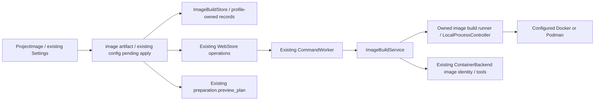

<!--
Copyright (c) 2026 DDP Engineering
This software is licensed under the PolyForm Noncommercial License 1.0.0.
Commercial use requires a separate commercial license.
See the LICENSE.txt in the .agentic folder for full license details.
SPDX-License-Identifier: LicenseRef-PolyForm-Noncommercial-1.0.0
-->

# TASK-6a22c8fa - Gitea #22 compact project image definition build verification and reviewed apply

stage: done
type: feature
path: full
interaction: autopilot
requirements: REQ-FUNC-a6a81d86, REQ-REL-2cbd8d83, REQ-FUNC-6d6843ab, REQ-SEC-56f5f4a9, REQ-UX-1b9b5789
parent:
branch: task/adore-web-interface
base: 79dbabb41efbf265371f4cab218426242edd0955
opened: 2026-10-07

## Done checklist (current stage)

- [x] validated candidate confirmed unchanged
- [x] validation evidence, diff, exclusions and outcome presented
- [x] authorized local delivery decision recorded
- [x] journal and report included in delivery commit
- [x] local-only delivery commit completed
- [x] close-out included with delivery commit

## Frame

Problem: STATED #22 requires administrators to prepare project images through external tools.
Desired outcome: Define a Dockerfile, explicitly build/verify on the configured ADORE server runtime, review and select the verified image in existing project Settings.
Actors: Administrator owns executable Dockerfile/tools; developer reads; durable web worker owns bounded operations; conductor retains run preparation/delivery.
Primary scenario: Saved stopped container project -> define/import Dockerfile -> reviewed bounded queued build -> image/executor/tool verification -> revision-bound candidate -> existing guarded apply.
Examples: Extend installed ADORE base with a compiler; retain Existing image; upload bounded UTF-8 Dockerfile text.
Counterexamples: Local profile, unauthorized developer/other project, context paths/COPY/ADD, corrupt runtime identity, stale draft/config, failed/cancelled/interrupted build never become applied images.
In scope: #22 project artifact/build/verify/review and durable queue integration; controlled runtime client, strict ownership/identity/bounds, compact existing Environment GUI, offline focused proof and directly affected docs/changelog/knowledge.
Out of scope: target YAML writes, automatic tooling/package inference, context snapshots, base-image construction, registry publishing/image deletion/pruning, local host preparation, remote Git publication, planning/release/managed payload edits, full suites and live acceptance.
Constraints: STATED preserve same chat/branch/checkout and existing work; task-specific AEGIS autopilot/local commit preauthorized, offline injected external boundaries; no complete suites/aggregate --run. Bound implementation edits to 45 files/5 review fix cycles, individual verification commands to finite timeouts; no live build.
Success signals: Define -> Build and verify -> Use image browser journey, explicit tools/library/model distinctions, all input/operation/apply trust boundaries prove happy and negative paths.
Evidence: OBSERVED complete issue #22 via tea ddp; clean branch task/adore-web-interface at 79dbabb; #24 journal/plan/backend image identities and #21 journal/native controller complete locally. WebStore durable operation queue, CommandWorker single-worker lock/recovery, config/apply immutable revision+state lock, preparation.resolve_plan image conflict authority. ContainerManager has strict image identity and shell-free declared checks.
Assumptions: INFERRED minimal Dockerfile-only context is sufficient for initial project-tool installs; runtime capabilities must be checked/rejected rather than silently weakened.
Unknowns: live runtime/build cancellation/resource enforcement and provider/forge acceptance remain operator work after offline implementation.
Decision-blocking questions: none; issue explicitly delegates persistence/runtime/context/network/bound/retention decisions against foundations.
Proposed behaviors: Project-owned versioned artifact outside clone; explicit controlled download/pull policy and runtime compatibility; per-operation immutable context/tag/evidence; durable queued phases, bounded redacted log, cancellation/restart refusal; shared image/recipe plan reviewed apply; localized compact panel with local ownership notice.
Path and reason: full; new behavior=no quick eligibility, new interface/data=no, no dependency=yes, existing requirement complete=no, unchanged security/data=no. Tightly integrated parent only; no children or delegation.

## Requirement coverage

| Outcome | Atomic requirement | Positive proof | Boundary proof / decision |
| --- | --- | --- | --- |
| Define/import/export | REQ-FUNC-a6a81d86 | current project artifact/template | text/check/context/secret/ownership limits |
| Build lifecycle | REQ-REL-2cbd8d83 | durable bounded phases/runtime | timeout/cancel/restart/corruption/retention/control |
| Verify | REQ-FUNC-6d6843ab | pinned image/non-root/executor/tools | runtime/image drift and failed checks |
| Reviewed selection | REQ-SEC-56f5f4a9 | existing pending/apply + tools | role/project/config/draft/image/recipe/idle guards |
| Compact UI | REQ-UX-1b9b5789 | define/build/review/use | existing/local/read-only/stale/upload regression |

Shared outcomes are inseparable within each row; pipeline phases remain independently verifiable by these five contracts.

## Design

Requirements: artifact/ownership REQ-FUNC-a6a81d86, durable owned build REQ-REL-2cbd8d83, image/tool verification REQ-FUNC-6d6843ab, reviewed apply REQ-SEC-56f5f4a9, compact localized UI REQ-UX-1b9b5789; detailed schemas/limits and runtime decisions in specs/REQ-FUNC-a6a81d86.md.
Components: web/image_build.py owns strict profile artifacts, input/fingerprint/identity/evidence and build pipeline. web/image_build_runner.py adapts shared native process controller to controlled bounded runtime commands/log/cancel; it is not a preparation runner. Existing CommandWorker owns queue/actor/state-lock dispatch and recovery; WebStore adds one fixed image-build action. ContainerBackend/ContainerManager remain authoritative image/resource/exec/check/control seams. app.py adds scoped artifact/build/status/export/review endpoints and an image-build binding to existing pending/apply. Frontend ProjectImage.tsx/imageBuild.ts own localized compact panel and strict response types; App SettingsList embeds it only in isolation group and uses existing PendingReview.
Ownership: profile-owned draft, immutable per-operation source/context/record/control/log under image-build/; JSON schema 1 and checksums validate reads. Operation UUID binds queue run_id, project ID, managed tag and native scope. Only Dockerfile enters runtime context; isolated runtime auth/home separate. Verification container has exact labels/name/ID and no host mounts/provider values. Preserve images; remove only verified temporary contexts/resources. No mutable repository YAML/source authority.
Execution: API authorization + paused/idle/conductor lock -> save current bounded draft -> immutable operation enqueue -> worker rechecks actor/project/config/draft/state and holds conductor lock -> runtime capability/base identity -> pin context -> bounded build -> image metadata/tool checks -> cleanup -> verified evidence; current profile/source rechecked before success.
Cancellation/restart: durable cancel file, worker/client watcher interrupts verified native scope; actual failed/control-unconfirmed result cannot become ready. Reconcile exact native lease and verification resource on worker startup before marking interrupted evidence; no repeat build or PID-only kill. CLI cancellation disconnects the owned runtime request; inability to confirm server cleanup is uncertain with preserved evidence, not claimed cancellation success. Real daemon cancellation/resource enforcement is explicitly deferred operator acceptance. Concurrent/API edits use existing locks and operation guards; stale source/config can't be applied.
Apply: extend ConfigEdit with optional image build UUID for container.image only; stage validates current verified record and creates one image-ID + required-tool-check candidate through existing pending flow. Include strict closed build binding/public review fields. Apply reinspects record/draft/runtime/image/labels and resolves shared preparation plan before replace; image conflicts require separately reviewed source/config consistency, never target YAML changes.
Security: administrator Dockerfile is executable runtime input; minimal supported syntax checks explain context constraints and are not sandbox claims. Native client uses Windows Jobs/Linux delegated cgroups and controlled OS/runtime env; Docker legacy/Podman compatibility/capability checks refuse unsupported modes. Fixed flags enforce network/pull/resources; no socket/privileged/secret/context forwarding. Offline/secret/corrupt input boundaries reject before effects. Developer reads saved evidence only, local-mode build rejects before commands.
Compatibility: additive optional queue action and pending binding; existing images/settings/pending/gates/default-container/native contracts unchanged. No new core dependency/schema migration/version assignment. Build user is verified non-root; actual server machine/account exposed as execution context rather than browser identity.
Test seams: public ImageBuildStore/service and injected runtime runner; worker/admin/CSRF/project/config/pending APIs; pure frontend closed validators; offline images browser fixture. Focused existing pending/worker/native/preparation selectors only; no full-suite fallback. Review quality and specification separately on current candidate.
Alternatives: project snapshot/COPY/ADD deferred to avoid unreviewed checkout/secret transfer; BuildKit resource support not assumed, explicit legacy builder used and unsupported installs fail; no competing queue, YAML parser, readiness/catalogue/installer or conductor.
Expected files: image_build.py/image_build_runner.py, web/app.py/commands.py/store.py, focused tests; ProjectImage.tsx/imageBuild.ts/App.tsx, E2E server/images tests, helper tests/CSS as needed; directly affected docs/component/context/knowledge/changelog (<=45 files).
Risks: powerful runtime/account and executable Dockerfile remain administrator trust boundary; client/server cancellation can require operator reconciliation; image disk retention belongs to runtime owner. Open decisions: none before build; material departures return to design/specify.

### Proposed architecture - TASK-6a22c8fa

## Log

- 2026-10-07 frame: complete #22 read and local foundations/status inspected; full path on unchanged clean branch/base, task-specific autopilot through local commit resolved. BMAD renderer missing (os error 3), sibling setup skill absent; explicit requested repository AEGIS governs continuation, no plugin setup/payload changes.
- 2026-10-07 DEVIATION validate: complete Python/frontend suites and aggregate strict --run deferred by user instruction; focused offline contract/regression/browser/lint/type/build proof substitutes. Full epic #23 integration and live OS/runtime/model/forge acceptance remain deferred.

- 2026-10-07 specify: five new draft atomic requirements and one exact spec cover every acceptance boundary; zero revised/retired existing contracts. Delegated decisions recorded: profile-owned artifact, Dockerfile-only context, installed pinned base, explicit Docker legacy/Podman bounded capabilities and network, unique retained images, same queue/config apply, native owned CLI control. No open human decision.

- 2026-10-07 design: closed artifact/runtime/cancel/verify/apply/UI interfaces constrained in Design/spec; shared queue, native scope controller, image backend and recipe/config guard seams retained. No second conductor/parser/preparation runner or external dependencies. Delegated choices settled; no open human decisions; proceed test-first.

- 2026-10-07 build red REQ-FUNC-a6a81d86: `04_Software/.venv/Scripts/python.exe -m pytest -q 04_Software/tests/test_image_build.py::test_project_image_artifact_round_trip_and_revision --tb=short`; exit=1; expected missing behavior=public project-owned Dockerfile artifact contract absent (assertion, not incidental import failure).

- 2026-10-07 build green REQ-FUNC-a6a81d86: `04_Software/.venv/Scripts/python.exe -m pytest -q 04_Software/tests/test_image_build.py --tb=short`; exit=0, 25 passed/one platform symlink-creation skip; closed text/check/policy/revision/corruption/known-secret boundaries proved. Changed-file Ruff exit=0. Real linked-directory operation remains platform acceptance; owned-path checks implemented.

- 2026-10-07 build red REQ-REL-2cbd8d83 / REQ-FUNC-6d6843ab: `04_Software/.venv/Scripts/python.exe -m pytest -q 04_Software/tests/test_image_build.py::test_project_image_build_verifies_owned_identity_and_tools --tb=short`; exit=1; expected missing behavior=durable project image build service absent. Initial anchor retained.

- 2026-10-07 build green image pipeline: focused image artifact/service tests exit=0, 36 passed/one Windows symlink creation skip; installed pinned base, unique context/tag, exact image/non-root/tool verification, timeout/failure/cancel/restart outcomes proven offline.

- 2026-10-07 build red REQ-SEC-56f5f4a9: focused `test_web_project_image_define_build_review_and_apply`; exit=1, expected missing /image-build public endpoint returns 404 before selection.

- 2026-10-07 build image selection/UI: HTTP journey and input/identity/role/state boundaries passed; helper red showed missing image response model before implementation, then closed validators passed (two focused Node tests). Offline Chromium upload/save/build/verify/review/apply and developer/native ownership journeys passed (3). Production/UI type checks and isolated build passed; Vite retains existing large-chunk advisory.

- 2026-10-07 build trust-boundary correction: a negative public test reproduced stripped image_build metadata hiding the companion tool-check edit (GET pending 200 instead of 503); pending reads and apply now reject this loss, focused correction tests passed. Shared credential readers expose existing strict private reads solely for in-memory source/output rejection; no credentials enter runtime argv/environment/context.

- 2026-10-07 build portability correction: exact context-byte assertion reproduced Windows newline translation mismatch between recorded context SHA and actual Dockerfile; context/log writes now use explicit bounded UTF-8 bytes. Pending base comparison also retains original raw bytes rather than newline-normalized reads. Disk/control retention is explicit (10 operations, 512 KiB records, 160 native launches per operation, bounded output) and source/verification images remain retained.

- 2026-10-07 build complete: all five requirements active/linked; component/operator docs, knowledge/context and Unreleased changelog reconciled. 42 candidate files within 45-file limit; evolution lists 29 non-governance paths (9 added,20 modified,zero removed), all expected foundation integration/credential redaction/docs. New focused Python contracts 68 passed/one Windows symlink creation skip; Node image/settings 12 passed; three browser ownership/flow journeys passed before final added upload-negative check. Changed Python Ruff clean. Proceed validate with explicit focused proof substitution.

- 2026-10-07 validate review round 1: specification_compliance=approved; implementation_quality=changes_required. Semantic runtime review found Podman info fingerprint included mutable store counters, and raw (unprefixed) OCI image IDs were normalized at build but not compared consistently at metadata/bound verification. Return build for these two recorded portability/identity corrections; no scope or authority change.

- 2026-10-07 build red REQ-FUNC-6d6843ab / REQ-REL-2cbd8d83 review correction: `04_Software/.venv/Scripts/python.exe -m pytest -q 04_Software/tests/test_image_build.py::test_image_supported_runtime_builds_are_bounded_and_scoped 04_Software/tests/test_image_build.py::test_image_verification_accepts_strict_equivalent_raw_oci_identity --tb=short`; exit=1, three expected identity failures/one Docker-WSL pass. Missing behavior=stable Podman store identity and consistent strict raw/sha256 OCI identity binding; initial anchor retained.

- 2026-10-07 build review correction green: same focused identity selectors plus replaced-resource cleanup refusal; exit=0, five passed. Podman identity now uses checked hostname/store graphRoot/runRoot/driver fields, excluding mutable counts. Strict equivalent raw/sha256 image IDs normalize for evidence while exact inspected resource representation remains the shared backend control authority. No scope change. Return validate, round 2.

- 2026-10-07 validate review round 2: specification_compliance=approved. Separately assessed scope/exclusions, all five active requirements/test links, exact spec and historical design against the final candidate; Dockerfile-only context, stopped-project administrator flow, explicit tools/library/model separation, durable queue and existing reviewed apply agree. No additional scope or unrequested work; 42 files within bound.

- 2026-10-07 validate review round 2: implementation_quality=approved. Independently assessed correctness/error/ownership/secrets, Windows newline and Docker/Podman/WSL identity portability, native client control, shared preparation conflicts, restart/cancel and retention bounds, public positive/negative tests and documentation. Earlier Podman findings corrected; cleanup uncertainty remains explicit operator acceptance. These are separate review questions assessed by this agent on the same candidate, not claims of separate reviewers.

- 2026-10-07 validate inspection: semantic diff and component architecture comparison confirm existing WebStore/worker, native controller, ContainerBackend and preparation preview seams; no second conductor, YAML writes, forwarded credentials or runtime context files beyond Dockerfile. Reviewed affected knowledge/context/public interfaces and all five requirements; linked the additional raw OCI public test and strict credential-reader paths. Admin executable Dockerfile format validation is documented as format validation, not isolation. Final proof follows these reconciliations.

- 2026-10-07 validate final traceability reconciliation: strict advisory exposed four unlinked frontend fixture/style/helper paths; added them to the existing UX/reliability affected-path lists without changing implementation or verification. Both separate round-2 verdicts reaffirmed approved for the unchanged executable candidate plus these current links. Production build artifacts were verification output and restored to the tracked baseline; only source is delivered, and the documented npm build remains required before serving/deploying changed frontend source. Final evolution (2026-10-07T17:18:34Z) reviewed all 31 paths: 29 expected implementation/docs paths plus two baseline static asset byte differences relative to the anchor; these assets have no Git diff and are excluded from the commit. Git candidate remains 42 files, no removals, within 45-file limit.

- 2026-10-07 consolidated final validation: every command exit=0. `04_Software/.venv/Scripts/python.exe -m pytest -q` with test_image_build.py/test_web_image_build.py plus 17 narrow existing selectors across worker (six), deletion (two), pending/apply/preparation (five), repository credentials (two), executor credentials (two): 112 passed, one skipped because Windows symlink creation unavailable, one baseline Starlette/httpx deprecation warning. Changed-file Ruff check (ten Python files): passed. `node --test tests/imageBuild.test.mjs tests/settings.test.mjs`: 12 passed. `npm run build` and `npm run build:e2e`: TypeScript app/E2E and Vite builds passed; existing >500 KiB bundle advisory accepted as unchanged packaging concern. `npx playwright test e2e/images.spec.ts --workers=1`: three passed (12.9 s), administrator invalid UTF-8/import/save/build/verify/review/apply, developer read-only and local ownership, offline runtime fixture. Viewed test-results/project-image-definition-mobile.png at 390px: source/check fields and wrapped actions readable, no clipping or overlapping controls. `git -c core.safecrlf=false diff --check`: passed. Final `python .agentic/aegis.py check --task TASK-6a22c8fa --strict` without --run: strict ok, zero errors/eight warnings/25 notes. Warnings: two pre-existing stale requirement paths, one tracked-sidecar advisory and five historical-journal records; older manual notes are unrelated. Browser NO_COLOR warning cosmetic. No task-introduced unresolved failure. All new generated candidate files legal/header reviewed; data/artifact exceptions only where comments technically impossible. Branch/base unchanged, no children, no remote/live actions.

- 2026-10-07 DEVIATION validate: focused offline 112 Python/12 helper/three browser tests, Ruff/type/build and strict advisory substitute for the complete Python/frontend suites and aggregate strict --run by explicit human restriction. These do not establish full epic #23 integration or live OS/runtime/model/forge acceptance. Deferred acceptance checklist is 01_Documentation/Project_Executor_Images.md. Windows link creation, real process/daemon limits/cancellation/recovery and provider/publication permissions are explicitly deferred and not claimed.

- 2026-10-07 deliver presentation and authorization: presented exact 42-file candidate (18 added,24 modified), both bound round-2 approved verdicts, 112 Python/12 helper/three browser proof, Ruff/type/build/strict advisory results, one Windows link skip, eight baseline advisories, dependency/bundle cosmetic warnings, no child tasks, full/epic/live deferrals and source-build requirement. Explicit originating human local-commit authorization and RULING-001 permit this concrete local outcome without another checkpoint. No push, PR/MR, merge, release, live runtime/provider/forge action or generated bundle delivery. Repeat DEVIATION deliver for focused verification substitution; acceptance checklist remains linked.

- 2026-10-07 deliver close-out: unchanged validated source/tests/requirements/docs delivered as one authorized repository-local commit including this journal/report, following deliver step 7 local-only close-out. No later external outcome is included; branch remains task/adore-web-interface. Full #23 and operator live acceptance remain deferred. If Git commit fails, reopen deliver and record the failure rather than retaining done status.

- 2026-10-07 deliver report inspection: report-time advisory has nine warnings because two still-open commit/close-out checklist items add unticked-deliver to the eight baseline findings; close-out now completes these items. This transient report-time warning is not a validation failure; final source proof remains zero errors/eight baseline advisories.

## Rulings

- RULING-001 | date=2026-10-07 | decision=Task-specific autopilot and local commit on existing branch with focused verification only; no remote publication/live builds | reason=Explicit originating human authorization carried by delegation | source=user | supersedes=none

## Handoff

current: done
status: ready
next: Epic #23 integrated proof and operator live acceptance are separately deferred.
must_read: .agentic/tasks/TASK-6a22c8fa.md, 01_Documentation/Project_Executor_Images.md
blockers: none

## Stage report

stage: deliver
result: completed
current: done
changed: project image define/build/verify/review/use implemented and locally delivered
evidence: 112 Python, 12 helpers, 3 browser; Ruff/type/build; strict advisory 0 errors
issues: full/epic/live proof deferred; one Windows link skip; existing advisories
next: deferred #23 integration and operator acceptance
needs_user: no
spec_compliance: approved
implementation_quality: approved
review_round: 2

## Delivery report (2026-10-07)

- stage: deliver; type: feature; path: full; branch: task/adore-web-interface
- requirements:
  - REQ-FUNC-a6a81d86 - Define a bounded project Dockerfile artifact
  - REQ-REL-2cbd8d83 - Build project images through bounded durable owned operations
  - REQ-FUNC-6d6843ab - Verify project image executor tools and identity
  - REQ-SEC-56f5f4a9 - Apply only a current verified project image through reviewed configuration
  - REQ-UX-1b9b5789 - Provide compact backend-aware project image flow
- deviations: 2 recorded
  - validate: complete Python/frontend suites and aggregate strict --run deferred by user instruction; focused offline contract/regression/browser/lint/type/build proof substitutes. Full epic #23 integration and live OS/runtime/model/forge acceptance remain deferred.
  - validate: focused offline 112 Python/12 helper/three browser tests, Ruff/type/build and strict advisory substitute for the complete Python/frontend suites and aggregate strict --run by explicit human restriction. These do not establish full epic #23 integration or live OS/runtime/model/forge acceptance. Deferred acceptance checklist is 01_Documentation/Project_Executor_Images.md. Windows link creation, real process/daemon limits/cancellation/recovery and provider/publication permissions are explicitly deferred and not claimed.
- explicit review: enabled; spec_compliance=approved; implementation_quality=approved; review_round=2
- diff vs task base 79dbabb: 42 file(s) changed, 3625 line(s) added
- checks: errors=0 warnings=9 notes=25
- checklist: 4/6 done; open: local-only delivery commit completed; close-out included with delivery commit
