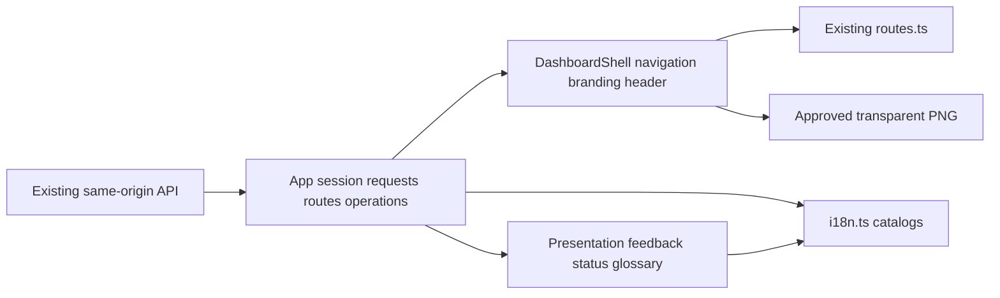

<!--
Copyright (c) 2026 DDP Engineering
This software is licensed under the PolyForm Noncommercial License 1.0.0.
Commercial use requires a separate commercial license.
See the LICENSE.txt in the .agentic folder for full license details.
SPDX-License-Identifier: LicenseRef-PolyForm-Noncommercial-1.0.0
-->

# TASK-7546e6dc - Issue 5: accessible dashboard shell, branding and plain-language vocabulary

stage: deliver
type: feature
path: full
interaction: autopilot
requirements: REQ-UX-955615bd, REQ-UX-aa5e358e, REQ-UX-8031b8eb, REQ-UX-0713852d, REQ-UX-257ab3f0, REQ-UX-9a8b409d, REQ-UX-4200375b, REQ-SEC-59d97c68
parent:
branch: task/adore-web-interface
base: 705e248ad24787e8f573aca477f36fdd4c6fd09f
opened: 2026-10-05

## Done checklist (current stage)

- [x] validated candidate confirmed unchanged; otherwise returned to validate
- [x] validation evidence, diff, exclusions, and outcome presented
- [x] delivery confirmed by the human
- [ ] journal and report included in the delivery commit
- [ ] agreed outcome delivered, normally a PR
- [ ] close-out committed after the outcome succeeded, or carried by the
      delivery commit where nothing could fail after it

## Frame

Problem: STATED in live Gitea issue #5: broad navigation, technical vocabulary and inconsistent scope make the dashboard difficult for unfamiliar operators.
Desired outcome: STATED: an accessible shared shell, approved branding and plain-language presentation using existing authorized capabilities, suitable for later flows.
Actors: STATED: Admin, project-scoped Dev, Dev without grants, and an operator unfamiliar with ADORE or AEGIS.
Primary scenario: STATED: sign in -> see server-authorized navigation and clear scope -> open an enrolled project, its jobs or statistics -> understand status and the supported next action.
Examples: STATED: Overview/Projects/Jobs/Statistics; project identity and contextual subnavigation; transparent sage company logo separate from ADORE; visible instructions and keyboard focus; useful no-grants guidance.
Counterexamples: STATED: a failed metrics request must not display zero totals; stopping project pickup must not imply pausing an active job; a Dev must not gain administrator actions through navigation or a deep link.
In scope: STATED: incremental React shell/page presentation primitives; existing routes/history and explicit project scope; administrator navigation and account/preferences; approved logo; English vocabulary with existing EN/FR/DE/RO support; loading/empty/error distinction; semantic headings, status text/icons, visible instructions and focus; meaningful offline regression tests; affected component/operator documentation, AEGIS knowledge and Unreleased changelog.
Out of scope: STATED: other tickets; new global job/metrics read models; enrollment/configuration workflow redesign; cloning, merge, browser approval or arbitrary job pause controls; release/version/tag operations; historical planning changes; ready/hold label changes; live external-service acceptance.
Constraints: STATED: four-hour active run, three corrective/review cycles, twenty hand-authored changed files; generated outputs and required workflow records counted separately. No new dependency without scoped justification. Preserve authorization, CSRF, secret redaction, localization, theme preferences, deep links, Back and supported actions. OBSERVED: interaction checkpoint and explicit review enabled in .agentic/aegis.toml; user cycle cap three is stricter than configured four. Executor budget: zero executor launches, zero additional paid executor calls and zero subagents before validation requires independent reviewers; any reviewer execution must first record explicit limits and remain within these bounds. Direct Codex model spend is not observable and no monetary result is claimed.
Success signals: STATED: every issue #5 acceptance criterion and prescribed frontend/Python validation; Admin/Dev/no-grants navigation, both themes, desktop/390px, deep links/Back, missing data/errors, no unsupported controls; representative screenshot and browser-error inspection. Automated evidence does not establish full WCAG or human novice acceptance.
Evidence: OBSERVED: authenticated tea login ddp retrieved current issue #5 (open, no comments), native dependencies (only #4, closed), epic #3 (open) and its publication comment. OBSERVED: local and freshly queried remote branch task/adore-web-interface both at 705e248ad24787e8f573aca477f36fdd4c6fd09f; initial working tree clean; zero open AEGIS tasks. OBSERVED: PUBLICATION.md, DESIGN_BRIEF.md, Prototip.html and approved overview capture read/inspected; all 52 publication hashes and all 9 approved hashes matched. Approved logo SHA-256: 4957da4edf9aebf02dcb0e24823ff5f8d5ee524622773f4285c9e2261903c481. OBSERVED: routes.ts retains /metrics and project IDs; App.tsx contains existing role navigation, account/preferences and selected-project job/metric requests. OBSERVED: overview/metric presentation uses zero fallbacks while asynchronous evidence may be absent. References: 04_Software/web/src/{App.tsx,routes.ts}, .agentic/knowledge/web-interface.md, 05_SoftwareDocu/Component_Web_Frontend.md, 01_Documentation/{Web_Interface.md,Code_Style.md}, 05_SoftwareDocu/component_documentation_template.md and 00_Planning/2026-10-05_Web_UX_Redesign/{PUBLICATION.md,Gitea_Issues/DESIGN_BRIEF.md,Gitea_Issues/asset-manifest.json,publication-manifest.json}.
Assumptions: INFERRED: existing selected-project job endpoints and existing metrics scopes can support the shell increment without adding later-ticket backend read models. Specify/design must document scope honestly rather than imply global jobs.
Unknowns: UNKNOWN: final extraction seams/file count, exact new localized messages and detailed keyboard/error presentation; resolve in specify/design. UNKNOWN: human novice acceptance and full accessibility audit; not claimed by this ticket's automation.
Decision-blocking questions: Accept the framed scope and continue to specify under checkpoint mode. No unresolved native dependency or product decision blocks framing.
Proposed behaviors: STATED: stable existing URLs with clearer Overview/Projects/Jobs/Statistics labels; explicit selected-project context and contextual links/tabs; server-role navigation, useful no-grants state and account/preferences; original-ratio approved logo on dark navigation in both themes; reusable loading/empty/error and status presentation; explanatory vocabulary and visible essential guidance; retain current supported mutations and progressive disclosure.
Path and reason: Full. New externally observable navigation/presentation behavior fails quick-path eligibility; detailed requirement and design work is appropriate. Keep this tightly coupled implementation in one task.

Quick-path assessment (yes means the quick-path criterion is satisfied):

| Criterion | Yes | No | Evidence |
| --- | --- | --- | --- |
| No new externally observable behavior | | x | Issue #5 introduces shared shell, vocabulary and new presentation states |
| No new interface or data format | x | | Existing route/API semantics must remain |
| No new dependency | x | | No dependency planned; any need requires scoped justification |
| Existing requirement already covers all behavior | | x | Exact #5 criteria require atomic traceability in specify |
| No security/data-handling behavior change | x | | Existing role, CSRF and redaction contracts preserved |

## Behavior inventory

| Frame outcome | Actor/system | Trigger/state | Response/oracle | Positive case | Boundary/failure |
| --- | --- | --- | --- | --- | --- |
| Navigation | Signed-in user | Select destination | Accessible authorized real links | Admin/Dev/keyboard | Admin deep link denied to Dev |
| Branding | Shell | Theme/viewport | Transparent original-ratio PNG | Desktop/390px | Pale panel/distortion rejected |
| Vocabulary | New operator | Read status/glossary | Localized definition/human next step | EN/FR/DE/RO | Unsupported control absent |
| Scope | Authorized user | View/project/history switch | Current identity/scoped links | Back/reload | Foreign project denied |
| Data | Browser | Pending/empty/error/recovery | Distinct feedback, proven totals | Loaded data | HTTP/corrupt/stale response |
| No grants | Dev/Admin | Successful empty projects | Role-specific guidance/account | Empty authorized list | Error is not empty |

## Requirement coverage

| Frame outcome | Atomic behavior | Requirement | Positive case | Boundary or failure | Verification | Design decision |
| --- | --- | --- | --- | --- | --- | --- |
| Navigate the dashboard with authorized accessible links | Navigate the dashboard with authorized accessible links | REQ-UX-955615bd | See verification | See verification | Offline Chromium | D1 |
| Display approved company branding at original proportions | Display approved company branding at original proportions | REQ-UX-aa5e358e | See verification | See verification | Offline Chromium | D2 |
| Explain delivery vocabulary in every supported locale | Explain delivery vocabulary in every supported locale | REQ-UX-8031b8eb | See verification | See verification | Offline Chromium / Node catalogs | D3 |
| Keep project scope explicit across dashboard views | Keep project scope explicit across dashboard views | REQ-UX-0713852d | See verification | See verification | Offline Chromium | D4 |
| Distinguish pending empty and failed dashboard data | Distinguish pending empty and failed dashboard data | REQ-UX-257ab3f0 | See verification | See verification | Offline Chromium | D5 |
| Explain project access when no projects are authorized | Explain project access when no projects are authorized | REQ-UX-9a8b409d | See verification | See verification | Offline Chromium | D6 |
| Compatibility | Stable existing URLs | REQ-UX-4200375b | Existing route suite/Back/reload | Malformed and unauthorized routes | Node and Chromium | Reuse routes.ts unchanged |
| Security | Existing grants/CSRF/redaction/session guards | REQ-SEC-59d97c68 | Authorized requests | Cross-project/CSRF/stale session | Existing Python and Chromium | Preserve API boundaries |

## Design

D1 (REQ-UX-955615bd): DashboardShell owns semantic primary/admin/account links, responsive menu, skip link, branding and header. App supplies navigation from the authenticated server role and callbacks; native modifier clicks are preserved.
D2 (REQ-UX-aa5e358e): import exact approved transparent PNG under src/assets; dark #102F29 sidebar in both themes; original dimensions with CSS height auto.
D3 (REQ-UX-8031b8eb): Presentation owns localized glossary/status/feedback; i18n retains EN/FR/DE/RO. GuidedField shows essential help inline and associates descriptions; filters/technical settings remain progressive disclosure.
D4 (REQ-UX-0713852d): show selected identity with scoped project/jobs/statistics links; preserve immutable IDs and existing route/history flow. Jobs explicitly uses selected-project scope; administrator Statistics can retain existing all-project scope.
D5 (REQ-UX-257ab3f0): ephemeral request states keyed by project/filter and guarded by session generation and request revisions; loading/error gates hide stale or zero-fallback totals. Global/project metrics and usage use independent gates. Failed or malformed input becomes explicit error. Refresh retries current scope.
D6 (REQ-UX-9a8b409d): successful empty authorized projects gets role-specific next step and account access; failed project requests are distinct. Project actions require an authorized project.
Existing REQ-UX-4200375b and REQ-SEC-59d97c68 retain route/API/state schemas, CSRF, redaction, role/grant boundaries and stale-session guards. No backend or dependency changes.
Execution: authenticated session -> authorized projects -> resolved identity -> scoped requests -> scoped content. Preferences remain server-owned with browser fallback.
Recovery: pending/ready/error presentation; stale completions ignored after project/filter/session/view changes; explicit Refresh reuses supported reads.
Test seams: shared offline shell journeys for D1-D4; Node catalog/provenance tests; no-grants/request-interception journeys for D5-D6; existing API and route regressions.
Tradeoff: incremental extraction retains page bodies/operations in App; selected-project Jobs has honest scope instead of adding later-ticket global read models.
Expected authored files (12): App.tsx, DashboardShell.tsx, Presentation.tsx, styles.css, i18n.ts, tests/shell.test.mjs, e2e/shell.spec.ts, e2e/dashboard.spec.ts, approved PNG, Component_Web_Frontend.md, Web_Interface.md, CHANGELOG.md. Workflow/knowledge records and generated static output counted separately.
Risks: App async coupling, stale scope, compact long localized help; addressed through scope guards and offline browser/screenshot evidence.
Open decisions: none blocking. Atomic requirements and existing route spec carry build contracts; no new detailed spec required. Full WCAG and human novice acceptance unclaimed.

### Proposed architecture - TASK-7546e6dc

## Log

- 2026-10-05 frame: verified live dependency, clean published branch and approved manifests; full path selected for new observable shell behavior; scope prepared and waiting at configured checkpoint. Product implementation and validation have not started.

- 2026-10-05 frame: explicit user continuation accepted scope and selected autopilot through final validation; Git publication authority remains separate.
- 2026-10-05 specify: six new atomic UX requirements drafted, two route/security requirements reused, zero retired; inventory/coverage audited.
- 2026-10-05 design: incremental shell and presentation extraction audited with scope-specific request gates, twelve expected authored files, no backend/dependency change or unresolved blocking decision.

- 2026-10-05 build red: REQ-UX-955615bd, REQ-UX-aa5e358e, REQ-UX-8031b8eb, REQ-UX-0713852d; command=npx playwright test e2e/shell.spec.ts -g "shell links"; exit=1; expected missing behavior=Primary navigation has no real Overview link. command=node --test tests/shell.test.mjs; exit=1; expected missing behavior=glossary strings and production logo absent.

- 2026-10-05 build red: REQ-UX-257ab3f0, REQ-UX-9a8b409d; command=npx playwright test e2e/shell.spec.ts -g "failed projects|Dev without grants"; exit=1; expected missing behavior=failed project request has no distinct Could not load data feedback; corrected no-grants fixture independently confirms missing semantic navigation before empty-state journey.

- 2026-10-05 build green: first four shell requirements plus main-view feedback/no-grants; node --test tests/shell.test.mjs exit=0 (2 tests); npx --prefix 04_Software/web playwright test --config 04_Software/web/playwright.config.ts e2e/shell.spec.ts exit=0 (7 journeys).
- 2026-10-05 build red: REQ-UX-257ab3f0 / REQ-UX-0713852d; command=npx playwright test e2e/shell.spec.ts -g "pending job details|configuration and administration"; exit=1; expected missing behavior=old project detail response refills new project and configuration errors lack scoped feedback. This directly affects the agreed explicit-scope/error contract.

- 2026-10-05 build red: REQ-UX-257ab3f0; npx playwright test e2e/shell.spec.ts -g "configuration and administration" exit=1; Refresh left configuration failure visible after the endpoint recovered. Current-view refresh now retries configuration, users, audit and requested job details.

- 2026-10-05 build completed: Node shell checks 2 passed; final focused shell run 11 passed, including Refresh recovery, stale detail rejection, no-grants light/dark desktop/390px, locales and close/deep-link identity. Additional Dev keyboard and administrator empty-enrollment checks 2 passed. Production build and TypeScript exit=0; uv run ruff check . exit=0. Approved PNG source hash unchanged. Twelve hand-authored files within twenty-file limit; generated static assets and workflow records counted separately.
- 2026-10-05 build audit: requirement paths/test links active and current. Advisory warnings classified: three pre-existing sidecar/journal findings; heuristic password literals are offline fixture values/localized password guidance; PNG and minified bundle scanner limits require source/provenance review, completed without credentials found. Traceability warnings corrected; unintended root test-result file removed. Nonfatal Vite >500kB warning is retained for the existing monolithic page bundle; code splitting is outside this shell increment.
- 2026-10-05 validate: full candidate semantic review started. Component knowledge and architecture reconciled to App -> DashboardShell/Presentation/routes/i18n/logo; project responsibility updated; environment toolchain/commands remain accurate. No child tasks or reviewer agents launched. Explicit verdicts will be two separately assessed review questions by this agent, with no claim of independent human or external reviewers; zero executor/cost budget and maximum three corrective cycles remain.

- 2026-10-05 validate review round 1 specification compliance=approved: separately checked issue #5/frame exclusions and eight requirement contracts against routes, shell props, locale catalogs, glossary, logo provenance, scopes and offline journey assertions. No backend, dependency, release, planning, merge or later-ticket action added. Human novice/full WCAG acceptance remains unclaimed.
- 2026-10-05 validate review round 1 implementation quality=approved: separately checked request/session/project guards and error gates, supported mutation/CSRF ownership, semantic links/modifier clicks, modal/focus behavior, responsive CSS, Node/browser negative cases, generated bundle provenance and documentation. Approved same source/doc/static candidate as specification review; assessments performed by the current agent, no independent reviewer identities claimed. Final suite remains the required proof.
- 2026-10-05 validate inspection: representative light desktop Admin, dark 390px Admin and light 390px assigned-Dev Jobs screenshots visually inspected; transparent proportional logo on dark navigation, readable wrapped content and visible guidance observed. Automated screenshot matrix and pageerror listeners cover both themes/widths. Stable route compatibility additionally covered by existing route module and browser Back/reload journeys. No live external-service, full accessibility or novice acceptance claimed.
- 2026-10-05 validate evolution: final report reviewed all 17 anchor-relative changes (6 added, 9 modified, 2 removed); old hashed static JS/CSS replaced by deterministic current build and exact approved PNG. All changes within scoped software/docs/generated output. Twelve authored files plus workflow records; no planning/version changes. Final proof dry run confirms three canonical commands; available run budget remains sufficient.

- 2026-10-05 validate initial proof: check --task TASK-7546e6dc --strict --run exit=0, test/lint/frontend succeeded, zero errors/eight classified warnings; frontend report 20 expected/20 total, zero unexpected/flaky/skipped. Exact published uv run pytest also exit=0: 756 passed, 1 skipped, 1 dependency deprecation warning. This proof is superseded by the correction below.
- 2026-10-05 DEVIATION validate: final dark Dev 390px screenshot exposed route-focus scrolling that hides the page heading and reveals a fixed offscreen skip link in full-page capture. Accepted correction within REQ-UX-955615bd accessibility scope; return to build, clear both verdicts and repeat focused and final proof. Review fix cycle 1 of maximum 3.
- 2026-10-05 build red: npx playwright test e2e/shell.spec.ts -g "localized shell" exit=1; navigation unexpectedly moved scrollY to 69 instead of retaining 0. Route focus now uses preventScroll; skip link uses clipping until focused, retaining its explicit content jump.

- 2026-10-05 build correction green: build:e2e/typecheck exit=0; npx playwright test e2e/shell.spec.ts -g "localized shell|shell links" exit=0, 2 passed. Production build exit=0. Corrected dark Dev 390px screenshot inspected: Jobs heading visible, inactive skip link clipped, logo/guidance intact.
- 2026-10-05 validate review round 2 specification compliance=approved: full scope/requirement/design assessment retained and corrected focus behavior checked against accessible keyboard/navigation requirement. Current candidate stays within issue #5 exclusions; no requirement weakened.
- 2026-10-05 validate review round 2 implementation quality=approved: separately reviewed preventScroll route-focus effect, clipped inactive link and focused visibility, exact scroll regression, generated assets and unchanged role/error/mutation guards. Both assessments by current agent apply to identical corrected candidate; one corrective review cycle used, zero reviewer/executor launches. Docs/knowledge retain accurate positive focus/navigation facts.

- 2026-10-05 validate final proof: python .agentic/aegis.py check --task TASK-7546e6dc --strict --run exit=0; configured Python full suite succeeded (148.2s), Ruff succeeded (0.1s), npm --prefix web run validate succeeded (67.5s). Browser report 20 expected/20 total, zero failures/flaky/skipped; Node helper suite and UI/E2E TypeScript/build succeeded. Exact published uv run pytest: 756 passed/1 skipped/1 warning; uv run ruff check . exit=0; npm run build exit=0. Platform skip is unavailable unprivileged Windows symlinks; dependency warning is Starlette/httpx deprecation. Advisory zero errors/eight warnings: pre-existing two tracked sidecars/two historical journal records (three findings), two fixture/localized-copy password heuristics, three PNG/minified-output scanning limitations independently checked by source/provenance. Nonfatal >500kB Vite warning accepted within incremental shell scope. No weakened proof or accepted test failure.
- 2026-10-05 validate transient runner diagnostic: previous corrected-candidate proof had 19 browser passes and Windows Playwright worker exit 3221226505 on the existing CSRF scenario. Same scenario passed isolated, unchanged candidate then passed complete final proof. No test retry setting, dependency or product change introduced for the crash.
- 2026-10-05 validate completed: round-2 specification and quality verdicts remain approved on unchanged final candidate; regenerated assets verified, evolution refreshed, diff whitespace clean. Final change set: twelve hand-authored files, nine workflow/context/knowledge records and six generated static path changes; no children/executors or additional paid executor calls. Under four-hour/three-cycle/twenty-authored-file bounds; one corrective review cycle. Advance to deliver for presentation only, waiting for separate human Git-publication authority. Commit/push/PR/issue closure not performed.

- 2026-10-05 delivery presentation: published English final-evidence comments 1971 on issue #5 and 1973 on epic #3; authenticated readback confirms both remain open. Local candidate is unchanged and Git publication remains unauthorized. Proposed outcome: commit scoped code/tests/docs/static/workflow records on task/adore-web-interface, push normally and open a draft PR targeting master; no merge, release or tag. Await separate human decision.

- 2026-10-05 deliver approval: trusted source-thread readback confirms the human message "commit / push #5" in 01a10aec-6ac2-79f3-ada3-741950212fb8. Authorized outcome is scoped commit and normal push on task/adore-web-interface only; no PR, merge, tag, version change or other task publication.
- 2026-10-05 deliver ownership audit: all 27 issue-5 path hashes match issue-6 initial ownership inventory; all 17 final evolution entries match validated bytes/deletions. Index initially empty; local and fresh remote HEAD both 705e248ad24787e8f573aca477f36fdd4c6fd09f. Concurrent issue 6 has only ISSUE-6-initial-ownership.md and TASK-8265e125.md, excluded. No candidate mutation or new verification concern warrants rerunning unchanged final proof. Explicitly stage issue-5 inventory only.

## Rulings

- RULING-001 | date=2026-10-05 | decision=Start only issue #5 directly on task/adore-web-interface; preserve ready/hold labels and other tickets | reason=Explicit operator authorization in delegated request | source=user | supersedes=none
- RULING-002 | date=2026-10-05 | decision=Keep interaction checkpoint; require separate Git publication approval; close #5 only after acceptance and delivery conditions, keep epic #3 open | reason=Actual configuration and explicit user instructions | source=user | supersedes=none
- RULING-003 | date=2026-10-05 | decision=Use repository AEGIS directly; do not install BMAD infrastructure | reason=User requests direct AEGIS implementation; optional bmad-build helper _bmad/scripts/render_skill.py and referenced sibling bmad setup skill are absent, confirmed by read/search. No product blocker or authority to expand task into framework provisioning | source=technical | supersedes=none

- RULING-004 | date=2026-10-05 | decision=Accept frame scope and proceed autonomously through final validation, then stop before Git publication | reason=Human instruction to continue implementation through final validation | source=user | supersedes=RULING-002

- RULING-005 | date=2026-10-05 | decision=Commit and normally push issue 5 only; no PR, merge, tag or version change | reason=Verified direct human commit / push #5 authorization in source thread | source=user | supersedes=RULING-004

## Handoff

current: deliver
status: ready
next: Commit and normally push the scoped issue-5 candidate
must_read: .agentic/tasks/TASK-7546e6dc.md, .agentic/steps/6_deliver.md
blockers: none; issue 6 records excluded from delivery

## Stage report

stage: validate
result: completed
current: deliver
changed: Accessible shell, branding, vocabulary, scope and error recovery; docs and static build
evidence: Strict full proof exit 0; 756 Python passed, 1 platform skip; 20 browser passed; Ruff/typecheck/build passed
issues: Eight classified advisories; dependency/bundle warnings; publication pending
next: Approve Git delivery or request revisions
needs_user: yes
spec_compliance: approved
implementation_quality: approved
review_round: 2

## Delivery report (2026-10-05)

- stage: deliver; type: feature; path: full; branch: task/adore-web-interface
- requirements:
  - REQ-UX-955615bd - Navigate the dashboard with authorized accessible links
  - REQ-UX-aa5e358e - Display approved company branding at original proportions
  - REQ-UX-8031b8eb - Explain delivery vocabulary in every supported locale
  - REQ-UX-0713852d - Keep project scope explicit across dashboard views
  - REQ-UX-257ab3f0 - Distinguish pending empty and failed dashboard data
  - REQ-UX-9a8b409d - Explain project access when no projects are authorized
  - REQ-UX-4200375b - Address every web view by a stable URL
  - REQ-SEC-59d97c68 - Project authorization and financial privacy
- deviations: 1 recorded
  - validate: final dark Dev 390px screenshot exposed route-focus scrolling that hides the page heading and reveals a fixed offscreen skip link in full-page capture. Accepted correction within REQ-UX-955615bd accessibility scope; return to build, clear both verdicts and repeat focused and final proof. Review fix cycle 1 of maximum 3.
- explicit review: enabled; spec_compliance=approved; implementation_quality=approved; review_round=2
- diff vs task base 705e248: 29 file(s) changed, 1441 line(s) added; 3 file(s) not content-scanned
- checks: errors=0 warnings=9 notes=31
- checklist: 3/6 done; open: journal and report included in the delivery commit; agreed outcome delivered, normally a PR; close-out committed after the outcome succeeded, or carried by the delivery commit where nothing could fail after it
