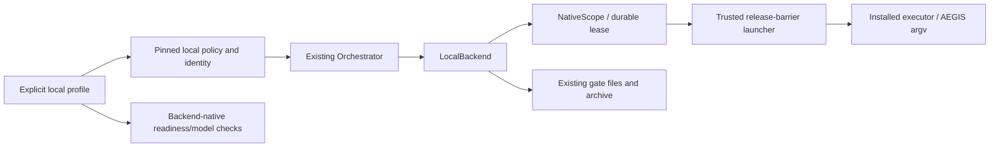

<!--
Copyright (c) 2026 DDP Engineering
This software is licensed under the PolyForm Noncommercial License 1.0.0.
Commercial use requires a separate commercial license.
See the LICENSE.txt in the .agentic folder for full license details.
SPDX-License-Identifier: LicenseRef-PolyForm-Noncommercial-1.0.0
-->

# TASK-8bb4c81d - Gitea #21 local executor using installed authenticated CLI

stage: done
type: feature
path: full
interaction: autopilot
requirements: REQ-FUNC-ffb9ed29, REQ-REL-50474528, REQ-FUNC-5e2fe079, REQ-SEC-f7b9111e, REQ-UX-b75e1df8
parent:
branch: task/adore-web-interface
base: 8a7460ff01270e92ff454e15dbf37f89b8bf5b1f
opened: 2026-10-07

## Done checklist (current stage)

- [x] current candidate confirmed unchanged after final proof
- [x] evidence, diff, exclusions and intended outcome presented
- [x] local-only commit authorized by originating human
- [x] journal/report included in delivery commit
- [x] agreed repository-local commit delivered
- [x] close-out carried by delivery commit

## Frame

Problem: STATED installed subscription-authenticated executor cannot run locally through ADORE.
Desired outcome: Explicit local profile runs a fresh installed CLI in each dedicated ticket worktree with safe native lifecycle and existing AEGIS/approval/evidence.
Actors: Administrator selects account environment; user installs project dependencies; conductor owns limits/worktree/delivery; executor advances AEGIS; human approves publication.
Primary scenario: Validated local profile -> pinned native machine/account/environment -> owned process scope -> gate and file evidence -> park/retry/cleanup without containers or recipes.
Examples: Worktree paths with spaces; already-authenticated Pi/OpenCode/Codex CLI; explicit provider-key model challenge.
Counterexamples: local+recipe, restricted container egress, unsupported OS/wrapping, corrupt lease, reused PID, changed profile fail closed before host project commands/control.
In scope: #21 adapter/config/state, gate/AEGIS transport, native Windows/Linux scope control, auth/environment, readiness/assisted setup/web notice, portable exclusions and directly affected documentation.
Out of scope: #22, local dependency discovery/catalogue/installer/bootstrap/manifest, account switching, hybrid container build/test, live acceptance, full suites, remote publication, planning, release assignment and managed AEGIS payload.
Constraints: STATED same clean checkout/branch at #24 commit 8a7460f; task-specific autopilot and local commit authorized; offline injected external boundaries; portable core; strict negative trust-boundary tests.
Success signals: Full #21 criteria represented by atomic requirements, public positive/negative proof and accurate account/OS/security guidance.
Evidence: OBSERVED complete current issue #21 via tea ddp; #24 completed journal and execution/preparation component docs; ExecutionBackend supplies native paths/lifecycle, conductor uses it for commands/controls but inventory still container-specific; AEGIS and launcher retain shell file transports; web probes and wizard provision/check containers.
Assumptions: INFERRED independently installed tools remain operator-owned; native process ownership needs OS scopes rather than PID-only control.
Unknowns: Live executor/provider and deployment account acceptance deferred to operators/epic #23.
Decision-blocking questions: none; user delegates exact local decisions and confirms scope/authority.
Proposed behaviors: Explicit local backend; current service account/environment; native argv file transport; durable pinned run and scoped process identity; fail-closed recovery; concise user-owned tooling notice.
Path and reason: full; new public backend/config/state/platform/credential contracts. No children; no separate conductor.

## Requirement coverage

| Outcome | Requirement | Happy proof | Negative boundary |
| --- | --- | --- | --- |
| Explicit pinned local profile | REQ-FUNC-ffb9ed29 | native selection/default container | recipe/egress/profile/host drift |
| Owned process tree lifecycle | REQ-REL-50474528 | scoped timeout/cancel/recovery | corrupt lease/PID reuse/control failure |
| Existing gate contract | REQ-FUNC-5e2fe079 | native paths/fresh files/archives/usage/questions/AEGIS | corrupt files/nonzero/timeout |
| Account auth/environment | REQ-SEC-f7b9111e | controlled env and existing auth reused | forged account/secret leakage/unsafe executable |
| Settings/setup/readiness | REQ-UX-b75e1df8 | backend-aware probes/notices/settings | container call in local/invalid/stale apply |

## Design

Requirements/spec audited against #24 code. LocalBackend implements the existing ExecutionBackend; core conductor selects it and owns the same AEGIS, limits, questions, recovery, candidate approval and delivery loop. No second conductor.
Components: local_execution.py owns selected native environment, executable resolution, account/auth checks, immutable runtime resource and bound paths/commands. local_process.py owns injectable native scopes and durable lease/control, with Windows Job bindings and Linux delegated cgroups kept outside core. local_child.py is a trusted release-barrier launcher that joins/retains the scope before starting project commands.
Transport: local target adds run_files(argv, output, stderr), invoked by existing FileProtocolExecutor/AegisClient; container shell transport remains unchanged. Tokenize templates before replacing placeholders for native argv. Archive a legal-header native-launch description plus existing bounded redacted output/meta/questions and usage parser.
Ownership: authoritative plan/resource/lease/launch controls outside worktree and IO; per-command random scopes, host/run token, PID birth and scope identity checked before control. Windows KillOnJobClose covers controller crash; Linux cgroup.kill covers owned descendants. No PID-only termination. Failure leaves explicit recoverable evidence; stale/corrupt controls refuse cleanup.
Account: current service account only, optional named-account assertion; explicit effective home/PATH and small system/environment allowlist. Existing executor auth stores reused in place and read boundedly only for readiness/redaction. No login or copied credential stores; forge variable names rejected. No host sandbox claim.
Compatibility: preserve #24 container policy shape by separate LocalConfig; local plans add a closed local policy/identity branch and resource type in optional schema-1 execution state. Old binaries reject local records. Local+recipe/restricted egress/staging/container-only checks fail early; legacy container profile recovery remains unchanged.
Surfaces: CLI/config plans; assisted backend choice; backend-native web host/endpoint/model probes; actual machine/account and tooling responsibility notice in settings/setup. Existing config revision/idle/project authorization retained. Portable export continues its current working-rule allowlist and explicitly excludes local identities/maps.
Tests: separate focused local config/environment/backend/scope/gate/AEGIS/probe/GUI selectors plus the smallest relevant existing regression selectors; no entire suites and no large #24 batch. Native subprocess, platform scopes and external CLIs injected offline. Docs: local operator guide, affected component/user/knowledge pages, context and Unreleased changelog; no planning.
Open decisions: none. Supported native Windows/Linux/conditional WSL and Windows npm-shim restrictions are explicit. Linux cgroup delegation is operator-managed process-control setup, not project tooling provision.

### Proposed architecture - TASK-8bb4c81d

## Log

- 2026-10-07 frame: complete #21 read; foundation #24 code/evidence available despite open forge dependency. Clean current branch/HEAD confirmed; no open journals. Full path and explicitly task-specific autopilot resolved, unchanged global defaults. BMAD installation remains missing its renderer/setup skill as recorded in #24; explicitly requested repository AEGIS governs continuation.
- 2026-10-07 DEVIATION validate: full Python/frontend suites and aggregate strict --run deferred by explicit user instruction; narrowly selected #21 contract/regression/lint/type/build proof substitutes. Full integrated epic #23 and live forge/model/container acceptance remain deferred.

- 2026-10-07 specify: closed local/account/environment configuration, Windows Job/Linux delegated cgroup ownership, native argv/auth-store behavior, additive schema-1 compatibility and operator/portable contracts recorded; no open design decisions requiring human clarification. Official Windows Job Objects and Linux kernel cgroup-v2 references checked for scope ownership semantics.

- 2026-10-07 design: closed configuration/OS/auth/recovery contracts and existing shared seam audited; release-barrier child ensures durable scope ownership precedes project commands. No pending human decisions. Separate native adapter keeps core portable and avoids shell/cmd injection.

- 2026-10-07 build red: REQ-FUNC-ffb9ed29; command=`04_Software/.venv/Scripts/python.exe -m pytest -q 04_Software/tests/test_local_execution.py`; exit=1; expected missing behavior=valid explicit local profile rejected because backend must be container.

- 2026-10-07 build green: config/local-selection plus affected config regressions, `04_Software/.venv/Scripts/python.exe -m pytest -q 04_Software/tests/test_local_execution.py 04_Software/tests/test_config.py`; exit=0; 44 passed.
- 2026-10-07 build red: REQ-FUNC-ffb9ed29 and REQ-REL-50474528; command=`04_Software/.venv/Scripts/python.exe -m pytest -q 04_Software/tests/test_local_execution.py::test_local_backend_is_available_through_the_shared_contract`; exit=1; expected missing behavior=no native adapter on the existing backend boundary.

- 2026-10-07 build green: local config/environment/backend/closed state/PID ownership/timeout/redaction contracts: `04_Software/.venv/Scripts/python.exe -m pytest -q 04_Software/tests/test_local_execution.py`; exit=0; 16 passed through injected native/process boundaries. Container plan regression focused proof: 41 passed.
- 2026-10-07 build red: REQ-FUNC-5e2fe079; command=`04_Software/.venv/Scripts/python.exe -m pytest -q 04_Software/tests/test_local_execution.py::test_local_gate_preserves_native_argv_files_and_archives 04_Software/tests/test_local_execution.py::test_local_aegis_file_transport_uses_native_argv`; exit=1; expected missing behavior=both existing transports invoke a shell instead of the native file/argv seam.

- 2026-10-07 build red: native conductor retry/cleanup selectors (test_local_execution); exit=1; missing durable local resource and unsafe worktree removal after native control failure.
- 2026-10-07 build green: native transports and conductor retry/parking/cleanup, 20 focused local tests passed. Build red REQ-UX-b75e1df8: three local readiness/model selectors fail because Docker detection/image inspection still occurs.
- 2026-10-07 build red: assisted native setup public selector exit=1, missing execution section; native readiness/model contract increment green (23 focused local tests).
- 2026-10-07 build red: node --test tests/executionPlan.test.mjs exit=1; native local plan rejected by browser closed validator.
- 2026-10-07 build red REQ-SEC-f7b9111e: direct local secret environment selector fails (accepts a persisted provider key); recipe/egress refusal and injected Linux owned-cgroup/inode control proof pass.
- 2026-10-07 build red REQ-REL-50474528: pytest selector test_local_execution.py::test_local_scope_control_refuses_reused_process_identity[other-job] exit=1; a different syntactically valid Job name is not independently bound to this launch. Add immutable per-launch ownership comparison before control.
- 2026-10-07 build red REQ-UX-b75e1df8: pytest -q test_local_execution.py::test_local_endpoint_probe_uses_owned_native_python exit=1, local endpoint still reports container context. Existing enrollment fake omitted strict tea HTTP/identity evidence; fixture corrected to that existing contract.
- 2026-10-07 build red REQ-FUNC-ffb9ed29: pytest -q test_local_execution.py::test_local_node_entrypoint_drift_refuses_execution exit=1, changed installed JavaScript entrypoint does not invalidate selected native executable identity.

- 2026-10-07 build red REQ-FUNC-ffb9ed29/REQ-FUNC-5e2fe079/REQ-SEC-f7b9111e: python -m pytest -q test_local_execution.py -k "container_adapter_refuses or inline_configuration or corrupt_retained"; focused negative selectors fail before fixes: mismatched backend reaches manager, native file UTF-8/size accepted and literal inline credentials accepted. Requirements activated and source/test links reconciled.

- 2026-10-07 build red REQ-REL-50474528: test_container_cleanup_retains_persisted_native_worktree (public cancel) exit=1, teardown swallowed backend mismatch then reached unsafe worktree removal. Native records now propagate control failure before worktree release. Native model four-executor selectors: 4 tool-bearing responses falsely accepted; parser now refuses tool-prefixed event types and tool-call envelopes.

- 2026-10-07 build red REQ-FUNC-5e2fe079: native AEGIS exchange-bound selector exit=1, missing stdout-limit seam constrained established 4 MiB JSON. Bound preserved with strict native decoding and 64 KiB gate/stderr defaults. REQ-UX-b75e1df8 readiness selector exit=1: approved profile provider values missing; saved checks now use the protected .env environment shared by gates/model checks.

- 2026-10-07 build green: python -m pytest -q 04_Software/tests/test_local_execution.py exit=0; 65 native happy/negative contract cases passed. All five requirements active/current source/test links; operator/component/context/knowledge documentation reconciled. Evolution 2026-10-07T15:18:55Z inspected: 63 in-scope non-agentic files; no planning/release/managed-payload edits. Advisory 0 errors/12 warnings: nine baseline/layout findings and three new missing source links corrected.

- 2026-10-07 validate review round 1 specification compliance=approved: independently checked explicit local selection/default container, pinned machine/account/native ownership, same gate/AEGIS/auth/probe semantics, tool-ownership exclusions, additive closed state and draft-only conductor boundaries against all five re-read active requirements/spec/design. No new contract decisions or scope changes.
- 2026-10-07 validate review round 1 implementation quality=approved: separately reviewed source hunks, native ctypes/cgroup layouts and lifecycle paths, barrier/lease ownership, timeout/drain/recovery, strict output/auth parsing, cross-backend cancellation/cleanup, protected .env readiness and reviewed stale native apply. Documentation/current diagrams agree; legal/Doxygen/source links checked. Both criteria reviewed by this agent, with no external reviewer claim. Focused native API apply proof passed; real platform/provider acceptance remains explicitly deferred.

- 2026-10-07 validate round 1 final proof: 98 focused Python tests and changed-file Ruff passed; 11 helpers, TypeScript/Vite build and strict advisory passed. Native browser exit=1: explicit empty image is rejected by setup API although local UI hides images. Implementation quality=changes_required; clear both verdicts and return to build for this recorded setup finding (fix cycle 1 of 5).

- 2026-10-07 build red REQ-UX-b75e1df8: test_local_execution.py::test_local_assisted_setup_and_portable_rules_keep_machine_identity_local with explicit image=""; exit=1, native setup API applies container-only image requirement. Correct only that backend validation condition; model and container image requirements remain.

- 2026-10-07 build correction proof: nine affected setup tests and app/test Ruff exit=0. Browser now reaches review but the new assertion addresses five sections ambiguously; scope it to Working environment. Review also finds container-only verification explanation/row still shown for a local draft; replace the explanation with existing localized native notice and suppress the irrelevant container row (same recorded backend-aware enrollment boundary).

- 2026-10-07 build correction completed: local empty image is accepted while explicit container image/model remain validated; native verification uses the existing four-locale account/tooling notice and hides the container-only row. Native journey assertion is scoped to the intended review section. Nine focused setup tests/Ruff and refreshed TypeScript/Vite build exit=0; return to validate review round 2. No change to scope, process lifecycle or auth contracts.

- 2026-10-07 validate review round 2 specification compliance=approved: re-read all five active requirements/spec and checked the corrected native enrollment against selected backend, account/tooling notices, container compatibility and recorded scope. Existing source/knowledge/context/architecture reviews remain current; all 63 evolution paths at 15:28:34Z inspected in scope, no planning/release/managed payload.
- 2026-10-07 validate review round 2 implementation quality=approved: separate correctness/error/security/portability review of the same candidate, including explicit empty-image rejection retained for containers, mandatory model validation, native verification notice/row and precise browser locator. Prior process/auth/transport reviews unaffected by these corrections; positive and negative affected setup proof passes. Both criterion reviews performed by this agent; no external reviewer or live-platform claim.

- 2026-10-07 validate round 2 final browser and strict advisory exit=0 (one native journey; 0 errors/9 warnings/25 notes). Final added-line UTF-8 diff inspection finds two pre-existing status glyphs corrupted in the touched enrollment row; implementation quality=changes_required, return to build fix cycle 2 of 5 to restore their original UTF-8 text. Other added non-ASCII lines checked and valid.

- 2026-10-07 build correction: restored original check/cross UTF-8 glyphs by explicit UTF-8 read/write; no behavior or contract change. Added-line diff scan confirms no other corrupt text (French accents are valid); refreshed TypeScript/Vite build exit=0. Return to validate round 3.

- 2026-10-07 validate review round 3 specification compliance=approved: all five requirements/spec remain true for the unchanged native behavior; glyph restoration is exact baseline text. Current component/context/architecture and all 63 final evolution paths at 15:30:11Z remain consistent with the reviewed scope/exclusions.
- 2026-10-07 validate review round 3 implementation quality=approved: independent criterion review confirms corrected UTF-8 status row, container-only condition and native notice filter; no corrupt added text, diff whitespace clean, final type/build successful. Earlier complete lifecycle/config/auth/transport/source/security review and nine setup regression proofs remain applicable. Both criteria performed by this agent for the same current candidate.

- 2026-10-07 consolidated final validation: all commands exit=0. Python focused set: `04_Software/.venv/Scripts/python.exe -m pytest -q` selecting test_local_execution.py, test_execution.py, four launcher gate/archive/timeout selectors, three AEGIS transport selectors, legacy preparation retry, two enrollment selectors, two pending-config selectors and test_web_setting_catalog.py: 98 passed. Following the recorded setup correction, exact assisted-native selector plus test_guided_invalid_explicit_fields_fail_closed, test_guided_candidate_review_binds_complete_setup_without_probes and test_wizard_preparation_keeps_cli_defaults_and_never_probes: nine passed; unchanged process/config/gate proof was not repeated. Changed-file Ruff (20 Python files), then corrected app/test Ruff: passed. `node --test tests/executionPlan.test.mjs tests/settingHelp.test.mjs tests/readiness.test.mjs`: 11 passed. Final `npm run build:e2e`: TypeScript application/E2E and Vite production build passed after glyph restoration. Final `npx playwright test e2e/enrollment.spec.ts --grep "native local enrollment" --project chromium`: one passed, explicit native setup reviewed/created with stopped pickup and actual machine/account. `git -c core.safecrlf=false diff --check`: passed. Final `python .agentic/aegis.py check --task TASK-8bb4c81d --strict` (without --run): strict ok, 0 errors/9 warnings/25 notes. Two stale-path, one tracked-sidecar and five historical-journal warnings are existing unrelated maintenance; config.example.toml layout warning manually inspected as in-scope commented documentation. Older manual notes are outside this task. Starlette/httpx deprecation and Vite chunk-size warning are existing dependency/bundle concerns outside scope; NO_COLOR test-runner warning is cosmetic. All 15 new files legal/prologue audited. No unresolved task-introduced failure. Explicit user restriction substitutes this narrow proof for entire Python/frontend suites and aggregate strict --run; epic #23 and live OS/provider/forge acceptance remain deferred, not claimed.

- 2026-10-07 deliver: presented final proof, exact 86-file scope (15 added/71 modified), current criterion verdicts, accepted warnings, no children and all deferrals. Originating human already authorizes task-specific autopilot through local commit (RULING-001); proceed with that outcome only on task/adore-web-interface. No push/PR/MR/merge or release. Candidate unchanged after final proof.

- 2026-10-07 deliver close-out: repository-local commit is the whole authorized outcome. Close-out is carried before that same commit under deliver step 7. Appended delivery report read: 0 errors/10 warnings/25 notes; its tenth warning is the expected open delivery checklist before close-out, now ticked. Source/test/spec/requirement/knowledge candidate unchanged after final validation. No push, PR/MR, merge, release or deployment.

## Rulings

- RULING-001 | date=2026-10-07 | decision=Task-specific autopilot through local commit on existing branch; focused verification only, no publication/live acceptance/global-default changes | reason=Explicit originating human authorization carried by delegation | source=user | supersedes=none

## Handoff

current: done
status: ready
next: none within #21 local delivery scope; close-out is carried by the delivery commit.
must_read: .agentic/tasks/TASK-8bb4c81d.md, .agentic/steps/6_deliver.md
blockers: none

## Stage report

stage: deliver
result: completed
current: done
changed: native backend/lifecycle/auth/transports, backend-aware setup/settings/probes and current documentation; 86 Git-visible files
evidence: 98 focused Python plus nine correction checks, 11 helpers, one native browser journey, Ruff/type/build, strict advisory 0 errors
issues: full suites/aggregate --run and live/epic #23 deferred by instruction; nine baseline/layout warnings retained
next: none within #21 local delivery scope
needs_user: no
spec_compliance: approved
implementation_quality: approved
review_round: 3

## Delivery report (2026-10-07)

- stage: deliver; type: feature; path: full; branch: task/adore-web-interface
- requirements:
  - REQ-FUNC-ffb9ed29 - Select native local execution with pinned machine account policy
  - REQ-REL-50474528 - Control only verified local process trees during recovery
  - REQ-FUNC-5e2fe079 - Preserve native local gate and AEGIS file evidence
  - REQ-SEC-f7b9111e - Reuse local executor authentication under a controlled account environment
  - REQ-UX-b75e1df8 - Configure and check local execution with user-owned tooling notice
- deviations: 1 recorded
  - validate: full Python/frontend suites and aggregate strict --run deferred by explicit user instruction; narrowly selected #21 contract/regression/lint/type/build proof substitutes. Full integrated epic #23 and live forge/model/container acceptance remain deferred.
- explicit review: enabled; spec_compliance=approved; implementation_quality=approved; review_round=3
- diff vs task base 8a7460f: 86 file(s) changed, 4210 line(s) added
- checks: errors=0 warnings=10 notes=25
- checklist: 3/6 done; open: journal/report included in delivery commit; agreed repository-local commit delivered; close-out carried by delivery commit
