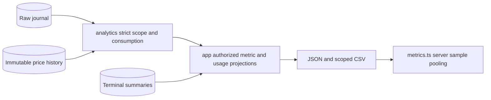

<!--
Copyright (c) 2026 DDP Engineering
This software is licensed under the PolyForm Noncommercial License 1.0.0.
Commercial use requires a separate commercial license.
See the LICENSE.txt in the .agentic folder for full license details.
SPDX-License-Identifier: LicenseRef-PolyForm-Noncommercial-1.0.0
-->

# TASK-97d530c5 - W10 issue 14 consistent scoped metrics

stage: done
type: change
path: full
interaction: autopilot
requirements: REQ-FUNC-448cbde7, REQ-DATA-5a620f4e, REQ-REL-6564a3b2, REQ-FUNC-83da8d95
parent:
branch: task/adore-web-interface
base: f1aeefa0ca49038c2d70c9987bbaffa6644c61b5
opened: 2026-10-06

## Done checklist (current stage)

- [x] Unchanged reviewed candidate verified against all 29 bound entries
- [x] Final strict proof passed and warnings classified
- [x] Exact inventory and evidence prepared for coordinator presentation
- [x] Coordinator exact-inventory verification and delivery instruction received
- [x] Journal/report included and agreed commit/push/issue-close outcome approved (execution follows)
- [x] Delivery closeout recorded after implementation push and authenticated issue closure

## Frame

Problem: STATED #14 requires one honest reporting scope; OBSERVED app.py mixes lifetime totals with period daily rows and skips malformed legacy usage.
Desired outcome: Authorized scope, consumption attribution, lifecycle counts, sample definitions and CSV agree.
Actors: Admin and project-granted Dev; server analytics and existing React consumers.
Primary scenario: Select local dates/timezone -> server resolves half-open instants -> cards/tables/CSV report identical measured evidence.
Examples: A job picked before March 29 consumes 5 tokens before local midnight and 7 after; only 7 enters the March 29 interval.
Counterexamples: Unknown telemetry is not measured zero; checkpoint activity is not completion; a launch is not a message.
In scope: #14 eight live criteria; metric/usage/per-job JSON and CSV, compatible consumer pooling, tests and same-change docs.
Out of scope: #15 redesign, #16/#17 messages, runtime migration, new dependencies/version, live acceptance, publication before coordinator instruction.
Constraints: <=4h from session start; <=3 corrective review cycles; <=20 authored product/test/doc paths; ZERO paid API/executors/subagents. Existing branch only.
Success signals: Offline hand-calculated boundaries/DST/cross-period/null/zero/unallocated/dedup/RBAC tests; complete strict and required native suites.
Evidence: OBSERVED clean local/remote f1aeefa; authenticated tea ddp #14 open/no comments, native dependency #4 closed; #10 closed 8/8; epic #3 open. Root/deeper inventory, full AEGIS, context, metrics/web knowledge, style/template, approved DESIGN_BRIEF read.
Assumptions: Date controls keep inclusive calendar dates for compatibility; canonical scope exposes exclusive next-midnight to instant. All-time is explicit when both bounds absent.
Unknowns: Real historical telemetry and novice/live acceptance are unmeasured; no evidence invented.
Decision-blocking questions: None in current live ticket contract.
Proposed behaviors: Scoped totals/quality/durations, explicit stock/lifetime, composite jobs and unavailable coverage, typed corrupt source/filter failures, same financial boundary.
Path and reason: full. Quick criteria: new observable contract=no; no interface change=no; dependency unchanged=yes; existing requirement complete=no; security/data unchanged=no.

## Requirement coverage

Frame outcome | Atomic behavior | Requirement | Positive case | Boundary/failure | Verification | Design
--- | --- | --- | --- | --- | --- | ---
Consistent scope | Shared scoped aggregates/exports | REQ-FUNC-448cbde7 | Cross-period local dates | DST/endpoints/money denial | API/CSV fixtures | Common scope and validated event primitives
Per-job evidence | Composite consumption projection | REQ-DATA-5a620f4e | Lifetime vs period | collisions/unknown/zero/unallocated | API fixtures | Shared usage projection
Fail closed | Strict source/filter handling | REQ-REL-6564a3b2 | Valid schema/filter | malformed source/schema/replay | Negative API tests | Analytics strict reader
Server analytics | Scoped samples/cohorts | REQ-FUNC-83da8d95 | Known mean/median/rates | empty/inconsistent sample | API and Node fixtures | Server selected samples pooled directly

Behavior inventory follows these four independently variable responses; first row deliberately groups aggregate/export consistency as one inseparable scope contract. Spec contains setups, oracles and recovery (correct source/filter then read); existing immutable pricing/revision/RBAC contracts remain.

## Design

Requirements: the four coverage rows map to the scoped-metrics spec and exact test seams.
Responsibilities: analytics.py owns strict analytical JSONL, reporting boundaries, measured amount/price primitives and job projection; app.py retains authorization, routes/CSV and compatible metrics cohorts. Runtime readers/state/CLI remain unchanged.
Interfaces: inclusive local date inputs translate to canonical half-open UTC scope; scoped existing totals plus separate lifetime/current_stock/jobs metadata. Null is unavailable; typed safe error codes preserve source secrecy.
Persistence/order: existing web usage cursor and immutable composite IDs; validate raw sources and complete events before filtering. Replay remains append-only. No runtime state migration, source rewrite or launches.
Security: project authorization before source access; Admin-only all cost data including nested coverage and exports. CSRF/mutations untouched.
Compatibility: retain existing route parameters/shapes and UTC price-day semantics; update consumer null pooling and server samples; correct old assertions only where explicitly superseded by #14.
Failure/recovery: typed failure leaves sources unchanged; fixing invalid filters or operator source repair permits retry. No synthetic dates or summary-default telemetry.
Expected files: metrics.py, web/analytics.py, web/app.py, tests/test_web_scoped_metrics.py, test_web_metrics.py, test_web_pricing.py, web/src/metrics.ts, App.tsx, web/tests/metrics.test.mjs; affected Metrics/Web_API/Frontend docs, Web_Interface, CHANGELOG; workflow knowledge/context/requirements/spec/journal separately.
Risks: legacy missing dates are unallocated; partial coverage is explicit. Windows ZoneInfo readiness checked through installed locked tzdata. Existing heartbeat proof may need unchanged retry.
Open decisions: none. Bounded review performed by primary agent in separate compliance/quality passes; no paid subagents.

### Proposed architecture - TASK-97d530c5

## Log

- 2026-10-06 build: Four active requirements implemented. Consolidated evidence in scoped-metrics-verification.md: initial DST and Node reds, strict source/overflow/history/quality-only/empty-export/per-job coverage reds followed by focused green. Native Python 1077 passed/1 skipped; Ruff, typecheck and production build exit 0; final focused analytics 31 passed, metrics/pricing combined 70 passed, Node 7 passed, Chromium 1 passed. Anchor/evolution track generated assets separately.

- 2026-10-06 design: Common strict analytics and server-selected samples approved under standing stage authority; spec/design audited; new-module stale path advisory expected until build.
- 2026-10-06 build: Initial DST scope regression red: 2 failed, expected 7 scoped tokens but old all-time total was 18. Anchor captured before product edits.
- 2026-10-06 specify: Three atomic requirements created, one existing broad web-metric contract explicitly revised by authorized #14; spec and coverage audited. Existing CLI persistence contracts retained.
- 2026-10-06 frame: Full path scoped to live #14; accepted stage checkpoints under explicit standing human authority conveyed by coordinator session 01a10aec-6ac2-79f3-ada3-741950212fb8. No publication authority inferred from journal or issue labels.

- 2026-10-06 validate: Separate primary-agent compliance and implementation-quality passes approved round 1 for candidate 0b783a7feb6dca018f00733fee4bd324e4f4a188ec7ecf8f79f6692b95687329, bound by TASK-97d530c5.candidate.json; zero corrective review cycles. Exact 17 authored paths plus 3 generated static paths; workflow separate. Final strict remains pending.
- 2026-10-06 design refinement: DEVIATION design: cohort and duration calculations were centralized in analytics.py alongside scope and consumption - accepted to keep one interval rule across all projections; scope and authorization remain unchanged. Proposed diagram retained; current component architecture reconciled.

- 2026-10-06 validate round 1: strict check exit 1: Python 1080 passed/1 skipped and lint exit 0; frontend 86 passed/1 failed in new Chromium response selector (matched global mapping). Implementation quality changes_required; both verdicts invalidated pending cycle 1. Return to build for exact project response binding and typed local-calendar overflow for revision dates; no scope expansion. Failed proof retained in round-1-check.json.

- 2026-10-06 build cycle 1: Revision-calendar negative red (one failure) corrected by shared typed Scope.local_day; browser exact immutable project response selector fixed without changing oracles. Focused 71 passed; Chromium 1 passed; Ruff exit 0. Requirements/component knowledge/context reviewed and current; no new dependency, version or authored path.
- 2026-10-06 validate round 2: Both separate primary-agent verdicts approved for e9ff78685f8606de38a23a72781ad4729b3e5d689a94c63e62bcfbc37120f3fe; exact 29 bound paths, 17 authored/3 generated; one corrective cycle used. Fresh strict proof follows final evolution.

- 2026-10-06 validate completion: Final strict check exit 0, zero errors, six warnings, thirty unrelated manual-verification notes; all commands exit 0: Python 1081 passed/1 skipped (native Windows symlink capability), Ruff passed, frontend validate passed including seven Node helpers/typecheck/E2E build and 87 Chromium journeys. One unchanged retry resolved a native Windows Playwright worker exit 3221226505 in an existing anonymous-credential test; interrupted proof retained. No candidate edits during retry. Final evolution refreshed; all 29 round-2 bound hashes unchanged. Three baseline warnings concern tracked fingerprints and unrelated journal syntax; three diff-scan gaps concern generated bundle and proof files, supplemented by full-content secret-pattern scan. Existing Starlette deprecation and Vite bundle-size advisories remain.
- 2026-10-06 deliver boundary: Local and remote branch task/adore-web-interface remain at f1aeefa0ca49038c2d70c9987bbaffa6644c61b5, staged inventory empty; issue #14 open with zero comments and eight unchecked criteria, epic #3 open. Candidate uses 17 authored paths and three generated asset paths, one corrective cycle, zero paid API/executor/subagent calls. Stop before commit/push/issue closure as explicitly delegated; coordinator must verify exact inventory and provide delivery instruction. Requirements, docs and reviewed candidate are frozen; only task ledger/proof metadata finalized.

- 2026-10-06 delivery approval: Coordinator session 01a10aec-6ac2-79f3-ada3-741950212fb8 verified all 48 live paths, 47 handoff entries and 29 reviewed candidate hashes, all eight live criteria and both round-2 verdicts; accepted unchanged candidate and centralized-analytics design refinement under explicitly delegated standing HUMAN authority. Instruction: commit precisely declared inventory plus journal/report metadata with requirement IDs, normal-push existing branch; after successful publication update eight criteria, comment and close #14, authenticated-readback; keep epic #3 open; subsequent journal-only closeout commit/push. No PR/merge/tag/release/version/deploy/live acceptance or later issue. Immediate delivery readback independently confirms inventory and hashes.

- 2026-10-06 publication check: Staged whitespace check reported existing formatting in exact raw failed-test transcripts and archived app-review diff (new untracked evidence was outside earlier unstaged check). Product/contract/ledger/inventory staged whitespace check passes. Preserve these approved raw artifacts byte-for-byte rather than rewrite proof; candidate and inventory hashes unchanged. No commit existed at first check; an up-to-date push changed nothing.

- 2026-10-06 delivery closeout: Implementation commit 0627a785b59e9bdc589852d58ea7a56ecbbc2bef contains exactly the approved 48 paths (journal/report delivery metadata excepted from snapshot hashes), normal-pushed to existing task/adore-web-interface; remote HEAD confirmed. Authenticated Gitea PATCH/comment/closure and subsequent GET confirm issue #14 closed, all eight criteria checked, existing labels preserved, comment 2101 (http://192.168.1.15:3001/dpasare/AgenticDeliveryOrchestratorRuntimeEngine/issues/14#issuecomment-2101); epic #3 remains open. This journal-only closeout commit records that successful approved outcome; its own push result must be verified externally after commit. No candidate edits, PR, merge, release/tag/version, deployment/live acceptance or later-issue implementation. No delivery failure; raw evidence whitespace advisory preserved.

## Rulings

- RULING-001 | date=2026-10-06 | decision=Autopilot through validated candidate; stop for coordinator exact-inventory delivery instruction | reason=Explicit standing HUMAN authority in delegated request; journals cannot grant authority | source=user | supersedes=none
- RULING-002 | date=2026-10-06 | decision=Keep existing branch; zero subagents/executors; maximum three fix cycles and twenty authored paths | reason=Explicit task bounds | source=user | supersedes=none

## Handoff

current: done
status: ready
next: Coordinator verifies publication and journal-only closeout; no further issue pickup authorized
must_read: .agentic/tasks/TASK-97d530c5.handoff-inventory.json, .agentic/tasks/TASK-97d530c5.candidate.json, .agentic/tasks/TASK-97d530c5.final-check.json, .agentic/specs/scoped-metrics-review.md, .agentic/specs/scoped-metrics-verification.md
blockers: none - approved implementation publication and issue closure succeeded

## Stage report

stage: done
result: completed
current: done
changed: Issue 14 shared reporting scope, per-job usage, coverage, scoped samples and CSV; 17 authored and 3 generated paths
evidence: Strict exit 0; Python 1081 passed/1 skipped, Ruff green, Node 7/Chromium 87; implementation 0627a785b59e9bdc589852d58ea7a56ecbbc2bef pushed; issue 14 closed 8/8, epic 3 open; candidate unchanged
issues: Six classified warnings; native Windows symlink skip; unchanged worker-crash retry resolved; no live acceptance
next: Coordinator verifies final closeout commit/push; no further issue pickup authorized
needs_user: no - approved outcome delivered; subsequent work requires separate coordinator selection
spec_compliance: approved
implementation_quality: approved
review_round: 2

## Delivery report (2026-10-06)

- stage: deliver; type: change; path: full; branch: task/adore-web-interface
- requirements:
  - REQ-FUNC-448cbde7 - Web metrics and usage history
  - REQ-DATA-5a620f4e - Expose composite job lifetime and period consumption
  - REQ-REL-6564a3b2 - Reject corrupt analytical sources and invalid reporting scopes
  - REQ-FUNC-83da8d95 - Expose scoped analytical sample and cohort definitions
- deviations: 1 recorded
  - design: cohort and duration calculations were centralized in analytics.py alongside scope and consumption - accepted to keep one interval rule across all projections; scope and authorization remain unchanged. Proposed diagram retained; current component architecture reconciled.
- explicit review: enabled; spec_compliance=approved; implementation_quality=approved; review_round=2
- diff vs task base f1aeefa: 48 file(s) changed, 7329 line(s) added; 1 file(s) not content-scanned
- checks: errors=0 warnings=5 notes=30
- checklist: 5/6 done; open: Delivery closeout recorded
