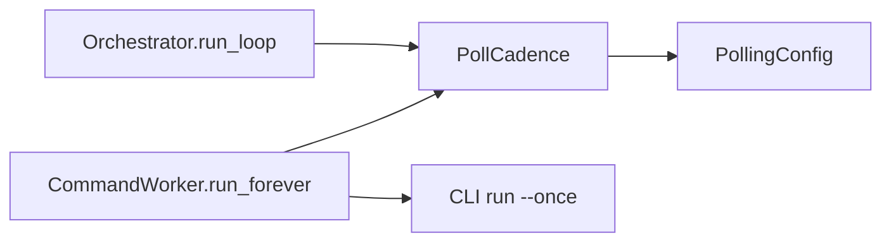

<!--
Copyright (c) 2026 DDP Engineering
This software is licensed under the PolyForm Noncommercial License 1.0.0.
Commercial use requires a separate commercial license.
See the LICENSE.txt in the .agentic folder for full license details.
SPDX-License-Identifier: LicenseRef-PolyForm-Noncommercial-1.0.0
-->

# TASK-a224af5d - Unify web and CLI polling cadence

stage: deliver
type: change
path: full
interaction: autopilot
requirements: REQ-FUNC-d62f500f, REQ-REL-5f261755, REQ-DATA-cb4ed315
parent:
branch: task/adore-web-interface
base: d72bdc5f7b1c00c7271cf890b235865c3613cc15
opened: 2026-10-08

## Done checklist (current stage)

- [x] validated candidate unchanged and both round2 verdicts approved
- [x] validation evidence, diff, exclusions and deviations presented
- [x] standing human local commit/DCP delivery authority reused
- [x] journal/report and source commit
- [ ] backup-protected DCP deployment and read-only acceptance
- [ ] close-out committed after success

## Frame

Problem: STATED web and CLI must use the same polling interval/backoff/jitter settings, retained in the GUI.
Desired outcome: equal per-project loop scheduling while web retains serial run --once commands.
Actors: operator editing settings; worker; CLI conductor.
Primary scenario: completed poll -> compute shared wait -> next eligible poll.
Examples: interval60/jitter0 and consecutive errors -> waits120/240/480/480; success ->60.
Counterexamples: a slow pass must not consume its own following wait; one failing project must not slow another; quiet hours must not advance work.
In scope: shared cadence policy, post-completion scheduling, per-identity ephemeral backoff, quiet-hour parity, offline tests and settings guidance/docs; existing local commit and DCP delivery authority.
Out of scope: persistent scheduler state, parallel commands, polling.mode changing the permanent web service, queued-action retries, platform/model checks, removal of settings or Git publication.
Constraints: 60 minutes, at most21 candidate paths, two correction cycles, one backup-protected DCP replacement; no children/delegation.
Success signals: deterministic CLI/web observations match; GUI keys stay editable; queue/cancel/heartbeat regression pass.
Evidence: OBSERVED commands.py run_forever uses fixed max(5,interval) scheduled before command; orchestrator.py run_loop owns quiet/backoff/jitter. STATED current request. INFERRED nonzero automatic CLI outcome is failure because the bounded CLI gives no typed forge error channel.
Assumptions: standing same-session autonomous implementation/local commit/DCP test replacement authority persists, as recorded by preceding TASK-7ea067ed.
Unknowns: fresh DCP activity at delivery, checked before switch.
Decision-blocking questions: none.
Proposed behaviors: maintain settings; shared wait = interval * bounded multiplier + uniform(0,jitter); suppress automatic passes in quiet hours; malformed config skips invocation; bad runner outcome increases delay; explicit operations remain independent.
Path and reason: full. New observable scheduling=yes; new dependency/data format=no; trust-boundary change=yes; no exact existing requirement covers parity. No independent child scope.

## Requirement coverage

| Outcome | Atomic behavior | Requirement | Positive | Boundary | Verification | Design |
|---|---|---|---|---|---|---|
| Parity | post-pass interval/backoff/jitter | REQ-FUNC-d62f500f | CLI/web equal waits | capped errors, timeout, success reset, disable, slow pass, separate projects | offline fake-clock loop tests | shared PollCadence |
| Pause window | skip scheduled work in quiet hours | REQ-REL-5f261755 | resume outside window | crossing midnight, retained error multiplier | injected quiet clock | same in_quiet_hours helper |
| Closed input | corrupt config does not invoke; invalid/exception runner outcome delays retries | REQ-DATA-cb4ed315 | valid config invokes | corrupt TOML/type/exception | worker boundary tests | skip config; normalized failure |

## Design

REQ-FUNC-d62f500f: new standard-library adore/polling.py provides PollCadence.next_delay(PollingConfig, failed: bool|None), with multiplier1 initially, 2/4/8 on failed,1 on success, unchanged on skipped quiet pass; disabled backoff resets1. Random uniform0..jitter added after multiplication. CLI keeps lock/log/sleep boundaries. Worker owns one cadence and deadline per immutable project_id, uses monotonic time after pass completion; archived profiles skipped. First pass is immediate, restart resets in-memory cadence. No forced minimum5, validated interval is positive.
REQ-REL-5f261755: worker checks shared in_quiet_hours before automatic run --once; skipped rounds retain multiplier and wait using shared cadence. Manual queued actions/cancellation/heartbeats remain available.
REQ-DATA-cb4ed315: configuration parse/validation failure schedules a bounded60-second recheck without executing. Normal automatic poll exit0 succeeds; nonzero/timeout/malformed type/raised invocation is failed for scheduler only. Explicit operation state contracts unchanged. Failure classification is coarser than in-process CLI because subprocess exit status has no typed error detail; never parse logs or turn failures into successful operations.
Frontend only updates existing localized help to describe scope; polling.mode still governs standalone CLI, permanent worker owns its loop. No schema, config keys/defaults or migration. Offline fake runners and logical clock test actual run_forever, existing CLI loop tested with fake poll/sleep. New component docs/knowledge plus existing worker/orchestrator docs reconciled.
### Proposed architecture - TASK-a224af5d

Risks: nonzero lock/config child outcome also backs off safely; serial long commands can delay another due project; existing global serial architecture preserved. No open decision.

## Log

- 2026-10-08 frame completed: full path, existing clean branch and standing autonomous/local delivery authority reused;60-minute/20-path/two-cycle bounds. Optional BMAD renderer and setup skill absent; use repository AEGIS directly; no product edits at frame.
- 2026-10-08 specify completed: three atomic requirements and coverage inventory; no existing matching engine/web scheduling requirement.
- 2026-10-08 design completed: shared policy, post-completion per-project monotonic deadlines, quiet parity and fail-closed config; preserved serial queue/heartbeat/cancel and settings keys. No schema/dependency change.

- 2026-10-08 build red: command=`./04_Software/.venv/Scripts/python.exe -m pytest -q 04_Software/tests/test_web_commands.py -k "automatic_polling_uses_loop_wait or bad_polling_config"`; exit1; four expected failures: only3s wait after7s pass instead of12/22/42/82, runner exception exits worker, invalid config still invokes. Covers REQ-FUNC-d62f500f and REQ-DATA-cb4ed315.

- 2026-10-08 build completed: focused scheduling/heartbeat/start/cancel set passes41 tests; Ruff and production TypeScript/Vite/stamping build pass. Shared policy/CLI/web and localized help delivered;3 active requirements linked. Production generated artifacts restored to baseline after build; delivery packages fresh isolated validation assets, following preceding deployment practice.
- 2026-10-08 DEVIATION build: quiet-hour regression cases added after that branch was implemented; public policy/worker tests and final full suite provide coverage, but red-first evidence applies only to cadence and corrupt-input requirements.
- 2026-10-08 design refinement: earliest-deadline ordering and sleep bounded by the next due project avoid starvation and preserve sub5-second valid intervals despite the default2-second queue tick. Same serial architecture and per-project post-completion policy; added default-tick regression.

- 2026-10-08 validate round1: reviewed entire candidate against all3 requirements as separate specification-compliance and implementation-quality assessments by the executing agent; both approved, no delegated agents. Same20-path candidate; policy has no I/O, worker invokes only validated due profiles, deadlines follow completion and earliest ordering prevents starvation. Current component diagrams and project/environment context remain accurate; no schema/dependency/migration. Generated static is baseline; isolated validated build supplies deployment media.10 expected catalog warnings:9 historical, one outside-layout for the explicitly updated config.example.toml documentation; no format or task-owned coverage error. Full proof follows final evolution and edits.

- 2026-10-08 validate returned to build, correction1: Python/ruff passed but during the browser phase review identified that negative cadence fixtures also omitted required repository configuration. Correct only fixture construction to replace the tested assignment inside a separately proven valid complete config; this makes boolean/string/negative failures discriminate cadence validation. Earlier in-flight proof no longer applies to the final tests; let its bounded browser phase finish, then perform new focused tests, both reviews and fresh full proof. No product change or weakened verification.

- 2026-10-08 superseded first strict proof exit1: Python1507 passed/3 existing Windows symlink skips/dependency warning, Ruff passed; Chromium149 passed/1 failed. Failure is statistics.spec.ts:159 mock route.fulfill already handled followed by afterEach closed-context/timeout; captured trace locates asynchronous fixture interception, no product assertion failure. Exact isolated rerun `npx playwright test e2e/statistics.spec.ts --grep "job list and direct detail share selected-period"` passes1 in7.7s, without candidate or retry configuration changes. Required fresh full proof remains.
- 2026-10-08 build/validate round2: all6 corrected negative config cases pass using complete separately validated templates. Same executing agent's independent specification and quality assessments both approve final20-path candidate. No behavior or browser fixture changes, no scope expansion, no skipped verification. Updated evolution and frozen hashes precede fresh full strict run; previous first-run evidence retained separately.

- 2026-10-08 validate documentation completion: frontend component guidance reconciled alongside existing operator/worker/policy pages;21 candidate files required (one additional component document). Code/tests/verification configuration remain frozen. Separate specification/quality reassessments approve the same round2 executable candidate plus this prose. Current in-flight runtime proof continues; a fresh strict catalog and documentation inspection after completion will cover the complete tree, following validate step8 prose-only verification exception.

- 2026-10-08 DEVIATION validate: extend the agent-owned20-path bound to21 solely for repository-required frontend component guidance. Runtime code/tests remain frozen; final strict catalog and prose inspection complement the ongoing runtime proof under validate step8. No weakened tests or execution limits.

- 2026-10-08 final validation: strict runtime run exit0; Python1507 passed/3 existing Windows symlink skips/one dependency deprecation warning (340.5s), Ruff passed (0.1s), helper tests/typechecks/fresh isolated stamped build and150 Chromium tests passed (417.8s), zero browser retries/skips. Fresh strict catalog after final prose reconciliation exit0, zero errors/zero promoted warnings,10 warnings and25 unrelated manual notes.9 historical catalog warnings plus config.example.toml outside layout; explicitly owned documentation, no coverage gap.20 non-journal hashes match final reviewed21-path candidate. Changelog consolidated under existing Fixed section; both final specification/quality assessments approved unchanged executable and final prose. Final evolution refreshed at12:01:52Z. First failed run remains recorded; final proof is successful.
- 2026-10-08 delivery presentation:21 paths cover3 runtime modules,2 tests, localized settings help/example, operator/component/knowledge docs, changelog,3 requirements and journal. No schema/dependency/default/config-key changes, state migration, children, Git publication, model/forge acceptance. Standing same-session local commit and DCP test replacement authority reused for the concrete reviewed candidate. Repeat deviations: quiet-hour tests followed implementation;21-path bound and prose-only completion during runtime verification with final strict catalog. One backup-protected replacement and read-only LAN/browser acceptance remain.

## Rulings

- RULING-001 | date=2026-10-08 | decision=Keep polling controls and apply loop scheduling to web | reason=Explicit user request; standing autonomous implementation/local delivery authority | source=user | supersedes=none

## Handoff

current: deliver
status: ready
next: Commit and package validated source for authorized DCP replacement
must_read: .agentic/tasks/TASK-a224af5d.md, .agentic/steps/6_deliver.md
blockers: none

## Stage report

stage: validate
result: completed
current: deliver
changed:21-path shared CLI/web cadence with retained settings and localized guidance
evidence: strict runtime exit0; Python1507/Chromium150; final strict catalog0; frozen hashes match
issues:3 existing Windows skips,10 catalog warnings; recorded workflow deviations
next: authorized local commit and backup-protected DCP replacement
needs_user: no
spec_compliance: approved
implementation_quality: approved
review_round:2

## Delivery report (2026-10-08)

- stage: deliver; type: change; path: full; branch: task/adore-web-interface
- requirements:
  - REQ-FUNC-d62f500f - Apply shared polling cadence in CLI and web
  - REQ-REL-5f261755 - Respect automatic polling quiet hours
  - REQ-DATA-cb4ed315 - Reject invalid automatic polling inputs
- deviations: 2 recorded
  - build: quiet-hour regression cases added after that branch was implemented; public policy/worker tests and final full suite provide coverage, but red-first evidence applies only to cadence and corrupt-input requirements.
  - validate: extend the agent-owned20-path bound to21 solely for repository-required frontend component guidance. Runtime code/tests remain frozen; final strict catalog and prose inspection complement the ongoing runtime proof under validate step8. No weakened tests or execution limits.
- explicit review: enabled; spec_compliance=approved; implementation_quality=approved; review_round=2
- diff vs task base d72bdc5: 21 file(s) changed, 721 line(s) added
- checks: errors=0 warnings=11 notes=25
- checklist: 3/6 done; open: journal/report and source commit; backup-protected DCP deployment and read-only acceptance; close-out committed after success
