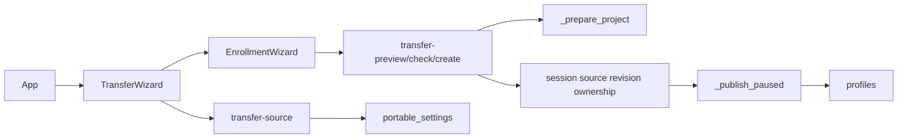

<!--
Copyright (c) 2026 DDP Engineering
This software is licensed under the PolyForm Noncommercial License 1.0.0.
Commercial use requires a separate commercial license.
See the LICENSE.txt in the .agentic folder for full license details.
SPDX-License-Identifier: LicenseRef-PolyForm-Noncommercial-1.0.0
-->

# TASK-b93bf854 - Portable new-project import and settings copy

stage: deliver
type: feature
path: full
interaction: autopilot
requirements: REQ-FUNC-20010f79, REQ-SEC-934b2dca, REQ-UX-7d0b71c3
parent:
branch: task/adore-web-interface
base: 5c739f1d57ab62ae004aac4f24b8a96909739d09
opened: 2026-10-06

## Done checklist (current stage)

- [x] Validated candidate confirmed unchanged; explicit current reviews approved.
- [x] Validation evidence, inventory, exclusions and intended outcome prepared.
- [x] Coordinator verified exact inventory and relayed standing human delivery instruction.
- [x] Journal/report prepared for the authorized delivery commit.
- [ ] Authorized scoped commit/normal push/ticket outcome delivered.
- [ ] Close-out after successful delivery.

## Frame

Problem: STATED Admin needs reusable working rules without transferring source ownership.
Desired outcome: STATED supported file/source-project rules create one independent stopped project.
Actors: Admin; unauthorized Dev/session; API; existing profile store.
Primary scenario: select source -> review allowlist/exclusions -> supply new target -> reconfirm environment/references -> validate/review -> atomic stopped creation.
Examples: exported JSON transfers all 16 fields; authorized source copies active rules only.
Counterexamples: source comment edit after review conflicts even when portable values are identical; source paths never seed target.
In scope: issue #10's eight criteria; minimal API/profile support; localized wizard and offline negatives; same-change docs/context/changelog.
Out of scope: existing-project replacement; cloning repositories; later tickets/audit redesign; live acceptance; releases; publication until coordinator instruction.
Constraints: <=4h; <=3 correction/review cycles; <=20 authored product/test/doc paths; zero paid APIs/executors/subagents. Existing task branch only. Read-only planning. Headers/style; RBAC/CSRF/strict #9 format unchanged.
Success signals: all eight criteria mapped to happy/boundary proofs; exact candidate inventory and full strict proof.
Evidence: STATED delegated session from coordinator 01a10aec-6ac2-79f3-ada3-741950212fb8; OBSERVED authenticated tea ddp issue #10 body/no comments, epic #3/comments, native #7/#9 closed; clean local/remote HEAD 5c739f1d57ab62ae004aac4f24b8a96909739d09; .agentic/knowledge/web-interface.md; portable-settings.md; profiles.md; portable format/operator/component docs; app.py setup/import boundaries; EnrollmentWizard.tsx.
Assumptions: INFERRED auto-allocation beneath target profile/home meets independent locations; this will be visible and collision-checked.
Unknowns: live host readiness, novice/full-WCAG acceptance remain human work.
Decision-blocking questions: none within delegated criteria.
Proposed behaviors: strict source review, exact revision+target binding, source reauthorization/reinspection under publication locks, isolated rollback, explicit localized mapping/reconfirmation.
Path and reason: full; new behavior=no quick criterion, new interface=no, new dependency=yes (none), existing coverage=no, security/data change=no. Any failed quick criterion selects full.

## Requirement coverage

Frame outcome | Actor/trigger/response | Requirement | Positive oracle | Boundary/failure/recovery | Design/test seam
--- | --- | --- | --- | --- | ---
New stopped project | Admin confirms exact candidate -> publish isolated rules | REQ-FUNC-20010f79 | both methods reproduce 16 fields, new identity and paths | overlaps/invalid references/rollback/replay -> no partial profile | existing preparation + guarded publication; test_web_transfer.py
Source integrity | Admin reads/confirms -> strict authorized source binding | REQ-SEC-934b2dca | compatible source review succeeds | unknown/duplicate/secrets/version, changed bytes/identity/role -> typed rejection/re-review | strict parser/export + fresh session/source callbacks; test_web_transfer.py
Explanatory flow | Admin selects method -> visible mapping/reconfirmation/review/stopped result | REQ-UX-7d0b71c3 | both localized browser journeys create | change/back/stale/failed transport/replay/Dev -> disabled or corrective flow | TransferWizard + EnrollmentWizard; e2e/transfer.spec.ts

## Design

Requirements coverage: FUNC uses complete projection + independent paths + atomic publication; SEC uses parser/export + exact source revision and fresh session; UX reuses existing guided target steps with a source/mapping gate.
Component responsibilities: portable_settings unchanged owns strict format; app owns source authorization/candidate assembly/ownership; profiles owns immutable IDs and reserved routes; TransferWizard owns source/mapping; EnrollmentWizard owns target/reconfirmation/review.
Interfaces: POST transfer-source, transfer-preview, transfer-check, transfer-create; strict source + target JSON, exact digests. See linked spec for errors/shape.
Ownership/transitions: no drafts stored; new target config -> paused state -> random stable profile metadata. Source, grants, jobs, history, pending/secrets remain untouched. Metrics derive from independent state.
Concurrency: existing home enrollment lock and target conductor lock; source config lock around confirmation; reauthorize/reinspect before and within publication. Direct external writes detected at rechecks, not claimed transactional with unmanaged host writes.
Failure: stale binding 409; invalid package 400; source unreadable 503/missing 404; fresh target path occupancy/overlap 409. Existing rollback removes profile metadata/config/state; no mutation to source or target clone. Repeated target ID rejected.
Compatibility: additive routes/optional wizard mode; conservative #9 allowlist unchanged. Exact TOML contract/bytes distinct. No schema migration/dependency/version change.
Observability: safe issues/errors plus exact source and candidate digests; existing creation audit only.
Tests: offline fake CLI runner; public API happy+negative source/target/rollback/security; real isolated API Chromium with fake external services and transport negatives.
Alternatives: importing exact host TOML as portable would carry ownership and is excluded; persisted drafts unnecessary for memory-only review.
Expected authored files (<=20): app.py, profiles.py, test_web_transfer.py; EnrollmentWizard.tsx, TransferWizard.tsx, transferCopy.ts, App.tsx, errors.ts; e2e/transfer.spec.ts; Component_Web_API/Frontend/Profiles; Portable_Project_Settings.md, Web_Interface.md, CHANGELOG.md. Workflow artifacts/generated assets separate.
Risks: unmanaged direct host edits can race last check; browser file reader must retain exact text and reject stale responses; target-owned worktrees may already exist independently of profile.
Open decisions: none; endpoint/credential references are excluded and target setup/reconfirmation is explicit.

### Proposed architecture - TASK-b93bf854

## Log

- 2026-10-06 build green: API increment focused command=`cd 04_Software; uv run pytest -q tests/test_web_transfer.py tests/test_web_enrollment.py tests/test_web_import.py tests/test_web_portable_settings.py`; exit=0, 151 passed, existing TestClient deprecation warning. All new 30 source/target/ownership/security cases passed.
- 2026-10-06 build red: REQ-UX-7d0b71c3; command=`cd 04_Software/web; npm run build:e2e; npx playwright test e2e/transfer.spec.ts --reporter=line`; exit=1; expected missing behavior=Copy project settings method absent, locator timeout.
- 2026-10-06 build red: REQ-FUNC-20010f79/REQ-SEC-934b2dca; command=`cd 04_Software; uv run pytest -q tests/test_web_transfer.py::test_transfer_roundtrip_independent_stopped_and_replay`; exit=1, two failures; expected missing behavior=transfer-source route returns 405 instead of supported source review.
- 2026-10-06 specify: three atomic requirements drafted; behavior inventory/coverage and exact additive contract audited, format check zero errors.
- 2026-10-06 design: constrained additive source/target integration documented above, <=15 expected authored paths, no dependencies/migration. Standing authority accepts stage transitions; same-agent separate reviews required, zero subagents.
- 2026-10-06 frame: full path scope accepted under delegated standing HUMAN authority; existing branch retained, no children. Human authorized routine checkpoints through validated candidate; coordinator inventory/delivery instruction remains the explicit stop.

- 2026-10-06 build: complete focused API/UI increment; expanded 36 API and 12 Chromium passed with no weakened assertion. All 16 nondefault portable values roundtrip; populated source history/grants/pending/secret files remain untouched. Same-change operator/component docs updated; setup/package/versions/dependencies unchanged.

- 2026-10-06 validate round 1: separate primary-agent specification pass approved scope/allowlist/identity/reference/stopped contract; separate quality pass changes_required: installed-default mapping values were shape-unchecked. Public browser regression `npx playwright test e2e/transfer.spec.ts -g "malformed installed-default" --reporter=line` exited 1; expected missing behavior=corrupt mapping rendered without alert and review stayed available. Return build for this finding only, correction cycle 1/3. No external reviewers/subagents.

- 2026-10-06 build correction cycle 1: closed portable value-domain validation now covers installed-default mapping and source response; public malformed-default regression passes. Production build/typecheck and Ruff entire software tree exit 0. Requirement linked paths corrected to repository-relative paths; environment/toolchain unchanged.

- 2026-10-06 validate round 2: separate primary-agent specification compliance=approved and implementation quality=approved, bound candidate SHA-256=6e5968816c1f57b1d188139bb9db519f9db98e6514c2b07b33e9e43fa26e737e; record=.agentic/specs/transfer-candidate-review.md. One correction cycle used, no external reviewers. Latest 13 Chromium, production/typecheck and full-tree Ruff exit 0; native-size screenshot crops visually inspected with readable wrapped paths/digests and stopped action. All requirements/knowledge/architecture/project/environment reconciled; 15 authored + 3 generated paths reviewed; final evolution refreshed UTC23:37:42. No deviations or weakened verification.

- 2026-10-06 final proof attempt 1 exit 1: Python 1048 passed/1 skipped/1 failure in unchanged heartbeat timing test, previously observed TASK-c4655839/TASK-fc000e98; focused unchanged selector exit 0, 1 passed. No causal claim or weakened assertion. Ruff passed; frontend 85 passed/1 failure: changed shared English invalid-source message dropped existing host correction guidance. Return build correction cycle 2/3 for compatibility finding; retain full failed JSON in TASK-b93bf854.validation-attempt1.json. Current bound verdicts cleared.

- 2026-10-06 validate round 3: second correction preserves existing host guidance and new source-file guidance; production/typecheck exit 0; unchanged export+transfer public Chromium 19 passed. Separate specification=approved and implementation-quality=approved passes bind current SHA-256=d40727cd3c0f3fedd90775efb878daad94e4036984f5ea1a0441120f460bd3d3; prior round invalidated. Inventory/evolution refreshed after message/assets/screenshots; same 15 authored+3 generated paths. Architecture/knowledge/requirements remain current; no further behavior/docs change. Full strict proof now rerun on unchanged candidate, failed attempt retained.

- 2026-10-06 final validation: `python -X utf8 .agentic/aegis.py check --task TASK-b93bf854 --strict --run --json` exit 0, strict passed=true, errors=0, warnings=9, notes=30; complete pytest 1049 passed/1 platform skip/1 existing TestClient warning, Ruff passed, frontend helper/typecheck/build plus 86 Chromium passed. Full proof=TASK-b93bf854.validation-final.json; earlier failed proof retained. Nine advisories: three historical other-task/fingerprint warnings plus six bounded scanner/binary/large-content notices, supplemented by reviewed sources/build provenance/visually checked fixture PNGs/exact hashes; no weakened proof. Build chunk/color/dependency notices informational. No deviations remain.

- 2026-10-06 deliver checkpoint: candidate d40727cd3c0f3fedd90775efb878daad94e4036984f5ea1a0441120f460bd3d3 unchanged against every inventory hash; 15 authored + 3 generated + 15 bound workflow files and explicit reporting exclusions. Local/remote HEAD remain 5c739f1d57ab62ae004aac4f24b8a96909739d09; authenticated Gitea #10/#3 open, #10 comments=0. Zero subagents/executors/paid calls, two correction cycles of three, within four-hour/twenty-authored limits. No commit/push/forge mutation. Waiting coordinator inventory verification and delivery instruction per standing human boundary; propose scoped commit + normal task-branch push + authorized issue #10 closure, no PR/merge/release/live work.

- 2026-10-06 final delivery-time advisory snapshot: zero errors/10 warnings/30 notes; the additional warning is expected unticked-deliver for four unpublished checklist items at this human checkpoint. It does not replace successful final strict proof (nine advisories). Final candidate hash/path inventory and unchanged HEAD confirmed after reporting-only updates.

- 2026-10-06 delivery instruction: coordinator 01a10aec-6ac2-79f3-ada3-741950212fb8 verified all 33 bound inventory files/deletions and exact 40-path status, both round-3 verdicts, full passing strict proof and unchanged baseline; relayed existing explicit HUMAN authority to commit requirement-scoped candidate, normal-push task/adore-web-interface, verify remote, complete eight #10 criteria/evidence and close only #10, append compact epic #3 evidence and keep it open, then journal-only closeout commit/push. This relays standing human authority, not authority created by a journal. Local recheck confirmed each working hash/deletion and strict envelope; current #10 eight criteria re-read and labels #10 P2/#3 P1 preserved. No candidate edit or new finding; routine needs_user=no. Execution session CODEX_THREAD_ID=01a10e4d-f2a8-7663-9d04-986ec8143f80.

## Rulings

- RULING-001 | date=2026-10-06 | decision=Autopilot through validated candidate only; no publication before coordinator inventory/delivery instruction | reason=Standing human authorization delegated in initial prompt via coordinator 01a10aec-6ac2-79f3-ada3-741950212fb8; records cannot create authority | source=user | supersedes=none

- RULING-002 | date=2026-10-06 | decision=Proceed with verified scoped commit/normal push, #10-only closure, epic evidence and journal closeout | reason=Coordinator relayed existing explicit human standing authority after exact inventory acceptance; no new authority inferred | source=user | supersedes=RULING-001

## Handoff

current: deliver
status: ready
next: Commit exact scoped inventory, normal push, authenticated issue readback and journal-only closeout.
must_read: .agentic/specs/transfer-candidate-inventory.json, .agentic/specs/transfer-candidate-review.md, .agentic/specs/transfer-verification.md, .agentic/tasks/TASK-b93bf854.validation-final.json
blockers: none

## Stage report

stage: deliver
result: in_progress
current: deliver
changed: Reporting-only delivery instruction; validated candidate unchanged.
evidence: All 33 bound hashes/deletions verified; strict passed; coordinator inventory acceptance.
issues: Nine classified proof advisories; no active findings/deviations.
next: Scoped commit/normal push and authorized #10-only closure, then journal-only closeout.
needs_user: no
spec_compliance: approved
implementation_quality: approved
review_round: 3

## Delivery report (2026-10-06)

- stage: deliver; type: feature; path: full; branch: task/adore-web-interface
- requirements:
  - REQ-FUNC-20010f79 - Guard portable new-project enrollment
  - REQ-SEC-934b2dca - Authorize and bind portable enrollment sources
  - REQ-UX-7d0b71c3 - Explain portable new-project mapping and reconfirmation
- deviations: none recorded
- explicit review: enabled; spec_compliance=approved; implementation_quality=approved; review_round=3
- diff vs task base 5c739f1: 40 file(s) changed, 3114 line(s) added; 9 file(s) not content-scanned
- checks: errors=0 warnings=10 notes=30
- checklist: 4/6 done; open: Authorized scoped commit/normal push/ticket outcome delivered.; Close-out after successful delivery.
