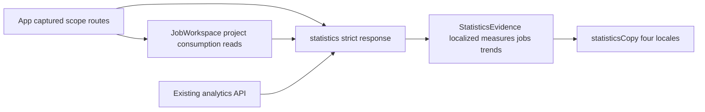

<!--
Copyright (c) 2026 DDP Engineering
This software is licensed under the PolyForm Noncommercial License 1.0.0.
Commercial use requires a separate commercial license.
See the LICENSE.txt file for full license details. SPDX-License-Identifier: LicenseRef-PolyForm-Noncommercial-1.0.0
-->

# TASK-bb98355e - W11 issue 15 honest scoped statistics presentation

stage: done
type: feature
path: full
interaction: autopilot
requirements: REQ-UX-9f1ec9fa, REQ-UX-a24db609, REQ-UX-c65b3022, REQ-UX-7fdffe77
parent:
branch: task/adore-web-interface
base: dc566608665605fc4a45a160438af2d7f910b804
opened: 2026-10-06

## Done checklist (current stage)

- [x] validated candidate confirmed unchanged after final round3 proof
- [x] current specification and quality verdicts approved round3
- [x] validation evidence, exact inventory, exclusions and intended outcome presented
- [x] coordinator confirms exact inventory and issues delivery instruction
- [x] journal/report prepared for inclusion in instructed delivery commit
- [x] instructed commit/push/issue15 closure outcome delivered
- [x] truthful closeout prepared for journal-only commit after instructed outcome succeeded

## Frame

Problem: STATED live #15 requires coherent explanatory statistics; OBSERVED App currently has separate unbound usage/metric views and job telemetry placeholders.
Desired outcome: One authorized scope, honest measured evidence, accessible trends and composite job consumption.
Actors: Admin and project-granted Dev.
Primary scenario: Select project/calendar/timezone/group -> request server scope -> all presentations and CSV use that captured scope.
Examples: Europe/Bucharest October 25 is 25 hours; a known zero remains measured while missing input/output remains unavailable.
Counterexamples: Launch counts are not messages; lifetime values are not interval events; stale authorization must hide earlier data.
In scope: Live eight #15 criteria; compatible frontend API consumers and same-change docs/tests.
Out of scope: Later tickets/messages/audit/accounts, runtime persistence, forge/runtime calls, new dependency/version, live acceptance and publication before instruction.
Constraints: <=4 hours; <=3 corrective review cycles; <=20 authored product/test/doc paths; zero paid API/executor/subagent calls; fixed branch and exact base dc566608665605fc4a45a160438af2d7f910b804.
Success signals: Offline hand-calculated fixtures, scope/stale/RBAC/CSV/malformed/mobile/keyboard/locales/theme tests; all native and strict checks.
Evidence: OBSERVED authenticated #15 open P2/no comments; native #5/#11/#14 closed; epic #3 live body and approved DESIGN_BRIEF read. Clean local/remote exact base. #14 journal/spec/review/verification read unchanged. AEGIS root/full/steps/context/style/template and owning Web interface contract read.
Assumptions: Preserve inclusive local dates, UTC default and existing tabs/routes; server resolves dates and samples. Dev selected-project scope remains supported.
Unknowns: Real telemetry coverage and novice/live acceptance are unmeasured.
Decision-blocking questions: None.
Proposed behaviors: Captured request keys including grants, strict response scope/identity, explicit all-time and current stock, honest coverage/cost/samples/message placeholders, accessible chart table and per-job lifetime/period.
Path and reason: full; no new observable behavior=no, no interface change=no, no dependency=yes, existing requirement complete=no, no data/security effect=no. No children under explicit zero-subagent bound.

## Requirement coverage

Frame outcome | Atomic behavior | Requirement | Positive case | Boundary/failure | Verification | Design
--- | --- | --- | --- | --- | --- | ---
Common scope | Captured authorized presentation/export | REQ-UX-9f1ec9fa | Scope changes/reload | stale/revoked/malformed | Node + offline Chromium | strict statistics reader and request keys
Honest measures | Explanatory accessible evidence | REQ-UX-a24db609 | zero/samples/trends | unknown/partial/error/Dev money | Node + offline Chromium | StatisticsEvidence and localized copy
Jobs consumption | Composite lifetime/period | REQ-UX-c65b3022 | same-run identities | missing/corrupt/route change | Node + offline Chromium | visible-project usage reader

## Design

All three requirements map to statistics-presentation.md and helper/browser tests.
Responsibilities: statistics.ts validates explicit #14 transport and formats evidence; StatisticsEvidence owns explanatory Summary, jobs and labeled trend; statisticsCopy preserves four locales. App retains routes/session/scope/export and existing tabs. JobWorkspace pools visible project reads with generation/authorization/query keys; no runtime/API persistence change.
Flow: select -> captured query and grant-set -> validated project response -> render current key only. Export is available after matching successful read; failures clear evidence and retry current scope. Query/unmount and response sequence suppress late completions. Server owns calendar boundaries, attribution, duration samples, filtering and money RBAC.
Compatibility: additive types/URL scope fields; keep existing routes and quality/usage/project tabs, four locales/themes and branding. No new dependency/backend/state contract. Default jobs consumption uses explicit all-time; selected period follows statistics controls.
Security: validate immutable IDs and authorized set; Dev omits money UI and existing server retains JSON/CSV boundary. Invalidate on grants/session. Read-only endpoints launch no executor/forge/container command.
Test seams: statistics helper malformed/zero/partial/identity tests; Chromium real offline API and deterministic intercepted analytical fixtures for scope/stale/CSV/accessibility.
Expected authored paths: 8 frontend sources listed in requirements, statistics Node test, statistics E2E, necessary existing shell E2E compatibility, frontend component doc, Web_Interface.md, CHANGELOG.md (<=20); workflow/knowledge/context/generated static separate.
Tradeoff: retain existing secondary tabs and aggregate helper; add strict transport validation only at UI boundary. Server evidence remains authoritative and nullable values never get browser date estimates.
Risks: incomplete telemetry persists honestly; concurrent authorization snapshots need render-key protection. Unknowns: actual live/novice acceptance unavailable. No decision-blocking open decisions.

### Proposed architecture - TASK-bb98355e

## Log

- 2026-10-06 build red: REQ-UX-9f1ec9fa/REQ-UX-a24db609; command=`node --test 04_Software/web/tests/statistics.test.mjs`; exit=1 (3 passed/1 failed); expected missing behavior=malformed daily missing counter accepted instead of failing closed. Extend same trust seam to fractional tokens, quality types and wrong sample means. First browser green confirmed #14 DST/CSV baseline; new initial-measures selector corrected to its semantic panel after duplicate column label.
- 2026-10-06 build red: REQ-UX-9f1ec9fa; command=`node --test --test-name-pattern="reporting selections" tests/routes.test.mjs`; exit=1; expected missing behavior=scope fields lost by public route serialization.
- 2026-10-06 build red: REQ-UX-9f1ec9fa/REQ-UX-a24db609; command=`npm run test:e2e -- --grep "statistics initial measures"`; exit=1; expected missing behavior=explicit All time control absent. Existing Vite chunk advisory; ignored screenshot/trace retained locally.
- 2026-10-06 build red: REQ-UX-a24db609/REQ-UX-c65b3022; command=`node --test tests/metrics.test.mjs` from web; exit=1; expected missing behavior=aggregateMetrics drops composite jobs and current_stock (7 passed, 1 failed).
- 2026-10-06 specify: Three independent UX requirements and exact presentation spec audited against live eight criteria and #14 contract; no backend expansion.
- 2026-10-06 design: Captured scope and strict frontend reader plus reusable evidence presentation accepted under standing stage authority. No children; browser/server boundaries and <=20 authored path estimate audited.
- 2026-10-06 frame: Live #15 scope accepted under explicit standing HUMAN authority conveyed by coordinator 01a10aec-6ac2-79f3-ada3-741950212fb8; full path, fixed existing branch, zero subagents. Autopilot through validation and candidate presentation only; delivery requires coordinator inventory verification and instruction.

- 2026-10-06 build red: REQ-UX-9f1ec9fa; command=`npm run test:e2e -- --grep "different canonical intervals"`; exit=1; expected missing behavior=individually valid metric and usage responses with different canonical boundaries still present data/export. Add a common response-scope guard without browser boundary calculation.

- 2026-10-06 semantic compliance review: Statistics consumption link omits selected reporting fields; recorded correction is to retain those fields in the existing jobs route and add a public browser regression. Candidate remains build; no final explicit verdict yet.

- 2026-10-06 contract reconciliation: live #15 honest successful empty/zero/unknown distinction supersedes older Summary-only no-zero wording in REQ-UX-7fdffe77. Update that active requirement to the explicit new contract and automate its empty-period oracle; Quality/Trends empty feedback and failed-read protections persist.

- 2026-10-06 build red: REQ-UX-9f1ec9fa/REQ-UX-c65b3022; `npm run test:e2e -- --grep "job list and direct detail"` exit=1, fixture-populated link has missing From (null). Preserve reporting in the Summary-to-job link; keep actual job title/actions ahead of secondary consumption.
- DEVIATION build: Summary now retains measured zero and explicit unknown evidence for successful empty intervals; REQ-UX-7fdffe77 is reconciled under live #15 scope; Quality/Trends empty feedback preserved.
- 2026-10-06 compatibility proof: `npm run validate` exit=1; 51 helper tests green, 74 browser tests green, 3 failures and 19 not run after 180s global limit. Correct existing missing-consumption placeholder/title selector and `{}`-as-empty assertion without weakening malformed-response fail-closed protection.

- 2026-10-06 verification bound: expand one-worker whole browser-suite timeout from 180s to 240s for 96 scenarios including all eight locale/theme combinations; retain 30s per-test, zero retries and strict offline boundary. Initial complete run exhausted old global bound before finishing; full proof is mandatory. Authored product/test/doc/config path inventory=18 (within20).

- 2026-10-06 trust-boundary audit red: `node --test 04_Software/web/tests/statistics.test.mjs` exit=1, 3 passed/1 failed; fractional totals token and missing required usage coverage accepted. Enforce safe integer token totals and explicit coverage before any known/unknown/partial presentation. These are pre-verdict semantic corrections, zero explicit corrective review cycles consumed.

- 2026-10-06 build green: focused helper18/18; focused Chromium13/13 including empty period, chart/table parity in all8 locale/theme combinations, cross-project identity, absent selected consumption with independently retained lifetime, Dev CSV and actual grant revocation. Typecheck and production build exit0; final direct job-link scope correction uses the same reporting serialization contract. Advance validate under standing human authority.

- 2026-10-06 validate reviews: separate primary-agent specification and implementation-quality passes both approved round1 for candidate 4d22027b8846cd916f922072482b31947a2ce3037f95e23559cb6f31b05fa2ad; same implementer, no external/subagent reviewer, 0/3 corrective cycles. Full byte heuristic scan compensates generated long-line gap; matches only translated/type labels and disposable fixture credentials. Reviewed all30 bound entries/deletions;18 authored/5 generated/7 workflow.

- 2026-10-06 validate failure: strict --run exit1, errors2/warnings5/notes29; native1080 passed/1 failed/1 skipped (heartbeat during blocking command), lint passed, helpers51 passed and browser95 passed/1 failed. Full-suite prior enroll/transfer scenarios leave4 authorized projects; hand-computed analytical fixture creates1 job/event per project, so hardcoded2-row oracle was wrong. Correct to captured authorized cohort N (N>=2); values must equal N, preserving collision/chart assertions. Invalidate both bound verdicts and open corrective cycle1/3 (review round2). Heartbeat test is byte-identical to base and focused rerun passed1/1; no backend change or test relaxation. Return build for fixture correction, then both review lenses and full strict rerun.

- 2026-10-06 corrective build green: focused8-combination chart/mobile Chromium1/1 passed11.8s; heartbeat unchanged isolated1/1 passed3.55s. Candidate rebound=d26ee64123d1cc042364998d5ea54f70535d4c2e49322669cb1821c3afbe4e90; only statistics.spec.ts changed, authorized fixture cohort N checked independently. Return validate; separate renewed specification pass approved round2,1/3 cycles.

- 2026-10-06 renewed validation reviews: both distinct primary-agent lenses approved round2 for d26ee64123d1cc042364998d5ea54f70535d4c2e49322669cb1821c3afbe4e90, candidate bytes/deletions and complete heuristic scan rechecked;1/3 corrective cycles. Earlier full proof remains failed historical evidence, not current acceptance. Evolution refreshed after only fixture-oracle correction; mandatory strict full rerun follows.

- 2026-10-06 consolidated final validate: `python -X utf8 .agentic/aegis.py check --task TASK-bb98355e --strict --run --json` exit0; errors0/warnings5/notes29, no promoted warnings. Native1081 passed/1 skipped/1 warning200.09s (command201.1s); Ruff exit0; frontend51 helpers and96 Chromium passed (command209.5s), including typecheck/build. Full byte candidate d26ee64123d1cc042364998d5ea54f70535d4c2e49322669cb1821c3afbe4e90 unchanged30/30 after proof. Round2 both separate primary-agent reviews approved,1/3 corrective cycles. Warnings: baseline tracked fingerprint sidecars and two old journal-format findings; generated long-line gap compensated by full scan; disposable fixture credential false positive. Native symlink skip/httpx deprecation and inherited Vite/color advisories explained in W11 verification. Evolution all22 post-red paths reviewed; metrics.test.mjs was already in the red anchor and is separately included in the base-relative byte inventory. Advance deliver only to present exact candidate; explicit delegation stops before commit/push/issue closure.

- 2026-10-06 final inventory reconciliation: operator guide line115 still stated three-minute browser-suite limit despite actual240s. Correct only that phrase to four-minute. Prior round2 full strict passed but applies to earlier doc bytes. Current candidate rebound=4e21c6abafe3d28e0fd1e62f76ece4865fb699ab4a0ddc23dc2bc9348160eb97; no product/test/config/generated changes. Both verdicts invalidated for changed prose; corrective cycle2/3, review round3; return validate and repeat complete final strict after renewed separate reviews. No accepted weaker verification.

- 2026-10-06 renewed round3 reviews: both separate primary-agent passes approved candidate 4e21c6abafe3d28e0fd1e62f76ece4865fb699ab4a0ddc23dc2bc9348160eb97; full byte/source heuristic checks complete, sole delta is accurate four-minute guide phrase.2/3 corrective cycles. Prior successful round2 full suite is retained historical; mandatory new full strict proof follows after documentation edit.

- 2026-10-06 consolidated final round3 validate: strict --run --json exit0, errors0/warnings5/notes29 and no promoted warnings. Native1081 passed/1 skipped/1 warning200.54s (command201.6s); Ruff green0.1s; frontend51 helper and96 Chromium green (command210.4s), including typecheck/build. Candidate 4e21c6abafe3d28e0fd1e62f76ece4865fb699ab4a0ddc23dc2bc9348160eb97 unchanged30/30 after proof; both separate primary-agent verdicts approved round3,2/3 corrective cycles. All eight issue15 criteria mapped to actual offline proof; no live/novice acceptance claimed. Same explained baseline/false-positive/generated-scan warnings as prior proof. Evolution refreshed after last guide edit; all22 post-anchor changes reviewed; full base-relative inventory also includes pre-anchor red test. Transition deliver/waiting under explicit coordinator boundary before commit/push/issue closure.

- 2026-10-06 deliver approval: Coordinator 01a10aec-6ac2-79f3-ada3-741950212fb8 verified exact38-path inventory, all37 row hashes/deletions and all30 bound candidate entries, current two approved round3 reviews, final strict success and actual eight live criteria. Under standing HUMAN delegation issued exact-inventory delivery instruction: accept unchanged candidate4e21c6abafe3d28e0fd1e62f76ece4865fb699ab4a0ddc23dc2bc9348160eb97 and disclosed empty-Summary contract reconciliation; commit scoped inventory with requirement IDs, normal-push existing branch, update8 criteria/comment/close #15 with authenticated readback, then journal-only closeout commit/push. No PR/merge/tag/release/deploy/live acceptance or later ticket. Locally reconfirmed exact inventory/hash/branch/base and remote base; only journal/report delivery metadata changes permitted. Frozen inventory remains the pre-delivery snapshot; journal metadata is intentionally updated after that snapshot. Publication has not yet occurred.

- 2026-10-06 truthful delivery closeout: Exact approved inventory committed as 9b689b6b1456aa4902661d7d52db9fd87d99a372 with four requirement IDs and normal-pushed task/adore-web-interface; remote SHA authenticated by git ls-remote. All8 live #15 acceptance criteria checked against final offline evidence, English delivery comment2106 posted, #15 closed and authenticated API readback confirmed closed/8of8/all existing labels preserved at 2026-10-06T06:15:36+03:00. Epic#3 authenticated open. Comment: http://192.168.1.15:3001/dpasare/AgenticDeliveryOrchestratorRuntimeEngine/issues/15#issuecomment-2106. Only journal delivery metadata changed after frozen inventory;30 bound candidate entries unchanged. No PR/merge/tag/version/deploy/live acceptance/later ticket. Stage done; subsequent journal-only closeout commit and normal push follow this already successful publication/closure. Generated CSS is represented by Git rename detection; --no-renames confirms exact38 declared paths. Corrected journal Handoff ready before final delivery report; earlier report7warn remains historical, corrected report6warn is advisory (five final strict warnings plus pending-deliver).

## Rulings

- RULING-001 | date=2026-10-06 | decision=Autopilot through reviewed validated candidate; stop before commit/push/closure for coordinator instruction | reason=Explicit standing human authority and delegation boundary | source=user | supersedes=none
- RULING-002 | date=2026-10-06 | decision=Fixed branch, four hours, three corrective review cycles, twenty authored paths, zero paid API/executors/subagents | reason=Explicit task bounds | source=user | supersedes=none

## Handoff

current: done
status: ready
next: Coordinator verifies delivered #15; no later-ticket work
must_read: .agentic/tasks/W11-bb98355e-verification.md, .agentic/tasks/W11-bb98355e-inventory.json, .agentic/tasks/W11-bb98355e-reviews.md
blockers: none; delivery instruction received

## Stage report

stage: deliver
result: completed
current: done
changed: Scoped Statistics and per-job consumption; 18 authored, 5 generated, 7 bound workflow entries
evidence: Delivery9b689b6 pushed; authenticated #15 closed8of8/labels preserved;epic3 open;strict exit0/1081 Python/51 helpers/96 Chromium/Ruff
issues: Five explained non-promoted strict warnings; live/novice acceptance unperformed;two corrective cycles of three
next: Journal-only closeout commit/push and final clean local/remote verification
needs_user: no - instructed publication and #15 closure succeeded
spec_compliance: approved
implementation_quality: approved
review_round: 3

## Delivery report (2026-10-06)

- stage: deliver; type: feature; path: full; branch: task/adore-web-interface
- requirements:
  - REQ-UX-9f1ec9fa - Synchronize authorized statistics scope and exports
  - REQ-UX-a24db609 - Explain measured statistics and accessible trends
  - REQ-UX-c65b3022 - Present composite job lifetime and selected consumption
  - REQ-UX-7fdffe77 - Distinguish successful empty statistics from unavailable measurements
- deviations: 1 recorded
  - build: Summary now retains measured zero and explicit unknown evidence for successful empty intervals; REQ-UX-7fdffe77 is reconciled under live #15 scope; Quality/Trends empty feedback preserved.
- explicit review: enabled; spec_compliance=approved; implementation_quality=approved; review_round=3
- diff vs task base dc56660: 38 file(s) changed, 2331 line(s) added; 1 file(s) not content-scanned
- checks: errors=0 warnings=7 notes=29
- checklist: 5/7 done; open: instructed commit/push/issue15 closure outcome delivered; truthful closeout committed only after instructed outcome succeeds

## Delivery report (2026-10-06)

- stage: deliver; type: feature; path: full; branch: task/adore-web-interface
- requirements:
  - REQ-UX-9f1ec9fa - Synchronize authorized statistics scope and exports
  - REQ-UX-a24db609 - Explain measured statistics and accessible trends
  - REQ-UX-c65b3022 - Present composite job lifetime and selected consumption
  - REQ-UX-7fdffe77 - Distinguish successful empty statistics from unavailable measurements
- deviations: 1 recorded
  - build: Summary now retains measured zero and explicit unknown evidence for successful empty intervals; REQ-UX-7fdffe77 is reconciled under live #15 scope; Quality/Trends empty feedback preserved.
- explicit review: enabled; spec_compliance=approved; implementation_quality=approved; review_round=3
- diff vs task base dc56660: 38 file(s) changed, 2346 line(s) added; 1 file(s) not content-scanned
- checks: errors=0 warnings=6 notes=29
- checklist: 5/7 done; open: instructed commit/push/issue15 closure outcome delivered; truthful closeout committed only after instructed outcome succeeds
